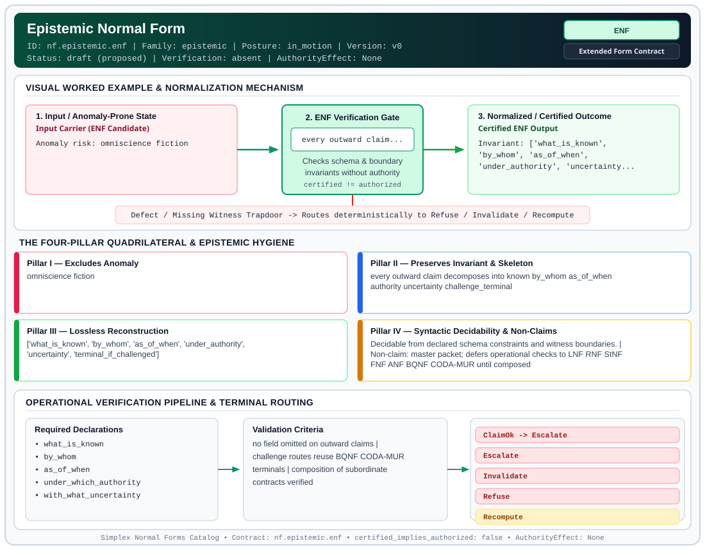

# Epistemic Normal Form (`ENF`)

> **Contract ID:** `nf.epistemic.enf` | **Family:** `epistemic` | **Index Status:** `draft` | **AuthorityEffect:** `None`

**[⬅ Back to Wiki Home](Home)** | **[View SVG Diagram](images/nf.epistemic.enf.svg)**

---

## 1. Executive Summary & Metadata

Epistemic Normal Form (ENF) enforces structural normalization and explicit defect routing in the epistemic regime.

| Property | Value |
| :--- | :--- |
| **Canonical ID** | `nf.epistemic.enf` |
| **Short Name** | `ENF` |
| **Full Name** | Epistemic Normal Form |
| **Family** | `epistemic` (Observer-Relative Epistemic, Freshness, Context, Provenance & Distinguishability Contracts) |
| **Qualification** | Extended Form Contract (Normal Form Contract) |
| **Data / Math Posture** | in_motion |
| **Index Status** | `draft` |
| **Theory Status** | `proposed` |
| **Verification Status** | `absent` |
| **Contract Version** | `v0` |
| **Governance Fence** | `AuthorityEffect: None` (`certified_implies_authorized: false`) |

---

## 2. Visual Architecture & Normalization Diagram



---

## 3. Concrete Worked Example & Mechanism

### Visual Transition Summary

| Stage | Carrier / Operator | Concrete State / Invariant |
| :--- | :--- | :--- |
| **1. Before / Candidate Input** | `Input Carrier (ENF Candidate)` | Anomaly risk: omniscience fiction |
| **2. Normalization / Gate** | `ENF Verification Gate` | `every outward claim...` (`certified_implies_authorized: false`) |
| **3. After / Certified Output** | `Certified ENF Output` | Invariant: ['what_is_known', ; 'by_whom', 'as_of_when', ; 'under_authority', 'uncertainty... |

---

## 4. The Four-Pillar Quadrilateral & Non-Claims

Every contract in `simplex-normal-forms` is evaluated against the **Four-Pillar Quadrilateral** defined in `contracts/_golden_nfs/standard.yaml`:

| Pillar | Requirement | Contract Specification for `nf.epistemic.enf` |
| :--- | :--- | :--- |
| **Pillar I: Excludes Anomaly** | Name and eliminate a specific class of data or state defects. | omniscience fiction |
| **Pillar II: Preserves Invariant** | State the structural invariant and protected skeleton preserved across transitions. | **Invariant:** every outward claim decomposes into known by_whom as_of_when authority uncertainty challenge_terminal<br>**Protected Skeleton:** ['what_is_known', 'by_whom', 'as_of_when', 'under_authority', 'uncertainty', 'terminal_if_challenged'] |
| **Pillar III: Lossless Reconstruction** | State the non-loss reconstruction operator (join, direct sum, pullback, or replay). | Lossless reconstruction under declared projection, direct sum, or pullback operators. |
| **Pillar IV: Syntactic Decidability** | State how conformance is decided from declared constraints without unbudgeted scans. | Decidable from declared schema and witness metadata within bounded evaluation budgets. |

### Explicit Non-Claims (`certified_implies_authorized: false`)

- master packet; defers operational checks to LNF RNF StNF FNF ANF BQNF CODA-MUR until composed

---

## 5. Operational Verification & Terminal Routing

### 5.1 Required Declarations

- what_is_known
- by_whom
- as_of_when
- under_which_authority
- with_what_uncertainty
- terminal_route_if_challenged

### 5.2 Required Evidence

- subordinate NF packets or refs

### 5.3 Validation Criteria

| Criterion ID | Name | Condition |
| :--- | :--- | :--- |
| `criterion` | Check | no field omitted on outward claims |
| `criterion` | Check | challenge routes reuse BQNF CODA-MUR terminals |
| `criterion` | Check | composition of subordinate contracts verified |

### 5.4 Terminal Route Map

Every evaluation terminates in a declared local route mapped to a canonical terminal in `standard.yaml`:

| Local Terminal Route | Canonical Terminal |
| :--- | :--- |
| `ClaimOk` | `Escalate` |
| `Escalate` | `Escalate` |
| `Invalidate` | `Invalidate` |
| `Refuse` | `Refuse` |
| `Recompute` | `Recompute` |

### 5.5 Declared Failure Modes

_All defects route explicitly through the Terminal Route Map above._

---

## 6. Epistemic Claim Hygiene Quadrant

In accordance with the repository's epistemic claim discipline:

1. **What it supports:**
   - Supports syntactic and operational checking of `nf.epistemic.enf` (`ENF`) against its declared schema, boundary constraints, and witness obligations in this model.
   - Supports deterministic terminal routing (`ClaimOk, Escalate, Invalidate, Refuse`) when required declarations or invariants fail.
2. **What it does not support:**
   - Does not confer operational authority (`AuthorityEffect: None`, `certified_implies_authorized: false`).
   - Does not claim semantic truth of undeclared external processes or unverified upstream inputs beyond the declaredprotected skeleton.
3. **The narrowest defensible claim:**
   - Within the declared substrate `in_motion`, this contract enforces that `omniscience fiction` is either excluded under `every outward claim decomposes into known by_whom as_of_when authority uncertainty challenge_terminal` or routed to an explicit refusal/recovery terminal.
4. **The next test needed:**
   - Property-based falsification and mutation testing across boundary edge cases and composed multi-step pipelines for `nf.epistemic.enf`.

---

## 7. Canonical YAML Contract (`contracts/nf.epistemic.enf.yaml`)

<details>
<summary><strong>Click to expand full canonical YAML contract (contracts/nf.epistemic.enf.yaml)</strong></summary>

```yaml
schema_version: smplx.nf.contract.v0
contract_kind: normal_form_contract
identity:
  id: nf.epistemic.enf
  name: Epistemic Normal Form
  short_name: ENF
  version: v0
  status: draft
  family: epistemic
  theory_status: proposed
  contract_status: draft
  verification_status: absent
classification:
  hierarchy_level: certified_normal_form
  subject_kind:
  - distributed_claim
  data_posture: in_motion
  mathematical_posture: operational
purpose:
  excludes_anomaly: omniscience fiction
  preserves_invariant: every outward claim decomposes into known by_whom as_of_when
    authority uncertainty challenge_terminal
  protected_skeleton:
  - what_is_known
  - by_whom
  - as_of_when
  - under_authority
  - uncertainty
  - terminal_if_challenged
  erased_structure: []
  non_claims:
  - master packet; defers operational checks to LNF RNF StNF FNF ANF BQNF CODA-MUR
    until composed
declarations_required:
- what_is_known
- by_whom
- as_of_when
- under_which_authority
- with_what_uncertainty
- terminal_route_if_challenged
evidence_required:
- subordinate NF packets or refs
validation_criteria:
- no field omitted on outward claims
- challenge routes reuse BQNF CODA-MUR terminals
- composition of subordinate contracts verified
proof_obligations: []
terminal_routes:
- ClaimOk
- Escalate
- Invalidate
- Refuse
- Recompute
certification:
  certificate_required: true
  certificate_kind: epistemic_claim_packet
  obstruction_class_required: true
  loss_ledger_required: conditional
  verifier_required: true
authorization:
  authorized_by: null
  certified_implies_authorized: false
references:
- ../1_normal_forms.md
terminal_route_map:
  ClaimOk: Escalate
  Escalate: Escalate
  Invalidate: Invalidate
  Refuse: Refuse
  Recompute: Recompute
definition:
  source: coda_all_universe/mssn_sn_tower/definitions.md
  formal_statement: omniscience fiction. every outward claim decomposes into known
    by_whom as_of_when authority uncertainty challenge_terminal
  quadrilateral:
    qualifies_as_true_normal_form: false
    qualification_gap: reconstruction_is_not_a_relational_project_join
    anomaly_exclusion: omniscience fiction
    lossless_join:
      status: declared_reconstruction
      statement: every outward claim decomposes into known by_whom as_of_when authority
        uncertainty challenge_terminal
    dependency_preservation:
      status: declared_with_the_invariant
      statement: The preserved invariant stays on the declared schema. This form does
        not state a functional-dependency projection of a flat relvar decomposition.
    syntactic_decision:
      status: declaration_decidable
      statement: The check reads the declared constraints and validation criteria.
        One unrecorded runtime image is not the decider.
schema_ref: ./normal_form_contract_schema.yaml
```

</details>
