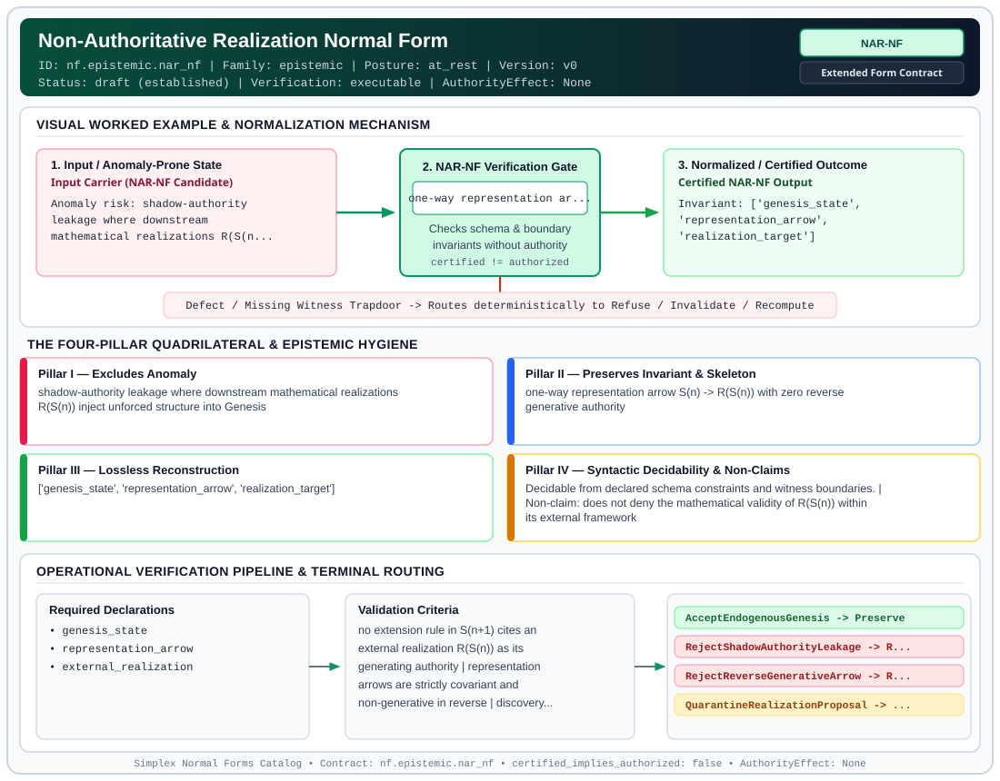

# Non-Authoritative Realization Normal Form (`NAR-NF`)

> **Contract ID:** `nf.epistemic.nar_nf` | **Family:** `epistemic` | **Index Status:** `draft` | **AuthorityEffect:** `None`

**[⬅ Back to Wiki Home](Home)** | **[View SVG Diagram](images/nf.epistemic.nar_nf.svg)**

---

## 1. Executive Summary & Metadata

Non-Authoritative Realization Normal Form (NAR-NF) enforces structural normalization and explicit defect routing in the epistemic regime.

| Property | Value |
| :--- | :--- |
| **Canonical ID** | `nf.epistemic.nar_nf` |
| **Short Name** | `NAR-NF` |
| **Full Name** | Non-Authoritative Realization Normal Form |
| **Family** | `epistemic` (Observer-Relative Epistemic, Freshness, Context, Provenance & Distinguishability Contracts) |
| **Qualification** | Extended Form Contract (Normal Form Contract) |
| **Data / Math Posture** | at_rest |
| **Index Status** | `draft` |
| **Theory Status** | `established` |
| **Verification Status** | `executable` |
| **Contract Version** | `v0` |
| **Governance Fence** | `AuthorityEffect: None` (`certified_implies_authorized: false`) |

---

## 2. Visual Architecture & Normalization Diagram



---

## 3. Concrete Worked Example & Mechanism

### Visual Transition Summary

| Stage | Carrier / Operator | Concrete State / Invariant |
| :--- | :--- | :--- |
| **1. Before / Candidate Input** | `Input Carrier (NAR-NF Candidate)` | Anomaly risk: shadow-authority ; leakage where downstream ; mathematical realizations R(S(n... |
| **2. Normalization / Gate** | `NAR-NF Verification Gate` | `one-way representation ar...` (`certified_implies_authorized: false`) |
| **3. After / Certified Output** | `Certified NAR-NF Output` | Invariant: ['genesis_state', ; 'representation_arrow', ; 'realization_target'] |

---

## 4. The Four-Pillar Quadrilateral & Non-Claims

Every contract in `simplex-normal-forms` is evaluated against the **Four-Pillar Quadrilateral** defined in `contracts/_golden_nfs/standard.yaml`:

| Pillar | Requirement | Contract Specification for `nf.epistemic.nar_nf` |
| :--- | :--- | :--- |
| **Pillar I: Excludes Anomaly** | Name and eliminate a specific class of data or state defects. | shadow-authority leakage where downstream mathematical realizations R(S(n)) inject unforced structure into Genesis |
| **Pillar II: Preserves Invariant** | State the structural invariant and protected skeleton preserved across transitions. | **Invariant:** one-way representation arrow S(n) -> R(S(n)) with zero reverse generative authority<br>**Protected Skeleton:** ['genesis_state', 'representation_arrow', 'realization_target'] |
| **Pillar III: Lossless Reconstruction** | State the non-loss reconstruction operator (join, direct sum, pullback, or replay). | Lossless reconstruction under declared projection, direct sum, or pullback operators. |
| **Pillar IV: Syntactic Decidability** | State how conformance is decided from declared constraints without unbudgeted scans. | Decidable from declared schema and witness metadata within bounded evaluation budgets. |

### Explicit Non-Claims (`certified_implies_authorized: false`)

- does not deny the mathematical validity of R(S(n)) within its external framework
- does not grant execution authority

---

## 5. Operational Verification & Terminal Routing

### 5.1 Required Declarations

- genesis_state
- representation_arrow
- external_realization

### 5.2 Required Evidence

- provenance_trace
- extension_forcing_witness

### 5.3 Validation Criteria

| Criterion ID | Name | Condition |
| :--- | :--- | :--- |
| `criterion` | Check | no extension rule in S(n+1) cites an external realization R(S(n)) as its generating authority |
| `criterion` | Check | representation arrows are strictly covariant and non-generative in reverse |
| `criterion` | Check | discovery of continuous or algebraic symmetries in R(S(n)) does not force new discrete symbols into S(n) |

### 5.4 Terminal Route Map

Every evaluation terminates in a declared local route mapped to a canonical terminal in `standard.yaml`:

| Local Terminal Route | Canonical Terminal |
| :--- | :--- |
| `AcceptEndogenousGenesis` | `Preserve` |
| `RejectShadowAuthorityLeakage` | `Reject` |
| `RejectReverseGenerativeArrow` | `Refuse` |
| `QuarantineRealizationProposal` | `Quarantine` |

### 5.5 Declared Failure Modes

- **symptom**: an extension S(n) -> S(n+1) is justified by properties of continuous manifolds or Hilbert spaces, **diagnosis**: shadow-authority leakage violating Boxed Law 2, **terminal**: RejectShadowAuthorityLeakage
- **symptom**: realization mapping R contains an arrow R(S(n)) -> S(n+1), **diagnosis**: illegal reverse generative arrow, **terminal**: RejectReverseGenerativeArrow

---

## 6. Epistemic Claim Hygiene Quadrant

In accordance with the repository's epistemic claim discipline:

1. **What it supports:**
   - Supports syntactic and operational checking of `nf.epistemic.nar_nf` (`NAR-NF`) against its declared schema, boundary constraints, and witness obligations in this model.
   - Supports deterministic terminal routing (`AcceptEndogenousGenesis, RejectShadowAuthorityLeakage, RejectReverseGenerativeArrow, QuarantineRealizationProposal`) when required declarations or invariants fail.
2. **What it does not support:**
   - Does not confer operational authority (`AuthorityEffect: None`, `certified_implies_authorized: false`).
   - Does not claim semantic truth of undeclared external processes or unverified upstream inputs beyond the declaredprotected skeleton.
3. **The narrowest defensible claim:**
   - Within the declared substrate `at_rest`, this contract enforces that `shadow-authority leakage where downstream mathematical realizations R(S(n)) inject unforced structure into Genesis` is either excluded under `one-way representation arrow S(n) -> R(S(n)) with zero reverse generative authority` or routed to an explicit refusal/recovery terminal.
4. **The next test needed:**
   - Property-based falsification and mutation testing across boundary edge cases and composed multi-step pipelines for `nf.epistemic.nar_nf`.

---

## 7. Canonical YAML Contract (`contracts/nf.epistemic.nar_nf.yaml`)

<details>
<summary><strong>Click to expand full canonical YAML contract (contracts/nf.epistemic.nar_nf.yaml)</strong></summary>

```yaml
schema_version: smplx.nf.contract.v0
contract_kind: form_contract
identity:
  id: nf.epistemic.nar_nf
  name: Non-Authoritative Realization Normal Form
  short_name: NAR-NF
  version: v0
  status: draft
  family: epistemic
  theory_status: established
  contract_status: draft
  verification_status: executable
classification:
  hierarchy_level: form
  subject_kind:
  - mathematical_realization
  - representation_arrow
  - genesis_state
  data_posture: at_rest
  mathematical_posture: formal_algebraic
purpose:
  excludes_anomaly: shadow-authority leakage where downstream mathematical realizations R(S(n)) inject unforced structure into Genesis
  preserves_invariant: one-way representation arrow S(n) -> R(S(n)) with zero reverse generative authority
  protected_skeleton:
  - genesis_state
  - representation_arrow
  - realization_target
  erased_structure:
  - realization_specific_auxiliaries
  non_claims:
  - does not deny the mathematical validity of R(S(n)) within its external framework
  - does not grant execution authority
declarations_required:
- genesis_state
- representation_arrow
- external_realization
evidence_required:
- provenance_trace
- extension_forcing_witness
validation_criteria:
- no extension rule in S(n+1) cites an external realization R(S(n)) as its generating authority
- representation arrows are strictly covariant and non-generative in reverse
- discovery of continuous or algebraic symmetries in R(S(n)) does not force new discrete symbols into S(n)
proof_obligations:
- id: narnf.boxed_law_two
  status: upstream_theorem
  ref: 002_s_n
  section: sn.md
terminal_routes:
- AcceptEndogenousGenesis
- RejectShadowAuthorityLeakage
- RejectReverseGenerativeArrow
- QuarantineRealizationProposal
terminal_route_map:
  AcceptEndogenousGenesis: Preserve
  RejectShadowAuthorityLeakage: Reject
  RejectReverseGenerativeArrow: Refuse
  QuarantineRealizationProposal: Quarantine
certification:
  certificate_required: true
  certificate_kind: realization_boundary_certificate
  obstruction_class_required: false
  loss_ledger_required: false
  verifier_required: true
authorization:
  authorized_by: null
  certified_implies_authorized: false
failure_modes:
- symptom: an extension S(n) -> S(n+1) is justified by properties of continuous manifolds or Hilbert spaces
  diagnosis: shadow-authority leakage violating Boxed Law 2
  terminal: RejectShadowAuthorityLeakage
- symptom: realization mapping R contains an arrow R(S(n)) -> S(n+1)
  diagnosis: illegal reverse generative arrow
  terminal: RejectReverseGenerativeArrow
definition:
  formal_statement: a derivation step is in Non-Authoritative Realization Normal Form iff all generative morphisms are strictly endogenous to S(n) and every external mathematical realization R(S(n)) has zero authority to extend S(n)
  quadrilateral:
    qualifies_as_true_normal_form: false
    qualification_gap: epistemic_boundary_not_relational_project_join
    anomaly_exclusion: shadow-authority leakage and reverse generative arrows
    lossless_join:
      status: one_way_representation
      statement: realization is uniquely determined by representation arrow rho and Genesis state
    dependency_preservation:
      status: endogenous_preservation
      statement: endogenous Genesis invariants are preserved without external axioms
    syntactic_decision:
      status: provenance_decidable
      statement: decidable by checking whether generating authorities in the provenance graph belong to Genesis
schema_ref: ./normal_form_contract_schema.yaml
```

</details>
