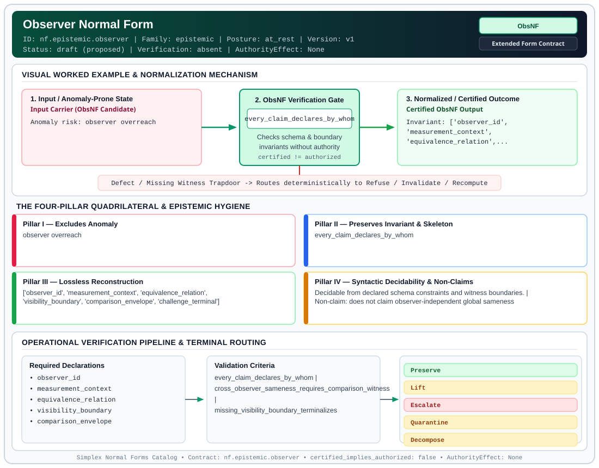

# Observer Normal Form (`ObsNF`)

> **Contract ID:** `nf.epistemic.observer` | **Family:** `epistemic` | **Index Status:** `draft` | **AuthorityEffect:** `None`

**[⬅ Back to Wiki Home](Home)** | **[View SVG Diagram](images/nf.epistemic.observer.svg)**

---

## 1. Executive Summary & Metadata

Observer Normal Form (ObsNF) enforces structural normalization and explicit defect routing in the epistemic regime.

| Property | Value |
| :--- | :--- |
| **Canonical ID** | `nf.epistemic.observer` |
| **Short Name** | `ObsNF` |
| **Full Name** | Observer Normal Form |
| **Family** | `epistemic` (Observer-Relative Epistemic, Freshness, Context, Provenance & Distinguishability Contracts) |
| **Qualification** | Extended Form Contract (Normal Form Contract) |
| **Data / Math Posture** | at_rest |
| **Index Status** | `draft` |
| **Theory Status** | `proposed` |
| **Verification Status** | `absent` |
| **Contract Version** | `v1` |
| **Governance Fence** | `AuthorityEffect: None` (`certified_implies_authorized: false`) |

---

## 2. Visual Architecture & Normalization Diagram



---

## 3. Concrete Worked Example & Mechanism

### Visual Transition Summary

| Stage | Carrier / Operator | Concrete State / Invariant |
| :--- | :--- | :--- |
| **1. Before / Candidate Input** | `Input Carrier (ObsNF Candidate)` | Anomaly risk: observer overreach |
| **2. Normalization / Gate** | `ObsNF Verification Gate` | `every_claim_declares_by_whom` (`certified_implies_authorized: false`) |
| **3. After / Certified Output** | `Certified ObsNF Output` | Invariant: ['observer_id', ; 'measurement_context', ; 'equivalence_relation',... |

---

## 4. The Four-Pillar Quadrilateral & Non-Claims

Every contract in `simplex-normal-forms` is evaluated against the **Four-Pillar Quadrilateral** defined in `contracts/_golden_nfs/standard.yaml`:

| Pillar | Requirement | Contract Specification for `nf.epistemic.observer` |
| :--- | :--- | :--- |
| **Pillar I: Excludes Anomaly** | Name and eliminate a specific class of data or state defects. | observer overreach |
| **Pillar II: Preserves Invariant** | State the structural invariant and protected skeleton preserved across transitions. | **Invariant:** every_claim_declares_by_whom<br>**Protected Skeleton:** ['observer_id', 'measurement_context', 'equivalence_relation', 'visibility_boundary', 'comparison_envelope', 'challenge_terminal'] |
| **Pillar III: Lossless Reconstruction** | State the non-loss reconstruction operator (join, direct sum, pullback, or replay). | Lossless reconstruction under declared projection, direct sum, or pullback operators. |
| **Pillar IV: Syntactic Decidability** | State how conformance is decided from declared constraints without unbudgeted scans. | Decidable from declared schema and witness metadata within bounded evaluation budgets. |

### Explicit Non-Claims (`certified_implies_authorized: false`)

- does not claim observer-independent global sameness

---

## 5. Operational Verification & Terminal Routing

### 5.1 Required Declarations

- observer_id
- measurement_context
- equivalence_relation
- visibility_boundary
- comparison_envelope
- challenge_terminal

### 5.2 Required Evidence

- observer_packet
- measurement_trace
- comparison_witness_when_crossing_observers

### 5.3 Validation Criteria

| Criterion ID | Name | Condition |
| :--- | :--- | :--- |
| `criterion` | Check | every_claim_declares_by_whom |
| `criterion` | Check | cross_observer_sameness_requires_comparison_witness |
| `criterion` | Check | missing_visibility_boundary_terminalizes |

### 5.4 Terminal Route Map

Every evaluation terminates in a declared local route mapped to a canonical terminal in `standard.yaml`:

| Local Terminal Route | Canonical Terminal |
| :--- | :--- |
| `Preserve` | `Preserve` |
| `Lift` | `Lift` |
| `Escalate` | `Escalate` |
| `Quarantine` | `Quarantine` |
| `Decompose` | `Decompose` |
| `Refuse` | `Refuse` |
| `Abstain` | `Abstain` |

### 5.5 Declared Failure Modes

_All defects route explicitly through the Terminal Route Map above._

---

## 6. Epistemic Claim Hygiene Quadrant

In accordance with the repository's epistemic claim discipline:

1. **What it supports:**
   - Supports syntactic and operational checking of `nf.epistemic.observer` (`ObsNF`) against its declared schema, boundary constraints, and witness obligations in this model.
   - Supports deterministic terminal routing (`Preserve, Lift, Escalate, Quarantine`) when required declarations or invariants fail.
2. **What it does not support:**
   - Does not confer operational authority (`AuthorityEffect: None`, `certified_implies_authorized: false`).
   - Does not claim semantic truth of undeclared external processes or unverified upstream inputs beyond the declaredprotected skeleton.
3. **The narrowest defensible claim:**
   - Within the declared substrate `at_rest`, this contract enforces that `observer overreach` is either excluded under `every_claim_declares_by_whom` or routed to an explicit refusal/recovery terminal.
4. **The next test needed:**
   - Property-based falsification and mutation testing across boundary edge cases and composed multi-step pipelines for `nf.epistemic.observer`.

---

## 7. Canonical YAML Contract (`contracts/nf.epistemic.observer.yaml`)

<details>
<summary><strong>Click to expand full canonical YAML contract (contracts/nf.epistemic.observer.yaml)</strong></summary>

```yaml
schema_version: smplx.nf.contract.v0
contract_kind: normal_form_contract
identity:
  id: nf.epistemic.observer
  name: Observer Normal Form
  short_name: ObsNF
  version: v1
  status: draft
  family: epistemic
  theory_status: proposed
  contract_status: draft
  verification_status: absent
classification:
  hierarchy_level: normal_form
  subject_kind:
  - observer_relative_claim
  data_posture: at_rest
  mathematical_posture: operational
purpose:
  excludes_anomaly: observer overreach
  preserves_invariant: every_claim_declares_by_whom
  protected_skeleton:
  - observer_id
  - measurement_context
  - equivalence_relation
  - visibility_boundary
  - comparison_envelope
  - challenge_terminal
  erased_structure: []
  non_claims:
  - does not claim observer-independent global sameness
declarations_required:
- observer_id
- measurement_context
- equivalence_relation
- visibility_boundary
- comparison_envelope
- challenge_terminal
evidence_required:
- observer_packet
- measurement_trace
- comparison_witness_when_crossing_observers
validation_criteria:
- every_claim_declares_by_whom
- cross_observer_sameness_requires_comparison_witness
- missing_visibility_boundary_terminalizes
terminal_routes:
- Preserve
- Lift
- Escalate
- Quarantine
- Decompose
- Refuse
- Abstain
certification:
  certificate_required: true
  certificate_kind: observer_claim_certificate
  obstruction_class_required: false
  loss_ledger_required: false
  verifier_required: false
terminal_route_map:
  Preserve: Preserve
  Lift: Lift
  Escalate: Escalate
  Quarantine: Quarantine
  Decompose: Decompose
  Refuse: Refuse
  Abstain: Abstain
authorization:
  authorized_by: null
  certified_implies_authorized: false
definition:
  source: coda_all_universe/mssn_sn_tower/definitions.md
  formal_statement: observer overreach. every_claim_declares_by_whom
  quadrilateral:
    qualifies_as_true_normal_form: false
    qualification_gap: reconstruction_is_not_a_relational_project_join
    anomaly_exclusion: observer overreach
    lossless_join:
      status: declared_reconstruction
      statement: every_claim_declares_by_whom
    dependency_preservation:
      status: declared_with_the_invariant
      statement: The preserved invariant stays on the declared schema. This form does
        not state a functional-dependency projection of a flat relvar decomposition.
    syntactic_decision:
      status: declaration_decidable
      statement: The check reads the declared constraints and validation criteria.
        One unrecorded runtime image is not the decider.
schema_ref: ./normal_form_contract_schema.yaml
```

</details>
