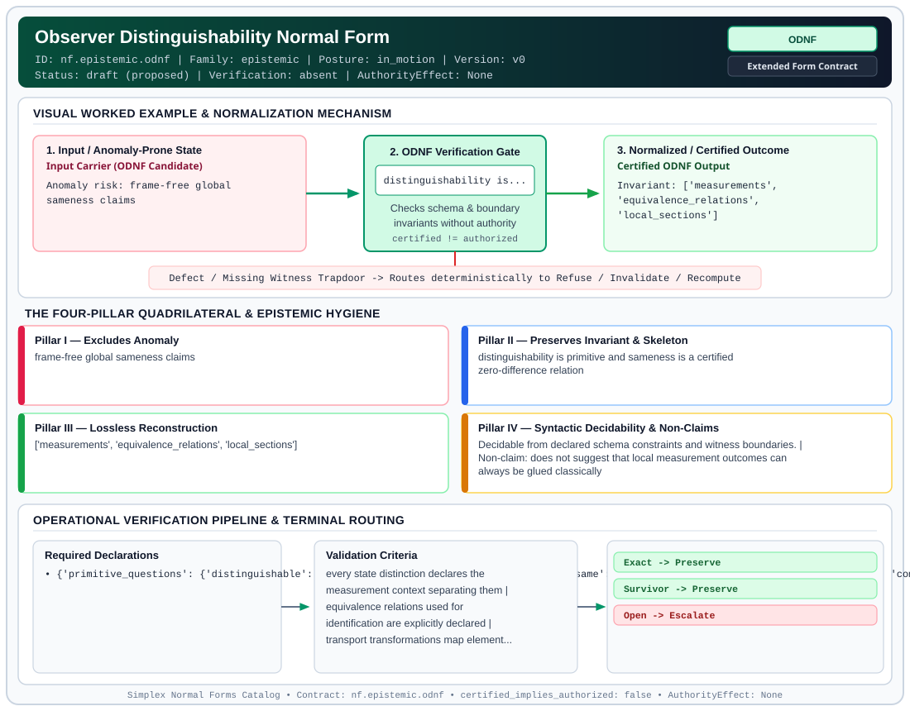

# Observer Distinguishability Normal Form (`ODNF`)

> **Contract ID:** `nf.epistemic.odnf` | **Family:** `epistemic` | **Index Status:** `draft` | **AuthorityEffect:** `None`

**[⬅ Back to Wiki Home](Home)** | **[View SVG Diagram](images/nf.epistemic.odnf.svg)**

---

## 1. Executive Summary & Metadata

Observer Distinguishability Normal Form (ODNF) enforces structural normalization and explicit defect routing in the epistemic regime.

| Property | Value |
| :--- | :--- |
| **Canonical ID** | `nf.epistemic.odnf` |
| **Short Name** | `ODNF` |
| **Full Name** | Observer Distinguishability Normal Form |
| **Family** | `epistemic` (Observer-Relative Epistemic, Freshness, Context, Provenance & Distinguishability Contracts) |
| **Qualification** | Extended Form Contract (Normal Form Contract) |
| **Data / Math Posture** | in_motion |
| **Index Status** | `draft` |
| **Theory Status** | `proposed` |
| **Verification Status** | `absent` |
| **Contract Version** | `v0` |
| **Governance Fence** | `AuthorityEffect: None` (`certified_implies_authorized: false`) |

---

## 2. Visual Architecture & Normalization Diagram



---

## 3. Concrete Worked Example & Mechanism

### Visual Transition Summary

| Stage | Carrier / Operator | Concrete State / Invariant |
| :--- | :--- | :--- |
| **1. Before / Candidate Input** | `Input Carrier (ODNF Candidate)` | Anomaly risk: frame-free global ; sameness claims |
| **2. Normalization / Gate** | `ODNF Verification Gate` | `distinguishability is...` (`certified_implies_authorized: false`) |
| **3. After / Certified Output** | `Certified ODNF Output` | Invariant: ['measurements', ; 'equivalence_relations', ; 'local_sections'] |

---

## 4. The Four-Pillar Quadrilateral & Non-Claims

Every contract in `simplex-normal-forms` is evaluated against the **Four-Pillar Quadrilateral** defined in `contracts/_golden_nfs/standard.yaml`:

| Pillar | Requirement | Contract Specification for `nf.epistemic.odnf` |
| :--- | :--- | :--- |
| **Pillar I: Excludes Anomaly** | Name and eliminate a specific class of data or state defects. | frame-free global sameness claims |
| **Pillar II: Preserves Invariant** | State the structural invariant and protected skeleton preserved across transitions. | **Invariant:** distinguishability is primitive and sameness is a certified zero-difference relation<br>**Protected Skeleton:** ['measurements', 'equivalence_relations', 'local_sections'] |
| **Pillar III: Lossless Reconstruction** | State the non-loss reconstruction operator (join, direct sum, pullback, or replay). | Lossless reconstruction under declared projection, direct sum, or pullback operators. |
| **Pillar IV: Syntactic Decidability** | State how conformance is decided from declared constraints without unbudgeted scans. | Decidable from declared schema and witness metadata within bounded evaluation budgets. |

### Explicit Non-Claims (`certified_implies_authorized: false`)

- does not suggest that local measurement outcomes can always be glued classically
- does not support absolute coordination without a shared consensus boundary
- does not imply a physical realist representation exists for all observer systems

---

## 5. Operational Verification & Terminal Routing

### 5.1 Required Declarations

- **primitive_questions**: {'distinguishable': 'What measurements separate two states?', 'same': 'What equivalence relation identifies them?', 'comparison': 'What survives transport between observers?', 'gluing': 'Can local observer sections form a global section?', 'repair': 'Can the defect be killed by allowed corrections?', 'residual': 'What remains after repair and comparison?', 'authority': 'What finite terminal certificate is earned?'}

### 5.2 Required Evidence

_None declared._

### 5.3 Validation Criteria

| Criterion ID | Name | Condition |
| :--- | :--- | :--- |
| `criterion` | Check | every state distinction declares the measurement context separating them |
| `criterion` | Check | equivalence relations used for identification are explicitly declared |
| `criterion` | Check | transport transformations map elements under a declared comparison witness |

### 5.4 Terminal Route Map

Every evaluation terminates in a declared local route mapped to a canonical terminal in `standard.yaml`:

| Local Terminal Route | Canonical Terminal |
| :--- | :--- |
| `Exact` | `Preserve` |
| `Survivor` | `Preserve` |
| `Open` | `Escalate` |

### 5.5 Declared Failure Modes

- **symptom**: treating non-comparable observer views as identical without transport maps, **diagnosis**: undefined equivalence relation, **terminal**: Open

---

## Deep-Dive Level Treatise

**AuthorityEffect:** None.  
**Level:** Level 17 (Data under Observation / Pseudometric Separation & Zero Distance)  
**Evidential Grade:** NATIVE IMPLEMENTED  
**Contract Reference:** [`nf.epistemic.odnf`](../../../../omega_engine_pfp/infrastructure/yaml/normal_forms/nf.epistemic.odnf.yaml)  
**Mathematical Posture:** Pseudometric Topology & Constructive Separation Axioms  
**Data Posture:** Under Observation  

---

## 1. Schematic & Conceptual Architecture

Observer Distinguishability Normal Form (ODNF) resolves a classic fallacy in mathematical data modeling:
$$\boxed{\text{Distance zero is a pseudometric fact; point equality is a separation claim.}}$$

When an observer pool $\mathcal{O}$ measures two representations $x, y$ and finds distance zero ($d_{\mathcal{O}}(x, y) = 0$):
- This demonstrates only that the current observer pool lacks the resolving power to separate them.
- It does **not** support that $x$ and $y$ are ontologically identical points on the carrier.
- ODNF strictly forbids collapsing $x$ and $y$ to a single point unless the contract declares an explicit **metric separation axiom** ($d(x, y) = 0 \implies x = y$).
- Without separation, the evaluation routes to `Abstain`, preserving distinct carrier IDs.

```text
       Observer Measurement: d_O(x, y) = 0
                       │
             Separation Axiom Declared?
                    /    \
                  NO      YES
                  /        \
                 ▼          ▼
             Abstain     Collapse
      (Retains Distinct   (True Point
         Carrier IDs)      Equality)
```

---

## 2. Mathematical Invariants & Quadrilateral Properties

1. **Pseudometric Invariants:**
   The observer distance function $d: X \times X \to \mathbb{Q}$ must satisfy:
   - Non-negativity: $d(x, y) \ge 0$ as an exact rational.
   - Symmetry: $d(x, y) = d(y, x)$.
   - Triangle Inequality: $d(x, z) \le d(x, y) + d(y, z)$.
   - But crucially: $d(x, y) = 0$ does **not** imply $x = y$ (pseudometric, not metric).

2. **The Separation Gate:**
   $$\operatorname{verdict}(x, y) = \begin{cases}
   \text{Preserve (Identified)}, & \text{if } d(x, y) = 0 \land \text{SeparationAxiomDeclared} \\
   \text{Abstain (Indistinguishable)}, & \text{if } d(x, y) = 0 \land \neg\text{SeparationAxiomDeclared} \\
   \text{Refuse (Separated)}, & \text{if } d(x, y) > 0
   \end{cases}$$

3. **The Quadrilateral Invariants:**
   - **Anomaly Excluded:** Conflating epistemic observational indistinguishability with ontological point identity.
   - **Protected Skeleton:** Carrier object identities, observer pool definitions, and exact rational distance values.
   - **Erased Structure:** None (distinctions are explicitly guarded against premature collapse).
   - **Reconstruction:** Quotient manifold projection under verified separation.

---

## 3. Terminal Routes & Verification Logic

```text
Measurement d_O(x, y) & Separation Context
      │
      ├── d(x, y) = 0 WITH separation axiom ──► Preserve (PointIdentityCertified)
      │
      ├── d(x, y) = 0 WITHOUT separation ────► Abstain (IndistinguishableDistinctIds)
      │
      ├── d(x, y) > 0 (Distinct states) ─────► Refuse (SeparatedByObserver)
      │
      └── d(x, y) < 0 (Metric violation) ────► Reject (NonPositiveDistanceDefect)
```

---

## 4. Test Evidence & Local Execution

Verified in [`test_tranche8_epistemic_and_authority.py`](../../../tests/normal_forms/test_tranche8_epistemic_and_authority.py) and [`test_tranche30_pseudometric_and_quotient_factors.py`](../../../tests/normal_forms/test_tranche30_pseudometric_and_quotient_factors.py):
- `test_pseudometric_zero_keeps_distinct_ids`: Asserts that when $d(O_1, O_2) = 0$ without a separation axiom, carrier IDs remain distinct.
- `test_odnf_zero_divergence_routes_to_abstain`: Verifies that zero divergence routes to `Abstain`.
- `test_separation_axiom_makes_zero_into_equality`: supports that declaring the separation axiom permits point collapse in the quotient.

---

## 5. Epistemic Claim Quadrant

1. **What it supports:**
   - Strict mathematical hygiene preventing false claims of identity from incomplete observations.
   - Separation of carrier state space from quotient observation space.
2. **What it does not support:**
   - canonical omniscience of any finite observer pool.
3. **The narrowest defensible claim:**
   - Zero distance under an observer pool certifies indistinguishability by that pool, not identity of the underlying objects.
4. **The next test needed:**
   - Multi-observer adjunction test verifying that adjoining an independent observer strictly refines or preserves the pseudometric partition.

---

## 6. Epistemic Claim Hygiene Quadrant

In accordance with the repository's epistemic claim discipline:

1. **What it supports:**
   - Supports syntactic and operational checking of `nf.epistemic.odnf` (`ODNF`) against its declared schema, boundary constraints, and witness obligations in this model.
   - Supports deterministic terminal routing (`Exact, Survivor, Open`) when required declarations or invariants fail.
2. **What it does not support:**
   - Does not confer operational authority (`AuthorityEffect: None`, `certified_implies_authorized: false`).
   - Does not claim semantic truth of undeclared external processes or unverified upstream inputs beyond the declaredprotected skeleton.
3. **The narrowest defensible claim:**
   - Within the declared substrate `in_motion`, this contract enforces that `frame-free global sameness claims` is either excluded under `distinguishability is primitive and sameness is a certified zero-difference relation` or routed to an explicit refusal/recovery terminal.
4. **The next test needed:**
   - Property-based falsification and mutation testing across boundary edge cases and composed multi-step pipelines for `nf.epistemic.odnf`.

---

## 7. Canonical YAML Contract (`contracts/nf.epistemic.odnf.yaml`)

<details>
<summary><strong>Click to expand full canonical YAML contract (contracts/nf.epistemic.odnf.yaml)</strong></summary>

```yaml
schema_version: smplx.nf.contract.v0
contract_kind: normal_form_contract
identity:
  id: nf.epistemic.odnf
  name: Observer Distinguishability Normal Form
  short_name: ODNF
  version: v0
  status: draft
  family: epistemic
  theory_status: proposed
  contract_status: draft
  verification_status: absent
classification:
  hierarchy_level: normal_form
  subject_kind:
  - observer_relvar
  - distributed_claim
  data_posture: in_motion
  mathematical_posture: operational
purpose:
  excludes_anomaly: frame-free global sameness claims
  preserves_invariant: distinguishability is primitive and sameness is a certified
    zero-difference relation
  protected_skeleton:
  - measurements
  - equivalence_relations
  - local_sections
  erased_structure: []
  non_claims:
  - does not suggest that local measurement outcomes can always be glued classically
  - does not support absolute coordination without a shared consensus boundary
  - does not imply a physical realist representation exists for all observer systems
obstruction_substrate:
  policy_ref: ../substrate/default_finite_obstruction_policy.yaml
  finite_carrier:
    description: Allowed repairs and distinguishability defects across observer measurements.
  cochain_complex:
    C0: allowed_repairs_or_gauge_transformations
    C1: observer_defects_or_distinguishability_gaps
    C2: gluing_failures_or_contextuality_failures
    d0: repair_to_defect
    d1: defect_to_gluing_failure
    quotient: Q1 = C1 / im(d0)
  obstruction_class:
    notation: '[omega]'
    exact: '[omega] == 0'
    residual_closed: '[omega] != 0 and d1(omega) == 0'
    open: d1(omega) != 0
declarations_required:
- primitive_questions:
    distinguishable: What measurements separate two states?
    same: What equivalence relation identifies them?
    comparison: What survives transport between observers?
    gluing: Can local observer sections form a global section?
    repair: Can the defect be killed by allowed corrections?
    residual: What remains after repair and comparison?
    authority: What finite terminal certificate is earned?
evidence_required: []
validation_criteria:
- every state distinction declares the measurement context separating them
- equivalence relations used for identification are explicitly declared
- transport transformations map elements under a declared comparison witness
proof_obligations: []
terminal_routes:
- Exact
- Survivor
- Open
certification:
  certificate_required: true
  certificate_kind: observer_distinguishability_certificate
  obstruction_class_required: true
  loss_ledger_required: false
  verifier_required: true
authorization:
  authorized_by: null
  certified_implies_authorized: false
failure_modes:
- symptom: treating non-comparable observer views as identical without transport maps
  diagnosis: undefined equivalence relation
  terminal: Open
references:
- ../relnf.md
terminal_route_map:
  Exact: Preserve
  Survivor: Preserve
  Open: Escalate
definition:
  source: coda_all_universe/mssn_sn_tower/definitions.md
  formal_statement: frame-free global sameness claims. distinguishability is primitive
    and sameness is a certified zero-difference relation
  quadrilateral:
    qualifies_as_true_normal_form: false
    qualification_gap: reconstruction_is_not_a_relational_project_join
    anomaly_exclusion: frame-free global sameness claims
    lossless_join:
      status: declared_reconstruction
      statement: distinguishability is primitive and sameness is a certified zero-difference
        relation
    dependency_preservation:
      status: declared_with_the_invariant
      statement: The preserved invariant stays on the declared schema. This form does
        not state a functional-dependency projection of a flat relvar decomposition.
    syntactic_decision:
      status: declaration_decidable
      statement: The check reads the declared constraints and validation criteria.
        One unrecorded runtime image is not the decider.
schema_ref: ./normal_form_contract_schema.yaml
```

</details>
