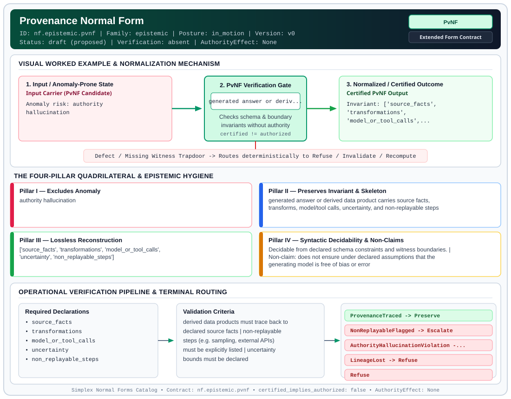

# Provenance Normal Form (`PvNF`)

> **Contract ID:** `nf.epistemic.pvnf` | **Family:** `epistemic` | **Index Status:** `draft` | **AuthorityEffect:** `None`

**[⬅ Back to Wiki Home](Home)** | **[View SVG Diagram](images/nf.epistemic.pvnf.svg)**

---

## 1. Executive Summary & Metadata

Provenance Normal Form (PvNF) enforces structural normalization and explicit defect routing in the epistemic regime.

| Property | Value |
| :--- | :--- |
| **Canonical ID** | `nf.epistemic.pvnf` |
| **Short Name** | `PvNF` |
| **Full Name** | Provenance Normal Form |
| **Family** | `epistemic` (Observer-Relative Epistemic, Freshness, Context, Provenance & Distinguishability Contracts) |
| **Qualification** | Extended Form Contract (Normal Form Contract) |
| **Data / Math Posture** | in_motion |
| **Index Status** | `draft` |
| **Theory Status** | `proposed` |
| **Verification Status** | `absent` |
| **Contract Version** | `v0` |
| **Governance Fence** | `AuthorityEffect: None` (`certified_implies_authorized: false`) |

---

## 2. Visual Architecture & Normalization Diagram



---

## 3. Concrete Worked Example & Mechanism

### Visual Transition Summary

| Stage | Carrier / Operator | Concrete State / Invariant |
| :--- | :--- | :--- |
| **1. Before / Candidate Input** | `Input Carrier (PvNF Candidate)` | Anomaly risk: authority ; hallucination |
| **2. Normalization / Gate** | `PvNF Verification Gate` | `generated answer or deriv...` (`certified_implies_authorized: false`) |
| **3. After / Certified Output** | `Certified PvNF Output` | Invariant: ['source_facts', ; 'transformations', ; 'model_or_tool_calls',... |

---

## 4. The Four-Pillar Quadrilateral & Non-Claims

Every contract in `simplex-normal-forms` is evaluated against the **Four-Pillar Quadrilateral** defined in `contracts/_golden_nfs/standard.yaml`:

| Pillar | Requirement | Contract Specification for `nf.epistemic.pvnf` |
| :--- | :--- | :--- |
| **Pillar I: Excludes Anomaly** | Name and eliminate a specific class of data or state defects. | authority hallucination |
| **Pillar II: Preserves Invariant** | State the structural invariant and protected skeleton preserved across transitions. | **Invariant:** generated answer or derived data product carries source facts, transforms, model/tool calls, uncertainty, and non-replayable steps<br>**Protected Skeleton:** ['source_facts', 'transformations', 'model_or_tool_calls', 'uncertainty', 'non_replayable_steps'] |
| **Pillar III: Lossless Reconstruction** | State the non-loss reconstruction operator (join, direct sum, pullback, or replay). | Lossless reconstruction under declared projection, direct sum, or pullback operators. |
| **Pillar IV: Syntactic Decidability** | State how conformance is decided from declared constraints without unbudgeted scans. | Decidable from declared schema and witness metadata within bounded evaluation budgets. |

### Explicit Non-Claims (`certified_implies_authorized: false`)

- does not ensure under declared assumptions that the generating model is free of bias or error

---

## 5. Operational Verification & Terminal Routing

### 5.1 Required Declarations

- source_facts
- transformations
- model_or_tool_calls
- uncertainty
- non_replayable_steps

### 5.2 Required Evidence

- fact_ids or tuple_ids
- model_version
- temperature or seed for replayable steps
- signature of the executing model/verifier

### 5.3 Validation Criteria

| Criterion ID | Name | Condition |
| :--- | :--- | :--- |
| `criterion` | Check | derived data products must trace back to declared source facts |
| `criterion` | Check | non-replayable steps (e.g. sampling, external APIs) must be explicitly listed |
| `criterion` | Check | uncertainty bounds must be declared |

### 5.4 Terminal Route Map

Every evaluation terminates in a declared local route mapped to a canonical terminal in `standard.yaml`:

| Local Terminal Route | Canonical Terminal |
| :--- | :--- |
| `ProvenanceTraced` | `Preserve` |
| `NonReplayableFlagged` | `Escalate` |
| `AuthorityHallucinationViolation` | `Reject` |
| `LineageLost` | `Refuse` |
| `Refuse` | `Refuse` |

### 5.5 Declared Failure Modes

- **symptom**: valid-sounding answer returned but no source facts or tool calls can be recovered, **diagnosis**: authority hallucination, **terminal**: AuthorityHallucinationViolation

---

## 6. Epistemic Claim Hygiene Quadrant

In accordance with the repository's epistemic claim discipline:

1. **What it supports:**
   - Supports syntactic and operational checking of `nf.epistemic.pvnf` (`PvNF`) against its declared schema, boundary constraints, and witness obligations in this model.
   - Supports deterministic terminal routing (`ProvenanceTraced, NonReplayableFlagged, AuthorityHallucinationViolation, LineageLost`) when required declarations or invariants fail.
2. **What it does not support:**
   - Does not confer operational authority (`AuthorityEffect: None`, `certified_implies_authorized: false`).
   - Does not claim semantic truth of undeclared external processes or unverified upstream inputs beyond the declaredprotected skeleton.
3. **The narrowest defensible claim:**
   - Within the declared substrate `in_motion`, this contract enforces that `authority hallucination` is either excluded under `generated answer or derived data product carries source facts, transforms, model/tool calls, uncertainty, and non-replayable steps` or routed to an explicit refusal/recovery terminal.
4. **The next test needed:**
   - Property-based falsification and mutation testing across boundary edge cases and composed multi-step pipelines for `nf.epistemic.pvnf`.

---

## 7. Canonical YAML Contract (`contracts/nf.epistemic.pvnf.yaml`)

<details>
<summary><strong>Click to expand full canonical YAML contract (contracts/nf.epistemic.pvnf.yaml)</strong></summary>

```yaml
schema_version: smplx.nf.contract.v0
contract_kind: normal_form_contract
identity:
  id: nf.epistemic.pvnf
  name: Provenance Normal Form
  short_name: PvNF
  version: v0
  status: draft
  family: epistemic
  theory_status: proposed
  contract_status: draft
  verification_status: absent
classification:
  hierarchy_level: normal_form
  subject_kind:
  - distributed_claim
  data_posture: in_motion
  mathematical_posture: operational
purpose:
  excludes_anomaly: authority hallucination
  preserves_invariant: generated answer or derived data product carries source facts,
    transforms, model/tool calls, uncertainty, and non-replayable steps
  protected_skeleton:
  - source_facts
  - transformations
  - model_or_tool_calls
  - uncertainty
  - non_replayable_steps
  erased_structure:
  - intermediate_activations
  - raw_generation_phases
  non_claims:
  - does not ensure under declared assumptions that the generating model is free of bias or error
declarations_required:
- source_facts
- transformations
- model_or_tool_calls
- uncertainty
- non_replayable_steps
evidence_required:
- fact_ids or tuple_ids
- model_version
- temperature or seed for replayable steps
- signature of the executing model/verifier
validation_criteria:
- derived data products must trace back to declared source facts
- non-replayable steps (e.g. sampling, external APIs) must be explicitly listed
- uncertainty bounds must be declared
proof_obligations: []
terminal_routes:
- ProvenanceTraced
- NonReplayableFlagged
- AuthorityHallucinationViolation
- LineageLost
- Refuse
certification:
  certificate_required: true
  certificate_kind: provenance_certificate
  obstruction_class_required: false
  loss_ledger_required: true
  verifier_required: true
authorization:
  authorized_by: null
  certified_implies_authorized: false
failure_modes:
- symptom: valid-sounding answer returned but no source facts or tool calls can be
    recovered
  diagnosis: authority hallucination
  terminal: AuthorityHallucinationViolation
references:
- ../1_normal_forms.md
terminal_route_map:
  ProvenanceTraced: Preserve
  NonReplayableFlagged: Escalate
  AuthorityHallucinationViolation: Reject
  LineageLost: Refuse
  Refuse: Refuse
definition:
  source: coda_all_universe/mssn_sn_tower/definitions.md
  formal_statement: authority hallucination. generated answer or derived data product
    carries source facts, transforms, model/tool calls, uncertainty, and non-replayable
    steps
  quadrilateral:
    qualifies_as_true_normal_form: false
    qualification_gap: reconstruction_is_not_a_relational_project_join
    anomaly_exclusion: authority hallucination
    lossless_join:
      status: declared_reconstruction
      statement: generated answer or derived data product carries source facts, transforms,
        model/tool calls, uncertainty, and non-replayable steps
    dependency_preservation:
      status: declared_with_the_invariant
      statement: The preserved invariant stays on the declared schema. This form does
        not state a functional-dependency projection of a flat relvar decomposition.
    syntactic_decision:
      status: declaration_decidable
      statement: The check reads the declared constraints and validation criteria.
        One unrecorded runtime image is not the decider.
schema_ref: ./normal_form_contract_schema.yaml
```

</details>
