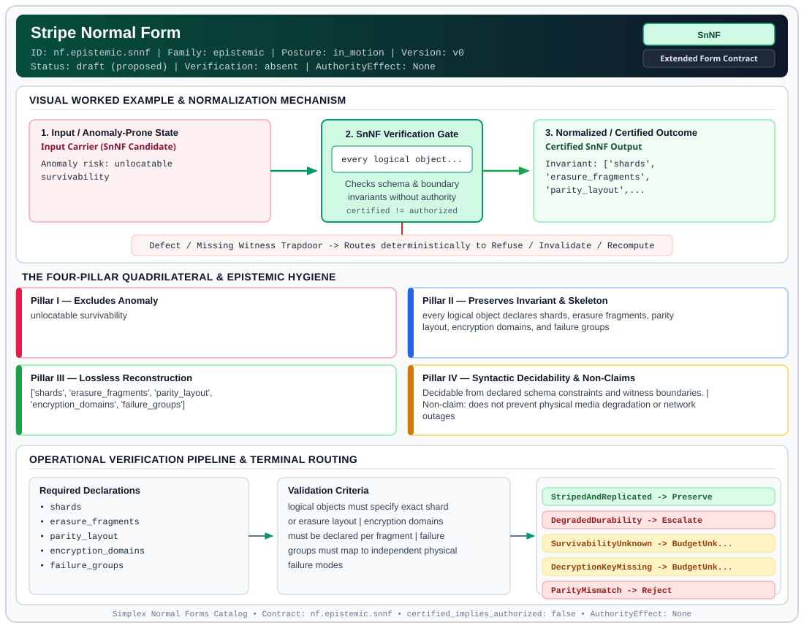

# Stripe Normal Form (`SnNF`)

> **Contract ID:** `nf.epistemic.snnf` | **Family:** `epistemic` | **Index Status:** `draft` | **AuthorityEffect:** `None`

**[⬅ Back to Wiki Home](Home)** | **[View SVG Diagram](images/nf.epistemic.snnf.svg)**

---

## 1. Executive Summary & Metadata

Stripe Normal Form (SnNF) enforces structural normalization and explicit defect routing in the epistemic regime.

| Property | Value |
| :--- | :--- |
| **Canonical ID** | `nf.epistemic.snnf` |
| **Short Name** | `SnNF` |
| **Full Name** | Stripe Normal Form |
| **Family** | `epistemic` (Observer-Relative Epistemic, Freshness, Context, Provenance & Distinguishability Contracts) |
| **Qualification** | Extended Form Contract (Normal Form Contract) |
| **Data / Math Posture** | in_motion |
| **Index Status** | `draft` |
| **Theory Status** | `proposed` |
| **Verification Status** | `absent` |
| **Contract Version** | `v0` |
| **Governance Fence** | `AuthorityEffect: None` (`certified_implies_authorized: false`) |

---

## 2. Visual Architecture & Normalization Diagram



---

## 3. Concrete Worked Example & Mechanism

### Visual Transition Summary

| Stage | Carrier / Operator | Concrete State / Invariant |
| :--- | :--- | :--- |
| **1. Before / Candidate Input** | `Input Carrier (SnNF Candidate)` | Anomaly risk: unlocatable ; survivability |
| **2. Normalization / Gate** | `SnNF Verification Gate` | `every logical object...` (`certified_implies_authorized: false`) |
| **3. After / Certified Output** | `Certified SnNF Output` | Invariant: ['shards', ; 'erasure_fragments', ; 'parity_layout',... |

---

## 4. The Four-Pillar Quadrilateral & Non-Claims

Every contract in `simplex-normal-forms` is evaluated against the **Four-Pillar Quadrilateral** defined in `contracts/_golden_nfs/standard.yaml`:

| Pillar | Requirement | Contract Specification for `nf.epistemic.snnf` |
| :--- | :--- | :--- |
| **Pillar I: Excludes Anomaly** | Name and eliminate a specific class of data or state defects. | unlocatable survivability |
| **Pillar II: Preserves Invariant** | State the structural invariant and protected skeleton preserved across transitions. | **Invariant:** every logical object declares shards, erasure fragments, parity layout, encryption domains, and failure groups<br>**Protected Skeleton:** ['shards', 'erasure_fragments', 'parity_layout', 'encryption_domains', 'failure_groups'] |
| **Pillar III: Lossless Reconstruction** | State the non-loss reconstruction operator (join, direct sum, pullback, or replay). | Lossless reconstruction under declared projection, direct sum, or pullback operators. |
| **Pillar IV: Syntactic Decidability** | State how conformance is decided from declared constraints without unbudgeted scans. | Decidable from declared schema and witness metadata within bounded evaluation budgets. |

### Explicit Non-Claims (`certified_implies_authorized: false`)

- does not prevent physical media degradation or network outages

---

## 5. Operational Verification & Terminal Routing

### 5.1 Required Declarations

- shards
- erasure_fragments
- parity_layout
- encryption_domains
- failure_groups

### 5.2 Required Evidence

- checksums_per_fragment
- placement_witnesses
- encryption_key_handles

### 5.3 Validation Criteria

| Criterion ID | Name | Condition |
| :--- | :--- | :--- |
| `criterion` | Check | logical objects must specify exact shard or erasure layout |
| `criterion` | Check | encryption domains must be declared per fragment |
| `criterion` | Check | failure groups must map to independent physical failure modes |

### 5.4 Terminal Route Map

Every evaluation terminates in a declared local route mapped to a canonical terminal in `standard.yaml`:

| Local Terminal Route | Canonical Terminal |
| :--- | :--- |
| `StripedAndReplicated` | `Preserve` |
| `DegradedDurability` | `Escalate` |
| `SurvivabilityUnknown` | `BudgetUnknown` |
| `DecryptionKeyMissing` | `BudgetUnknown` |
| `ParityMismatch` | `Reject` |
| `Refuse` | `Refuse` |

### 5.5 Declared Failure Modes

- **symptom**: data is claimed durable without declaring shard layout or survived failure modes, **diagnosis**: unlocatable survivability, **terminal**: SurvivabilityUnknown

---

## 6. Epistemic Claim Hygiene Quadrant

In accordance with the repository's epistemic claim discipline:

1. **What it supports:**
   - Supports syntactic and operational checking of `nf.epistemic.snnf` (`SnNF`) against its declared schema, boundary constraints, and witness obligations in this model.
   - Supports deterministic terminal routing (`StripedAndReplicated, DegradedDurability, SurvivabilityUnknown, DecryptionKeyMissing`) when required declarations or invariants fail.
2. **What it does not support:**
   - Does not confer operational authority (`AuthorityEffect: None`, `certified_implies_authorized: false`).
   - Does not claim semantic truth of undeclared external processes or unverified upstream inputs beyond the declaredprotected skeleton.
3. **The narrowest defensible claim:**
   - Within the declared substrate `in_motion`, this contract enforces that `unlocatable survivability` is either excluded under `every logical object declares shards, erasure fragments, parity layout, encryption domains, and failure groups` or routed to an explicit refusal/recovery terminal.
4. **The next test needed:**
   - Property-based falsification and mutation testing across boundary edge cases and composed multi-step pipelines for `nf.epistemic.snnf`.

---

## 7. Canonical YAML Contract (`contracts/nf.epistemic.snnf.yaml`)

<details>
<summary><strong>Click to expand full canonical YAML contract (contracts/nf.epistemic.snnf.yaml)</strong></summary>

```yaml
schema_version: smplx.nf.contract.v0
contract_kind: normal_form_contract
identity:
  id: nf.epistemic.snnf
  name: Stripe Normal Form
  short_name: SnNF
  version: v0
  status: draft
  family: epistemic
  theory_status: proposed
  contract_status: draft
  verification_status: absent
classification:
  hierarchy_level: normal_form
  subject_kind:
  - distributed_claim
  data_posture: in_motion
  mathematical_posture: operational
purpose:
  excludes_anomaly: unlocatable survivability
  preserves_invariant: every logical object declares shards, erasure fragments, parity
    layout, encryption domains, and failure groups
  protected_skeleton:
  - shards
  - erasure_fragments
  - parity_layout
  - encryption_domains
  - failure_groups
  erased_structure:
  - physical_disk_blocks
  - raw_block_offsets
  non_claims:
  - does not prevent physical media degradation or network outages
declarations_required:
- shards
- erasure_fragments
- parity_layout
- encryption_domains
- failure_groups
evidence_required:
- checksums_per_fragment
- placement_witnesses
- encryption_key_handles
validation_criteria:
- logical objects must specify exact shard or erasure layout
- encryption domains must be declared per fragment
- failure groups must map to independent physical failure modes
proof_obligations: []
terminal_routes:
- StripedAndReplicated
- DegradedDurability
- SurvivabilityUnknown
- DecryptionKeyMissing
- ParityMismatch
- Refuse
certification:
  certificate_required: true
  certificate_kind: stripe_certificate
  obstruction_class_required: false
  loss_ledger_required: false
  verifier_required: true
authorization:
  authorized_by: null
  certified_implies_authorized: false
failure_modes:
- symptom: data is claimed durable without declaring shard layout or survived failure
    modes
  diagnosis: unlocatable survivability
  terminal: SurvivabilityUnknown
references:
- ../1_normal_forms.md
terminal_route_map:
  StripedAndReplicated: Preserve
  DegradedDurability: Escalate
  SurvivabilityUnknown: BudgetUnknown
  DecryptionKeyMissing: BudgetUnknown
  ParityMismatch: Reject
  Refuse: Refuse
definition:
  source: coda_all_universe/mssn_sn_tower/definitions.md
  formal_statement: unlocatable survivability. every logical object declares shards,
    erasure fragments, parity layout, encryption domains, and failure groups
  quadrilateral:
    qualifies_as_true_normal_form: false
    qualification_gap: reconstruction_is_not_a_relational_project_join
    anomaly_exclusion: unlocatable survivability
    lossless_join:
      status: declared_reconstruction
      statement: every logical object declares shards, erasure fragments, parity layout,
        encryption domains, and failure groups
    dependency_preservation:
      status: declared_with_the_invariant
      statement: The preserved invariant stays on the declared schema. This form does
        not state a functional-dependency projection of a flat relvar decomposition.
    syntactic_decision:
      status: declaration_decidable
      statement: The check reads the declared constraints and validation criteria.
        One unrecorded runtime image is not the decider.
schema_ref: ./normal_form_contract_schema.yaml
```

</details>
