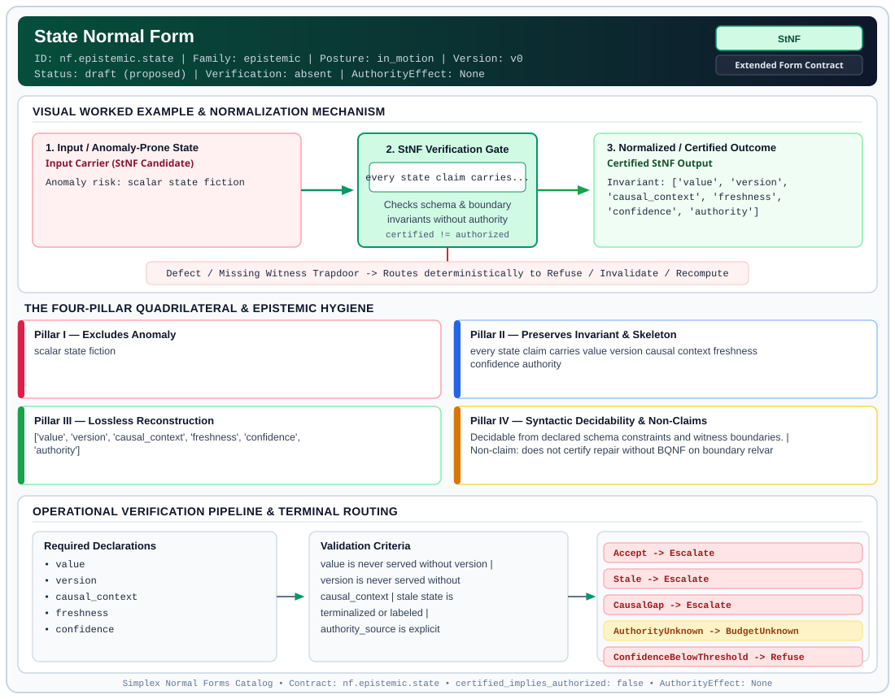

# State Normal Form (`StNF`)

> **Contract ID:** `nf.epistemic.state` | **Family:** `epistemic` | **Index Status:** `draft` | **AuthorityEffect:** `None`

**[⬅ Back to Wiki Home](Home)** | **[View SVG Diagram](images/nf.epistemic.state.svg)**

---

## 1. Executive Summary & Metadata

State Normal Form (StNF) enforces structural normalization and explicit defect routing in the epistemic regime.

| Property | Value |
| :--- | :--- |
| **Canonical ID** | `nf.epistemic.state` |
| **Short Name** | `StNF` |
| **Full Name** | State Normal Form |
| **Family** | `epistemic` (Observer-Relative Epistemic, Freshness, Context, Provenance & Distinguishability Contracts) |
| **Qualification** | Extended Form Contract (Normal Form Contract) |
| **Data / Math Posture** | in_motion |
| **Index Status** | `draft` |
| **Theory Status** | `proposed` |
| **Verification Status** | `absent` |
| **Contract Version** | `v0` |
| **Governance Fence** | `AuthorityEffect: None` (`certified_implies_authorized: false`) |

---

## 2. Visual Architecture & Normalization Diagram



---

## 3. Concrete Worked Example & Mechanism

### Visual Transition Summary

| Stage | Carrier / Operator | Concrete State / Invariant |
| :--- | :--- | :--- |
| **1. Before / Candidate Input** | `Input Carrier (StNF Candidate)` | Anomaly risk: scalar state fiction |
| **2. Normalization / Gate** | `StNF Verification Gate` | `every state claim carries...` (`certified_implies_authorized: false`) |
| **3. After / Certified Output** | `Certified StNF Output` | Invariant: ['value', 'version', ; 'causal_context', 'freshness', ; 'confidence', 'authority'] |

---

## 4. The Four-Pillar Quadrilateral & Non-Claims

Every contract in `simplex-normal-forms` is evaluated against the **Four-Pillar Quadrilateral** defined in `contracts/_golden_nfs/standard.yaml`:

| Pillar | Requirement | Contract Specification for `nf.epistemic.state` |
| :--- | :--- | :--- |
| **Pillar I: Excludes Anomaly** | Name and eliminate a specific class of data or state defects. | scalar state fiction |
| **Pillar II: Preserves Invariant** | State the structural invariant and protected skeleton preserved across transitions. | **Invariant:** every state claim carries value version causal context freshness confidence authority<br>**Protected Skeleton:** ['value', 'version', 'causal_context', 'freshness', 'confidence', 'authority'] |
| **Pillar III: Lossless Reconstruction** | State the non-loss reconstruction operator (join, direct sum, pullback, or replay). | Lossless reconstruction under declared projection, direct sum, or pullback operators. |
| **Pillar IV: Syntactic Decidability** | State how conformance is decided from declared constraints without unbudgeted scans. | Decidable from declared schema and witness metadata within bounded evaluation budgets. |

### Explicit Non-Claims (`certified_implies_authorized: false`)

- does not certify repair without BQNF on boundary relvar
- draft until verifier implements packet checks

---

## 5. Operational Verification & Terminal Routing

### 5.1 Required Declarations

- value
- version
- causal_context
- freshness
- confidence
- authority_source
- observer

### 5.2 Required Evidence

- version_id or epoch
- read_timestamp
- authority_gate label

### 5.3 Validation Criteria

| Criterion ID | Name | Condition |
| :--- | :--- | :--- |
| `criterion` | Check | value is never served without version |
| `criterion` | Check | version is never served without causal_context |
| `criterion` | Check | stale state is terminalized or labeled |
| `criterion` | Check | authority_source is explicit |
| `criterion` | Check | pairs with BQNF repair updates packet in lockstep |

### 5.4 Terminal Route Map

Every evaluation terminates in a declared local route mapped to a canonical terminal in `standard.yaml`:

| Local Terminal Route | Canonical Terminal |
| :--- | :--- |
| `Accept` | `Escalate` |
| `Stale` | `Escalate` |
| `CausalGap` | `Escalate` |
| `AuthorityUnknown` | `BudgetUnknown` |
| `ConfidenceBelowThreshold` | `Refuse` |
| `Refuse` | `Refuse` |

### 5.5 Declared Failure Modes

- **symptom**: API returns revenue equals 42000 without epoch, **diagnosis**: state flattening, **terminal**: CausalGap

---

## 6. Epistemic Claim Hygiene Quadrant

In accordance with the repository's epistemic claim discipline:

1. **What it supports:**
   - Supports syntactic and operational checking of `nf.epistemic.state` (`StNF`) against its declared schema, boundary constraints, and witness obligations in this model.
   - Supports deterministic terminal routing (`Accept, Stale, CausalGap, AuthorityUnknown`) when required declarations or invariants fail.
2. **What it does not support:**
   - Does not confer operational authority (`AuthorityEffect: None`, `certified_implies_authorized: false`).
   - Does not claim semantic truth of undeclared external processes or unverified upstream inputs beyond the declaredprotected skeleton.
3. **The narrowest defensible claim:**
   - Within the declared substrate `in_motion`, this contract enforces that `scalar state fiction` is either excluded under `every state claim carries value version causal context freshness confidence authority` or routed to an explicit refusal/recovery terminal.
4. **The next test needed:**
   - Property-based falsification and mutation testing across boundary edge cases and composed multi-step pipelines for `nf.epistemic.state`.

---

## 7. Canonical YAML Contract (`contracts/nf.epistemic.state.yaml`)

<details>
<summary><strong>Click to expand full canonical YAML contract (contracts/nf.epistemic.state.yaml)</strong></summary>

```yaml
schema_version: smplx.nf.contract.v0
contract_kind: normal_form_contract
identity:
  id: nf.epistemic.state
  name: State Normal Form
  short_name: StNF
  version: v0
  status: draft
  family: epistemic
  theory_status: proposed
  contract_status: draft
  verification_status: absent
classification:
  hierarchy_level: normal_form
  subject_kind:
  - distributed_claim
  - observer_relvar
  data_posture: in_motion
  mathematical_posture: operational
obstruction_substrate:
  policy_ref: ../substrate/default_finite_obstruction_policy.yaml
  finite_carrier:
    description: epistemic state packet per observer; finite feature basis only
  cochain_complex:
    C0: admissible_state_rewrites
    C1: stale_or_missing_version_defects
    C2: inconsistent_freshness_closure
    d0: repair_to_defect
    d1: null
    quotient: Q1 = C1 / im(d0)
  obstruction_class:
    notation: '[omega]'
    exact: '[omega] == 0'
  carrier_realization:
    ref: matrix_or_density_operator
    catalog: ../substrate/carrier_realizations_catalog.yaml
  geometry_module:
    ref: geom.density_projection.v0
    path: ../geometry_modules/geom.density_projection.v0.yaml
    status: quarantined
purpose:
  excludes_anomaly: scalar state fiction
  preserves_invariant: every state claim carries value version causal context freshness
    confidence authority
  protected_skeleton:
  - value
  - version
  - causal_context
  - freshness
  - confidence
  - authority
  erased_structure: []
  non_claims:
  - does not certify repair without BQNF on boundary relvar
  - draft until verifier implements packet checks
declarations_required:
- value
- version
- causal_context
- freshness
- confidence
- authority_source
- observer
evidence_required:
- version_id or epoch
- read_timestamp
- authority_gate label
validation_criteria:
- value is never served without version
- version is never served without causal_context
- stale state is terminalized or labeled
- authority_source is explicit
- pairs with BQNF repair updates packet in lockstep
proof_obligations: []
terminal_routes:
- Accept
- Stale
- CausalGap
- AuthorityUnknown
- ConfidenceBelowThreshold
- Refuse
certification:
  certificate_required: false
  certificate_kind: null
  obstruction_class_required: false
  loss_ledger_required: false
  verifier_required: true
authorization:
  authorized_by: null
  certified_implies_authorized: false
failure_modes:
- symptom: API returns revenue equals 42000 without epoch
  diagnosis: state flattening
  terminal: CausalGap
references:
- ../1_normal_forms.md
- ../1a_bqnf_incremental_repair.md
terminal_route_map:
  Accept: Escalate
  Stale: Escalate
  CausalGap: Escalate
  AuthorityUnknown: BudgetUnknown
  ConfidenceBelowThreshold: Refuse
  Refuse: Refuse
definition:
  source: coda_all_universe/mssn_sn_tower/definitions.md
  formal_statement: scalar state fiction. every state claim carries value version
    causal context freshness confidence authority
  quadrilateral:
    qualifies_as_true_normal_form: false
    qualification_gap: reconstruction_is_not_a_relational_project_join
    anomaly_exclusion: scalar state fiction
    lossless_join:
      status: declared_reconstruction
      statement: every state claim carries value version causal context freshness
        confidence authority
    dependency_preservation:
      status: declared_with_the_invariant
      statement: The preserved invariant stays on the declared schema. This form does
        not state a functional-dependency projection of a flat relvar decomposition.
    syntactic_decision:
      status: declaration_decidable
      statement: The check reads the declared constraints and validation criteria.
        One unrecorded runtime image is not the decider.
schema_ref: ./normal_form_contract_schema.yaml
```

</details>
