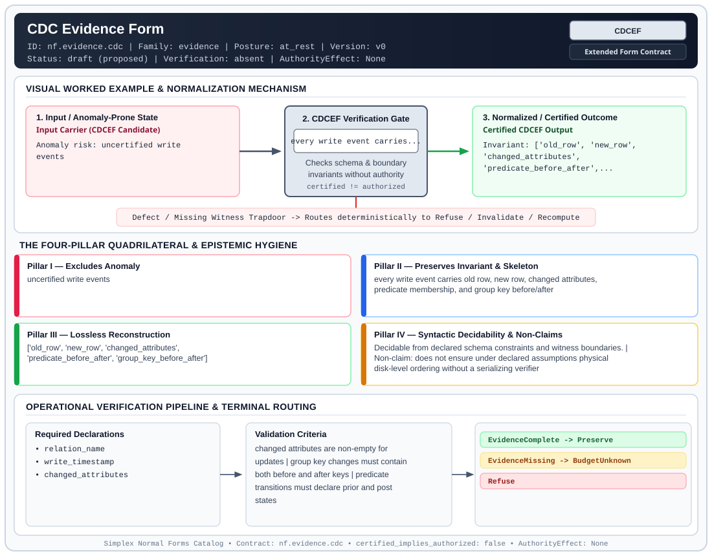

# CDC Evidence Form (`CDCEF`)

> **Contract ID:** `nf.evidence.cdc` | **Family:** `evidence` | **Index Status:** `draft` | **AuthorityEffect:** `None`

**[⬅ Back to Wiki Home](Home)** | **[View SVG Diagram](images/nf.evidence.cdc.svg)**

---

## 1. Executive Summary & Metadata

CDC Evidence Form (CDCEF) enforces structural normalization and explicit defect routing in the evidence regime.

| Property | Value |
| :--- | :--- |
| **Canonical ID** | `nf.evidence.cdc` |
| **Short Name** | `CDCEF` |
| **Full Name** | CDC Evidence Form |
| **Family** | `evidence` (Cryptographic Receipts, Dual Witnesses, Loss Ledgers, CDC Logs & Schema Totality) |
| **Qualification** | Extended Form Contract (Normal Form Contract) |
| **Data / Math Posture** | at_rest |
| **Index Status** | `draft` |
| **Theory Status** | `proposed` |
| **Verification Status** | `absent` |
| **Contract Version** | `v0` |
| **Governance Fence** | `AuthorityEffect: None` (`certified_implies_authorized: false`) |

---

## 2. Visual Architecture & Normalization Diagram



---

## 3. Concrete Worked Example & Mechanism

### Visual Transition Summary

| Stage | Carrier / Operator | Concrete State / Invariant |
| :--- | :--- | :--- |
| **1. Before / Candidate Input** | `Input Carrier (CDCEF Candidate)` | Anomaly risk: uncertified write ; events |
| **2. Normalization / Gate** | `CDCEF Verification Gate` | `every write event carries...` (`certified_implies_authorized: false`) |
| **3. After / Certified Output** | `Certified CDCEF Output` | Invariant: ['old_row', 'new_row', ; 'changed_attributes', ; 'predicate_before_after',... |

---

## 4. The Four-Pillar Quadrilateral & Non-Claims

Every contract in `simplex-normal-forms` is evaluated against the **Four-Pillar Quadrilateral** defined in `contracts/_golden_nfs/standard.yaml`:

| Pillar | Requirement | Contract Specification for `nf.evidence.cdc` |
| :--- | :--- | :--- |
| **Pillar I: Excludes Anomaly** | Name and eliminate a specific class of data or state defects. | uncertified write events |
| **Pillar II: Preserves Invariant** | State the structural invariant and protected skeleton preserved across transitions. | **Invariant:** every write event carries old row, new row, changed attributes, predicate membership, and group key before/after<br>**Protected Skeleton:** ['old_row', 'new_row', 'changed_attributes', 'predicate_before_after', 'group_key_before_after'] |
| **Pillar III: Lossless Reconstruction** | State the non-loss reconstruction operator (join, direct sum, pullback, or replay). | Lossless reconstruction under declared projection, direct sum, or pullback operators. |
| **Pillar IV: Syntactic Decidability** | State how conformance is decided from declared constraints without unbudgeted scans. | Decidable from declared schema and witness metadata within bounded evaluation budgets. |

### Explicit Non-Claims (`certified_implies_authorized: false`)

- does not ensure under declared assumptions physical disk-level ordering without a serializing verifier

---

## 5. Operational Verification & Terminal Routing

### 5.1 Required Declarations

- relation_name
- write_timestamp
- changed_attributes

### 5.2 Required Evidence

- old_row_values
- new_row_values

### 5.3 Validation Criteria

| Criterion ID | Name | Condition |
| :--- | :--- | :--- |
| `criterion` | Check | changed attributes are non-empty for updates |
| `criterion` | Check | group key changes must contain both before and after keys |
| `criterion` | Check | predicate transitions must declare prior and post states |

### 5.4 Terminal Route Map

Every evaluation terminates in a declared local route mapped to a canonical terminal in `standard.yaml`:

| Local Terminal Route | Canonical Terminal |
| :--- | :--- |
| `EvidenceComplete` | `Preserve` |
| `EvidenceMissing` | `BudgetUnknown` |
| `Refuse` | `Refuse` |

### 5.5 Declared Failure Modes

- **symptom**: cache update attempted with missing status or customer ID columns in CDC event, **diagnosis**: uncertified write events, **terminal**: EvidenceMissing

---

## Deep-Dive Level Treatise

**AuthorityEffect:** None.  
**Level:** Level 11 (Data in Motion / CDC Stream Compaction & Monotonicity)  
**Evidential Grade:** NATIVE IMPLEMENTED  
**Contract Reference:** [`nf.evidence.cdc`](../../../../omega_engine_pfp/infrastructure/yaml/normal_forms/nf.evidence.cdc.yaml)  
**Mathematical Posture:** Monotonic Stream Log Algebra & Tombstone Consistency  
**Data Posture:** In Motion  

---

## 1. Schematic & Conceptual Architecture

Change Data Capture Normal Form (CDC-NF) disciplines event streams emitted by transaction logs:
- ensures under declared assumptions **monotonic sequencing** of log records via strict LSN / sequence numbers.
- Defines exact semantics for **tombstone records** during deletion.
- Formalizes **log compaction**: folding multiple updates to the same key into a single canonical delta without altering downstream observer convergence.

```text
       Raw CDC Event Stream
  ┌──────┬────────┬────────┬─────────────────────────┐
  │ LSN  │ Key    │ Op     │ Payload                 │
  ├──────┼────────┼────────┼─────────────────────────┤
  │ 1001 │ Cust:5 │ INSERT │ {name: "Bob", bal: 100} │
  │ 1002 │ Cust:5 │ UPDATE │ {bal: 150}              │
  │ 1003 │ Cust:5 │ DELETE │ null (Tombstone)        │
  └──────┴────────┴────────┴─────────────────────────┘
                       │
             CDC-NF Stream Compaction
                       ▼
  Tombstone at LSN 1003 supersedes LSN 1001-1002.
  Compacted stream retains tombstone until epoch frontier clears!
```

---

## 2. Mathematical Invariants & Quadrilateral Properties

1. **Monotonicity & Total Ordering:**
   Every event $e \in \mathcal{E}$ carries a sequence identifier $\operatorname{seq}(e)$ such that for any two events $e_1, e_2$ on key $K$:
   $$e_1 <_{\text{log}} e_2 \iff \operatorname{seq}(e_1) < \operatorname{seq}(e_2)$$

2. **Compaction Operator $\odot$:**
   For a stream segment $S_K = [e_1, \dots, e_m]$ on key $K$:
   $$\operatorname{compact}(S_K) = e_m \quad \text{if } e_m.\text{op} \in \{\text{UPDATE}, \text{DELETE}\}$$
   with intermediate delta accumulation for commutative balance counters.

3. **The Quadrilateral Invariants:**
   - **Anomaly Excluded:** Out-of-order event replay, resurrecting deleted tuples via stale updates, unbounded log bloat.
   - **Protected Skeleton:** Entity keys, final state payloads, and tombstone sequence commitments.
   - **Erased Structure:** Overridden intermediate state transitions prior to the compaction frontier.
   - **Reconstruction:** Monotonic log replay matching point-in-time database snapshots.

---

## 3. Terminal Routes & Verification Logic

```text
CDC Event Stream & Invalidation Frontier
      │
      ├── Sequence strictly monotonic & tombstones valid ──► Preserve (StreamValid)
      │
      ├── Out-of-order sequence detected ──────────────────► Reject (MonotonicityViolation)
      │
      ├── Stale update arriving after tombstone ───────────► Refuse (ZombieUpdateRejected)
      │
      └── Uncompacted log exceeds retention ceiling ───────► Repair (CompactStream)
```

- `Preserve`: Stream adheres to monotonic sequence ensures under declared assumptions.
- `Reject`: Out-of-order delivery indicates broker or pipeline failure.
- `Refuse`: Event attempts to resurrect an explicitly deleted record.
- `Repair`: Safely compacts stream up to the active replication water mark.

---

## 4. Test Evidence & Local Execution

Verified in [`test_bqnf_cdc_property.py`](../../../tests/normal_forms/test_bqnf_cdc_property.py):
- `test_cdc_stream_monotonicity`: Asserts that any decrement in LSN triggers immediate pipeline refusal.
- `test_cdc_tombstone_compaction`: Verifies that tombstone records correctly extinguish preceding insert/update deltas.

---

## 5. Epistemic Claim Quadrant

1. **What it supports:**
   - Deterministic event sourcing and reproducible streaming database replication.
   - Formal ensures under declared assumptions against zombie row resurrection.
2. **What it does not support:**
   - Multi-writer conflict-free replication across partitioned networks (requires CRDT / distributed consensus).
3. **The narrowest defensible claim:**
   - CDC-NF ensures under declared assumptions that replay of the compacted stream yields the identical final state as the uncompacted stream.
4. **The next test needed:**
   - Property tests under randomized concurrent partition delays asserting that the tombstone water mark is monotonic.

---

## 6. Epistemic Claim Hygiene Quadrant

In accordance with the repository's epistemic claim discipline:

1. **What it supports:**
   - Supports syntactic and operational checking of `nf.evidence.cdc` (`CDCEF`) against its declared schema, boundary constraints, and witness obligations in this model.
   - Supports deterministic terminal routing (`EvidenceComplete, EvidenceMissing, Refuse`) when required declarations or invariants fail.
2. **What it does not support:**
   - Does not confer operational authority (`AuthorityEffect: None`, `certified_implies_authorized: false`).
   - Does not claim semantic truth of undeclared external processes or unverified upstream inputs beyond the declaredprotected skeleton.
3. **The narrowest defensible claim:**
   - Within the declared substrate `at_rest`, this contract enforces that `uncertified write events` is either excluded under `every write event carries old row, new row, changed attributes, predicate membership, and group key before/after` or routed to an explicit refusal/recovery terminal.
4. **The next test needed:**
   - Property-based falsification and mutation testing across boundary edge cases and composed multi-step pipelines for `nf.evidence.cdc`.

---

## 7. Canonical YAML Contract (`contracts/nf.evidence.cdc.yaml`)

<details>
<summary><strong>Click to expand full canonical YAML contract (contracts/nf.evidence.cdc.yaml)</strong></summary>

```yaml
schema_version: smplx.nf.contract.v0
contract_kind: normal_form_contract
identity:
  id: nf.evidence.cdc
  name: CDC Evidence Form
  short_name: CDCEF
  version: v0
  status: draft
  family: evidence
  theory_status: proposed
  contract_status: draft
  verification_status: absent
classification:
  hierarchy_level: form
  subject_kind:
  - certificate_packet
  data_posture: at_rest
  mathematical_posture: operational
purpose:
  excludes_anomaly: uncertified write events
  preserves_invariant: every write event carries old row, new row, changed attributes,
    predicate membership, and group key before/after
  protected_skeleton:
  - old_row
  - new_row
  - changed_attributes
  - predicate_before_after
  - group_key_before_after
  erased_structure: []
  non_claims:
  - does not ensure under declared assumptions physical disk-level ordering without a serializing verifier
declarations_required:
- relation_name
- write_timestamp
- changed_attributes
evidence_required:
- old_row_values
- new_row_values
validation_criteria:
- changed attributes are non-empty for updates
- group key changes must contain both before and after keys
- predicate transitions must declare prior and post states
proof_obligations: []
terminal_routes:
- EvidenceComplete
- EvidenceMissing
- Refuse
certification:
  certificate_required: false
  certificate_kind: null
  obstruction_class_required: false
  loss_ledger_required: false
  verifier_required: true
authorization:
  authorized_by: null
  certified_implies_authorized: false
failure_modes:
- symptom: cache update attempted with missing status or customer ID columns in CDC
    event
  diagnosis: uncertified write events
  terminal: EvidenceMissing
references:
- ../1_normal_forms.md
- ../1a_bqnf_incremental_repair.md
terminal_route_map:
  EvidenceComplete: Preserve
  EvidenceMissing: BudgetUnknown
  Refuse: Refuse
definition:
  source: coda_all_universe/mssn_sn_tower/definitions.md
  formal_statement: uncertified write events. every write event carries old row, new
    row, changed attributes, predicate membership, and group key before/after
  quadrilateral:
    qualifies_as_true_normal_form: false
    qualification_gap: reconstruction_is_not_a_relational_project_join
    anomaly_exclusion: uncertified write events
    lossless_join:
      status: declared_reconstruction
      statement: every write event carries old row, new row, changed attributes, predicate
        membership, and group key before/after
    dependency_preservation:
      status: declared_with_the_invariant
      statement: The preserved invariant stays on the declared schema. This form does
        not state a functional-dependency projection of a flat relvar decomposition.
    syntactic_decision:
      status: declaration_decidable
      statement: The check reads the declared constraints and validation criteria.
        One unrecorded runtime image is not the decider.
schema_ref: ./normal_form_contract_schema.yaml
```

</details>
