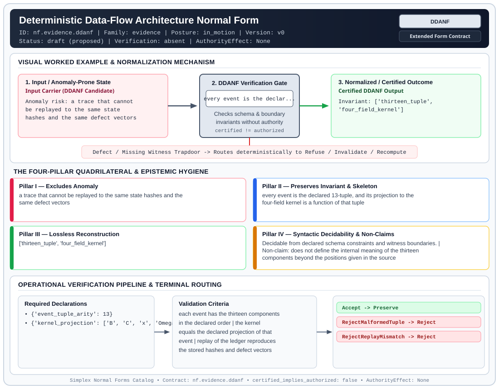

# Deterministic Data-Flow Architecture Normal Form (`DDANF`)

> **Contract ID:** `nf.evidence.ddanf` | **Family:** `evidence` | **Index Status:** `draft` | **AuthorityEffect:** `None`

**[⬅ Back to Wiki Home](Home)** | **[View SVG Diagram](images/nf.evidence.ddanf.svg)**

---

## 1. Executive Summary & Metadata

Deterministic Data-Flow Architecture Normal Form (DDANF) enforces structural normalization and explicit defect routing in the evidence regime.

| Property | Value |
| :--- | :--- |
| **Canonical ID** | `nf.evidence.ddanf` |
| **Short Name** | `DDANF` |
| **Full Name** | Deterministic Data-Flow Architecture Normal Form |
| **Family** | `evidence` (Cryptographic Receipts, Dual Witnesses, Loss Ledgers, CDC Logs & Schema Totality) |
| **Qualification** | Extended Form Contract (Normal Form Contract) |
| **Data / Math Posture** | in_motion |
| **Index Status** | `draft` |
| **Theory Status** | `proposed` |
| **Verification Status** | `absent` |
| **Contract Version** | `v0` |
| **Governance Fence** | `AuthorityEffect: None` (`certified_implies_authorized: false`) |

### Foundational Treatise Specification

- **Levels**: Level 12
- **Spec Files**: ['12_grammar.md', '12_math.md']
- **Anomaly Excluded**: State desynchronization, unverified side effects, and non-reproducible trace execution.
- **Preserved Invariant**: Every event record structured as immutable 13-tuple projecting to 4-field irredundant kernel.
- **Lossless Reconstruction**: Deterministic step-by-step replay reconstructs identical state hashes and defect vectors.

---

## 2. Visual Architecture & Normalization Diagram



---

## 3. Concrete Worked Example & Mechanism

### Visual Transition Summary

| Stage | Carrier / Operator | Concrete State / Invariant |
| :--- | :--- | :--- |
| **1. Before / Candidate Input** | `Input Carrier (DDANF Candidate)` | Anomaly risk: a trace that cannot ; be replayed to the same state ; hashes and the same defect vectors |
| **2. Normalization / Gate** | `DDANF Verification Gate` | `every event is the declar...` (`certified_implies_authorized: false`) |
| **3. After / Certified Output** | `Certified DDANF Output` | Invariant: ['thirteen_tuple', ; 'four_field_kernel'] |

### Contract-Declared Worked Cases

```yaml
- ref: coda_all_universe/mssn_sn_tower/definitions.md
  section: '3.3'
```

---

## 4. The Four-Pillar Quadrilateral & Non-Claims

Every contract in `simplex-normal-forms` is evaluated against the **Four-Pillar Quadrilateral** defined in `contracts/_golden_nfs/standard.yaml`:

| Pillar | Requirement | Contract Specification for `nf.evidence.ddanf` |
| :--- | :--- | :--- |
| **Pillar I: Excludes Anomaly** | Name and eliminate a specific class of data or state defects. | a trace that cannot be replayed to the same state hashes and the same defect vectors |
| **Pillar II: Preserves Invariant** | State the structural invariant and protected skeleton preserved across transitions. | **Invariant:** every event is the declared 13-tuple, and its projection to the four-field kernel is a function of that tuple<br>**Protected Skeleton:** ['thirteen_tuple', 'four_field_kernel'] |
| **Pillar III: Lossless Reconstruction** | State the non-loss reconstruction operator (join, direct sum, pullback, or replay). | Lossless reconstruction under declared projection, direct sum, or pullback operators. |
| **Pillar IV: Syntactic Decidability** | State how conformance is decided from declared constraints without unbudgeted scans. | Decidable from declared schema and witness metadata within bounded evaluation budgets. |

### Explicit Non-Claims (`certified_implies_authorized: false`)

- does not define the internal meaning of the thirteen components beyond the positions given in the source
- does not treat a matching final hash as a substitute for step-by-step replay
- does not imply authorization

---

## 5. Operational Verification & Terminal Routing

### 5.1 Required Declarations

- **event_tuple_arity**: 13
- **kernel_projection**: ['B', 'C', 'x', 'Omega']

### 5.2 Required Evidence

_None declared._

### 5.3 Validation Criteria

| Criterion ID | Name | Condition |
| :--- | :--- | :--- |
| `criterion` | Check | each event has the thirteen components in the declared order |
| `criterion` | Check | the kernel equals the declared projection of that event |
| `criterion` | Check | replay of the ledger reproduces the stored hashes and defect vectors |

### 5.4 Terminal Route Map

Every evaluation terminates in a declared local route mapped to a canonical terminal in `standard.yaml`:

| Local Terminal Route | Canonical Terminal |
| :--- | :--- |
| `Accept` | `Preserve` |
| `RejectMalformedTuple` | `Reject` |
| `RejectReplayMismatch` | `Reject` |

### 5.5 Declared Failure Modes

- **symptom**: an event arrives with a component missing or reordered, **diagnosis**: the record is not the declared 13-tuple, **terminal**: RejectMalformedTuple
- **symptom**: replay yields a different state hash, **diagnosis**: the ledger does not determine the recorded state, **terminal**: RejectReplayMismatch

---

## 6. Epistemic Claim Hygiene Quadrant

In accordance with the repository's epistemic claim discipline:

1. **What it supports:**
   - Supports syntactic and operational checking of `nf.evidence.ddanf` (`DDANF`) against its declared schema, boundary constraints, and witness obligations in this model.
   - Supports deterministic terminal routing (`Accept, RejectMalformedTuple, RejectReplayMismatch`) when required declarations or invariants fail.
2. **What it does not support:**
   - Does not confer operational authority (`AuthorityEffect: None`, `certified_implies_authorized: false`).
   - Does not claim semantic truth of undeclared external processes or unverified upstream inputs beyond the declaredprotected skeleton.
3. **The narrowest defensible claim:**
   - Within the declared substrate `in_motion`, this contract enforces that `a trace that cannot be replayed to the same state hashes and the same defect vectors` is either excluded under `every event is the declared 13-tuple, and its projection to the four-field kernel is a function of that tuple` or routed to an explicit refusal/recovery terminal.
4. **The next test needed:**
   - Property-based falsification and mutation testing across boundary edge cases and composed multi-step pipelines for `nf.evidence.ddanf`.

---

## 7. Canonical YAML Contract (`contracts/nf.evidence.ddanf.yaml`)

<details>
<summary><strong>Click to expand full canonical YAML contract (contracts/nf.evidence.ddanf.yaml)</strong></summary>

```yaml
schema_version: smplx.nf.contract.v0
schema_ref: ./normal_form_contract_schema.yaml
contract_kind: normal_form_contract
identity:
  id: nf.evidence.ddanf
  name: Deterministic Data-Flow Architecture Normal Form
  short_name: DDANF
  version: v0
  theory_status: proposed
  contract_status: draft
  verification_status: absent
  family: evidence
  status: draft
classification:
  hierarchy_level: normal_form
  subject_kind:
  - trace_record
  - replay_ledger
  data_posture: in_motion
  mathematical_posture: operational
purpose:
  excludes_anomaly: a trace that cannot be replayed to the same state hashes and the
    same defect vectors
  preserves_invariant: every event is the declared 13-tuple, and its projection to
    the four-field kernel is a function of that tuple
  protected_skeleton:
  - thirteen_tuple
  - four_field_kernel
  erased_structure: []
  non_claims:
  - does not define the internal meaning of the thirteen components beyond the positions
    given in the source
  - does not treat a matching final hash as a substitute for step-by-step replay
  - does not imply authorization
definition:
  source: coda_all_universe/mssn_sn_tower/definitions.md
  section: '3.3'
  formal_statement: 'An event record is the 13-tuple (B, C-, x-, o, D, C+, x+, H(x-),
    Omega-, Omega+, Delta C, I, p). The kernel projection is K = (B, C, x, Omega).
    Replay of the tuple sequence reproduces the recorded state hashes and the recorded
    defect vectors.

    '
  quadrilateral:
    qualifies_as_true_normal_form: false
    qualification_gap: reconstruction_is_replay_not_a_relational_join
    qualifies_as_extended_form: true
    anomaly_exclusion: unreproducible traces, unverified side effects, and state labels
      that drift from the ledger
    lossless_join:
      status: replay
      statement: stepping the 13-tuple ledger reconstructs the recorded hashes and
        defect vectors
    dependency_preservation:
      status: kernel_is_a_projection
      statement: the four-field kernel is computed from the tuple and does not add
        a component
    syntactic_decision:
      status: schema_decidable
      statement: a record is checked by arity, component position, and replay against
        the stored hashes
declarations_required:
- event_tuple_arity: 13
- kernel_projection:
  - B
  - C
  - x
  - Omega
evidence_required: []
validation_criteria:
- each event has the thirteen components in the declared order
- the kernel equals the declared projection of that event
- replay of the ledger reproduces the stored hashes and defect vectors
terminal_routes:
- Accept
- RejectMalformedTuple
- RejectReplayMismatch
terminal_route_map:
  Accept: Preserve
  RejectMalformedTuple: Reject
  RejectReplayMismatch: Reject
certification:
  certificate_required: false
  certificate_kind: null
  obstruction_class_required: false
  loss_ledger_required: false
  verifier_required: false
  loss_ledger_trigger_id: null
authorization:
  authorized_by: null
  certified_implies_authorized: false
failure_modes:
- symptom: an event arrives with a component missing or reordered
  diagnosis: the record is not the declared 13-tuple
  terminal: RejectMalformedTuple
- symptom: replay yields a different state hash
  diagnosis: the ledger does not determine the recorded state
  terminal: RejectReplayMismatch
examples:
- ref: coda_all_universe/mssn_sn_tower/definitions.md
  section: '3.3'
references:
- coda_all_universe/mssn_sn_tower/definitions.md
```

</details>
