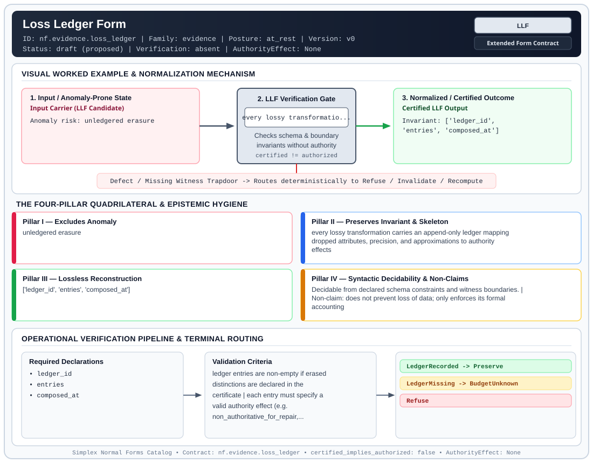

# Loss Ledger Form (`LLF`)

> **Contract ID:** `nf.evidence.loss_ledger` | **Family:** `evidence` | **Index Status:** `draft` | **AuthorityEffect:** `None`

**[⬅ Back to Wiki Home](Home)** | **[View SVG Diagram](images/nf.evidence.loss_ledger.svg)**

---

## 1. Executive Summary & Metadata

Loss Ledger Form (LLF) enforces structural normalization and explicit defect routing in the evidence regime.

| Property | Value |
| :--- | :--- |
| **Canonical ID** | `nf.evidence.loss_ledger` |
| **Short Name** | `LLF` |
| **Full Name** | Loss Ledger Form |
| **Family** | `evidence` (Cryptographic Receipts, Dual Witnesses, Loss Ledgers, CDC Logs & Schema Totality) |
| **Qualification** | Extended Form Contract (Normal Form Contract) |
| **Data / Math Posture** | at_rest |
| **Index Status** | `draft` |
| **Theory Status** | `proposed` |
| **Verification Status** | `absent` |
| **Contract Version** | `v0` |
| **Governance Fence** | `AuthorityEffect: None` (`certified_implies_authorized: false`) |

---

## 2. Visual Architecture & Normalization Diagram



---

## 3. Concrete Worked Example & Mechanism

### Visual Transition Summary

| Stage | Carrier / Operator | Concrete State / Invariant |
| :--- | :--- | :--- |
| **1. Before / Candidate Input** | `Input Carrier (LLF Candidate)` | Anomaly risk: unledgered erasure |
| **2. Normalization / Gate** | `LLF Verification Gate` | `every lossy transformatio...` (`certified_implies_authorized: false`) |
| **3. After / Certified Output** | `Certified LLF Output` | Invariant: ['ledger_id', ; 'entries', 'composed_at'] |

---

## 4. The Four-Pillar Quadrilateral & Non-Claims

Every contract in `simplex-normal-forms` is evaluated against the **Four-Pillar Quadrilateral** defined in `contracts/_golden_nfs/standard.yaml`:

| Pillar | Requirement | Contract Specification for `nf.evidence.loss_ledger` |
| :--- | :--- | :--- |
| **Pillar I: Excludes Anomaly** | Name and eliminate a specific class of data or state defects. | unledgered erasure |
| **Pillar II: Preserves Invariant** | State the structural invariant and protected skeleton preserved across transitions. | **Invariant:** every lossy transformation carries an append-only ledger mapping dropped attributes, precision, and approximations to authority effects<br>**Protected Skeleton:** ['ledger_id', 'entries', 'composed_at'] |
| **Pillar III: Lossless Reconstruction** | State the non-loss reconstruction operator (join, direct sum, pullback, or replay). | Lossless reconstruction under declared projection, direct sum, or pullback operators. |
| **Pillar IV: Syntactic Decidability** | State how conformance is decided from declared constraints without unbudgeted scans. | Decidable from declared schema and witness metadata within bounded evaluation budgets. |

### Explicit Non-Claims (`certified_implies_authorized: false`)

- does not prevent loss of data; only enforces its formal accounting

---

## 5. Operational Verification & Terminal Routing

### 5.1 Required Declarations

- ledger_id
- entries
- composed_at

### 5.2 Required Evidence

- entry_kind (attribute_drop | precision_loss | approximation)
- entry_source
- entry_reason
- authority_effect

### 5.3 Validation Criteria

| Criterion ID | Name | Condition |
| :--- | :--- | :--- |
| `criterion` | Check | ledger entries are non-empty if erased distinctions are declared in the certificate |
| `criterion` | Check | each entry must specify a valid authority effect (e.g. non_authoritative_for_repair, rounded_display_only) |

### 5.4 Terminal Route Map

Every evaluation terminates in a declared local route mapped to a canonical terminal in `standard.yaml`:

| Local Terminal Route | Canonical Terminal |
| :--- | :--- |
| `LedgerRecorded` | `Preserve` |
| `LedgerMissing` | `BudgetUnknown` |
| `Refuse` | `Refuse` |

### 5.5 Declared Failure Modes

- **symptom**: database columns are dropped during migration without an accounting ledger, **diagnosis**: unledgered erasure, **terminal**: LedgerMissing

---

## 6. Epistemic Claim Hygiene Quadrant

In accordance with the repository's epistemic claim discipline:

1. **What it supports:**
   - Supports syntactic and operational checking of `nf.evidence.loss_ledger` (`LLF`) against its declared schema, boundary constraints, and witness obligations in this model.
   - Supports deterministic terminal routing (`LedgerRecorded, LedgerMissing, Refuse`) when required declarations or invariants fail.
2. **What it does not support:**
   - Does not confer operational authority (`AuthorityEffect: None`, `certified_implies_authorized: false`).
   - Does not claim semantic truth of undeclared external processes or unverified upstream inputs beyond the declaredprotected skeleton.
3. **The narrowest defensible claim:**
   - Within the declared substrate `at_rest`, this contract enforces that `unledgered erasure` is either excluded under `every lossy transformation carries an append-only ledger mapping dropped attributes, precision, and approximations to authority effects` or routed to an explicit refusal/recovery terminal.
4. **The next test needed:**
   - Property-based falsification and mutation testing across boundary edge cases and composed multi-step pipelines for `nf.evidence.loss_ledger`.

---

## 7. Canonical YAML Contract (`contracts/nf.evidence.loss_ledger.yaml`)

<details>
<summary><strong>Click to expand full canonical YAML contract (contracts/nf.evidence.loss_ledger.yaml)</strong></summary>

```yaml
schema_version: smplx.nf.contract.v0
contract_kind: normal_form_contract
identity:
  id: nf.evidence.loss_ledger
  name: Loss Ledger Form
  short_name: LLF
  version: v0
  status: draft
  family: evidence
  theory_status: proposed
  contract_status: draft
  verification_status: absent
classification:
  hierarchy_level: form
  subject_kind:
  - certificate_packet
  data_posture: at_rest
  mathematical_posture: operational
purpose:
  excludes_anomaly: unledgered erasure
  preserves_invariant: every lossy transformation carries an append-only ledger mapping
    dropped attributes, precision, and approximations to authority effects
  protected_skeleton:
  - ledger_id
  - entries
  - composed_at
  erased_structure: []
  non_claims:
  - does not prevent loss of data; only enforces its formal accounting
declarations_required:
- ledger_id
- entries
- composed_at
evidence_required:
- entry_kind (attribute_drop | precision_loss | approximation)
- entry_source
- entry_reason
- authority_effect
validation_criteria:
- ledger entries are non-empty if erased distinctions are declared in the certificate
- each entry must specify a valid authority effect (e.g. non_authoritative_for_repair,
  rounded_display_only)
proof_obligations: []
terminal_routes:
- LedgerRecorded
- LedgerMissing
- Refuse
certification:
  certificate_required: false
  certificate_kind: null
  obstruction_class_required: false
  loss_ledger_required: false
  verifier_required: true
authorization:
  authorized_by: null
  certified_implies_authorized: false
failure_modes:
- symptom: database columns are dropped during migration without an accounting ledger
  diagnosis: unledgered erasure
  terminal: LedgerMissing
references:
- ../1_normal_forms.md
- ../nf.coda.mur.transport.yaml
terminal_route_map:
  LedgerRecorded: Preserve
  LedgerMissing: BudgetUnknown
  Refuse: Refuse
definition:
  source: coda_all_universe/mssn_sn_tower/definitions.md
  formal_statement: unledgered erasure. every lossy transformation carries an append-only
    ledger mapping dropped attributes, precision, and approximations to authority
    effects
  quadrilateral:
    qualifies_as_true_normal_form: false
    qualification_gap: reconstruction_is_not_a_relational_project_join
    anomaly_exclusion: unledgered erasure
    lossless_join:
      status: declared_reconstruction
      statement: every lossy transformation carries an append-only ledger mapping
        dropped attributes, precision, and approximations to authority effects
    dependency_preservation:
      status: declared_with_the_invariant
      statement: The preserved invariant stays on the declared schema. This form does
        not state a functional-dependency projection of a flat relvar decomposition.
    syntactic_decision:
      status: declaration_decidable
      statement: The check reads the declared constraints and validation criteria.
        One unrecorded runtime image is not the decider.
schema_ref: ./normal_form_contract_schema.yaml
```

</details>
