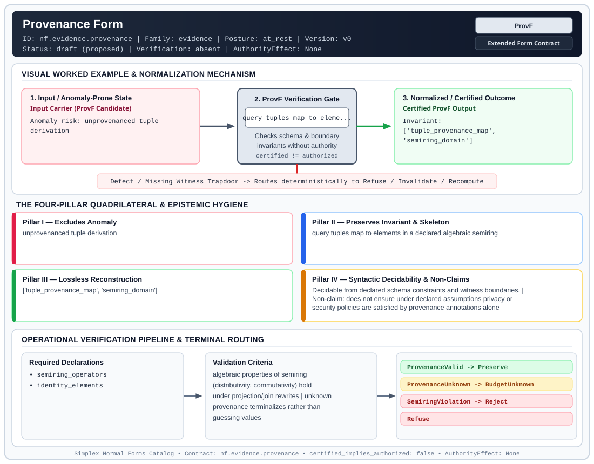

# Provenance Form (`ProvF`)

> **Contract ID:** `nf.evidence.provenance` | **Family:** `evidence` | **Index Status:** `draft` | **AuthorityEffect:** `None`

**[⬅ Back to Wiki Home](Home)** | **[View SVG Diagram](images/nf.evidence.provenance.svg)**

---

## 1. Executive Summary & Metadata

Provenance Form (ProvF) enforces structural normalization and explicit defect routing in the evidence regime.

| Property | Value |
| :--- | :--- |
| **Canonical ID** | `nf.evidence.provenance` |
| **Short Name** | `ProvF` |
| **Full Name** | Provenance Form |
| **Family** | `evidence` (Cryptographic Receipts, Dual Witnesses, Loss Ledgers, CDC Logs & Schema Totality) |
| **Qualification** | Extended Form Contract (Normal Form Contract) |
| **Data / Math Posture** | at_rest |
| **Index Status** | `draft` |
| **Theory Status** | `proposed` |
| **Verification Status** | `absent` |
| **Contract Version** | `v0` |
| **Governance Fence** | `AuthorityEffect: None` (`certified_implies_authorized: false`) |

---

## 2. Visual Architecture & Normalization Diagram



---

## 3. Concrete Worked Example & Mechanism

### Visual Transition Summary

| Stage | Carrier / Operator | Concrete State / Invariant |
| :--- | :--- | :--- |
| **1. Before / Candidate Input** | `Input Carrier (ProvF Candidate)` | Anomaly risk: unprovenanced tuple ; derivation |
| **2. Normalization / Gate** | `ProvF Verification Gate` | `query tuples map to eleme...` (`certified_implies_authorized: false`) |
| **3. After / Certified Output** | `Certified ProvF Output` | Invariant: ; ['tuple_provenance_map', ; 'semiring_domain'] |

---

## 4. The Four-Pillar Quadrilateral & Non-Claims

Every contract in `simplex-normal-forms` is evaluated against the **Four-Pillar Quadrilateral** defined in `contracts/_golden_nfs/standard.yaml`:

| Pillar | Requirement | Contract Specification for `nf.evidence.provenance` |
| :--- | :--- | :--- |
| **Pillar I: Excludes Anomaly** | Name and eliminate a specific class of data or state defects. | unprovenanced tuple derivation |
| **Pillar II: Preserves Invariant** | State the structural invariant and protected skeleton preserved across transitions. | **Invariant:** query tuples map to elements in a declared algebraic semiring<br>**Protected Skeleton:** ['tuple_provenance_map', 'semiring_domain'] |
| **Pillar III: Lossless Reconstruction** | State the non-loss reconstruction operator (join, direct sum, pullback, or replay). | Lossless reconstruction under declared projection, direct sum, or pullback operators. |
| **Pillar IV: Syntactic Decidability** | State how conformance is decided from declared constraints without unbudgeted scans. | Decidable from declared schema and witness metadata within bounded evaluation budgets. |

### Explicit Non-Claims (`certified_implies_authorized: false`)

- does not ensure under declared assumptions privacy or security policies are satisfied by provenance annotations alone

---

## 5. Operational Verification & Terminal Routing

### 5.1 Required Declarations

- semiring_operators
- identity_elements

### 5.2 Required Evidence

- tuple_derivations
- semiring_annotations

### 5.3 Validation Criteria

| Criterion ID | Name | Condition |
| :--- | :--- | :--- |
| `criterion` | Check | algebraic properties of semiring (distributivity, commutativity) hold under projection/join rewrites |
| `criterion` | Check | unknown provenance terminalizes rather than guessing values |

### 5.4 Terminal Route Map

Every evaluation terminates in a declared local route mapped to a canonical terminal in `standard.yaml`:

| Local Terminal Route | Canonical Terminal |
| :--- | :--- |
| `ProvenanceValid` | `Preserve` |
| `ProvenanceUnknown` | `BudgetUnknown` |
| `SemiringViolation` | `Reject` |
| `Refuse` | `Refuse` |

### 5.5 Declared Failure Modes

- **symptom**: query result contains tuples whose provenance annotations violate semiring distributivity, **diagnosis**: unprovenanced tuple derivation, **terminal**: SemiringViolation

---

## 6. Epistemic Claim Hygiene Quadrant

In accordance with the repository's epistemic claim discipline:

1. **What it supports:**
   - Supports syntactic and operational checking of `nf.evidence.provenance` (`ProvF`) against its declared schema, boundary constraints, and witness obligations in this model.
   - Supports deterministic terminal routing (`ProvenanceValid, ProvenanceUnknown, SemiringViolation, Refuse`) when required declarations or invariants fail.
2. **What it does not support:**
   - Does not confer operational authority (`AuthorityEffect: None`, `certified_implies_authorized: false`).
   - Does not claim semantic truth of undeclared external processes or unverified upstream inputs beyond the declaredprotected skeleton.
3. **The narrowest defensible claim:**
   - Within the declared substrate `at_rest`, this contract enforces that `unprovenanced tuple derivation` is either excluded under `query tuples map to elements in a declared algebraic semiring` or routed to an explicit refusal/recovery terminal.
4. **The next test needed:**
   - Property-based falsification and mutation testing across boundary edge cases and composed multi-step pipelines for `nf.evidence.provenance`.

---

## 7. Canonical YAML Contract (`contracts/nf.evidence.provenance.yaml`)

<details>
<summary><strong>Click to expand full canonical YAML contract (contracts/nf.evidence.provenance.yaml)</strong></summary>

```yaml
schema_version: smplx.nf.contract.v0
contract_kind: normal_form_contract
identity:
  id: nf.evidence.provenance
  name: Provenance Form
  short_name: ProvF
  version: v0
  status: draft
  family: evidence
  theory_status: proposed
  contract_status: draft
  verification_status: absent
classification:
  hierarchy_level: form
  subject_kind:
  - certificate_packet
  data_posture: at_rest
  mathematical_posture: operational
purpose:
  excludes_anomaly: unprovenanced tuple derivation
  preserves_invariant: query tuples map to elements in a declared algebraic semiring
  protected_skeleton:
  - tuple_provenance_map
  - semiring_domain
  erased_structure: []
  non_claims:
  - does not ensure under declared assumptions privacy or security policies are satisfied by provenance annotations
    alone
declarations_required:
- semiring_operators
- identity_elements
evidence_required:
- tuple_derivations
- semiring_annotations
validation_criteria:
- algebraic properties of semiring (distributivity, commutativity) hold under projection/join
  rewrites
- unknown provenance terminalizes rather than guessing values
proof_obligations: []
terminal_routes:
- ProvenanceValid
- ProvenanceUnknown
- SemiringViolation
- Refuse
certification:
  certificate_required: false
  certificate_kind: null
  obstruction_class_required: false
  loss_ledger_required: false
  verifier_required: true
authorization:
  authorized_by: null
  certified_implies_authorized: false
failure_modes:
- symptom: query result contains tuples whose provenance annotations violate semiring
    distributivity
  diagnosis: unprovenanced tuple derivation
  terminal: SemiringViolation
references:
- ../1_normal_forms.md
- ../nf.coda.mur.transport.yaml
terminal_route_map:
  ProvenanceValid: Preserve
  ProvenanceUnknown: BudgetUnknown
  SemiringViolation: Reject
  Refuse: Refuse
definition:
  source: coda_all_universe/mssn_sn_tower/definitions.md
  formal_statement: unprovenanced tuple derivation. query tuples map to elements in
    a declared algebraic semiring
  quadrilateral:
    qualifies_as_true_normal_form: false
    qualification_gap: reconstruction_is_not_a_relational_project_join
    anomaly_exclusion: unprovenanced tuple derivation
    lossless_join:
      status: declared_reconstruction
      statement: query tuples map to elements in a declared algebraic semiring
    dependency_preservation:
      status: declared_with_the_invariant
      statement: The preserved invariant stays on the declared schema. This form does
        not state a functional-dependency projection of a flat relvar decomposition.
    syntactic_decision:
      status: declaration_decidable
      statement: The check reads the declared constraints and validation criteria.
        One unrecorded runtime image is not the decider.
schema_ref: ./normal_form_contract_schema.yaml
```

</details>
