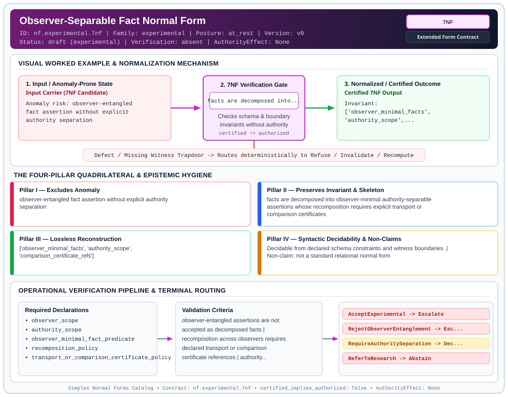

# Observer-Separable Fact Normal Form (`7NF`)

> **Contract ID:** `nf.experimental.7nf` | **Family:** `experimental` | **Index Status:** `draft` | **AuthorityEffect:** `None`

**[⬅ Back to Wiki Home](Home)** | **[View SVG Diagram](images/nf.experimental.7nf.svg)**

---

## 1. Executive Summary & Metadata

Observer-Separable Fact Normal Form (7NF) enforces structural normalization and explicit defect routing in the experimental regime.

| Property | Value |
| :--- | :--- |
| **Canonical ID** | `nf.experimental.7nf` |
| **Short Name** | `7NF` |
| **Full Name** | Observer-Separable Fact Normal Form |
| **Family** | `experimental` (Bounded Quantum-Classical, Contextuality, Quantifier Alternation & Agent-State Contracts) |
| **Qualification** | Extended Form Contract (Normal Form Contract) |
| **Data / Math Posture** | at_rest |
| **Index Status** | `draft` |
| **Theory Status** | `experimental` |
| **Verification Status** | `absent` |
| **Contract Version** | `v0` |
| **Governance Fence** | `AuthorityEffect: None` (`certified_implies_authorized: false`) |

---

## 2. Visual Architecture & Normalization Diagram



---

## 3. Concrete Worked Example & Mechanism

### Visual Transition Summary

| Stage | Carrier / Operator | Concrete State / Invariant |
| :--- | :--- | :--- |
| **1. Before / Candidate Input** | `Input Carrier (7NF Candidate)` | Anomaly risk: observer-entangled ; fact assertion without explicit ; authority separation |
| **2. Normalization / Gate** | `7NF Verification Gate` | `facts are decomposed into...` (`certified_implies_authorized: false`) |
| **3. After / Certified Output** | `Certified 7NF Output` | Invariant: ; ['observer_minimal_facts', ; 'authority_scope',... |

### Contract-Declared Worked Cases

```yaml
- ref: ../1_normal_forms.md
  section: 7. Epistemic Verification and Distributed Claims
```

---

## 4. The Four-Pillar Quadrilateral & Non-Claims

Every contract in `simplex-normal-forms` is evaluated against the **Four-Pillar Quadrilateral** defined in `contracts/_golden_nfs/standard.yaml`:

| Pillar | Requirement | Contract Specification for `nf.experimental.7nf` |
| :--- | :--- | :--- |
| **Pillar I: Excludes Anomaly** | Name and eliminate a specific class of data or state defects. | observer-entangled fact assertion without explicit authority separation |
| **Pillar II: Preserves Invariant** | State the structural invariant and protected skeleton preserved across transitions. | **Invariant:** facts are decomposed into observer-minimal authority-separable assertions whose recomposition requires explicit transport or comparison certificates<br>**Protected Skeleton:** ['observer_minimal_facts', 'authority_scope', 'comparison_certificate_refs'] |
| **Pillar III: Lossless Reconstruction** | State the non-loss reconstruction operator (join, direct sum, pullback, or replay). | Lossless reconstruction under declared projection, direct sum, or pullback operators. |
| **Pillar IV: Syntactic Decidability** | State how conformance is decided from declared constraints without unbudgeted scans. | Decidable from declared schema and witness metadata within bounded evaluation budgets. |

### Explicit Non-Claims (`certified_implies_authorized: false`)

- not a standard relational normal form
- not part of the classical normal-form baseline
- does not replace 6NF
- does not certify runtime repair
- does not imply authorization
- experimental research target only

---

## 5. Operational Verification & Terminal Routing

### 5.1 Required Declarations

- observer_scope
- authority_scope
- observer_minimal_fact_predicate
- recomposition_policy
- transport_or_comparison_certificate_policy

### 5.2 Required Evidence

_None declared._

### 5.3 Validation Criteria

| Criterion ID | Name | Condition |
| :--- | :--- | :--- |
| `criterion` | Check | observer-entangled assertions are not accepted as decomposed facts |
| `criterion` | Check | recomposition across observers requires declared transport or comparison certificate references |
| `criterion` | Check | authority separation is declared before claims are promoted |

### 5.4 Terminal Route Map

Every evaluation terminates in a declared local route mapped to a canonical terminal in `standard.yaml`:

| Local Terminal Route | Canonical Terminal |
| :--- | :--- |
| `AcceptExperimental` | `Escalate` |
| `RejectObserverEntanglement` | `Escalate` |
| `RequireAuthoritySeparation` | `Decompose` |
| `DeferToResearch` | `Abstain` |

### 5.5 Declared Failure Modes

- **symptom**: fact assertion combines value, observer, and authority context but claims to be irreducible classical data, **diagnosis**: observer-entangled fact, **terminal**: RejectObserverEntanglement

---

## 6. Epistemic Claim Hygiene Quadrant

In accordance with the repository's epistemic claim discipline:

1. **What it supports:**
   - Supports syntactic and operational checking of `nf.experimental.7nf` (`7NF`) against its declared schema, boundary constraints, and witness obligations in this model.
   - Supports deterministic terminal routing (`AcceptExperimental, RejectObserverEntanglement, RequireAuthoritySeparation, DeferToResearch`) when required declarations or invariants fail.
2. **What it does not support:**
   - Does not confer operational authority (`AuthorityEffect: None`, `certified_implies_authorized: false`).
   - Does not claim semantic truth of undeclared external processes or unverified upstream inputs beyond the declaredprotected skeleton.
3. **The narrowest defensible claim:**
   - Within the declared substrate `at_rest`, this contract enforces that `observer-entangled fact assertion without explicit authority separation` is either excluded under `facts are decomposed into observer-minimal authority-separable assertions whose recomposition requires explicit transport or comparison certificates` or routed to an explicit refusal/recovery terminal.
4. **The next test needed:**
   - Property-based falsification and mutation testing across boundary edge cases and composed multi-step pipelines for `nf.experimental.7nf`.

---

## 7. Canonical YAML Contract (`contracts/nf.experimental.7nf.yaml`)

<details>
<summary><strong>Click to expand full canonical YAML contract (contracts/nf.experimental.7nf.yaml)</strong></summary>

```yaml
schema_version: smplx.nf.contract.v0
contract_kind: normal_form_contract
identity:
  id: nf.experimental.7nf
  name: Observer-Separable Fact Normal Form
  short_name: 7NF
  version: v0
  status: draft
  family: experimental
  theory_status: experimental
  contract_status: draft
  verification_status: absent
classification:
  hierarchy_level: normal_form
  subject_kind:
  - relvar
  data_posture: at_rest
  mathematical_posture: operational
purpose:
  excludes_anomaly: observer-entangled fact assertion without explicit authority separation
  preserves_invariant: facts are decomposed into observer-minimal authority-separable
    assertions whose recomposition requires explicit transport or comparison certificates
  protected_skeleton:
  - observer_minimal_facts
  - authority_scope
  - comparison_certificate_refs
  erased_structure: []
  non_claims:
  - not a standard relational normal form
  - not part of the classical normal-form baseline
  - does not replace 6NF
  - does not certify runtime repair
  - does not imply authorization
  - experimental research target only
declarations_required:
- observer_scope
- authority_scope
- observer_minimal_fact_predicate
- recomposition_policy
- transport_or_comparison_certificate_policy
evidence_required: []
validation_criteria:
- observer-entangled assertions are not accepted as decomposed facts
- recomposition across observers requires declared transport or comparison certificate
  references
- authority separation is declared before claims are promoted
proof_obligations:
- status: Experimental conjecture
  item: define executable observer-separation checks before any promotion from research
    status
terminal_routes:
- AcceptExperimental
- RejectObserverEntanglement
- RequireAuthoritySeparation
- DeferToResearch
certification:
  certificate_required: false
  certificate_kind: null
  obstruction_class_required: false
  loss_ledger_required: false
  verifier_required: false
authorization:
  authorized_by: null
  certified_implies_authorized: false
failure_modes:
- symptom: fact assertion combines value, observer, and authority context but claims
    to be irreducible classical data
  diagnosis: observer-entangled fact
  terminal: RejectObserverEntanglement
examples:
- ref: ../1_normal_forms.md
  section: 7. Epistemic Verification and Distributed Claims
references:
- ../1_normal_forms.md
- ../0_relvar_relation_table_and_boundary_relvar.md
terminal_route_map:
  AcceptExperimental: Escalate
  RejectObserverEntanglement: Escalate
  RequireAuthoritySeparation: Decompose
  DeferToResearch: Abstain
definition:
  source: coda_all_universe/mssn_sn_tower/definitions.md
  formal_statement: observer-entangled fact assertion without explicit authority separation.
    facts are decomposed into observer-minimal authority-separable assertions whose
    recomposition requires explicit transport or comparison certificates
  quadrilateral:
    qualifies_as_true_normal_form: false
    qualification_gap: reconstruction_is_not_a_relational_project_join
    anomaly_exclusion: observer-entangled fact assertion without explicit authority
      separation
    lossless_join:
      status: declared_reconstruction
      statement: facts are decomposed into observer-minimal authority-separable assertions
        whose recomposition requires explicit transport or comparison certificates
    dependency_preservation:
      status: declared_with_the_invariant
      statement: The preserved invariant stays on the declared schema. This form does
        not state a functional-dependency projection of a flat relvar decomposition.
    syntactic_decision:
      status: declaration_decidable
      statement: The check reads the declared constraints and validation criteria.
        One unrecorded runtime image is not the decider.
schema_ref: ./normal_form_contract_schema.yaml
```

</details>
