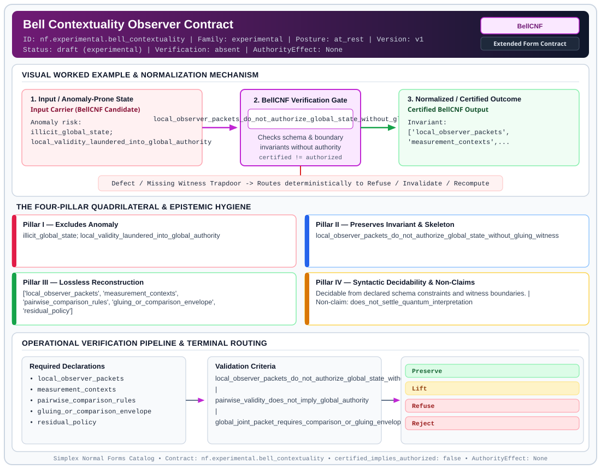

# Bell Contextuality Observer Contract (`BellCNF`)

> **Contract ID:** `nf.experimental.bell_contextuality` | **Family:** `experimental` | **Index Status:** `draft` | **AuthorityEffect:** `None`

**[⬅ Back to Wiki Home](Home)** | **[View SVG Diagram](images/nf.experimental.bell_contextuality.svg)**

---

## 1. Executive Summary & Metadata

Bell Contextuality Observer Contract (BellCNF) enforces structural normalization and explicit defect routing in the experimental regime.

| Property | Value |
| :--- | :--- |
| **Canonical ID** | `nf.experimental.bell_contextuality` |
| **Short Name** | `BellCNF` |
| **Full Name** | Bell Contextuality Observer Contract |
| **Family** | `experimental` (Bounded Quantum-Classical, Contextuality, Quantifier Alternation & Agent-State Contracts) |
| **Qualification** | Extended Form Contract (Normal Form Contract) |
| **Data / Math Posture** | at_rest |
| **Index Status** | `draft` |
| **Theory Status** | `experimental` |
| **Verification Status** | `absent` |
| **Contract Version** | `v1` |
| **Governance Fence** | `AuthorityEffect: None` (`certified_implies_authorized: false`) |

---

## 2. Visual Architecture & Normalization Diagram



---

## 3. Concrete Worked Example & Mechanism

### Visual Transition Summary

| Stage | Carrier / Operator | Concrete State / Invariant |
| :--- | :--- | :--- |
| **1. Before / Candidate Input** | `Input Carrier (BellCNF Candidate)` | Anomaly risk: ; illicit_global_state; ; local_validity_laundered_into_global_authority |
| **2. Normalization / Gate** | `BellCNF Verification Gate` | `local_observer_packets_do_not_authorize_global_state_without_gluing_witness` (`certified_implies_authorized: false`) |
| **3. After / Certified Output** | `Certified BellCNF Output` | Invariant: ; ['local_observer_packets', ; 'measurement_contexts',... |

---

## 4. The Four-Pillar Quadrilateral & Non-Claims

Every contract in `simplex-normal-forms` is evaluated against the **Four-Pillar Quadrilateral** defined in `contracts/_golden_nfs/standard.yaml`:

| Pillar | Requirement | Contract Specification for `nf.experimental.bell_contextuality` |
| :--- | :--- | :--- |
| **Pillar I: Excludes Anomaly** | Name and eliminate a specific class of data or state defects. | illicit_global_state; local_validity_laundered_into_global_authority |
| **Pillar II: Preserves Invariant** | State the structural invariant and protected skeleton preserved across transitions. | **Invariant:** local_observer_packets_do_not_authorize_global_state_without_gluing_witness<br>**Protected Skeleton:** ['local_observer_packets', 'measurement_contexts', 'pairwise_comparison_rules', 'gluing_or_comparison_envelope', 'residual_policy'] |
| **Pillar III: Lossless Reconstruction** | State the non-loss reconstruction operator (join, direct sum, pullback, or replay). | Lossless reconstruction under declared projection, direct sum, or pullback operators. |
| **Pillar IV: Syntactic Decidability** | State how conformance is decided from declared constraints without unbudgeted scans. | Decidable from declared schema and witness metadata within bounded evaluation budgets. |

### Explicit Non-Claims (`certified_implies_authorized: false`)

- does_not_settle_quantum_interpretation
- does_not_replace_physics
- does_not_conflict_with_boyce_codd_normal_form_because_it_is_quarantined_and_not_core_bcnf
- only_disciplines_local_packet_to_global_authority_promotion

---

## 5. Operational Verification & Terminal Routing

### 5.1 Required Declarations

- local_observer_packets
- measurement_contexts
- pairwise_comparison_rules
- gluing_or_comparison_envelope
- residual_policy

### 5.2 Required Evidence

- local_probability_or_claim_packets
- comparison_witnesses_when_claimed
- terminal_event_or_refusal

### 5.3 Validation Criteria

| Criterion ID | Name | Condition |
| :--- | :--- | :--- |
| `criterion` | Check | local_observer_packets_do_not_authorize_global_state_without_gluing_witness |
| `criterion` | Check | pairwise_validity_does_not_imply_global_authority |
| `criterion` | Check | global_joint_packet_requires_comparison_or_gluing_envelope |

### 5.4 Terminal Route Map

Every evaluation terminates in a declared local route mapped to a canonical terminal in `standard.yaml`:

| Local Terminal Route | Canonical Terminal |
| :--- | :--- |
| `Preserve` | `Preserve` |
| `Lift` | `Lift` |
| `Refuse` | `Refuse` |
| `Reject` | `Reject` |

### 5.5 Declared Failure Modes

_All defects route explicitly through the Terminal Route Map above._

---

## 6. Epistemic Claim Hygiene Quadrant

In accordance with the repository's epistemic claim discipline:

1. **What it supports:**
   - Supports syntactic and operational checking of `nf.experimental.bell_contextuality` (`BellCNF`) against its declared schema, boundary constraints, and witness obligations in this model.
   - Supports deterministic terminal routing (`Preserve, Lift, Refuse, Reject`) when required declarations or invariants fail.
2. **What it does not support:**
   - Does not confer operational authority (`AuthorityEffect: None`, `certified_implies_authorized: false`).
   - Does not claim semantic truth of undeclared external processes or unverified upstream inputs beyond the declaredprotected skeleton.
3. **The narrowest defensible claim:**
   - Within the declared substrate `at_rest`, this contract enforces that `illicit_global_state; local_validity_laundered_into_global_authority` is either excluded under `local_observer_packets_do_not_authorize_global_state_without_gluing_witness` or routed to an explicit refusal/recovery terminal.
4. **The next test needed:**
   - Property-based falsification and mutation testing across boundary edge cases and composed multi-step pipelines for `nf.experimental.bell_contextuality`.

---

## 7. Canonical YAML Contract (`contracts/nf.experimental.bell_contextuality.yaml`)

<details>
<summary><strong>Click to expand full canonical YAML contract (contracts/nf.experimental.bell_contextuality.yaml)</strong></summary>

```yaml
schema_version: smplx.nf.contract.v0
contract_kind: normal_form_contract
identity:
  id: nf.experimental.bell_contextuality
  name: Bell Contextuality Observer Contract
  short_name: BellCNF
  version: v1
  status: draft
  family: experimental
  theory_status: experimental
  contract_status: draft
  verification_status: absent
classification:
  hierarchy_level: normal_form
  subject_kind:
  - distributed_observer_claim
  data_posture: at_rest
  mathematical_posture: operational
purpose:
  excludes_anomaly: illicit_global_state; local_validity_laundered_into_global_authority
  preserves_invariant: local_observer_packets_do_not_authorize_global_state_without_gluing_witness
  protected_skeleton:
  - local_observer_packets
  - measurement_contexts
  - pairwise_comparison_rules
  - gluing_or_comparison_envelope
  - residual_policy
  erased_structure: []
  non_claims:
  - does_not_settle_quantum_interpretation
  - does_not_replace_physics
  - does_not_conflict_with_boyce_codd_normal_form_because_it_is_quarantined_and_not_core_bcnf
  - only_disciplines_local_packet_to_global_authority_promotion
declarations_required:
- local_observer_packets
- measurement_contexts
- pairwise_comparison_rules
- gluing_or_comparison_envelope
- residual_policy
evidence_required:
- local_probability_or_claim_packets
- comparison_witnesses_when_claimed
- terminal_event_or_refusal
validation_criteria:
- local_observer_packets_do_not_authorize_global_state_without_gluing_witness
- pairwise_validity_does_not_imply_global_authority
- global_joint_packet_requires_comparison_or_gluing_envelope
terminal_routes:
- Preserve
- Lift
- Refuse
- Reject
certification:
  certificate_required: true
  certificate_kind: bell_contextuality_observer_packet
  obstruction_class_required: false
  loss_ledger_required: false
  verifier_required: true
local_terminal_routes:
- LocalOnly
- ComparisonRequired
- NoGlobalSection
- BellResidual
- LiftRequired
- RefuseGlobalClaim
terminal_route_map:
  Preserve: Preserve
  Lift: Lift
  Refuse: Refuse
  Reject: Reject
  LocalOnly: Escalate
  ComparisonRequired: Escalate
  NoGlobalSection: Escalate
  BellResidual: Escalate
  LiftRequired: Escalate
  RefuseGlobalClaim: Refuse
authorization:
  authorized_by: null
  certified_implies_authorized: false
definition:
  source: coda_all_universe/mssn_sn_tower/definitions.md
  formal_statement: illicit_global_state; local_validity_laundered_into_global_authority.
    local_observer_packets_do_not_authorize_global_state_without_gluing_witness
  quadrilateral:
    qualifies_as_true_normal_form: false
    qualification_gap: reconstruction_is_not_a_relational_project_join
    anomaly_exclusion: illicit_global_state; local_validity_laundered_into_global_authority
    lossless_join:
      status: declared_reconstruction
      statement: local_observer_packets_do_not_authorize_global_state_without_gluing_witness
    dependency_preservation:
      status: declared_with_the_invariant
      statement: The preserved invariant stays on the declared schema. This form does
        not state a functional-dependency projection of a flat relvar decomposition.
    syntactic_decision:
      status: declaration_decidable
      statement: The check reads the declared constraints and validation criteria.
        One unrecorded runtime image is not the decider.
schema_ref: ./normal_form_contract_schema.yaml
```

</details>
