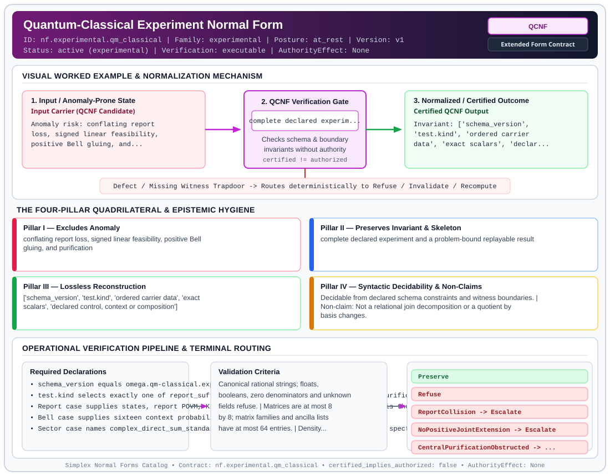

# Quantum-Classical Experiment Normal Form (`QCNF`)

> **Contract ID:** `nf.experimental.qm_classical` | **Family:** `experimental` | **Index Status:** `active` | **AuthorityEffect:** `None`

**[⬅ Back to Wiki Home](Home)** | **[View SVG Diagram](images/nf.experimental.qm_classical.svg)**

---

## 1. Executive Summary & Metadata

Quantum-Classical Experiment Normal Form (QCNF) enforces structural normalization and explicit defect routing in the experimental regime.

| Property | Value |
| :--- | :--- |
| **Canonical ID** | `nf.experimental.qm_classical` |
| **Short Name** | `QCNF` |
| **Full Name** | Quantum-Classical Experiment Normal Form |
| **Family** | `experimental` (Bounded Quantum-Classical, Contextuality, Quantifier Alternation & Agent-State Contracts) |
| **Qualification** | Extended Form Contract (Normal Form Contract) |
| **Data / Math Posture** | at_rest |
| **Index Status** | `active` |
| **Theory Status** | `experimental` |
| **Verification Status** | `executable` |
| **Contract Version** | `v1` |
| **Governance Fence** | `AuthorityEffect: None` (`certified_implies_authorized: false`) |

---

## 2. Visual Architecture & Normalization Diagram



---

## 3. Concrete Worked Example & Mechanism

### Visual Transition Summary

| Stage | Carrier / Operator | Concrete State / Invariant |
| :--- | :--- | :--- |
| **1. Before / Candidate Input** | `Input Carrier (QCNF Candidate)` | Anomaly risk: conflating report ; loss, signed linear feasibility, ; positive Bell gluing, and... |
| **2. Normalization / Gate** | `QCNF Verification Gate` | `complete declared experim...` (`certified_implies_authorized: false`) |
| **3. After / Certified Output** | `Certified QCNF Output` | Invariant: ['schema_version', ; 'test.kind', 'ordered carrier ; data', 'exact scalars', 'declar... |

---

## 4. The Four-Pillar Quadrilateral & Non-Claims

Every contract in `simplex-normal-forms` is evaluated against the **Four-Pillar Quadrilateral** defined in `contracts/_golden_nfs/standard.yaml`:

| Pillar | Requirement | Contract Specification for `nf.experimental.qm_classical` |
| :--- | :--- | :--- |
| **Pillar I: Excludes Anomaly** | Name and eliminate a specific class of data or state defects. | conflating report loss, signed linear feasibility, positive Bell gluing, and purification |
| **Pillar II: Preserves Invariant** | State the structural invariant and protected skeleton preserved across transitions. | **Invariant:** complete declared experiment and a problem-bound replayable result<br>**Protected Skeleton:** ['schema_version', 'test.kind', 'ordered carrier data', 'exact scalars', 'declared control, context or composition'] |
| **Pillar III: Lossless Reconstruction** | State the non-loss reconstruction operator (join, direct sum, pullback, or replay). | Lossless reconstruction under declared projection, direct sum, or pullback operators. |
| **Pillar IV: Syntactic Decidability** | State how conformance is decided from declared constraints without unbudgeted scans. | Decidable from declared schema and witness metadata within bounded evaluation budgets. |

### Explicit Non-Claims (`certified_implies_authorized: false`)

- Not a relational join decomposition or a quotient by basis changes.
- No derivation of quantum ontology, Born probabilities, locality or actual outcome occurrence.
- Report sufficiency concerns only the listed states and supplied future measurement.
- Bell interpretation additionally needs causal locality and setting independence.
- Central bounds assume full positive complex block states and standard tensor composition.
- Spectra are declarations; they are not bound to an independently supplied matrix.
- A zero central obstruction does not support canonical purification.

---

## 5. Operational Verification & Terminal Routing

### 5.1 Required Declarations

- schema_version equals omega.qm-classical.experiment.v1
- test.kind selects exactly one of report_sufficiency, positive_joint_extension, sector_purification
- Report case supplies states, report POVM, Kraus control, and future POVM; outcome zero is the protected question.
- Bell case supplies sixteen context probabilities in 00,01,10,11 and ++,+-,-+,-- order.
- Sector case names complex_direct_sum_standard_tensor, central weights, normalized block spectra, and available ancilla block sizes.

### 5.2 Required Evidence

- Complete experiment retained in normal_form and bound by input_digest.
- A replayed report decoder or explicit equal-report unequal-answer collision.
- A positive joint decomposition or separating functional verified on all sixteen local vertices.
- Central purity and distance bounds, distinguished from the specified available-ancilla capacity.

### 5.3 Validation Criteria

| Criterion ID | Name | Condition |
| :--- | :--- | :--- |
| `criterion` | Check | Canonical rational strings; floats, booleans, zero denominators and unknown fields refuse. |
| `criterion` | Check | Matrices are at most 8 by 8; matrix families and ancilla lists have at most 64 entries. |
| `criterion` | Check | Density positivity and normalization, POVM completeness, and CPTP control replay before report comparison. |
| `criterion` | Check | Bell probability positivity and per-context normalization replay before positive convex-hull membership. |
| `criterion` | Check | Sector weights sum to one, block spectra normalize, and ancilla block sizes are positive and at most 64. |
| `criterion` | Check | Verification re-evaluates the experiment and compares the complete certificate, including scope and authority fields. |

### 5.4 Terminal Route Map

Every evaluation terminates in a declared local route mapped to a canonical terminal in `standard.yaml`:

| Local Terminal Route | Canonical Terminal |
| :--- | :--- |
| `Preserve` | `Preserve` |
| `Refuse` | `Refuse` |
| `ReportCollision` | `Escalate` |
| `NoPositiveJointExtension` | `Escalate` |
| `CentralPurificationObstructed` | `Escalate` |

### 5.5 Declared Failure Modes

_All defects route explicitly through the Terminal Route Map above._

---

## 6. Epistemic Claim Hygiene Quadrant

In accordance with the repository's epistemic claim discipline:

1. **What it supports:**
   - Supports syntactic and operational checking of `nf.experimental.qm_classical` (`QCNF`) against its declared schema, boundary constraints, and witness obligations in this model.
   - Supports deterministic terminal routing (`Preserve, Refuse, ReportCollision, NoPositiveJointExtension`) when required declarations or invariants fail.
2. **What it does not support:**
   - Does not confer operational authority (`AuthorityEffect: None`, `certified_implies_authorized: false`).
   - Does not claim semantic truth of undeclared external processes or unverified upstream inputs beyond the declaredprotected skeleton.
3. **The narrowest defensible claim:**
   - Within the declared substrate `at_rest`, this contract enforces that `conflating report loss, signed linear feasibility, positive Bell gluing, and purification` is either excluded under `complete declared experiment and a problem-bound replayable result` or routed to an explicit refusal/recovery terminal.
4. **The next test needed:**
   - Property-based falsification and mutation testing across boundary edge cases and composed multi-step pipelines for `nf.experimental.qm_classical`.

---

## 7. Canonical YAML Contract (`contracts/nf.experimental.qm_classical.yaml`)

<details>
<summary><strong>Click to expand full canonical YAML contract (contracts/nf.experimental.qm_classical.yaml)</strong></summary>

```yaml
schema_version: smplx.nf.contract.v0
schema_ref: ./_golden_nfs/normal_form_contract_schema.yaml
contract_kind: normal_form_contract
identity:
  id: nf.experimental.qm_classical
  name: Quantum-Classical Experiment Normal Form
  short_name: QCNF
  version: v1
  family: experimental
  status: active
  theory_status: experimental
  contract_status: active
  verification_status: executable
classification:
  hierarchy_level: normal_form
  subject_kind: [finite_experiment_packet]
  data_posture: at_rest
  mathematical_posture: operational
purpose:
  excludes_anomaly: conflating report loss, signed linear feasibility, positive Bell gluing, and purification
  preserves_invariant: complete declared experiment and a problem-bound replayable result
  protected_skeleton:
  - schema_version
  - test.kind
  - ordered carrier data
  - exact scalars
  - declared control, context or composition
  erased_structure: []
  non_claims:
  - Not a relational join decomposition or a quotient by basis changes.
  - No derivation of quantum ontology, Born probabilities, locality or actual outcome occurrence.
  - Report sufficiency concerns only the listed states and supplied future measurement.
  - Bell interpretation additionally needs causal locality and setting independence.
  - Central bounds assume full positive complex block states and standard tensor composition.
  - Spectra are declarations; they are not bound to an independently supplied matrix.
  - A zero central obstruction does not support canonical purification.
definition:
  formal_statement: >-
    Parse the closed omega.qm-classical.experiment.v1 sum type; require canonical
    rational strings and ordered Gaussian-rational matrices, or fixed CHSH
    coordinates, or declared central weights and normalized spectra. Validate
    the mathematical carrier in Rust before producing a certificate. Serialize
    the admitted sum type with canonical sorted object keys, preserving every
    array order and every declared field. This serialization is lossless and
    idempotent on admitted inputs. No labels, state, context, sign or premise
    is forgotten. The normal form is relative to the declared presentation.
  quadrilateral:
    qualifies_as_true_normal_form: false
    qualification_gap: canonical experiment representation, not a relational decomposition theorem
    anomaly_exclusion: signed solutions and shape-valid packets cannot substitute for the requested positive or operational witness
    lossless_join:
      status: declared_reconstruction
      statement: Decoding the canonical experiment reconstructs the complete admitted request; no join or gauge quotient is asserted.
    dependency_preservation:
      status: declared_with_the_invariant
      statement: State, effect, channel, context and tensor premises remain explicit in the tagged experiment.
    syntactic_decision:
      status: declaration_decidable
      statement: Finite schema and budget admission precede exact native evaluation; solver exhaustion is a refusal, not a negative theorem.
declarations_required:
- schema_version equals omega.qm-classical.experiment.v1
- test.kind selects exactly one of report_sufficiency, positive_joint_extension, sector_purification
- Report case supplies states, report POVM, Kraus control, and future POVM; outcome zero is the protected question.
- Bell case supplies sixteen context probabilities in 00,01,10,11 and ++,+-,-+,-- order.
- Sector case names complex_direct_sum_standard_tensor, central weights, normalized block spectra, and available ancilla block sizes.
evidence_required:
- Complete experiment retained in normal_form and bound by input_digest.
- A replayed report decoder or explicit equal-report unequal-answer collision.
- A positive joint decomposition or separating functional verified on all sixteen local vertices.
- Central purity and distance bounds, distinguished from the specified available-ancilla capacity.
validation_criteria:
- Canonical rational strings; floats, booleans, zero denominators and unknown fields refuse.
- Matrices are at most 8 by 8; matrix families and ancilla lists have at most 64 entries.
- Density positivity and normalization, POVM completeness, and CPTP control replay before report comparison.
- Bell probability positivity and per-context normalization replay before positive convex-hull membership.
- Sector weights sum to one, block spectra normalize, and ancilla block sizes are positive and at most 64.
- Verification re-evaluates the experiment and compares the complete certificate, including scope and authority fields.
terminal_routes: [Preserve, Refuse, ReportCollision, NoPositiveJointExtension, CentralPurificationObstructed]
terminal_route_map:
  Preserve: Preserve
  Refuse: Refuse
  ReportCollision: Escalate
  NoPositiveJointExtension: Escalate
  CentralPurificationObstructed: Escalate
certification:
  certificate_required: true
  certificate_kind: omega.qm-classical.certificate.v1
  verifier_required: true
  obstruction_class_required: false
  loss_ledger_required: false
authorization:
  authorized_by: null
  certified_implies_authorized: false
references:
- omega_engine/crates_rs/omega_quantum_physics/src/carrier_tests.rs
- omega_engine/crates_rs/omega_symbol_game/src/invoke/qm_classical.rs
- omega_engine/crates_rs/tests/omega_symbol_game/data/qm_classical.json
- omega_engine_pfp/infrastructure/normal_forms/qm_classical.py
- lean4/quantum_mechanics/CarrierTests.lean
```

</details>
