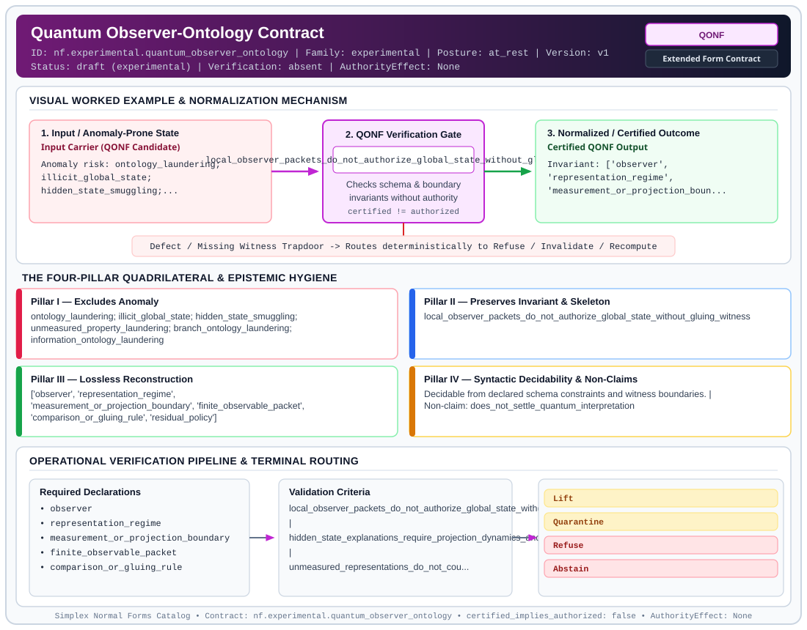

# Quantum Observer-Ontology Contract (`QONF`)

> **Contract ID:** `nf.experimental.quantum_observer_ontology` | **Family:** `experimental` | **Index Status:** `draft` | **AuthorityEffect:** `None`

**[⬅ Back to Wiki Home](Home)** | **[View SVG Diagram](images/nf.experimental.quantum_observer_ontology.svg)**

---

## 1. Executive Summary & Metadata

Quantum Observer-Ontology Contract (QONF) enforces structural normalization and explicit defect routing in the experimental regime.

| Property | Value |
| :--- | :--- |
| **Canonical ID** | `nf.experimental.quantum_observer_ontology` |
| **Short Name** | `QONF` |
| **Full Name** | Quantum Observer-Ontology Contract |
| **Family** | `experimental` (Bounded Quantum-Classical, Contextuality, Quantifier Alternation & Agent-State Contracts) |
| **Qualification** | Extended Form Contract (Normal Form Contract) |
| **Data / Math Posture** | at_rest |
| **Index Status** | `draft` |
| **Theory Status** | `experimental` |
| **Verification Status** | `absent` |
| **Contract Version** | `v1` |
| **Governance Fence** | `AuthorityEffect: None` (`certified_implies_authorized: false`) |

---

## 2. Visual Architecture & Normalization Diagram



---

## 3. Concrete Worked Example & Mechanism

### Visual Transition Summary

| Stage | Carrier / Operator | Concrete State / Invariant |
| :--- | :--- | :--- |
| **1. Before / Candidate Input** | `Input Carrier (QONF Candidate)` | Anomaly risk: ontology_laundering; ; illicit_global_state; ; hidden_state_smuggling;... |
| **2. Normalization / Gate** | `QONF Verification Gate` | `local_observer_packets_do_not_authorize_global_state_without_gluing_witness` (`certified_implies_authorized: false`) |
| **3. After / Certified Output** | `Certified QONF Output` | Invariant: ['observer', ; 'representation_regime', ; 'measurement_or_projection_boun... |

---

## 4. The Four-Pillar Quadrilateral & Non-Claims

Every contract in `simplex-normal-forms` is evaluated against the **Four-Pillar Quadrilateral** defined in `contracts/_golden_nfs/standard.yaml`:

| Pillar | Requirement | Contract Specification for `nf.experimental.quantum_observer_ontology` |
| :--- | :--- | :--- |
| **Pillar I: Excludes Anomaly** | Name and eliminate a specific class of data or state defects. | ontology_laundering; illicit_global_state; hidden_state_smuggling; unmeasured_property_laundering; branch_ontology_laundering; information_ontology_laundering |
| **Pillar II: Preserves Invariant** | State the structural invariant and protected skeleton preserved across transitions. | **Invariant:** local_observer_packets_do_not_authorize_global_state_without_gluing_witness<br>**Protected Skeleton:** ['observer', 'representation_regime', 'measurement_or_projection_boundary', 'finite_observable_packet', 'comparison_or_gluing_rule', 'residual_policy'] |
| **Pillar III: Lossless Reconstruction** | State the non-loss reconstruction operator (join, direct sum, pullback, or replay). | Lossless reconstruction under declared projection, direct sum, or pullback operators. |
| **Pillar IV: Syntactic Decidability** | State how conformance is decided from declared constraints without unbudgeted scans. | Decidable from declared schema and witness metadata within bounded evaluation budgets. |

### Explicit Non-Claims (`certified_implies_authorized: false`)

- does_not_settle_quantum_interpretation
- does_not_claim_bohm_is_true
- does_not_claim_copenhagen_is_true
- does_not_claim_everett_is_true
- does_not_claim_hidden_variables_are_true
- does_not_claim_many_worlds_is_false
- does_not_replace_physics
- only_disciplines_authority_transfer_between_observer_packets_and_ontology_claims

---

## 5. Operational Verification & Terminal Routing

### 5.1 Required Declarations

- observer
- representation_regime
- measurement_or_projection_boundary
- finite_observable_packet
- comparison_or_gluing_rule
- residual_policy

### 5.2 Required Evidence

- terminal_event_or_refusal
- projection_witness
- loss_or_branch_ledger_if_applicable

### 5.3 Validation Criteria

| Criterion ID | Name | Condition |
| :--- | :--- | :--- |
| `criterion` | Check | local_observer_packets_do_not_authorize_global_state_without_gluing_witness |
| `criterion` | Check | hidden_state_explanations_require_projection_dynamics_and_nonlocality_ledgers |
| `criterion` | Check | unmeasured_representations_do_not_count_as_measured_authority |
| `criterion` | Check | branch_decompositions_require_observer_localization_decoherence_and_measure_rules |
| `criterion` | Check | information_claims_require_encoding_observer_record_and_realization_maps |

### 5.4 Terminal Route Map

Every evaluation terminates in a declared local route mapped to a canonical terminal in `standard.yaml`:

| Local Terminal Route | Canonical Terminal |
| :--- | :--- |
| `Lift` | `Lift` |
| `Quarantine` | `Quarantine` |
| `Refuse` | `Refuse` |
| `Abstain` | `Abstain` |

### 5.5 Declared Failure Modes

_All defects route explicitly through the Terminal Route Map above._

---

## 6. Epistemic Claim Hygiene Quadrant

In accordance with the repository's epistemic claim discipline:

1. **What it supports:**
   - Supports syntactic and operational checking of `nf.experimental.quantum_observer_ontology` (`QONF`) against its declared schema, boundary constraints, and witness obligations in this model.
   - Supports deterministic terminal routing (`Lift, Quarantine, Refuse, Abstain`) when required declarations or invariants fail.
2. **What it does not support:**
   - Does not confer operational authority (`AuthorityEffect: None`, `certified_implies_authorized: false`).
   - Does not claim semantic truth of undeclared external processes or unverified upstream inputs beyond the declaredprotected skeleton.
3. **The narrowest defensible claim:**
   - Within the declared substrate `at_rest`, this contract enforces that `ontology_laundering; illicit_global_state; hidden_state_smuggling; unmeasured_property_laundering; branch_ontology_laundering; information_ontology_laundering` is either excluded under `local_observer_packets_do_not_authorize_global_state_without_gluing_witness` or routed to an explicit refusal/recovery terminal.
4. **The next test needed:**
   - Property-based falsification and mutation testing across boundary edge cases and composed multi-step pipelines for `nf.experimental.quantum_observer_ontology`.

---

## 7. Canonical YAML Contract (`contracts/nf.experimental.quantum_observer_ontology.yaml`)

<details>
<summary><strong>Click to expand full canonical YAML contract (contracts/nf.experimental.quantum_observer_ontology.yaml)</strong></summary>

```yaml
schema_version: smplx.nf.contract.v0
contract_kind: normal_form_contract
identity:
  id: nf.experimental.quantum_observer_ontology
  name: Quantum Observer-Ontology Contract
  short_name: QONF
  version: v1
  status: draft
  family: experimental
  theory_status: experimental
  contract_status: draft
  verification_status: absent
classification:
  hierarchy_level: normal_form
  subject_kind:
  - observer_relative_physical_claim
  data_posture: at_rest
  mathematical_posture: operational
purpose:
  excludes_anomaly: ontology_laundering; illicit_global_state; hidden_state_smuggling;
    unmeasured_property_laundering; branch_ontology_laundering; information_ontology_laundering
  preserves_invariant: local_observer_packets_do_not_authorize_global_state_without_gluing_witness
  protected_skeleton:
  - observer
  - representation_regime
  - measurement_or_projection_boundary
  - finite_observable_packet
  - comparison_or_gluing_rule
  - residual_policy
  erased_structure: []
  non_claims:
  - does_not_settle_quantum_interpretation
  - does_not_claim_bohm_is_true
  - does_not_claim_copenhagen_is_true
  - does_not_claim_everett_is_true
  - does_not_claim_hidden_variables_are_true
  - does_not_claim_many_worlds_is_false
  - does_not_replace_physics
  - only_disciplines_authority_transfer_between_observer_packets_and_ontology_claims
declarations_required:
- observer
- representation_regime
- measurement_or_projection_boundary
- finite_observable_packet
- comparison_or_gluing_rule
- residual_policy
evidence_required:
- terminal_event_or_refusal
- projection_witness
- loss_or_branch_ledger_if_applicable
validation_criteria:
- local_observer_packets_do_not_authorize_global_state_without_gluing_witness
- hidden_state_explanations_require_projection_dynamics_and_nonlocality_ledgers
- unmeasured_representations_do_not_count_as_measured_authority
- branch_decompositions_require_observer_localization_decoherence_and_measure_rules
- information_claims_require_encoding_observer_record_and_realization_maps
terminal_routes:
- Lift
- Quarantine
- Refuse
- Abstain
certification:
  certificate_required: true
  certificate_kind: observer_ontology_packet
  obstruction_class_required: false
  loss_ledger_required: false
  verifier_required: false
local_terminal_routes:
- LocalOnly
- ComparisonRequired
- NoGlobalSection
- BellResidual
- LiftRequired
- RefuseGlobalClaim
- HiddenPacketDeclared
- ProjectionLedgerRequired
- NonlocalityLedgerRequired
- NoHiddenStateAuthority
- RefuseHiddenMechanism
- ContextDeclared
- MeasurementTerminalized
- ObserverBoundaryRequired
- NoCounterfactualAuthority
- RefuseOnticPromotion
- BranchDeclared
- ObserverLocalized
- DecoherenceWitnessed
- MeasureRuleMissing
- BranchAmbiguityResidual
- RefuseCrossBranchAuthority
- BitDeclared
- EncodingDeclared
- ObserverDeclared
- RealizationMapMissing
- RecordTerminalized
- RefuseItFromBitPromotion
terminal_route_map:
  Lift: Lift
  Quarantine: Quarantine
  Refuse: Refuse
  Abstain: Abstain
  LocalOnly: Escalate
  ComparisonRequired: Escalate
  NoGlobalSection: Escalate
  BellResidual: Escalate
  LiftRequired: Escalate
  RefuseGlobalClaim: Refuse
  HiddenPacketDeclared: Escalate
  ProjectionLedgerRequired: Escalate
  NonlocalityLedgerRequired: Escalate
  NoHiddenStateAuthority: Escalate
  RefuseHiddenMechanism: Refuse
  ContextDeclared: Escalate
  MeasurementTerminalized: Escalate
  ObserverBoundaryRequired: Escalate
  NoCounterfactualAuthority: Escalate
  RefuseOnticPromotion: Refuse
  BranchDeclared: Escalate
  ObserverLocalized: Escalate
  DecoherenceWitnessed: Escalate
  MeasureRuleMissing: BudgetUnknown
  BranchAmbiguityResidual: Escalate
  RefuseCrossBranchAuthority: Refuse
  BitDeclared: Escalate
  EncodingDeclared: Escalate
  ObserverDeclared: Escalate
  RealizationMapMissing: BudgetUnknown
  RecordTerminalized: Escalate
  RefuseItFromBitPromotion: Refuse
authorization:
  authorized_by: null
  certified_implies_authorized: false
definition:
  source: coda_all_universe/mssn_sn_tower/definitions.md
  formal_statement: ontology_laundering; illicit_global_state; hidden_state_smuggling;
    unmeasured_property_laundering; branch_ontology_laundering; information_ontology_laundering.
    local_observer_packets_do_not_authorize_global_state_without_gluing_witness
  quadrilateral:
    qualifies_as_true_normal_form: false
    qualification_gap: reconstruction_is_not_a_relational_project_join
    anomaly_exclusion: ontology_laundering; illicit_global_state; hidden_state_smuggling;
      unmeasured_property_laundering; branch_ontology_laundering; information_ontology_laundering
    lossless_join:
      status: declared_reconstruction
      statement: local_observer_packets_do_not_authorize_global_state_without_gluing_witness
    dependency_preservation:
      status: declared_with_the_invariant
      statement: The preserved invariant stays on the declared schema. This form does
        not state a functional-dependency projection of a flat relvar decomposition.
    syntactic_decision:
      status: declaration_decidable
      statement: The check reads the declared constraints and validation criteria.
        One unrecorded runtime image is not the decider.
schema_ref: ./normal_form_contract_schema.yaml
```

</details>
