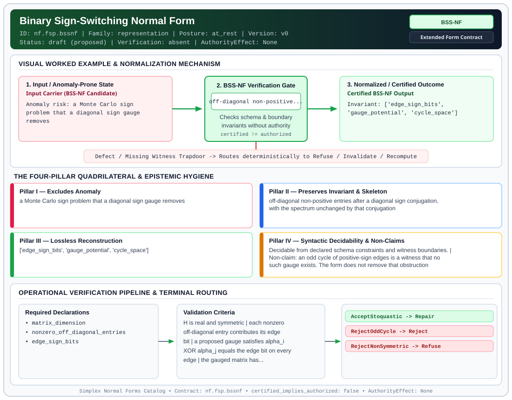

# Binary Sign-Switching Normal Form (`BSS-NF`)

> **Contract ID:** `nf.fsp.bssnf` | **Family:** `representation` | **Index Status:** `draft` | **AuthorityEffect:** `None`

**[⬅ Back to Wiki Home](Home)** | **[View SVG Diagram](images/nf.fsp.bssnf.svg)**

---

## 1. Executive Summary & Metadata

Binary Sign-Switching Normal Form (BSS-NF) enforces structural normalization and explicit defect routing in the representation regime.

| Property | Value |
| :--- | :--- |
| **Canonical ID** | `nf.fsp.bssnf` |
| **Short Name** | `BSS-NF` |
| **Full Name** | Binary Sign-Switching Normal Form |
| **Family** | `representation` (Data in Representation, Canonical Wire Grammars, Orbit Representatives & Gauge Fixing) |
| **Qualification** | Extended Form Contract (Normal Form Contract) |
| **Data / Math Posture** | at_rest |
| **Index Status** | `draft` |
| **Theory Status** | `proposed` |
| **Verification Status** | `absent` |
| **Contract Version** | `v0` |
| **Governance Fence** | `AuthorityEffect: None` (`certified_implies_authorized: false`) |

### Foundational Treatise Specification

- **Domain**: Real symmetric matrices H in R^{N x N} in a fixed discrete basis.
- **Transformation Group**: Diagonal sign changes G_gauge = {diag((-1)^{alpha_1}, ..., (-1)^{alpha_N})}.
- **Target Property**: Stoquasticity (H_ij <= 0 for all i != j).
- **Anomaly Excluded**: Quantum Monte Carlo on artificially non-stoquastic presentation when diagonal gauge eliminates negative signs.
- **Necessary And Sufficient Criterion**: Cycle Holonomy Theorem: sum_{e in C} s_e == 0 mod 2 for every cycle C in the graph.
- **Reconstruction Theorem**: Transformed matrix H' = D_alpha H D_alpha is stoquastic; partition function sign weights are positive.
- **Positive Witness**: Spanning forest rooted potential alpha in {0, 1}^N satisfying edge equations.
- **Negative Witness Obstruction**: Explicit cycle C with odd sign-bit holonomy (sum_{e in C} s_e == 1 mod 2).

---

## 2. Visual Architecture & Normalization Diagram



---

## 3. Concrete Worked Example & Mechanism

### Visual Transition Summary

| Stage | Carrier / Operator | Concrete State / Invariant |
| :--- | :--- | :--- |
| **1. Before / Candidate Input** | `Input Carrier (BSS-NF Candidate)` | Anomaly risk: a Monte Carlo sign ; problem that a diagonal sign gauge ; removes |
| **2. Normalization / Gate** | `BSS-NF Verification Gate` | `off-diagonal non-positive...` (`certified_implies_authorized: false`) |
| **3. After / Certified Output** | `Certified BSS-NF Output` | Invariant: ['edge_sign_bits', ; 'gauge_potential', 'cycle_space'] |

### Contract-Declared Worked Cases

```yaml
- ref: coda_all_universe/mssn_sn_tower/definitions.md
  section: '4.1'
```

---

## 4. The Four-Pillar Quadrilateral & Non-Claims

Every contract in `simplex-normal-forms` is evaluated against the **Four-Pillar Quadrilateral** defined in `contracts/_golden_nfs/standard.yaml`:

| Pillar | Requirement | Contract Specification for `nf.fsp.bssnf` |
| :--- | :--- | :--- |
| **Pillar I: Excludes Anomaly** | Name and eliminate a specific class of data or state defects. | a Monte Carlo sign problem that a diagonal sign gauge removes |
| **Pillar II: Preserves Invariant** | State the structural invariant and protected skeleton preserved across transitions. | **Invariant:** off-diagonal non-positive entries after a diagonal sign conjugation, with the spectrum unchanged by that conjugation<br>**Protected Skeleton:** ['edge_sign_bits', 'gauge_potential', 'cycle_space'] |
| **Pillar III: Lossless Reconstruction** | State the non-loss reconstruction operator (join, direct sum, pullback, or replay). | Lossless reconstruction under declared projection, direct sum, or pullback operators. |
| **Pillar IV: Syntactic Decidability** | State how conformance is decided from declared constraints without unbudgeted scans. | Decidable from declared schema and witness metadata within bounded evaluation budgets. |

### Explicit Non-Claims (`certified_implies_authorized: false`)

- an odd cycle of positive-sign edges is a witness that no such gauge exists. The form does not remove that obstruction
- the matrix is real and symmetric in a fixed finite basis. Continuous basis changes are outside the form
- the normal-form packaging is local to the source treatise. The holonomy criterion itself is the standard GF(2) switching condition
- does not imply authorization

---

## 5. Operational Verification & Terminal Routing

### 5.1 Required Declarations

- matrix_dimension
- nonzero_off_diagonal_entries
- edge_sign_bits

### 5.2 Required Evidence

_None declared._

### 5.3 Validation Criteria

| Criterion ID | Name | Condition |
| :--- | :--- | :--- |
| `criterion` | Check | H is real and symmetric |
| `criterion` | Check | each nonzero off-diagonal entry contributes its edge bit |
| `criterion` | Check | a proposed gauge satisfies alpha_i XOR alpha_j equals the edge bit on every edge |
| `criterion` | Check | the gauged matrix has non-positive off-diagonal entries |
| `criterion` | Check | if no gauge exists, an odd cycle is exhibited |

### 5.4 Terminal Route Map

Every evaluation terminates in a declared local route mapped to a canonical terminal in `standard.yaml`:

| Local Terminal Route | Canonical Terminal |
| :--- | :--- |
| `AcceptStoquastic` | `Repair` |
| `RejectOddCycle` | `Reject` |
| `RejectNonSymmetric` | `Refuse` |

### 5.5 Declared Failure Modes

- **symptom**: a cycle has odd edge-bit sum, **diagnosis**: no diagonal sign gauge makes H stoquastic, **terminal**: RejectOddCycle
- **symptom**: an off-diagonal pair disagrees, **diagnosis**: H is not symmetric, **terminal**: RejectNonSymmetric

---

## 6. Epistemic Claim Hygiene Quadrant

In accordance with the repository's epistemic claim discipline:

1. **What it supports:**
   - Supports syntactic and operational checking of `nf.fsp.bssnf` (`BSS-NF`) against its declared schema, boundary constraints, and witness obligations in this model.
   - Supports deterministic terminal routing (`AcceptStoquastic, RejectOddCycle, RejectNonSymmetric`) when required declarations or invariants fail.
2. **What it does not support:**
   - Does not confer operational authority (`AuthorityEffect: None`, `certified_implies_authorized: false`).
   - Does not claim semantic truth of undeclared external processes or unverified upstream inputs beyond the declaredprotected skeleton.
3. **The narrowest defensible claim:**
   - Within the declared substrate `at_rest`, this contract enforces that `a Monte Carlo sign problem that a diagonal sign gauge removes` is either excluded under `off-diagonal non-positive entries after a diagonal sign conjugation, with the spectrum unchanged by that conjugation` or routed to an explicit refusal/recovery terminal.
4. **The next test needed:**
   - Property-based falsification and mutation testing across boundary edge cases and composed multi-step pipelines for `nf.fsp.bssnf`.

---

## 7. Canonical YAML Contract (`contracts/nf.fsp.bssnf.yaml`)

<details>
<summary><strong>Click to expand full canonical YAML contract (contracts/nf.fsp.bssnf.yaml)</strong></summary>

```yaml
schema_version: smplx.nf.contract.v0
schema_ref: ./normal_form_contract_schema.yaml
contract_kind: normal_form_contract
identity:
  id: nf.fsp.bssnf
  name: Binary Sign-Switching Normal Form
  short_name: BSS-NF
  version: v0
  theory_status: proposed
  contract_status: draft
  verification_status: absent
  family: representation
  status: draft
classification:
  hierarchy_level: normal_form
  subject_kind:
  - real_symmetric_matrix
  - diagonal_sign_gauge
  data_posture: at_rest
  mathematical_posture: formal_algebraic
purpose:
  excludes_anomaly: a Monte Carlo sign problem that a diagonal sign gauge removes
  preserves_invariant: off-diagonal non-positive entries after a diagonal sign conjugation,
    with the spectrum unchanged by that conjugation
  protected_skeleton:
  - edge_sign_bits
  - gauge_potential
  - cycle_space
  erased_structure: []
  non_claims:
  - an odd cycle of positive-sign edges is a witness that no such gauge exists. The
    form does not remove that obstruction
  - the matrix is real and symmetric in a fixed finite basis. Continuous basis changes
    are outside the form
  - the normal-form packaging is local to the source treatise. The holonomy criterion
    itself is the standard GF(2) switching condition
  - does not imply authorization
definition:
  source: coda_all_universe/mssn_sn_tower/definitions.md
  section: '4.1'
  formal_statement: 'Let H be a real symmetric N by N matrix. A diagonal sign gauge
    is a diagonal matrix D with diagonal entries +1 or -1. The gauged matrix is D
    H D. It is stoquastic when every off-diagonal entry is less than or equal to zero.
    For each off-diagonal nonzero entry, the edge bit is 1 when the entry is positive
    and 0 when the entry is negative. A gauge with bits alpha exists if and only if
    alpha_i XOR alpha_j equals the edge bit on every edge, if and only if every cycle
    has edge-bit sum even. A positive witness is a 0-1 potential on a spanning forest
    that meets every edge equation. A negative witness is one cycle whose edge-bit
    sum is odd.

    '
  quadrilateral:
    qualifies_as_true_normal_form: false
    qualification_gap: reconstruction_is_a_diagonal_similarity_not_a_relational_join
    qualifies_as_extended_form: true
    anomaly_exclusion: running a sign-problem method on a presentation that a diagonal
      sign gauge makes stoquastic
    lossless_join:
      status: similarity
      statement: D H D has the same spectrum as H, and the gauge is inverted by applying
        it twice
    dependency_preservation:
      status: edge_equations_retained
      statement: every nonzero off-diagonal edge keeps its sign equation under the
        gauge search
    syntactic_decision:
      status: matrix_decidable
      statement: 'The decision reads the sign pattern of H. It builds a spanning forest,
        propagates the edge equations, and checks the remaining edges. A Monte Carlo
        sample is not the decider.

        '
declarations_required:
- matrix_dimension
- nonzero_off_diagonal_entries
- edge_sign_bits
evidence_required: []
validation_criteria:
- H is real and symmetric
- each nonzero off-diagonal entry contributes its edge bit
- a proposed gauge satisfies alpha_i XOR alpha_j equals the edge bit on every edge
- the gauged matrix has non-positive off-diagonal entries
- if no gauge exists, an odd cycle is exhibited
terminal_routes:
- AcceptStoquastic
- RejectOddCycle
- RejectNonSymmetric
terminal_route_map:
  AcceptStoquastic: Repair
  RejectOddCycle: Reject
  RejectNonSymmetric: Refuse
certification:
  certificate_required: false
  certificate_kind: null
  obstruction_class_required: false
  loss_ledger_required: false
  verifier_required: false
  loss_ledger_trigger_id: null
authorization:
  authorized_by: null
  certified_implies_authorized: false
failure_modes:
- symptom: a cycle has odd edge-bit sum
  diagnosis: no diagonal sign gauge makes H stoquastic
  terminal: RejectOddCycle
- symptom: an off-diagonal pair disagrees
  diagnosis: H is not symmetric
  terminal: RejectNonSymmetric
examples:
- ref: coda_all_universe/mssn_sn_tower/definitions.md
  section: '4.1'
references:
- coda_all_universe/mssn_sn_tower/definitions.md
obstruction_substrate:
  policy_ref: ../substrate/default_finite_obstruction_policy.yaml
  finite_carrier:
    description: real symmetric matrix H over finite basis V
    max_rank: null
  cochain_complex:
    C0: vertex_gauge_potentials_alpha_in_Z2
    C1: edge_sign_bits_s_in_Z2
    C2: cycle_holonomies_in_Z2
    d0: 'maps vertex signs to edge differentials: (d0 alpha)_ij = alpha_i XOR alpha_j'
    d1: maps edge bits to cycle sums modulo 2
    quotient: H1(G, Z2) = ker(d1) / im(d0)
  obstruction_class:
    notation: '[holonomy(C)]'
    exact: 'all_cycles_even: [s] == 0'
    residual_closed: 'frustrated_odd_cycle: [s] != 0'
    open: unbounded_graph_or_non_hermitian
proof_obligations:
- id: bssnf.holonomy_soundness
  status: theorem_shaped
  ref: ../demos/demo_2/sign_switching.py
  section: 4. Binary graph switching
```

</details>
