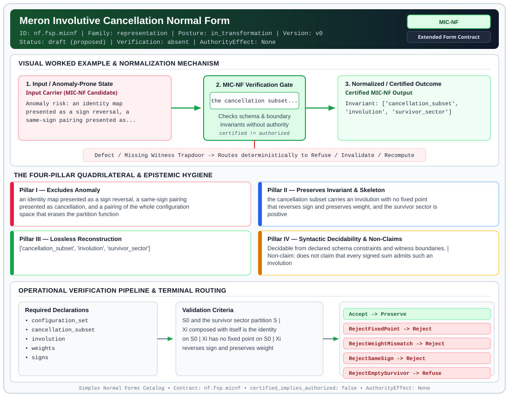

# Meron Involutive Cancellation Normal Form (`MIC-NF`)

> **Contract ID:** `nf.fsp.micnf` | **Family:** `representation` | **Index Status:** `draft` | **AuthorityEffect:** `None`

**[⬅ Back to Wiki Home](Home)** | **[View SVG Diagram](images/nf.fsp.micnf.svg)**

---

## 1. Executive Summary & Metadata

Meron Involutive Cancellation Normal Form (MIC-NF) enforces structural normalization and explicit defect routing in the representation regime.

| Property | Value |
| :--- | :--- |
| **Canonical ID** | `nf.fsp.micnf` |
| **Short Name** | `MIC-NF` |
| **Full Name** | Meron Involutive Cancellation Normal Form |
| **Family** | `representation` (Data in Representation, Canonical Wire Grammars, Orbit Representatives & Gauge Fixing) |
| **Qualification** | Extended Form Contract (Normal Form Contract) |
| **Data / Math Posture** | in_transformation |
| **Index Status** | `draft` |
| **Theory Status** | `proposed` |
| **Verification Status** | `absent` |
| **Contract Version** | `v0` |
| **Governance Fence** | `AuthorityEffect: None` (`certified_implies_authorized: false`) |

### Foundational Treatise Specification

- **Domain**: Finite signed configuration path sums Z = sum_{x in S} w(x) sgn(x).
- **Transformation Group**: Involutive sign-reversing pairing Xi: S_0 -> S_0.
- **Target Property**: Exact cancellation of negative path sectors leaving non-negative survivor sector.
- **Anomaly Excluded**: Identity map fallacy, same-sign pairing, and unbudgeted global annihilation (Z == 0).
- **Necessary And Sufficient Criterion**: Exists cancellation subset S_0 and bijection Xi: S_0 -> S_0 such that Xi(Xi(x)) = x, Xi(x) != x, sgn(Xi(x)) = -sgn(x), w(Xi(x)) = w(x), and sgn(y) = +1 for all y in S \ S_0.
- **Reconstruction Theorem**: Z = 0 + sum_{y in S_surv} w(y) >= 0. Strict positivity requires non-empty survivor sector.
- **Positive Witness**: Explicit involution table Xi and non-empty survivor set S_surv.
- **Negative Witness Obstruction**: Fixed points (Xi(x) = x), same-sign pairs, or weight mismatch (w(Xi(x)) != w(x)).

---

## 2. Visual Architecture & Normalization Diagram



---

## 3. Concrete Worked Example & Mechanism

### Visual Transition Summary

| Stage | Carrier / Operator | Concrete State / Invariant |
| :--- | :--- | :--- |
| **1. Before / Candidate Input** | `Input Carrier (MIC-NF Candidate)` | Anomaly risk: an identity map ; presented as a sign reversal, a ; same-sign pairing presented as... |
| **2. Normalization / Gate** | `MIC-NF Verification Gate` | `the cancellation subset...` (`certified_implies_authorized: false`) |
| **3. After / Certified Output** | `Certified MIC-NF Output` | Invariant: ['cancellation_subset', ; 'involution', 'survivor_sector'] |

### Contract-Declared Worked Cases

```yaml
- ref: coda_all_universe/mssn_sn_tower/definitions.md
  section: '4.2'
```

---

## 4. The Four-Pillar Quadrilateral & Non-Claims

Every contract in `simplex-normal-forms` is evaluated against the **Four-Pillar Quadrilateral** defined in `contracts/_golden_nfs/standard.yaml`:

| Pillar | Requirement | Contract Specification for `nf.fsp.micnf` |
| :--- | :--- | :--- |
| **Pillar I: Excludes Anomaly** | Name and eliminate a specific class of data or state defects. | an identity map presented as a sign reversal, a same-sign pairing presented as cancellation, and a pairing of the whole configuration space that erases the partition function |
| **Pillar II: Preserves Invariant** | State the structural invariant and protected skeleton preserved across transitions. | **Invariant:** the cancellation subset carries an involution with no fixed point that reverses sign and preserves weight, and the survivor sector is positive<br>**Protected Skeleton:** ['cancellation_subset', 'involution', 'survivor_sector'] |
| **Pillar III: Lossless Reconstruction** | State the non-loss reconstruction operator (join, direct sum, pullback, or replay). | Lossless reconstruction under declared projection, direct sum, or pullback operators. |
| **Pillar IV: Syntactic Decidability** | State how conformance is decided from declared constraints without unbudgeted scans. | Decidable from declared schema and witness metadata within bounded evaluation budgets. |

### Explicit Non-Claims (`certified_implies_authorized: false`)

- does not claim that every signed sum admits such an involution
- a survivor sector that is empty makes the partitioned sum zero. That total cancellation is the anomaly named in the source, so this form refuses it
- expectation values of observables need their own numerator check
- does not imply authorization

---

## 5. Operational Verification & Terminal Routing

### 5.1 Required Declarations

- configuration_set
- cancellation_subset
- involution
- weights
- signs

### 5.2 Required Evidence

_None declared._

### 5.3 Validation Criteria

| Criterion ID | Name | Condition |
| :--- | :--- | :--- |
| `criterion` | Check | S0 and the survivor sector partition S |
| `criterion` | Check | Xi composed with itself is the identity on S0 |
| `criterion` | Check | Xi has no fixed point on S0 |
| `criterion` | Check | Xi reverses sign and preserves weight |
| `criterion` | Check | every survivor has sign +1 |
| `criterion` | Check | the survivor sector is non-empty |

### 5.4 Terminal Route Map

Every evaluation terminates in a declared local route mapped to a canonical terminal in `standard.yaml`:

| Local Terminal Route | Canonical Terminal |
| :--- | :--- |
| `Accept` | `Preserve` |
| `RejectFixedPoint` | `Reject` |
| `RejectWeightMismatch` | `Reject` |
| `RejectSameSign` | `Reject` |
| `RejectEmptySurvivor` | `Refuse` |

### 5.5 Declared Failure Modes

- **symptom**: Xi(x) = x for some x in the cancellation subset, **diagnosis**: a fixed point cannot reverse its own sign, **terminal**: RejectFixedPoint
- **symptom**: Xi preserves sign, **diagnosis**: the pair adds the weights, **terminal**: RejectSameSign
- **symptom**: the weights of a pair differ, **diagnosis**: the pair leaves a nonzero remainder, **terminal**: RejectWeightMismatch
- **symptom**: the cancellation subset is the whole configuration set, **diagnosis**: the pairing annihilates the partitioned sum, **terminal**: RejectEmptySurvivor

---

## 6. Epistemic Claim Hygiene Quadrant

In accordance with the repository's epistemic claim discipline:

1. **What it supports:**
   - Supports syntactic and operational checking of `nf.fsp.micnf` (`MIC-NF`) against its declared schema, boundary constraints, and witness obligations in this model.
   - Supports deterministic terminal routing (`Accept, RejectFixedPoint, RejectWeightMismatch, RejectSameSign`) when required declarations or invariants fail.
2. **What it does not support:**
   - Does not confer operational authority (`AuthorityEffect: None`, `certified_implies_authorized: false`).
   - Does not claim semantic truth of undeclared external processes or unverified upstream inputs beyond the declaredprotected skeleton.
3. **The narrowest defensible claim:**
   - Within the declared substrate `in_transformation`, this contract enforces that `an identity map presented as a sign reversal, a same-sign pairing presented as cancellation, and a pairing of the whole configuration space that erases the partition function` is either excluded under `the cancellation subset carries an involution with no fixed point that reverses sign and preserves weight, and the survivor sector is positive` or routed to an explicit refusal/recovery terminal.
4. **The next test needed:**
   - Property-based falsification and mutation testing across boundary edge cases and composed multi-step pipelines for `nf.fsp.micnf`.

---

## 7. Canonical YAML Contract (`contracts/nf.fsp.micnf.yaml`)

<details>
<summary><strong>Click to expand full canonical YAML contract (contracts/nf.fsp.micnf.yaml)</strong></summary>

```yaml
schema_version: smplx.nf.contract.v0
schema_ref: ./normal_form_contract_schema.yaml
contract_kind: normal_form_contract
identity:
  id: nf.fsp.micnf
  name: Meron Involutive Cancellation Normal Form
  short_name: MIC-NF
  version: v0
  theory_status: proposed
  contract_status: draft
  verification_status: absent
  family: representation
  status: draft
classification:
  hierarchy_level: normal_form
  subject_kind:
  - signed_configuration_sum
  - involution
  data_posture: in_transformation
  mathematical_posture: formal_algebraic
purpose:
  excludes_anomaly: an identity map presented as a sign reversal, a same-sign pairing
    presented as cancellation, and a pairing of the whole configuration space that
    erases the partition function
  preserves_invariant: the cancellation subset carries an involution with no fixed
    point that reverses sign and preserves weight, and the survivor sector is positive
  protected_skeleton:
  - cancellation_subset
  - involution
  - survivor_sector
  erased_structure:
  - cancelling_pairs
  non_claims:
  - does not claim that every signed sum admits such an involution
  - a survivor sector that is empty makes the partitioned sum zero. That total cancellation
    is the anomaly named in the source, so this form refuses it
  - expectation values of observables need their own numerator check
  - does not imply authorization
definition:
  source: coda_all_universe/mssn_sn_tower/definitions.md
  section: '4.2'
  formal_statement: 'The partitioned sum is Z = sum_x w(x) sgn(x) over a finite set
    S, with w(x) positive and sgn(x) equal to +1 or -1. A cancellation subset S0 and
    its complement, the survivor sector, partition S. The map Xi on S0 satisfies Xi(Xi(x))
    = x, Xi(x) different from x, sgn(Xi(x)) = -sgn(x), and w(Xi(x)) = w(x). Every
    survivor has sign +1. The sum over S0 is then zero, and Z equals the sum of the
    survivor weights. The survivor sector is required to be non-empty, so that sum
    is positive.

    '
  quadrilateral:
    qualifies_as_true_normal_form: false
    qualification_gap: reconstruction_is_the_survivor_sum_not_a_relational_join
    qualifies_as_extended_form: true
    anomaly_exclusion: identity pairings, same-sign pairings, and cancellation of
      every configuration
    lossless_join:
      status: survivor_sum
      statement: Z equals the sum of the positive survivor weights
    dependency_preservation:
      status: pair_axioms_retained
      statement: involution, absence of fixed points, sign reversal, and weight equality
        are all required
    syntactic_decision:
      status: finite_set_decidable
      statement: the five conditions are checked on the declared finite set, the declared
        subset, and the declared map
declarations_required:
- configuration_set
- cancellation_subset
- involution
- weights
- signs
evidence_required: []
validation_criteria:
- S0 and the survivor sector partition S
- Xi composed with itself is the identity on S0
- Xi has no fixed point on S0
- Xi reverses sign and preserves weight
- every survivor has sign +1
- the survivor sector is non-empty
terminal_routes:
- Accept
- RejectFixedPoint
- RejectWeightMismatch
- RejectSameSign
- RejectEmptySurvivor
terminal_route_map:
  Accept: Preserve
  RejectFixedPoint: Reject
  RejectWeightMismatch: Reject
  RejectSameSign: Reject
  RejectEmptySurvivor: Refuse
certification:
  certificate_required: false
  certificate_kind: null
  obstruction_class_required: false
  loss_ledger_required: false
  verifier_required: false
  loss_ledger_trigger_id: null
authorization:
  authorized_by: null
  certified_implies_authorized: false
failure_modes:
- symptom: Xi(x) = x for some x in the cancellation subset
  diagnosis: a fixed point cannot reverse its own sign
  terminal: RejectFixedPoint
- symptom: Xi preserves sign
  diagnosis: the pair adds the weights
  terminal: RejectSameSign
- symptom: the weights of a pair differ
  diagnosis: the pair leaves a nonzero remainder
  terminal: RejectWeightMismatch
- symptom: the cancellation subset is the whole configuration set
  diagnosis: the pairing annihilates the partitioned sum
  terminal: RejectEmptySurvivor
examples:
- ref: coda_all_universe/mssn_sn_tower/definitions.md
  section: '4.2'
references:
- coda_all_universe/mssn_sn_tower/definitions.md
obstruction_substrate:
  policy_ref: ../substrate/default_finite_obstruction_policy.yaml
  finite_carrier:
    description: finite set of signed paths S with weights w(x) > 0 and signs in {-1,
      +1}
    max_rank: null
  cochain_complex:
    C0: path_weights_and_signs
    C1: paired_cancellation_edges
    C2: closure_obstructions
    d0: maps path pairs (x, Xi(x)) to weight differences and sign sum
    d1: checks completeness and fixed-point freedom
    quotient: Q_meron = S0 / <x ~ Xi(x)>
  obstruction_class:
    notation: '[meron_defect]'
    exact: 'involution_valid_and_weights_equal: [defect] == 0'
    residual_closed: 'sign_mismatch_or_weight_delta: [defect] != 0'
    open: unpaired_negative_paths_remain
proof_obligations:
- id: micnf.involution_cancellation_soundness
  status: theorem_shaped
  ref: ../demos/demo_2/meron_witness.py
  section: Meron pairing gate
```

</details>
