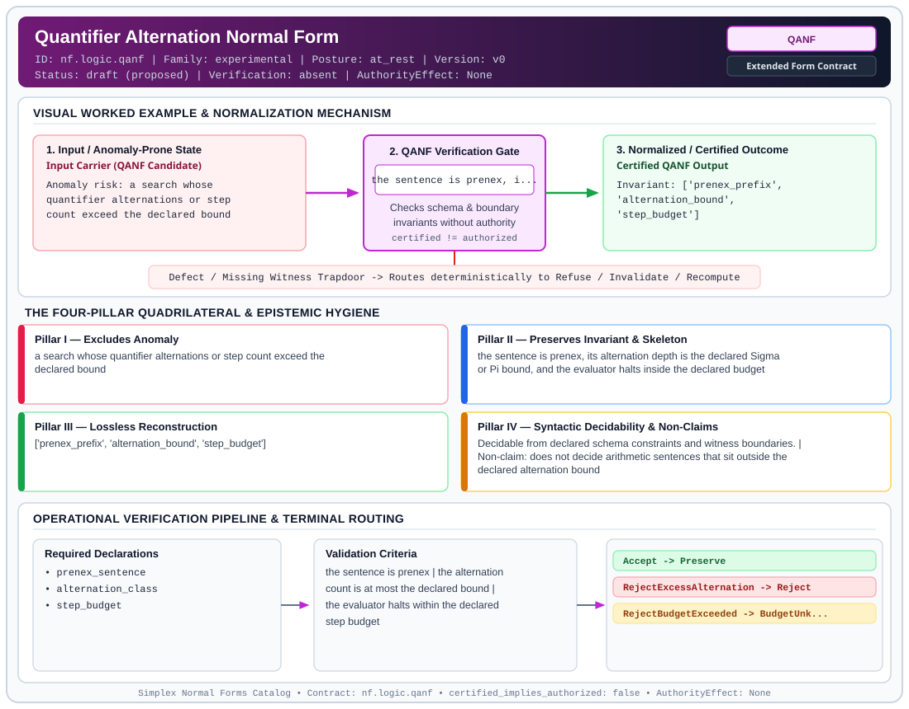

# Quantifier Alternation Normal Form (`QANF`)

> **Contract ID:** `nf.logic.qanf` | **Family:** `experimental` | **Index Status:** `draft` | **AuthorityEffect:** `None`

**[⬅ Back to Wiki Home](Home)** | **[View SVG Diagram](images/nf.logic.qanf.svg)**

---

## 1. Executive Summary & Metadata

Quantifier Alternation Normal Form (QANF) enforces structural normalization and explicit defect routing in the experimental regime.

| Property | Value |
| :--- | :--- |
| **Canonical ID** | `nf.logic.qanf` |
| **Short Name** | `QANF` |
| **Full Name** | Quantifier Alternation Normal Form |
| **Family** | `experimental` (Bounded Quantum-Classical, Contextuality, Quantifier Alternation & Agent-State Contracts) |
| **Qualification** | Extended Form Contract (Normal Form Contract) |
| **Data / Math Posture** | at_rest |
| **Index Status** | `draft` |
| **Theory Status** | `proposed` |
| **Verification Status** | `absent` |
| **Contract Version** | `v0` |
| **Governance Fence** | `AuthorityEffect: None` (`certified_implies_authorized: false`) |

### Foundational Treatise Specification

- **Levels**: Level 13 - 14
- **Spec Files**: ['13_grammar.md', '14_math.md']
- **Anomaly Excluded**: Undecidable looping and unbounded search explosions in higher-order logical specifications.
- **Preserved Invariant**: Quantifier alternation depth bounded by Sigma_k^0 / Pi_k^0 with strict induction budget B.
- **Lossless Reconstruction**: Primitive recursive evaluators decide bounded statements; budget overflow yields BudgetUnknown.

---

## 2. Visual Architecture & Normalization Diagram



---

## 3. Concrete Worked Example & Mechanism

### Visual Transition Summary

| Stage | Carrier / Operator | Concrete State / Invariant |
| :--- | :--- | :--- |
| **1. Before / Candidate Input** | `Input Carrier (QANF Candidate)` | Anomaly risk: a search whose ; quantifier alternations or step ; count exceed the declared bound |
| **2. Normalization / Gate** | `QANF Verification Gate` | `the sentence is prenex, i...` (`certified_implies_authorized: false`) |
| **3. After / Certified Output** | `Certified QANF Output` | Invariant: ['prenex_prefix', ; 'alternation_bound', ; 'step_budget'] |

### Contract-Declared Worked Cases

```yaml
- ref: coda_all_universe/mssn_sn_tower/definitions.md
  section: '3.4'
```

---

## 4. The Four-Pillar Quadrilateral & Non-Claims

Every contract in `simplex-normal-forms` is evaluated against the **Four-Pillar Quadrilateral** defined in `contracts/_golden_nfs/standard.yaml`:

| Pillar | Requirement | Contract Specification for `nf.logic.qanf` |
| :--- | :--- | :--- |
| **Pillar I: Excludes Anomaly** | Name and eliminate a specific class of data or state defects. | a search whose quantifier alternations or step count exceed the declared bound |
| **Pillar II: Preserves Invariant** | State the structural invariant and protected skeleton preserved across transitions. | **Invariant:** the sentence is prenex, its alternation depth is the declared Sigma or Pi bound, and the evaluator halts inside the declared budget<br>**Protected Skeleton:** ['prenex_prefix', 'alternation_bound', 'step_budget'] |
| **Pillar III: Lossless Reconstruction** | State the non-loss reconstruction operator (join, direct sum, pullback, or replay). | Lossless reconstruction under declared projection, direct sum, or pullback operators. |
| **Pillar IV: Syntactic Decidability** | State how conformance is decided from declared constraints without unbudgeted scans. | Decidable from declared schema and witness metadata within bounded evaluation budgets. |

### Explicit Non-Claims (`certified_implies_authorized: false`)

- does not decide arithmetic sentences that sit outside the declared alternation bound
- does not remove the bound by an appeal to an unbounded search
- does not imply authorization

---

## 5. Operational Verification & Terminal Routing

### 5.1 Required Declarations

- prenex_sentence
- alternation_class
- step_budget

### 5.2 Required Evidence

_None declared._

### 5.3 Validation Criteria

| Criterion ID | Name | Condition |
| :--- | :--- | :--- |
| `criterion` | Check | the sentence is prenex |
| `criterion` | Check | the alternation count is at most the declared bound |
| `criterion` | Check | the evaluator halts within the declared step budget |

### 5.4 Terminal Route Map

Every evaluation terminates in a declared local route mapped to a canonical terminal in `standard.yaml`:

| Local Terminal Route | Canonical Terminal |
| :--- | :--- |
| `Accept` | `Preserve` |
| `RejectExcessAlternation` | `Reject` |
| `RejectBudgetExceeded` | `BudgetUnknown` |

### 5.5 Declared Failure Modes

- **symptom**: the prenex prefix alternates more times than the declared bound, **diagnosis**: alternation depth exceeds the contract, **terminal**: RejectExcessAlternation
- **symptom**: evaluation has not halted at step B, **diagnosis**: the declared budget is exhausted, **terminal**: RejectBudgetExceeded

---

## 6. Epistemic Claim Hygiene Quadrant

In accordance with the repository's epistemic claim discipline:

1. **What it supports:**
   - Supports syntactic and operational checking of `nf.logic.qanf` (`QANF`) against its declared schema, boundary constraints, and witness obligations in this model.
   - Supports deterministic terminal routing (`Accept, RejectExcessAlternation, RejectBudgetExceeded`) when required declarations or invariants fail.
2. **What it does not support:**
   - Does not confer operational authority (`AuthorityEffect: None`, `certified_implies_authorized: false`).
   - Does not claim semantic truth of undeclared external processes or unverified upstream inputs beyond the declaredprotected skeleton.
3. **The narrowest defensible claim:**
   - Within the declared substrate `at_rest`, this contract enforces that `a search whose quantifier alternations or step count exceed the declared bound` is either excluded under `the sentence is prenex, its alternation depth is the declared Sigma or Pi bound, and the evaluator halts inside the declared budget` or routed to an explicit refusal/recovery terminal.
4. **The next test needed:**
   - Property-based falsification and mutation testing across boundary edge cases and composed multi-step pipelines for `nf.logic.qanf`.

---

## 7. Canonical YAML Contract (`contracts/nf.logic.qanf.yaml`)

<details>
<summary><strong>Click to expand full canonical YAML contract (contracts/nf.logic.qanf.yaml)</strong></summary>

```yaml
schema_version: smplx.nf.contract.v0
schema_ref: ./normal_form_contract_schema.yaml
contract_kind: normal_form_contract
identity:
  id: nf.logic.qanf
  name: Quantifier Alternation Normal Form
  short_name: QANF
  version: v0
  theory_status: proposed
  contract_status: draft
  verification_status: absent
  family: experimental
  status: draft
classification:
  hierarchy_level: normal_form
  subject_kind:
  - prenex_sentence
  - evaluation_budget
  data_posture: at_rest
  mathematical_posture: formal_algebraic
purpose:
  excludes_anomaly: a search whose quantifier alternations or step count exceed the
    declared bound
  preserves_invariant: the sentence is prenex, its alternation depth is the declared
    Sigma or Pi bound, and the evaluator halts inside the declared budget
  protected_skeleton:
  - prenex_prefix
  - alternation_bound
  - step_budget
  erased_structure: []
  non_claims:
  - does not decide arithmetic sentences that sit outside the declared alternation
    bound
  - does not remove the bound by an appeal to an unbounded search
  - does not imply authorization
definition:
  source: coda_all_universe/mssn_sn_tower/definitions.md
  section: '3.4'
  formal_statement: 'A sentence in this form is written in prenex normal form. The
    number of alternating quantifier blocks is at most the declared bound, recorded
    as a Sigma or Pi class. Evaluation runs inside a declared step budget B and halts.
    A sentence that cannot be placed inside that bound is refused.

    '
  quadrilateral:
    qualifies_as_true_normal_form: false
    qualification_gap: reconstruction_is_bounded_evaluation_not_a_relational_join
    qualifies_as_extended_form: true
    anomaly_exclusion: unbounded search and an alternation depth above the declaration
    lossless_join:
      status: bounded_evaluation
      statement: the prenex sentence and the budget determine the evaluator's halt
        result
    dependency_preservation:
      status: bound_retained
      statement: transformations keep the sentence inside the declared alternation
        bound and the budget B
    syntactic_decision:
      status: schema_decidable
      statement: the prefix, the alternation count, and the budget are read from the
        declared sentence
declarations_required:
- prenex_sentence
- alternation_class
- step_budget
evidence_required: []
validation_criteria:
- the sentence is prenex
- the alternation count is at most the declared bound
- the evaluator halts within the declared step budget
terminal_routes:
- Accept
- RejectExcessAlternation
- RejectBudgetExceeded
terminal_route_map:
  Accept: Preserve
  RejectExcessAlternation: Reject
  RejectBudgetExceeded: BudgetUnknown
certification:
  certificate_required: false
  certificate_kind: null
  obstruction_class_required: false
  loss_ledger_required: false
  verifier_required: false
  loss_ledger_trigger_id: null
authorization:
  authorized_by: null
  certified_implies_authorized: false
failure_modes:
- symptom: the prenex prefix alternates more times than the declared bound
  diagnosis: alternation depth exceeds the contract
  terminal: RejectExcessAlternation
- symptom: evaluation has not halted at step B
  diagnosis: the declared budget is exhausted
  terminal: RejectBudgetExceeded
examples:
- ref: coda_all_universe/mssn_sn_tower/definitions.md
  section: '3.4'
references:
- coda_all_universe/mssn_sn_tower/definitions.md
```

</details>
