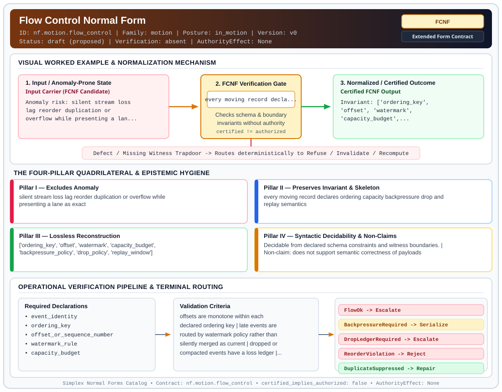

# Flow Control Normal Form (`FCNF`)

> **Contract ID:** `nf.motion.flow_control` | **Family:** `motion` | **Index Status:** `draft` | **AuthorityEffect:** `None`

**[⬅ Back to Wiki Home](Home)** | **[View SVG Diagram](images/nf.motion.flow_control.svg)**

---

## 1. Executive Summary & Metadata

Flow Control Normal Form (FCNF) enforces structural normalization and explicit defect routing in the motion regime.

| Property | Value |
| :--- | :--- |
| **Canonical ID** | `nf.motion.flow_control` |
| **Short Name** | `FCNF` |
| **Full Name** | Flow Control Normal Form |
| **Family** | `motion` (Flow Control, Horizon Emission & Lieb-Robinson Locality Bounds) |
| **Qualification** | Extended Form Contract (Normal Form Contract) |
| **Data / Math Posture** | in_motion |
| **Index Status** | `draft` |
| **Theory Status** | `proposed` |
| **Verification Status** | `absent` |
| **Contract Version** | `v0` |
| **Governance Fence** | `AuthorityEffect: None` (`certified_implies_authorized: false`) |

---

## 2. Visual Architecture & Normalization Diagram



---

## 3. Concrete Worked Example & Mechanism

### Visual Transition Summary

| Stage | Carrier / Operator | Concrete State / Invariant |
| :--- | :--- | :--- |
| **1. Before / Candidate Input** | `Input Carrier (FCNF Candidate)` | Anomaly risk: silent stream loss ; lag reorder duplication or ; overflow while presenting a lan... |
| **2. Normalization / Gate** | `FCNF Verification Gate` | `every moving record decla...` (`certified_implies_authorized: false`) |
| **3. After / Certified Output** | `Certified FCNF Output` | Invariant: ['ordering_key', ; 'offset', 'watermark', ; 'capacity_budget',... |

---

## 4. The Four-Pillar Quadrilateral & Non-Claims

Every contract in `simplex-normal-forms` is evaluated against the **Four-Pillar Quadrilateral** defined in `contracts/_golden_nfs/standard.yaml`:

| Pillar | Requirement | Contract Specification for `nf.motion.flow_control` |
| :--- | :--- | :--- |
| **Pillar I: Excludes Anomaly** | Name and eliminate a specific class of data or state defects. | silent stream loss lag reorder duplication or overflow while presenting a lane as exact |
| **Pillar II: Preserves Invariant** | State the structural invariant and protected skeleton preserved across transitions. | **Invariant:** every moving record declares ordering capacity backpressure drop and replay semantics<br>**Protected Skeleton:** ['ordering_key', 'offset', 'watermark', 'capacity_budget', 'backpressure_policy', 'drop_policy', 'replay_window'] |
| **Pillar III: Lossless Reconstruction** | State the non-loss reconstruction operator (join, direct sum, pullback, or replay). | Lossless reconstruction under declared projection, direct sum, or pullback operators. |
| **Pillar IV: Syntactic Decidability** | State how conformance is decided from declared constraints without unbudgeted scans. | Decidable from declared schema and witness metadata within bounded evaluation budgets. |

### Explicit Non-Claims (`certified_implies_authorized: false`)

- does not support semantic correctness of payloads
- does not certify downstream repair without BQNF on the affected observer boundary
- does not authorize side effects produced by the stream consumer

---

## 5. Operational Verification & Terminal Routing

### 5.1 Required Declarations

- event_identity
- ordering_key
- offset_or_sequence_number
- watermark_rule
- capacity_budget
- backpressure_policy
- drop_policy
- replay_window
- duplicate_handling_rule

### 5.2 Required Evidence

- offset_log
- watermark_trace
- enqueue_dequeue_ack_records
- retry_or_drop_ledger
- capacity_measurements

### 5.3 Validation Criteria

| Criterion ID | Name | Condition |
| :--- | :--- | :--- |
| `criterion` | Check | offsets are monotone within each declared ordering key |
| `criterion` | Check | late events are routed by watermark policy rather than silently merged as current |
| `criterion` | Check | dropped or compacted events have a loss ledger |
| `criterion` | Check | backpressure terminal is emitted before capacity overflow is treated as successful delivery |

### 5.4 Terminal Route Map

Every evaluation terminates in a declared local route mapped to a canonical terminal in `standard.yaml`:

| Local Terminal Route | Canonical Terminal |
| :--- | :--- |
| `FlowOk` | `Escalate` |
| `BackpressureRequired` | `Serialize` |
| `DropLedgerRequired` | `Escalate` |
| `ReorderViolation` | `Reject` |
| `DuplicateSuppressed` | `Repair` |
| `CapacityExceeded` | `Refuse` |
| `ReplayWindowExpired` | `Refuse` |

### 5.5 Declared Failure Modes

- **symptom**: consumer sees a current aggregate after queue overflow dropped events, **diagnosis**: unledgered stream loss, **terminal**: DropLedgerRequired
- **symptom**: watermark advances past late data then read model accepts the late data as fresh, **diagnosis**: nonmonotone freshness boundary, **terminal**: ReorderViolation

---

## 6. Epistemic Claim Hygiene Quadrant

In accordance with the repository's epistemic claim discipline:

1. **What it supports:**
   - Supports syntactic and operational checking of `nf.motion.flow_control` (`FCNF`) against its declared schema, boundary constraints, and witness obligations in this model.
   - Supports deterministic terminal routing (`FlowOk, BackpressureRequired, DropLedgerRequired, ReorderViolation`) when required declarations or invariants fail.
2. **What it does not support:**
   - Does not confer operational authority (`AuthorityEffect: None`, `certified_implies_authorized: false`).
   - Does not claim semantic truth of undeclared external processes or unverified upstream inputs beyond the declaredprotected skeleton.
3. **The narrowest defensible claim:**
   - Within the declared substrate `in_motion`, this contract enforces that `silent stream loss lag reorder duplication or overflow while presenting a lane as exact` is either excluded under `every moving record declares ordering capacity backpressure drop and replay semantics` or routed to an explicit refusal/recovery terminal.
4. **The next test needed:**
   - Property-based falsification and mutation testing across boundary edge cases and composed multi-step pipelines for `nf.motion.flow_control`.

---

## 7. Canonical YAML Contract (`contracts/nf.motion.flow_control.yaml`)

<details>
<summary><strong>Click to expand full canonical YAML contract (contracts/nf.motion.flow_control.yaml)</strong></summary>

```yaml
schema_version: smplx.nf.contract.v0
contract_kind: normal_form_contract
identity:
  id: nf.motion.flow_control
  name: Flow Control Normal Form
  short_name: FCNF
  version: v0
  status: draft
  family: motion
  theory_status: proposed
  contract_status: draft
  verification_status: absent
classification:
  hierarchy_level: normal_form
  subject_kind:
  - event_stream
  - flow_lane
  - distributed_write
  data_posture: in_motion
  mathematical_posture: operational
purpose:
  excludes_anomaly: silent stream loss lag reorder duplication or overflow while presenting
    a lane as exact
  preserves_invariant: every moving record declares ordering capacity backpressure
    drop and replay semantics
  protected_skeleton:
  - ordering_key
  - offset
  - watermark
  - capacity_budget
  - backpressure_policy
  - drop_policy
  - replay_window
  erased_structure: []
  non_claims:
  - does not support semantic correctness of payloads
  - does not certify downstream repair without BQNF on the affected observer boundary
  - does not authorize side effects produced by the stream consumer
obstruction_substrate:
  policy_ref: ../substrate/default_finite_obstruction_policy.yaml
  finite_carrier:
    description: finite ordered event lane with offsets watermarks capacity windows
      retries and drops
  cochain_complex:
    C0: retry_reorder_watermark_or_backpressure_repairs
    C1: loss_lag_duplicate_reorder_or_overflow_defects
    C2: nonmonotone_watermark_capacity_or_replay_closure_failures
    d0: repair_to_stream_defect
    d1: stream_defect_to_closure_failure
    quotient: Q1 = C1 / im(d0)
  obstruction_class:
    notation: '[omega]'
    exact: '[omega] == 0'
    residual_closed: '[omega] != 0 and d1(omega) == 0'
    open: d1(omega) != 0
  carrier_realization: ordered_stream
  geometry_module: null
  gauge_metric_selector: null
declarations_required:
- event_identity
- ordering_key
- offset_or_sequence_number
- watermark_rule
- capacity_budget
- backpressure_policy
- drop_policy
- replay_window
- duplicate_handling_rule
evidence_required:
- offset_log
- watermark_trace
- enqueue_dequeue_ack_records
- retry_or_drop_ledger
- capacity_measurements
validation_criteria:
- offsets are monotone within each declared ordering key
- late events are routed by watermark policy rather than silently merged as current
- dropped or compacted events have a loss ledger
- backpressure terminal is emitted before capacity overflow is treated as successful
  delivery
proof_obligations: []
terminal_routes:
- FlowOk
- BackpressureRequired
- DropLedgerRequired
- ReorderViolation
- DuplicateSuppressed
- CapacityExceeded
- ReplayWindowExpired
certification:
  certificate_required: true
  certificate_kind: flow_control_certificate
  obstruction_class_required: true
  loss_ledger_required: conditional
  verifier_required: true
authorization:
  authorized_by: null
  certified_implies_authorized: false
failure_modes:
- symptom: consumer sees a current aggregate after queue overflow dropped events
  diagnosis: unledgered stream loss
  terminal: DropLedgerRequired
- symptom: watermark advances past late data then read model accepts the late data
    as fresh
  diagnosis: nonmonotone freshness boundary
  terminal: ReorderViolation
references:
- ../1_normal_forms.md
- ../symbol_dictionary.md
terminal_route_map:
  FlowOk: Escalate
  BackpressureRequired: Serialize
  DropLedgerRequired: Escalate
  ReorderViolation: Reject
  DuplicateSuppressed: Repair
  CapacityExceeded: Refuse
  ReplayWindowExpired: Refuse
definition:
  source: coda_all_universe/mssn_sn_tower/definitions.md
  formal_statement: silent stream loss lag reorder duplication or overflow while presenting
    a lane as exact. every moving record declares ordering capacity backpressure drop
    and replay semantics
  quadrilateral:
    qualifies_as_true_normal_form: false
    qualification_gap: reconstruction_is_not_a_relational_project_join
    anomaly_exclusion: silent stream loss lag reorder duplication or overflow while
      presenting a lane as exact
    lossless_join:
      status: declared_reconstruction
      statement: every moving record declares ordering capacity backpressure drop
        and replay semantics
    dependency_preservation:
      status: declared_with_the_invariant
      statement: The preserved invariant stays on the declared schema. This form does
        not state a functional-dependency projection of a flat relvar decomposition.
    syntactic_decision:
      status: declaration_decidable
      statement: The check reads the declared constraints and validation criteria.
        One unrecorded runtime image is not the decider.
schema_ref: ./normal_form_contract_schema.yaml
```

</details>
