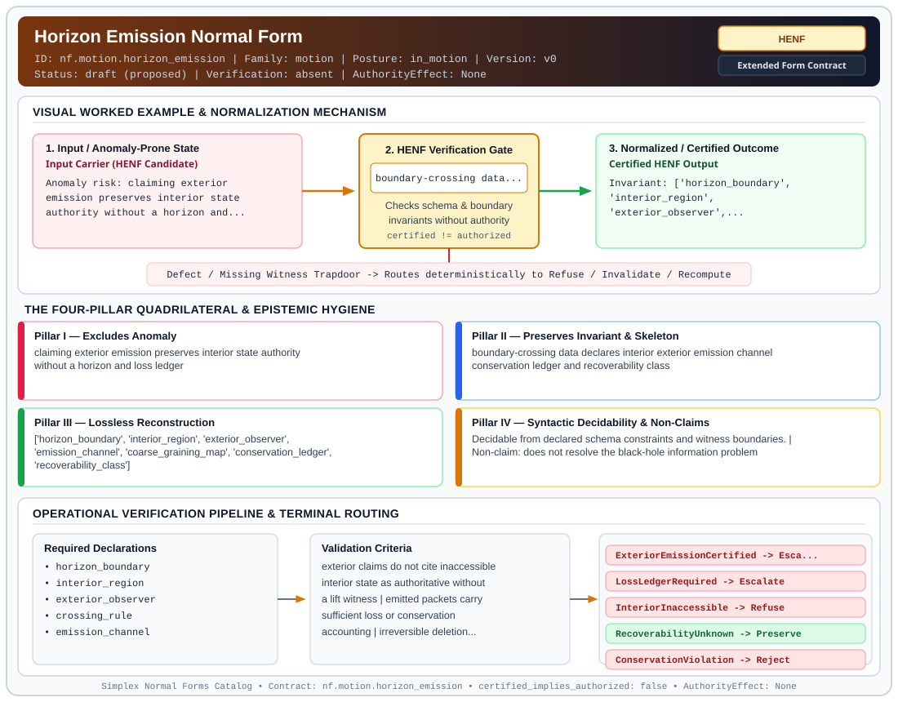

# Horizon Emission Normal Form (`HENF`)

> **Contract ID:** `nf.motion.horizon_emission` | **Family:** `motion` | **Index Status:** `draft` | **AuthorityEffect:** `None`

**[⬅ Back to Wiki Home](Home)** | **[View SVG Diagram](images/nf.motion.horizon_emission.svg)**

---

## 1. Executive Summary & Metadata

Horizon Emission Normal Form (HENF) enforces structural normalization and explicit defect routing in the motion regime.

| Property | Value |
| :--- | :--- |
| **Canonical ID** | `nf.motion.horizon_emission` |
| **Short Name** | `HENF` |
| **Full Name** | Horizon Emission Normal Form |
| **Family** | `motion` (Flow Control, Horizon Emission & Lieb-Robinson Locality Bounds) |
| **Qualification** | Extended Form Contract (Normal Form Contract) |
| **Data / Math Posture** | in_motion |
| **Index Status** | `draft` |
| **Theory Status** | `proposed` |
| **Verification Status** | `absent` |
| **Contract Version** | `v0` |
| **Governance Fence** | `AuthorityEffect: None` (`certified_implies_authorized: false`) |

---

## 2. Visual Architecture & Normalization Diagram



---

## 3. Concrete Worked Example & Mechanism

### Visual Transition Summary

| Stage | Carrier / Operator | Concrete State / Invariant |
| :--- | :--- | :--- |
| **1. Before / Candidate Input** | `Input Carrier (HENF Candidate)` | Anomaly risk: claiming exterior ; emission preserves interior state ; authority without a horizon and... |
| **2. Normalization / Gate** | `HENF Verification Gate` | `boundary-crossing data...` (`certified_implies_authorized: false`) |
| **3. After / Certified Output** | `Certified HENF Output` | Invariant: ['horizon_boundary', ; 'interior_region', ; 'exterior_observer',... |

---

## 4. The Four-Pillar Quadrilateral & Non-Claims

Every contract in `simplex-normal-forms` is evaluated against the **Four-Pillar Quadrilateral** defined in `contracts/_golden_nfs/standard.yaml`:

| Pillar | Requirement | Contract Specification for `nf.motion.horizon_emission` |
| :--- | :--- | :--- |
| **Pillar I: Excludes Anomaly** | Name and eliminate a specific class of data or state defects. | claiming exterior emission preserves interior state authority without a horizon and loss ledger |
| **Pillar II: Preserves Invariant** | State the structural invariant and protected skeleton preserved across transitions. | **Invariant:** boundary-crossing data declares interior exterior emission channel conservation ledger and recoverability class<br>**Protected Skeleton:** ['horizon_boundary', 'interior_region', 'exterior_observer', 'emission_channel', 'coarse_graining_map', 'conservation_ledger', 'recoverability_class'] |
| **Pillar III: Lossless Reconstruction** | State the non-loss reconstruction operator (join, direct sum, pullback, or replay). | Lossless reconstruction under declared projection, direct sum, or pullback operators. |
| **Pillar IV: Syntactic Decidability** | State how conformance is decided from declared constraints without unbudgeted scans. | Decidable from declared schema and witness metadata within bounded evaluation budgets. |

### Explicit Non-Claims (`certified_implies_authorized: false`)

- does not resolve the black-hole information problem
- does not assert a physical Hawking spectrum unless a finite physical model supplies that evidence
- does not let exterior summaries authorize inaccessible interior state without a declared lift or refusal
- does not replace CODA-MUR loss-ledger obligations for ordinary representation transport

---

## 5. Operational Verification & Terminal Routing

### 5.1 Required Declarations

- horizon_boundary
- interior_region
- exterior_observer
- crossing_rule
- emission_channel
- coarse_graining_map
- conservation_ledger
- recoverability_class
- refusal_rule_for_interior_claims

### 5.2 Required Evidence

- boundary_crossing_trace
- emitted_packet_log
- loss_or_redaction_ledger
- conservation_ledger
- lift_witness_if_exterior_claim_mentions_interior_state

### 5.3 Validation Criteria

| Criterion ID | Name | Condition |
| :--- | :--- | :--- |
| `criterion` | Check | exterior claims do not cite inaccessible interior state as authoritative without a lift witness |
| `criterion` | Check | emitted packets carry sufficient loss or conservation accounting |
| `criterion` | Check | irreversible deletion redaction eviction or compaction terminalizes as LossLedgerRequired unless exact lift exists |
| `criterion` | Check | recoverability class is explicit before emitted data drives downstream authority |

### 5.4 Terminal Route Map

Every evaluation terminates in a declared local route mapped to a canonical terminal in `standard.yaml`:

| Local Terminal Route | Canonical Terminal |
| :--- | :--- |
| `ExteriorEmissionCertified` | `Escalate` |
| `LossLedgerRequired` | `Escalate` |
| `InteriorInaccessible` | `Refuse` |
| `RecoverabilityUnknown` | `Preserve` |
| `ConservationViolation` | `Reject` |
| `RefuseUnledgeredHorizon` | `Refuse` |

### 5.5 Declared Failure Modes

- **symptom**: compacted log or redacted store serves an exterior summary as if the erased interior rows remained reconstructable, **diagnosis**: unledgered horizon crossing, **terminal**: LossLedgerRequired
- **symptom**: consumer relies on emitted aggregate to make a row-level claim across an inaccessible boundary, **diagnosis**: exterior authority overreach, **terminal**: InteriorInaccessible

---

## 6. Epistemic Claim Hygiene Quadrant

In accordance with the repository's epistemic claim discipline:

1. **What it supports:**
   - Supports syntactic and operational checking of `nf.motion.horizon_emission` (`HENF`) against its declared schema, boundary constraints, and witness obligations in this model.
   - Supports deterministic terminal routing (`ExteriorEmissionCertified, LossLedgerRequired, InteriorInaccessible, RecoverabilityUnknown`) when required declarations or invariants fail.
2. **What it does not support:**
   - Does not confer operational authority (`AuthorityEffect: None`, `certified_implies_authorized: false`).
   - Does not claim semantic truth of undeclared external processes or unverified upstream inputs beyond the declaredprotected skeleton.
3. **The narrowest defensible claim:**
   - Within the declared substrate `in_motion`, this contract enforces that `claiming exterior emission preserves interior state authority without a horizon and loss ledger` is either excluded under `boundary-crossing data declares interior exterior emission channel conservation ledger and recoverability class` or routed to an explicit refusal/recovery terminal.
4. **The next test needed:**
   - Property-based falsification and mutation testing across boundary edge cases and composed multi-step pipelines for `nf.motion.horizon_emission`.

---

## 7. Canonical YAML Contract (`contracts/nf.motion.horizon_emission.yaml`)

<details>
<summary><strong>Click to expand full canonical YAML contract (contracts/nf.motion.horizon_emission.yaml)</strong></summary>

```yaml
schema_version: smplx.nf.contract.v0
contract_kind: normal_form_contract
identity:
  id: nf.motion.horizon_emission
  name: Horizon Emission Normal Form
  short_name: HENF
  version: v0
  status: draft
  family: motion
  theory_status: proposed
  contract_status: draft
  verification_status: absent
classification:
  hierarchy_level: normal_form
  subject_kind:
  - horizon_boundary
  - emission_stream
  - distributed_claim
  data_posture: in_motion
  mathematical_posture: operational
purpose:
  excludes_anomaly: claiming exterior emission preserves interior state authority
    without a horizon and loss ledger
  preserves_invariant: boundary-crossing data declares interior exterior emission
    channel conservation ledger and recoverability class
  protected_skeleton:
  - horizon_boundary
  - interior_region
  - exterior_observer
  - emission_channel
  - coarse_graining_map
  - conservation_ledger
  - recoverability_class
  erased_structure: []
  non_claims:
  - does not resolve the black-hole information problem
  - does not assert a physical Hawking spectrum unless a finite physical model supplies
    that evidence
  - does not let exterior summaries authorize inaccessible interior state without
    a declared lift or refusal
  - does not replace CODA-MUR loss-ledger obligations for ordinary representation
    transport
obstruction_substrate:
  policy_ref: ../substrate/default_finite_obstruction_policy.yaml
  finite_carrier:
    description: finite boundary channel separating interior claims from exterior
      emitted packets summaries tombstones or redactions
  cochain_complex:
    C0: admissible_decodings_lifts_tombstones_or_loss_ledgers
    C1: horizon_crossing_loss_emission_mismatch_or_unledgered_redaction_defects
    C2: conservation_recoverability_or_authority_closure_failures
    d0: ledger_or_lift_to_emission_defect
    d1: emission_defect_to_closure_failure
    quotient: Q1 = C1 / im(d0)
  obstruction_class:
    notation: '[omega]'
    exact: '[omega] == 0'
    residual_closed: '[omega] != 0 and d1(omega) == 0'
    open: d1(omega) != 0
  carrier_realization: boundary_channel
  geometry_module: null
  gauge_metric_selector:
    weights:
    - recoverability
    - loss
    - conservation_violation
    - authority_risk
    selector_role: choose refusal or residual terminal when exterior evidence cannot
      lift interior claims
declarations_required:
- horizon_boundary
- interior_region
- exterior_observer
- crossing_rule
- emission_channel
- coarse_graining_map
- conservation_ledger
- recoverability_class
- refusal_rule_for_interior_claims
evidence_required:
- boundary_crossing_trace
- emitted_packet_log
- loss_or_redaction_ledger
- conservation_ledger
- lift_witness_if_exterior_claim_mentions_interior_state
validation_criteria:
- exterior claims do not cite inaccessible interior state as authoritative without
  a lift witness
- emitted packets carry sufficient loss or conservation accounting
- irreversible deletion redaction eviction or compaction terminalizes as LossLedgerRequired
  unless exact lift exists
- recoverability class is explicit before emitted data drives downstream authority
proof_obligations:
- id: henf.exterior_authority_soundness
  statement: exterior authority is limited to emitted packets and declared finite
    lifts
  status: deferred
terminal_routes:
- ExteriorEmissionCertified
- LossLedgerRequired
- InteriorInaccessible
- RecoverabilityUnknown
- ConservationViolation
- RefuseUnledgeredHorizon
certification:
  certificate_required: true
  certificate_kind: horizon_emission_certificate
  obstruction_class_required: true
  loss_ledger_required: true
  verifier_required: true
authorization:
  authorized_by: null
  certified_implies_authorized: false
failure_modes:
- symptom: compacted log or redacted store serves an exterior summary as if the erased
    interior rows remained reconstructable
  diagnosis: unledgered horizon crossing
  terminal: LossLedgerRequired
- symptom: consumer relies on emitted aggregate to make a row-level claim across an
    inaccessible boundary
  diagnosis: exterior authority overreach
  terminal: InteriorInaccessible
references:
- ../nf.coda.mur.transport.yaml
- ../relnf.md
- ../1_normal_forms.md
terminal_route_map:
  ExteriorEmissionCertified: Escalate
  LossLedgerRequired: Escalate
  InteriorInaccessible: Refuse
  RecoverabilityUnknown: Preserve
  ConservationViolation: Reject
  RefuseUnledgeredHorizon: Refuse
definition:
  source: coda_all_universe/mssn_sn_tower/definitions.md
  formal_statement: claiming exterior emission preserves interior state authority
    without a horizon and loss ledger. boundary-crossing data declares interior exterior
    emission channel conservation ledger and recoverability class
  quadrilateral:
    qualifies_as_true_normal_form: false
    qualification_gap: reconstruction_is_not_a_relational_project_join
    anomaly_exclusion: claiming exterior emission preserves interior state authority
      without a horizon and loss ledger
    lossless_join:
      status: declared_reconstruction
      statement: boundary-crossing data declares interior exterior emission channel
        conservation ledger and recoverability class
    dependency_preservation:
      status: declared_with_the_invariant
      statement: The preserved invariant stays on the declared schema. This form does
        not state a functional-dependency projection of a flat relvar decomposition.
    syntactic_decision:
      status: declaration_decidable
      statement: The check reads the declared constraints and validation criteria.
        One unrecorded runtime image is not the decider.
schema_ref: ./normal_form_contract_schema.yaml
```

</details>
