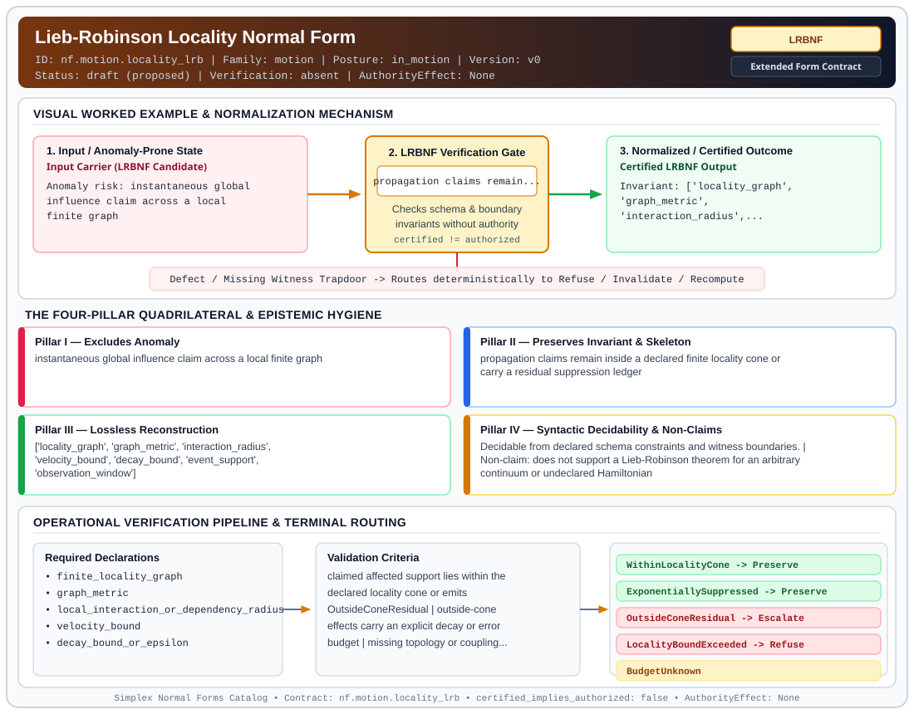

# Lieb-Robinson Locality Normal Form (`LRBNF`)

> **Contract ID:** `nf.motion.locality_lrb` | **Family:** `motion` | **Index Status:** `draft` | **AuthorityEffect:** `None`

**[⬅ Back to Wiki Home](Home)** | **[View SVG Diagram](images/nf.motion.locality_lrb.svg)**

---

## 1. Executive Summary & Metadata

Lieb-Robinson Locality Normal Form (LRBNF) enforces structural normalization and explicit defect routing in the motion regime.

| Property | Value |
| :--- | :--- |
| **Canonical ID** | `nf.motion.locality_lrb` |
| **Short Name** | `LRBNF` |
| **Full Name** | Lieb-Robinson Locality Normal Form |
| **Family** | `motion` (Flow Control, Horizon Emission & Lieb-Robinson Locality Bounds) |
| **Qualification** | Extended Form Contract (Normal Form Contract) |
| **Data / Math Posture** | in_motion |
| **Index Status** | `draft` |
| **Theory Status** | `proposed` |
| **Verification Status** | `absent` |
| **Contract Version** | `v0` |
| **Governance Fence** | `AuthorityEffect: None` (`certified_implies_authorized: false`) |

---

## 2. Visual Architecture & Normalization Diagram



---

## 3. Concrete Worked Example & Mechanism

### Visual Transition Summary

| Stage | Carrier / Operator | Concrete State / Invariant |
| :--- | :--- | :--- |
| **1. Before / Candidate Input** | `Input Carrier (LRBNF Candidate)` | Anomaly risk: instantaneous global ; influence claim across a local ; finite graph |
| **2. Normalization / Gate** | `LRBNF Verification Gate` | `propagation claims remain...` (`certified_implies_authorized: false`) |
| **3. After / Certified Output** | `Certified LRBNF Output` | Invariant: ['locality_graph', ; 'graph_metric', ; 'interaction_radius',... |

---

## 4. The Four-Pillar Quadrilateral & Non-Claims

Every contract in `simplex-normal-forms` is evaluated against the **Four-Pillar Quadrilateral** defined in `contracts/_golden_nfs/standard.yaml`:

| Pillar | Requirement | Contract Specification for `nf.motion.locality_lrb` |
| :--- | :--- | :--- |
| **Pillar I: Excludes Anomaly** | Name and eliminate a specific class of data or state defects. | instantaneous global influence claim across a local finite graph |
| **Pillar II: Preserves Invariant** | State the structural invariant and protected skeleton preserved across transitions. | **Invariant:** propagation claims remain inside a declared finite locality cone or carry a residual suppression ledger<br>**Protected Skeleton:** ['locality_graph', 'graph_metric', 'interaction_radius', 'velocity_bound', 'decay_bound', 'event_support', 'observation_window'] |
| **Pillar III: Lossless Reconstruction** | State the non-loss reconstruction operator (join, direct sum, pullback, or replay). | Lossless reconstruction under declared projection, direct sum, or pullback operators. |
| **Pillar IV: Syntactic Decidability** | State how conformance is decided from declared constraints without unbudgeted scans. | Decidable from declared schema and witness metadata within bounded evaluation budgets. |

### Explicit Non-Claims (`certified_implies_authorized: false`)

- does not support a Lieb-Robinson theorem for an arbitrary continuum or undeclared Hamiltonian
- does not imply zero influence outside the cone; it requires bounded residual accounting
- does not authorize physical interpretation beyond the finite carrier and declared bound

---

## 5. Operational Verification & Terminal Routing

### 5.1 Required Declarations

- finite_locality_graph
- graph_metric
- local_interaction_or_dependency_radius
- velocity_bound
- decay_bound_or_epsilon
- event_support
- observation_window
- residual_ledger_policy

### 5.2 Required Evidence

- topology_snapshot
- dependency_or_coupling_bound
- event_support_witness
- observation_time_window
- residual_bound_computation

### 5.3 Validation Criteria

| Criterion ID | Name | Condition |
| :--- | :--- | :--- |
| `criterion` | Check | claimed affected support lies within the declared locality cone or emits OutsideConeResidual |
| `criterion` | Check | outside-cone effects carry an explicit decay or error budget |
| `criterion` | Check | missing topology or coupling evidence terminalizes as BudgetUnknown or LocalityBoundExceeded |
| `criterion` | Check | locality cone composition is checked for multi-hop transports |

### 5.4 Terminal Route Map

Every evaluation terminates in a declared local route mapped to a canonical terminal in `standard.yaml`:

| Local Terminal Route | Canonical Terminal |
| :--- | :--- |
| `WithinLocalityCone` | `Preserve` |
| `ExponentiallySuppressed` | `Preserve` |
| `OutsideConeResidual` | `Escalate` |
| `LocalityBoundExceeded` | `Refuse` |
| `BudgetUnknown` | `BudgetUnknown` |
| `RefuseInstantInfluence` | `Refuse` |

### 5.5 Declared Failure Modes

- **symptom**: distant cache partition is invalidated or trusted as updated before any declared dependency path can carry the event, **diagnosis**: unbounded propagation assumption, **terminal**: RefuseInstantInfluence
- **symptom**: approximate locality is used without publishing the residual error budget, **diagnosis**: missing outside-cone residual ledger, **terminal**: OutsideConeResidual

---

## 6. Epistemic Claim Hygiene Quadrant

In accordance with the repository's epistemic claim discipline:

1. **What it supports:**
   - Supports syntactic and operational checking of `nf.motion.locality_lrb` (`LRBNF`) against its declared schema, boundary constraints, and witness obligations in this model.
   - Supports deterministic terminal routing (`WithinLocalityCone, ExponentiallySuppressed, OutsideConeResidual, LocalityBoundExceeded`) when required declarations or invariants fail.
2. **What it does not support:**
   - Does not confer operational authority (`AuthorityEffect: None`, `certified_implies_authorized: false`).
   - Does not claim semantic truth of undeclared external processes or unverified upstream inputs beyond the declaredprotected skeleton.
3. **The narrowest defensible claim:**
   - Within the declared substrate `in_motion`, this contract enforces that `instantaneous global influence claim across a local finite graph` is either excluded under `propagation claims remain inside a declared finite locality cone or carry a residual suppression ledger` or routed to an explicit refusal/recovery terminal.
4. **The next test needed:**
   - Property-based falsification and mutation testing across boundary edge cases and composed multi-step pipelines for `nf.motion.locality_lrb`.

---

## 7. Canonical YAML Contract (`contracts/nf.motion.locality_lrb.yaml`)

<details>
<summary><strong>Click to expand full canonical YAML contract (contracts/nf.motion.locality_lrb.yaml)</strong></summary>

```yaml
schema_version: smplx.nf.contract.v0
contract_kind: normal_form_contract
identity:
  id: nf.motion.locality_lrb
  name: Lieb-Robinson Locality Normal Form
  short_name: LRBNF
  version: v0
  status: draft
  family: motion
  theory_status: proposed
  contract_status: draft
  verification_status: absent
classification:
  hierarchy_level: normal_form
  subject_kind:
  - locality_graph
  - distributed_write
  - distributed_claim
  data_posture: in_motion
  mathematical_posture: formal_algebraic
purpose:
  excludes_anomaly: instantaneous global influence claim across a local finite graph
  preserves_invariant: propagation claims remain inside a declared finite locality
    cone or carry a residual suppression ledger
  protected_skeleton:
  - locality_graph
  - graph_metric
  - interaction_radius
  - velocity_bound
  - decay_bound
  - event_support
  - observation_window
  erased_structure: []
  non_claims:
  - does not support a Lieb-Robinson theorem for an arbitrary continuum or undeclared
    Hamiltonian
  - does not imply zero influence outside the cone; it requires bounded residual accounting
  - does not authorize physical interpretation beyond the finite carrier and declared
    bound
obstruction_substrate:
  policy_ref: ../substrate/default_finite_obstruction_policy.yaml
  finite_carrier:
    description: finite metric graph with local supports propagation windows velocity
      bounds and residual decay budgets
  cochain_complex:
    C0: local_delays_repair_paths_or_basis_updates
    C1: out_of_cone_influence_or_unbounded_commutator_defects
    C2: locality_cycle_or_noncomposable_bound_closure_failures
    d0: local_repair_to_propagation_defect
    d1: propagation_defect_to_locality_closure_failure
    quotient: Q1 = C1 / im(d0)
  obstruction_class:
    notation: '[omega]'
    exact: '[omega] == 0'
    residual_closed: '[omega] != 0 and d1(omega) == 0'
    open: d1(omega) != 0
  carrier_realization: finite_metric_graph
  geometry_module: null
  gauge_metric_selector:
    weights:
    - distance
    - time
    - residual_bound
    - confidence
    selector_role: choose conservative terminal when suppression evidence is incomplete
declarations_required:
- finite_locality_graph
- graph_metric
- local_interaction_or_dependency_radius
- velocity_bound
- decay_bound_or_epsilon
- event_support
- observation_window
- residual_ledger_policy
evidence_required:
- topology_snapshot
- dependency_or_coupling_bound
- event_support_witness
- observation_time_window
- residual_bound_computation
validation_criteria:
- claimed affected support lies within the declared locality cone or emits OutsideConeResidual
- outside-cone effects carry an explicit decay or error budget
- missing topology or coupling evidence terminalizes as BudgetUnknown or LocalityBoundExceeded
- locality cone composition is checked for multi-hop transports
proof_obligations:
- id: lrbnf.finite_locality_bound
  statement: finite propagation bound is sound for the declared graph metric and dependency
    radius
  status: deferred
terminal_routes:
- WithinLocalityCone
- ExponentiallySuppressed
- OutsideConeResidual
- LocalityBoundExceeded
- BudgetUnknown
- RefuseInstantInfluence
certification:
  certificate_required: true
  certificate_kind: locality_bound_certificate
  obstruction_class_required: true
  loss_ledger_required: conditional
  verifier_required: true
authorization:
  authorized_by: null
  certified_implies_authorized: false
failure_modes:
- symptom: distant cache partition is invalidated or trusted as updated before any
    declared dependency path can carry the event
  diagnosis: unbounded propagation assumption
  terminal: RefuseInstantInfluence
- symptom: approximate locality is used without publishing the residual error budget
  diagnosis: missing outside-cone residual ledger
  terminal: OutsideConeResidual
references:
- ../relnf.md
- ../1_normal_forms.md
- ../symbol_dictionary.md
terminal_route_map:
  WithinLocalityCone: Preserve
  ExponentiallySuppressed: Preserve
  OutsideConeResidual: Escalate
  LocalityBoundExceeded: Refuse
  BudgetUnknown: BudgetUnknown
  RefuseInstantInfluence: Refuse
definition:
  source: coda_all_universe/mssn_sn_tower/definitions.md
  formal_statement: instantaneous global influence claim across a local finite graph.
    propagation claims remain inside a declared finite locality cone or carry a residual
    suppression ledger
  quadrilateral:
    qualifies_as_true_normal_form: false
    qualification_gap: reconstruction_is_not_a_relational_project_join
    anomaly_exclusion: instantaneous global influence claim across a local finite
      graph
    lossless_join:
      status: declared_reconstruction
      statement: propagation claims remain inside a declared finite locality cone
        or carry a residual suppression ledger
    dependency_preservation:
      status: declared_with_the_invariant
      statement: The preserved invariant stays on the declared schema. This form does
        not state a functional-dependency projection of a flat relvar decomposition.
    syntactic_decision:
      status: declaration_decidable
      statement: The check reads the declared constraints and validation criteria.
        One unrecorded runtime image is not the decider.
schema_ref: ./normal_form_contract_schema.yaml
```

</details>
