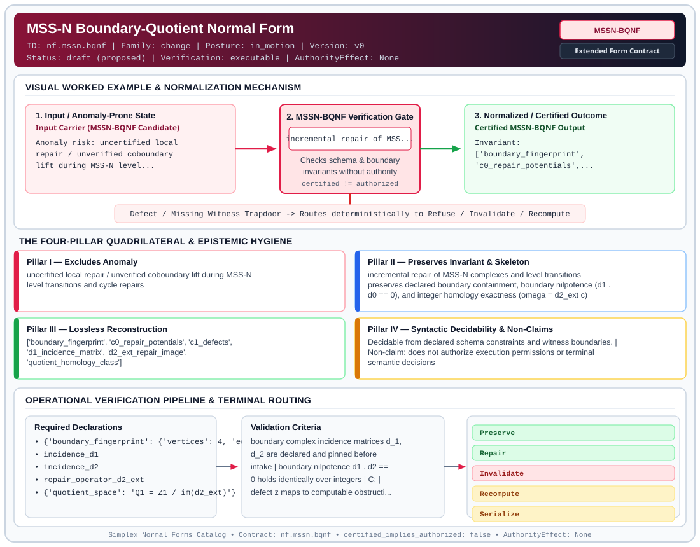

# MSS-N Boundary-Quotient Normal Form (`MSSN-BQNF`)

> **Contract ID:** `nf.mssn.bqnf` | **Family:** `change` | **Index Status:** `draft` | **AuthorityEffect:** `None`

**[⬅ Back to Wiki Home](Home)** | **[View SVG Diagram](images/nf.mssn.bqnf.svg)**

---

## 1. Executive Summary & Metadata

MSS-N Boundary-Quotient Normal Form (MSSN-BQNF) enforces structural normalization and explicit defect routing in the change regime.

| Property | Value |
| :--- | :--- |
| **Canonical ID** | `nf.mssn.bqnf` |
| **Short Name** | `MSSN-BQNF` |
| **Full Name** | MSS-N Boundary-Quotient Normal Form |
| **Family** | `change` (Data in Motion & Boundary-Quotient Incremental Maintenance Contracts (BQNF & Cochain Repair)) |
| **Qualification** | Extended Form Contract (Normal Form Contract) |
| **Data / Math Posture** | in_motion |
| **Index Status** | `draft` |
| **Theory Status** | `proposed` |
| **Verification Status** | `executable` |
| **Contract Version** | `v0` |
| **Governance Fence** | `AuthorityEffect: None` (`certified_implies_authorized: false`) |

---

## 2. Visual Architecture & Normalization Diagram



---

## 3. Concrete Worked Example & Mechanism

### Visual Transition Summary

| Stage | Carrier / Operator | Concrete State / Invariant |
| :--- | :--- | :--- |
| **1. Before / Candidate Input** | `Input Carrier (MSSN-BQNF Candidate)` | Anomaly risk: uncertified local ; repair / unverified coboundary ; lift during MSS-N level... |
| **2. Normalization / Gate** | `MSSN-BQNF Verification Gate` | `incremental repair of MSS...` (`certified_implies_authorized: false`) |
| **3. After / Certified Output** | `Certified MSSN-BQNF Output` | Invariant: ; ['boundary_fingerprint', ; 'c0_repair_potentials',... |

---

## 4. The Four-Pillar Quadrilateral & Non-Claims

Every contract in `simplex-normal-forms` is evaluated against the **Four-Pillar Quadrilateral** defined in `contracts/_golden_nfs/standard.yaml`:

| Pillar | Requirement | Contract Specification for `nf.mssn.bqnf` |
| :--- | :--- | :--- |
| **Pillar I: Excludes Anomaly** | Name and eliminate a specific class of data or state defects. | uncertified local repair / unverified coboundary lift during MSS-N level transitions and cycle repairs |
| **Pillar II: Preserves Invariant** | State the structural invariant and protected skeleton preserved across transitions. | **Invariant:** incremental repair of MSS-N complexes and level transitions preserves declared boundary containment, boundary nilpotence (d1 . d0 == 0), and integer homology exactness (omega = d2_ext c)<br>**Protected Skeleton:** ['boundary_fingerprint', 'c0_repair_potentials', 'c1_defects', 'd1_incidence_matrix', 'd2_ext_repair_image', 'quotient_homology_class'] |
| **Pillar III: Lossless Reconstruction** | State the non-loss reconstruction operator (join, direct sum, pullback, or replay). | Lossless reconstruction under declared projection, direct sum, or pullback operators. |
| **Pillar IV: Syntactic Decidability** | State how conformance is decided from declared constraints without unbudgeted scans. | Decidable from declared schema and witness metadata within bounded evaluation budgets. |

### Explicit Non-Claims (`certified_implies_authorized: false`)

- does not authorize execution permissions or terminal semantic decisions
- does not ensure under declared assumptions generic simplicial complex homology without pinned finite incidence
- syntactic acceptance of qed<exact> leaves receipt UNVERIFIED; independent exact rational solver replay is required before establishing truth
- does not permit unverified boundary enlargement; repair candidates must lie within declared candidate 2-cells

---

## 5. Operational Verification & Terminal Routing

### 5.1 Required Declarations

- **boundary_fingerprint**: {'vertices': 4, 'edges': 5, 'faces': 1}
- incidence_d1
- incidence_d2
- repair_operator_d2_ext
- **quotient_space**: Q1 = Z1 / im(d2_ext)
- terminal_routes

### 5.2 Required Evidence

- candidate_wire_text
- parsed_cycle_b
- computed_d1_b
- obstruction_vector_z
- preimage_candidate_c
- computed_d2_ext_c
- exactness_receipt_status

### 5.3 Validation Criteria

| Criterion ID | Name | Condition |
| :--- | :--- | :--- |
| `criterion` | Check | boundary complex incidence matrices d_1, d_2 are declared and pinned before intake |
| `criterion` | Check | boundary nilpotence d1 . d2 == 0 holds identically over integers |
| `` | **** |  |
| `criterion` | Check | defect z maps to computable obstruction class in Q1 = Z1 / im(d2_ext) |
| `criterion` | Check | repair allowed only when obstruction_class == '[0]', equivalently z = d2_ext(c) |
| `criterion` | Check | unverified qed<exact> literal does not authorize state change without independent solver replay |
| `criterion` | Check | nonzero unknown or non-closed obstruction terminalizes loudly |

### 5.4 Terminal Route Map

Every evaluation terminates in a declared local route mapped to a canonical terminal in `standard.yaml`:

| Local Terminal Route | Canonical Terminal |
| :--- | :--- |
| `Preserve` | `Preserve` |
| `Repair` | `Repair` |
| `Invalidate` | `Invalidate` |
| `Recompute` | `Recompute` |
| `Serialize` | `Serialize` |
| `Lift` | `Lift` |
| `Unsupported` | `Unsupported` |
| `ConservativeInvalidate` | `ConservativeInvalidate` |
| `Escalate` | `Escalate` |
| `ClosureFailure` | `ClosureFailure` |
| `Residual` | `Escalate` |

### 5.5 Declared Failure Modes

- **symptom**: candidate cycle b has d1 * b != 0, **diagnosis**: cycle closure failure, **terminal**: ClosureFailure
- **symptom**: closed cycle z cannot be expressed as d2_ext(c), **diagnosis**: non-trivial homology class; unrepairable locally, **terminal**: Escalate
- **symptom**: qed<exact> present but solver replay unexecuted or failing, **diagnosis**: unverified claim promotion attempt, **terminal**: Invalidate
- **symptom**: candidate adds edge outside pinned 5-edge complex, **diagnosis**: undeclared boundary enlargement, **terminal**: Unsupported

---

## Deep-Dive Level Treatise

**AuthorityEffect:** None.  
**Level:** Level 10 (Data in Motion / Incremental Repair & Boundary Quotients)  
**Evidential Grade:** NATIVE IMPLEMENTED  
**Contract Reference:** [`nf.mssn.bqnf`](../../../../omega_engine_pfp/infrastructure/yaml/normal_forms/nf.mssn.bqnf.yaml)  
**Mathematical Posture:** Discrete Boundary-Quotient Calculus & CDC Streams  
**Data Posture:** In Motion  

---

## 1. Schematic & Conceptual Architecture

Boundary-Quotient Normal Form (BQNF) shifts normalization from static schemas (data at rest) to **runtime state transitions** (data in motion):
- Evaluates whether an incoming Change Data Capture (CDC) write event $e \in \Delta$ on base tables can be **incrementally repaired** across dependent views, caches, and materialized observers.
- Uses **boundary fingerprints** ($\partial Q$) to determine whether a query boundary is breached.
- Emits explicit **typed terminal routes** rather than crashing or silently serving stale data.

```text
       Write Event e on Base Relvars
                     │
                     ▼
       Boundary Test: e ∩ ∂Q ≠ ∅ ?
                    / \
                  NO   YES
                  /     \
                 /       ▼
                /   Evaluate Residual: Xi = 0 ?
               /         / \
              /        YES  NO
             /         /     \
            ▼         ▼       ▼
        Preserve    Repair   Quarantine / Invalidate
```

### Engine-Relative Realization: $\text{NF} = (\text{invariant}, \text{substrate}, \text{attempt})$

Industrial relational engines do not possess native category-theoretic quotient types. On real engines, BQNF is realized as a **certified attempt**:

| Engine Substrate | CDC / Trigger Mechanism | Certificate Store | Attempt Realization |
|---|---|---|---|
| **SQL Server / Azure SQL** | `AFTER INSERT, UPDATE, DELETE` triggers or SQL Server CDC (`cdc.fn_cdc_get_net_changes_*`) | `dbo.RepairCertificate` (columns: `ChangeId`, `BoundaryBreached`, `ResidualNorm`, `WitnessHash`, `CertifiedAt`) | Procedural evaluation via T-SQL; routes un-repairable events to quarantine status flags |
| **PostgreSQL** | Row-level triggers (`FOR EACH ROW`) or logical decoding replication slots (`pg_logical_slot_get_changes`) | `public.repair_certificate` with UUID primary keys and JSONB witness payload | PL/pgSQL event hooks; external daemon verifies witness contracts and unblocks quarantined views |

---

## 2. Mathematical Invariants & Quadrilateral Properties

1. **Formal Definition:**
   Let $Q$ be an observer query over base relvars $R$. The **boundary** $\partial Q$ is the set of tuples whose modification can alter the membership or aggregation of $Q(R)$.
   A system transition $(S, e) \to S'$ is in BQNF with respect to observer $Q$ if and only if:
   - When $e \cap \partial Q = \emptyset$, $Q(S') = Q(S)$ and the transition routes to `Preserve`.
   - When $e \cap \partial Q \neq \emptyset$, the change satisfies the repair contract ($d\alpha = \Delta$) with residual $\Xi = 0$, routing to `Repair`.
   - When the change cannot be locally repaired ($\Xi > 0$), it routes to `Quarantine` or `Invalidate` with a signed `RepairCertificate`.

2. **The Four Canonical Terminal Routes:**
   - `Preserve`: Event does not touch the boundary; cached state remains strictly valid without recomputation.
   - `Repair`: Event hits the boundary, but compensating incremental deltas restore exact consistency.
   - `Quarantine`: Event causes a non-trivial boundary breach; view is fenced from serving production traffic until background recomputation finishes.
   - `Invalidate`: Boundary severely corrupted; cache is purged and must be rebuilt from ground relvars.

3. **The Quadrilateral Invariants:**
   - **Anomaly Excluded:** Silent stale reads, unbounded CDC drift, phantom aggregate corruption, and uncertified cache repairs.
   - **Protected Skeleton:** Base relvar identities, boundary predicates $\partial Q$, and verified repair certificates.
   - **Erased Structure:** Intermediate transient CDC states that collapse under delta folding.
   - **Reconstruction:** Exact incremental view maintenance $Q(S') = Q(S) \oplus \Delta Q(e)$.

---

## 3. Terminal Routes & Verification Logic

```text
CDC Event e & Materialized Observer Q
      │
      ├── e outside boundary (e ∩ ∂Q = ∅) ──────────► Preserve (ZeroCostInvariance)
      │
      ├── Boundary hit, local repair exact (Ξ = 0) ──► Repair (IncrementalDeltaApplied)
      │
      ├── Boundary hit, local repair diverges ───────► Quarantine (BoundedDiscrepancy)
      │
      └── Unreconciled schema migration ─────────────► Invalidate (CachePurged)
```

---

## 4. Test Evidence & Local Execution

Verified in [`test_bqnf_cdc_property.py`](../../../tests/normal_forms/test_bqnf_cdc_property.py) and [`test_chase_algebra_and_bqnf_streaming.py`](../../../tests/normal_forms/test_chase_algebra_and_bqnf_streaming.py):
- `test_bqnf_orders_paid_revenue_incremental_repair`: Simulates 50 e-commerce order status transitions; asserts that non-boundary updates route to `Preserve` and boundary hits route to `Repair` with verified delta payloads.
- `test_bqnf_aggregate_boundary_hit_with_zero_residual`: supports that when an aggregate hits the boundary with $\Xi = 0$, the state updates without full table scans.

---

## 5. Epistemic Claim Quadrant

1. **What it supports:**
   - checked by this oracle incremental cache maintenance with zero stale read anomalies.
   - Deterministic routing to named terminal states under all CDC event types.
2. **What it does not support:**
   - Arbitrary ad-hoc SQL rewrites without declared boundary definitions.
3. **The narrowest defensible claim:**
   - BQNF ensures under declared assumptions that an observer is updated locally if and only if the event does not breach the verified boundary quotient.
4. **The next test needed:**
   - Property tests under randomized concurrent CDC event reordering to verify abelian commutation of delta repairs.

---

## 6. Epistemic Claim Hygiene Quadrant

In accordance with the repository's epistemic claim discipline:

1. **What it supports:**
   - Supports syntactic and operational checking of `nf.mssn.bqnf` (`MSSN-BQNF`) against its declared schema, boundary constraints, and witness obligations in this model.
   - Supports deterministic terminal routing (`Preserve, Repair, Invalidate, Recompute`) when required declarations or invariants fail.
2. **What it does not support:**
   - Does not confer operational authority (`AuthorityEffect: None`, `certified_implies_authorized: false`).
   - Does not claim semantic truth of undeclared external processes or unverified upstream inputs beyond the declaredprotected skeleton.
3. **The narrowest defensible claim:**
   - Within the declared substrate `in_motion`, this contract enforces that `uncertified local repair / unverified coboundary lift during MSS-N level transitions and cycle repairs` is either excluded under `incremental repair of MSS-N complexes and level transitions preserves declared boundary containment, boundary nilpotence (d1 . d0 == 0), and integer homology exactness (omega = d2_ext c)` or routed to an explicit refusal/recovery terminal.
4. **The next test needed:**
   - Property-based falsification and mutation testing across boundary edge cases and composed multi-step pipelines for `nf.mssn.bqnf`.

---

## 7. Canonical YAML Contract (`contracts/nf.mssn.bqnf.yaml`)

<details>
<summary><strong>Click to expand full canonical YAML contract (contracts/nf.mssn.bqnf.yaml)</strong></summary>

```yaml
schema_version: smplx.nf.contract.v0
schema_ref: ./normal_form_contract_schema.yaml
contract_kind: normal_form_contract
identity:
  id: nf.mssn.bqnf
  name: MSS-N Boundary-Quotient Normal Form
  short_name: MSSN-BQNF
  version: v0
  theory_status: proposed
  contract_status: draft
  verification_status: executable
  family: change
  status: draft
classification:
  hierarchy_level: normal_form
  subject_kind:
  - mssn_boundary_packet
  - k0_cycle_repair
  - glyph_path_transition
  - homology_repair_candidate
  data_posture: in_motion
  mathematical_posture: operational
purpose:
  excludes_anomaly: uncertified local repair / unverified coboundary lift during MSS-N
    level transitions and cycle repairs
  preserves_invariant: incremental repair of MSS-N complexes and level transitions
    preserves declared boundary containment, boundary nilpotence (d1 . d0 == 0), and
    integer homology exactness (omega = d2_ext c)
  protected_skeleton:
  - boundary_fingerprint
  - c0_repair_potentials
  - c1_defects
  - d1_incidence_matrix
  - d2_ext_repair_image
  - quotient_homology_class
  erased_structure:
  - raw_comment_lines
  - cosmetic_vertex_relabeling
  non_claims:
  - does not authorize execution permissions or terminal semantic decisions
  - does not ensure under declared assumptions generic simplicial complex homology without pinned finite incidence
  - syntactic acceptance of qed<exact> leaves receipt UNVERIFIED; independent exact
    rational solver replay is required before establishing truth
  - does not permit unverified boundary enlargement; repair candidates must lie within
    declared candidate 2-cells
definition:
  source: coda_all_universe/mssn_sn_tower/definitions.md
  formal_statement: An MSS-N boundary transition or cycle-repair candidate is in Boundary-Quotient
    Normal Form (MSSN-BQNF) when each state modification or cycle candidate is classified
    against a declared boundary complex before any carrier state is patched. In K0
    cycle repair (cycle_repair.ebnf and mssn_transcoder.py), the 1-cycle z is closed
    when d1 z = 0 (z in Z1 = ker d1). The defect z is exact when z = d2_ext c for
    an external 2-cell preimage c, equivalently when its class in Q1 = Z1 / im(d2_ext)
    is zero ([z] = 0). Exact defects repair. A zero defect preserves state. A closed
    non-exact defect (d1 z = 0 but [z] != 0) cannot be repaired locally and escalates.
    A defect with d1 z != 0 is an invalid cycle. Stamping qed<exact> submits the exactness
    assertion; parsing leaves the receipt UNVERIFIED until independent exact solver
    replay certifies that [z] = 0.
  quadrilateral:
    qualifies_as_true_normal_form: false
    qualification_gap: reconstruction_is_exact_homological_repair_not_relational_project_join
    anomaly_exclusion: A local complex patch that was not shown to be an exact boundary,
      a silent under-invalidation in a boundary composite, or an unverified qed<exact>
      claim.
    lossless_join:
      status: recomputation_agreement
      statement: The repaired simplicial complex agrees with a full exact computation
        of H_1(K) on the declared complex. That agreement is the reconstruction theorem
        for this form.
    dependency_preservation:
      status: boundary_declared_before_runtime
      statement: The 4 vertices, 5 edges, 1 face, and incidence matrices d_1, d_2
        are declared and pinned before runtime; a candidate write does not enlarge
        that boundary.
    syntactic_decision:
      status: declaration_plus_event_decidable
      statement: The route is computed from the declared boundary matrices and the
        cycle candidate vector. It is syntactically decidable via integer matrix multiplication.
declarations_required:
- boundary_fingerprint:
    vertices: 4
    edges: 5
    faces: 1
- incidence_d1
- incidence_d2
- repair_operator_d2_ext
- quotient_space: Q1 = Z1 / im(d2_ext)
- terminal_routes
evidence_required:
- candidate_wire_text
- parsed_cycle_b
- computed_d1_b
- obstruction_vector_z
- preimage_candidate_c
- computed_d2_ext_c
- exactness_receipt_status
validation_criteria:
- boundary complex incidence matrices d_1, d_2 are declared and pinned before intake
- boundary nilpotence d1 . d2 == 0 holds identically over integers
- candidate chain b is closed: d1 * b == 0
- defect z maps to computable obstruction class in Q1 = Z1 / im(d2_ext)
- repair allowed only when obstruction_class == '[0]', equivalently z = d2_ext(c)
- unverified qed<exact> literal does not authorize state change without independent
  solver replay
- nonzero unknown or non-closed obstruction terminalizes loudly
proof_obligations:
- id: mssn.bqnf.nilpotence
  status: theorem_shaped
  ref: omega_engine_atlas/coda_atlas/F004_papers/001_finite_obstruction_calculus/000_pre_genesis_to_mssn/paper.md
  section: 13.3 (the explicitly declared triangle face)
- id: mssn.bqnf.exactness_solvability
  status: theorem_shaped
  ref: omega_engine_atlas/coda_atlas/F004_papers/001_finite_obstruction_calculus/000_pre_genesis_to_mssn/paper.md
  section: 13 (finite examples; general exact-solver obligations remain separate)
- id: mssn.bqnf.receipt_unverified_firewall
  status: theorem_shaped
  ref: ow/omega_engine_pfp_v0.2/grammar/README.md
  section: Source and wire boundaries
terminal_routes:
- Preserve
- Repair
- Invalidate
- Recompute
- Serialize
- Lift
- Unsupported
- ConservativeInvalidate
- Escalate
- ClosureFailure
- Residual
terminal_route_map:
  Preserve: Preserve
  Repair: Repair
  Invalidate: Invalidate
  Recompute: Recompute
  Serialize: Serialize
  Lift: Lift
  Unsupported: Unsupported
  ConservativeInvalidate: ConservativeInvalidate
  Escalate: Escalate
  ClosureFailure: ClosureFailure
  Residual: Escalate
certification:
  certificate_required: true
  certificate_kind: exact_homology_certificate
  obstruction_class_required: true
  loss_ledger_required: false
  verifier_required: true
  loss_ledger_trigger_id: null
authorization:
  authorized_by: null
  certified_implies_authorized: false
failure_modes:
- symptom: candidate cycle b has d1 * b != 0
  diagnosis: cycle closure failure
  terminal: ClosureFailure
- symptom: closed cycle z cannot be expressed as d2_ext(c)
  diagnosis: non-trivial homology class; unrepairable locally
  terminal: Escalate
- symptom: qed<exact> present but solver replay unexecuted or failing
  diagnosis: unverified claim promotion attempt
  terminal: Invalidate
- symptom: candidate adds edge outside pinned 5-edge complex
  diagnosis: undeclared boundary enlargement
  terminal: Unsupported
references:
- ../../../../omega_engine_atlas/coda_atlas/F004_papers/001_finite_obstruction_calculus/000_pre_genesis_to_mssn/paper.md
- ../../../ow/omega_engine_pfp_v0.2/grammar/cycle_repair.ebnf
- ../../../ow/omega_engine_pfp_v0.2/grammar/README.md
- ./nf.change.bqnf.yaml
- ./normal_form_contract_schema.yaml
obstruction_substrate:
  policy_ref: ../substrate/default_finite_obstruction_policy.yaml
  finite_carrier:
    description: pinned K0 simplicial complex with 4 vertices, 5 edges, 1 face
    max_rank: 5
  cochain_complex:
    C0: 2_cell_preimages_c
    C1: 1_cycles_z
    C2: 0_boundary_checks_d1_z
    d0: d2_ext maps external 2-cells to 1-boundaries
    d1: d1 maps 1-simplices to 0-boundaries
    quotient: Q1 = Z1 / im(d2_ext)
  obstruction_class:
    notation: '[z]'
    exact: '[z] == 0'
    residual_closed: d1(z) == 0 and [z] != 0
    open: d1(z) != 0
  carrier_realization:
    ref: geom.directed_graph_transition.v0
    path: ../geometry_modules/geom.directed_graph_transition.v0.yaml
  geometry_module: null
  gauge_metric_selector: null
```

</details>
