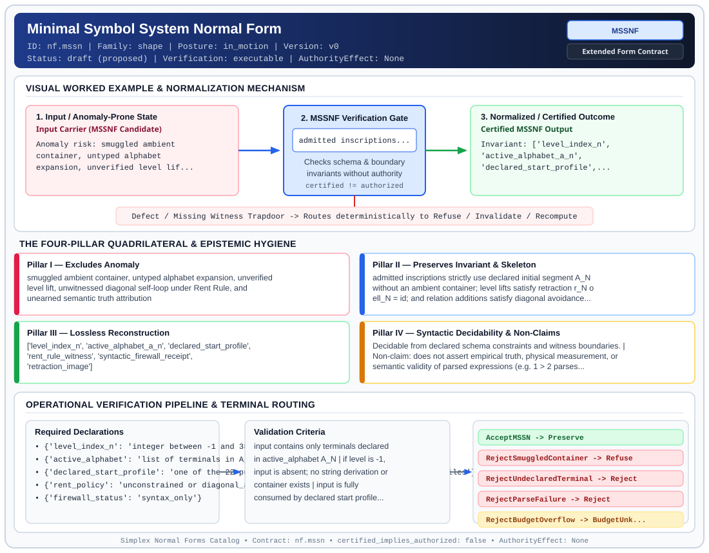

# Minimal Symbol System Normal Form (`MSSNF`)

> **Contract ID:** `nf.mssn` | **Family:** `shape` | **Index Status:** `draft` | **AuthorityEffect:** `None`

**[⬅ Back to Wiki Home](Home)** | **[View SVG Diagram](images/nf.mssn.svg)**

---

## 1. Executive Summary & Metadata

Minimal Symbol System Normal Form (MSSNF) enforces structural normalization and explicit defect routing in the shape regime.

| Property | Value |
| :--- | :--- |
| **Canonical ID** | `nf.mssn` |
| **Short Name** | `MSSNF` |
| **Full Name** | Minimal Symbol System Normal Form |
| **Family** | `shape` (Relational, Algebraic & Cochain Shape Normal Forms (Data at Rest & Structural Decompositions)) |
| **Qualification** | Extended Form Contract (Normal Form Contract) |
| **Data / Math Posture** | in_motion |
| **Index Status** | `draft` |
| **Theory Status** | `proposed` |
| **Verification Status** | `executable` |
| **Contract Version** | `v0` |
| **Governance Fence** | `AuthorityEffect: None` (`certified_implies_authorized: false`) |

---

## 2. Visual Architecture & Normalization Diagram



---

## 3. Concrete Worked Example & Mechanism

### Visual Transition Summary

| Stage | Carrier / Operator | Concrete State / Invariant |
| :--- | :--- | :--- |
| **1. Before / Candidate Input** | `Input Carrier (MSSNF Candidate)` | Anomaly risk: smuggled ambient ; container, untyped alphabet ; expansion, unverified level lif... |
| **2. Normalization / Gate** | `MSSNF Verification Gate` | `admitted inscriptions...` (`certified_implies_authorized: false`) |
| **3. After / Certified Output** | `Certified MSSNF Output` | Invariant: ['level_index_n', ; 'active_alphabet_a_n', ; 'declared_start_profile',... |

---

## 4. The Four-Pillar Quadrilateral & Non-Claims

Every contract in `simplex-normal-forms` is evaluated against the **Four-Pillar Quadrilateral** defined in `contracts/_golden_nfs/standard.yaml`:

| Pillar | Requirement | Contract Specification for `nf.mssn` |
| :--- | :--- | :--- |
| **Pillar I: Excludes Anomaly** | Name and eliminate a specific class of data or state defects. | smuggled ambient container, untyped alphabet expansion, unverified level lift, unwitnessed diagonal self-loop under Rent Rule, and unearned semantic truth attribution |
| **Pillar II: Preserves Invariant** | State the structural invariant and protected skeleton preserved across transitions. | **Invariant:** admitted inscriptions strictly use declared initial segment A_N without an ambient container; level lifts satisfy retraction r_N o ell_N = id; and relation additions satisfy diagonal avoidance witnessed by distinct endpoints<br>**Protected Skeleton:** ['level_index_n', 'active_alphabet_a_n', 'declared_start_profile', 'rent_rule_witness', 'syntactic_firewall_receipt', 'retraction_image'] |
| **Pillar III: Lossless Reconstruction** | State the non-loss reconstruction operator (join, direct sum, pullback, or replay). | Lossless reconstruction under declared projection, direct sum, or pullback operators. |
| **Pillar IV: Syntactic Decidability** | State how conformance is decided from declared constraints without unbudgeted scans. | Decidable from declared schema and witness metadata within bounded evaluation budgets. |

### Explicit Non-Claims (`certified_implies_authorized: false`)

- does not assert empirical truth, physical measurement, or semantic validity of parsed expressions (e.g. 1 > 2 parses syntactically; truth evaluation belongs to downstream model checkers)
- does not authorize downstream bytecode execution or automated policy actions
- does not assume general context-free grammar equivalence is decidable
- does not claim an infinite universe without explicit inductive constructor derivation
- does not imply a single blanket monolithic parser or default union grammar over all starts

---

## 5. Operational Verification & Terminal Routing

### 5.1 Required Declarations

- **level_index_n**: integer between -1 and 38
- **active_alphabet**: list of terminals in A_N
- **declared_start_profile**: one of the 22 public starts in mssn.ebnf or 6 retained profiles
- **rent_policy**: unconstrained or diagonal_avoidance_irreflexive
- **firewall_status**: syntax_only
- **resource_limits**: {'max_bytes': 65536, 'max_nodes': 4096, 'max_depth': 32}

### 5.2 Required Evidence

- submitted_wire_bytes
- parsed_ast_or_token_stream
- restriction_image_under_prior_level
- **rent_rule_witness_pair**: required when N in [2, 28, 37, 38] and rent policy is active

### 5.3 Validation Criteria

| Criterion ID | Name | Condition |
| :--- | :--- | :--- |
| `criterion` | Check | input contains only terminals declared in active_alphabet A_N |
| `criterion` | Check | if level is -1, input is absent; no string derivation or container exists |
| `criterion` | Check | input is fully consumed by declared start profile without trailing characters or whitespace |
| `criterion` | Check | AST node count, byte length, and recursion depth remain within declared resource limits |
| `criterion` | Check | under diagonal_avoidance_irreflexive, relational endpoints must be distinct (a != b in a < b) |
| `criterion` | Check | restriction r_N maps lifted word back to identical prior word (r_N o ell_N = id) |
| `criterion` | Check | parser acceptance emits UNVERIFIED semantic status across external evaluator interfaces |

### 5.4 Terminal Route Map

Every evaluation terminates in a declared local route mapped to a canonical terminal in `standard.yaml`:

| Local Terminal Route | Canonical Terminal |
| :--- | :--- |
| `AcceptMSSN` | `Preserve` |
| `RejectSmuggledContainer` | `Refuse` |
| `RejectUndeclaredTerminal` | `Reject` |
| `RejectParseFailure` | `Reject` |
| `RejectBudgetOverflow` | `BudgetUnknown` |
| `RejectDiagonalSelfLoop` | `Reject` |
| `RejectUncertifiedLift` | `Refuse` |
| `EscalateToSemanticEvaluator` | `Escalate` |

### 5.5 Declared Failure Modes

- **symptom**: empty string epsilon submitted at Level -1 where void is required, **diagnosis**: smuggled container trap, **terminal**: RejectSmuggledContainer
- **symptom**: terminal character outside active initial segment A_N encountered, **diagnosis**: undeclared terminal expansion, **terminal**: RejectUndeclaredTerminal
- **symptom**: adjacent glyphs submitted to glyph_path (e.g. a0), **diagnosis**: profile tokenization violation, **terminal**: RejectParseFailure
- **symptom**: self-loop relational claim submitted (e.g. a < a or a > a), **diagnosis**: diagonal violation under irreflexive rent rule, **terminal**: RejectDiagonalSelfLoop
- **symptom**: lifted expression restricted to prior level does not equal original, **diagnosis**: split extension failure, **terminal**: RejectUncertifiedLift
- **symptom**: syntactically valid expression assumed empirically true without evaluation, **diagnosis**: syntactic firewall violation, **terminal**: EscalateToSemanticEvaluator

---

## 6. Epistemic Claim Hygiene Quadrant

In accordance with the repository's epistemic claim discipline:

1. **What it supports:**
   - Supports syntactic and operational checking of `nf.mssn` (`MSSNF`) against its declared schema, boundary constraints, and witness obligations in this model.
   - Supports deterministic terminal routing (`AcceptMSSN, RejectSmuggledContainer, RejectUndeclaredTerminal, RejectParseFailure`) when required declarations or invariants fail.
2. **What it does not support:**
   - Does not confer operational authority (`AuthorityEffect: None`, `certified_implies_authorized: false`).
   - Does not claim semantic truth of undeclared external processes or unverified upstream inputs beyond the declaredprotected skeleton.
3. **The narrowest defensible claim:**
   - Within the declared substrate `in_motion`, this contract enforces that `smuggled ambient container, untyped alphabet expansion, unverified level lift, unwitnessed diagonal self-loop under Rent Rule, and unearned semantic truth attribution` is either excluded under `admitted inscriptions strictly use declared initial segment A_N without an ambient container; level lifts satisfy retraction r_N o ell_N = id; and relation additions satisfy diagonal avoidance witnessed by distinct endpoints` or routed to an explicit refusal/recovery terminal.
4. **The next test needed:**
   - Property-based falsification and mutation testing across boundary edge cases and composed multi-step pipelines for `nf.mssn`.

---

## 7. Canonical YAML Contract (`contracts/nf.mssn.yaml`)

<details>
<summary><strong>Click to expand full canonical YAML contract (contracts/nf.mssn.yaml)</strong></summary>

```yaml
schema_version: smplx.nf.contract.v0
schema_ref: ./normal_form_contract_schema.yaml
contract_kind: normal_form_contract
identity:
  id: nf.mssn
  name: Minimal Symbol System Normal Form
  short_name: MSSNF
  version: v0
  theory_status: proposed
  contract_status: draft
  verification_status: executable
  family: shape
  status: draft
classification:
  hierarchy_level: normal_form
  subject_kind:
  - glyph_inscription
  - mssn_ladder_state
  - level_presentation
  - level_lift_transition
  data_posture: in_motion
  mathematical_posture: operational
purpose:
  excludes_anomaly: smuggled ambient container, untyped alphabet expansion, unverified
    level lift, unwitnessed diagonal self-loop under Rent Rule, and unearned semantic
    truth attribution
  preserves_invariant: admitted inscriptions strictly use declared initial segment
    A_N without an ambient container; level lifts satisfy retraction r_N o ell_N =
    id; and relation additions satisfy diagonal avoidance witnessed by distinct endpoints
  protected_skeleton:
  - level_index_n
  - active_alphabet_a_n
  - declared_start_profile
  - rent_rule_witness
  - syntactic_firewall_receipt
  - retraction_image
  erased_structure:
  - formatting_whitespace
  - cosmetic_label_permutations
  non_claims:
  - does not assert empirical truth, physical measurement, or semantic validity of
    parsed expressions (e.g. 1 > 2 parses syntactically; truth evaluation belongs
    to downstream model checkers)
  - does not authorize downstream bytecode execution or automated policy actions
  - does not assume general context-free grammar equivalence is decidable
  - does not claim an infinite universe without explicit inductive constructor derivation
  - does not imply a single blanket monolithic parser or default union grammar over
    all starts
definition:
  source: omega_engine_atlas/coda_atlas/F004_papers/001_finite_obstruction_calculus/000_pre_genesis_to_mssn/paper.md
  formal_statement: 'An inscription or level state is in Minimal Symbol System Normal
    Form (MSSNF) when: (1) It is defined over an explicitly declared stage N in [-1,
    38] whose terminal inventory A_N is the initial segment of the fixed lexical order
    (a..z, 0..9, <, >), where Level -1 enforces the radical void (absence of grammar
    and derivation; no empty string epsilon admitted). (2) It is consumed byte-for-byte
    under an explicitly selected public start profile from the 22 canonical MSS-N
    starts (or 6 retained runtime profiles) without trimming, guessing, or implicit
    outer enclosures. (3) The Syntactic Firewall is respected: syntax acceptance verifies
    character formation against grammar productions and does not attest to semantic
    truth. (4) Any level lift ell_N splits via restriction r_N(L) = L cap A_N* with
    (r_N o ell_N)(w) = w, and under the Rent Rule, every newly admitted key x_{N+1}
    must occur in a witnessed sentence connecting two non-identical items (avoiding
    the diagonal Delta).'
  quadrilateral:
    qualifies_as_true_normal_form: false
    qualification_gap: reconstruction_is_split_extension_and_parser_retraction_not_relational_project_join
    anomaly_exclusion: Smuggled ambient containers, untyped profile guessing, uncertified
      diagonal self-loops, and unearned semantic truth attribution.
    lossless_join:
      status: retraction_agreement
      statement: (r_N o ell_N)(w) = w on all words of Language N; restriction discards
        only new terminals and recovers the exact prior syntax tree without loss.
    dependency_preservation:
      status: profile_and_level_bound
      statement: Level N alphabet A_N, declared start symbol, and rent rules are bound
        before intake; input cannot enlarge its active terminal set during parsing.
    syntactic_decision:
      status: declaration_plus_grammar_decidable
      statement: Decidable by standard CFG recognition over A_N and budget bounds
        (65536 bytes, 4096 nodes, depth 32).
declarations_required:
- level_index_n: integer between -1 and 38
- active_alphabet: list of terminals in A_N
- declared_start_profile: one of the 22 public starts in mssn.ebnf or 6 retained profiles
- rent_policy: unconstrained or diagonal_avoidance_irreflexive
- firewall_status: syntax_only
- resource_limits:
    max_bytes: 65536
    max_nodes: 4096
    max_depth: 32
evidence_required:
- submitted_wire_bytes
- parsed_ast_or_token_stream
- restriction_image_under_prior_level
- rent_rule_witness_pair: required when N in [2, 28, 37, 38] and rent policy is active
validation_criteria:
- input contains only terminals declared in active_alphabet A_N
- if level is -1, input is absent; no string derivation or container exists
- input is fully consumed by declared start profile without trailing characters or
  whitespace
- AST node count, byte length, and recursion depth remain within declared resource
  limits
- under diagonal_avoidance_irreflexive, relational endpoints must be distinct (a !=
  b in a < b)
- restriction r_N maps lifted word back to identical prior word (r_N o ell_N = id)
- parser acceptance emits UNVERIFIED semantic status across external evaluator interfaces
proof_obligations:
- id: mssn.split_extension_retraction
  status: theorem_shaped
  ref: omega_engine_atlas/coda_atlas/F004_papers/001_finite_obstruction_calculus/000_pre_genesis_to_mssn/paper.md
  section: 13.1 (chain-retraction obstruction)
- id: mssn.rent_rule_diagonal_avoidance
  status: theorem_shaped
  ref: omega_engine_atlas/coda_atlas/F004_papers/001_finite_obstruction_calculus/000_pre_genesis_to_mssn/paper.md
  section: 15 (repair obligations; no general diagonal-avoidance theorem claimed)
- id: mssn.syntactic_firewall_soundness
  status: theorem_shaped
  ref: omega_engine_atlas/coda_atlas/F004_papers/001_finite_obstruction_calculus/000_pre_genesis_to_mssn/paper.md
  section: 14 (grammar recognition and its semantic limits)
- id: mssn.radical_void_container_refusal
  status: theorem_shaped
  ref: omega_engine_atlas/coda_atlas/F004_papers/001_finite_obstruction_calculus/000_pre_genesis_to_mssn/paper.md
  section: 1 (input distinctions; no object-level void-generation theorem)
terminal_routes:
- AcceptMSSN
- RejectSmuggledContainer
- RejectUndeclaredTerminal
- RejectParseFailure
- RejectBudgetOverflow
- RejectDiagonalSelfLoop
- RejectUncertifiedLift
- EscalateToSemanticEvaluator
terminal_route_map:
  AcceptMSSN: Preserve
  RejectSmuggledContainer: Refuse
  RejectUndeclaredTerminal: Reject
  RejectParseFailure: Reject
  RejectBudgetOverflow: BudgetUnknown
  RejectDiagonalSelfLoop: Reject
  RejectUncertifiedLift: Refuse
  EscalateToSemanticEvaluator: Escalate
certification:
  certificate_required: true
  certificate_kind: mssn_conformance_certificate
  obstruction_class_required: true
  loss_ledger_required: false
  verifier_required: true
  loss_ledger_trigger_id: null
authorization:
  authorized_by: null
  certified_implies_authorized: false
failure_modes:
- symptom: empty string epsilon submitted at Level -1 where void is required
  diagnosis: smuggled container trap
  terminal: RejectSmuggledContainer
- symptom: terminal character outside active initial segment A_N encountered
  diagnosis: undeclared terminal expansion
  terminal: RejectUndeclaredTerminal
- symptom: adjacent glyphs submitted to glyph_path (e.g. a0)
  diagnosis: profile tokenization violation
  terminal: RejectParseFailure
- symptom: self-loop relational claim submitted (e.g. a < a or a > a)
  diagnosis: diagonal violation under irreflexive rent rule
  terminal: RejectDiagonalSelfLoop
- symptom: lifted expression restricted to prior level does not equal original
  diagnosis: split extension failure
  terminal: RejectUncertifiedLift
- symptom: syntactically valid expression assumed empirically true without evaluation
  diagnosis: syntactic firewall violation
  terminal: EscalateToSemanticEvaluator
references:
- ../../../../omega_engine_atlas/coda_atlas/F004_papers/001_finite_obstruction_calculus/000_pre_genesis_to_mssn/paper.md
- ../grammar/mssn.ebnf
- ../../../ow/omega_engine_pfp_v0.2/grammar/README.md
- ./normal_form_contract_schema.yaml
```

</details>
