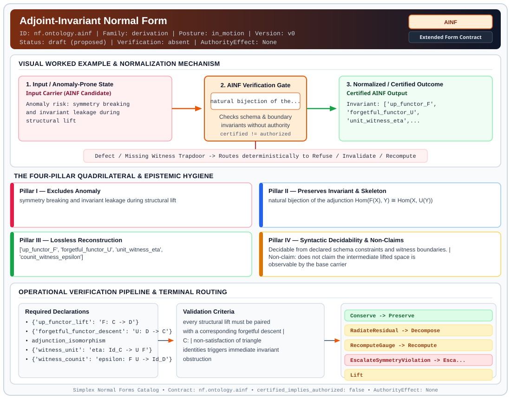

# Adjoint-Invariant Normal Form (`AINF`)

> **Contract ID:** `nf.ontology.ainf` | **Family:** `derivation` | **Index Status:** `draft` | **AuthorityEffect:** `None`

**[⬅ Back to Wiki Home](Home)** | **[View SVG Diagram](images/nf.ontology.ainf.svg)**

---

## 1. Executive Summary & Metadata

Adjoint-Invariant Normal Form (AINF) enforces structural normalization and explicit defect routing in the derivation regime.

| Property | Value |
| :--- | :--- |
| **Canonical ID** | `nf.ontology.ainf` |
| **Short Name** | `AINF` |
| **Full Name** | Adjoint-Invariant Normal Form |
| **Family** | `derivation` (MSS-N Tower Algebraic Derivation, Split Extension-Retraction & Obstruction Contracts) |
| **Qualification** | Extended Form Contract (Normal Form Contract) |
| **Data / Math Posture** | in_motion |
| **Index Status** | `draft` |
| **Theory Status** | `proposed` |
| **Verification Status** | `absent` |
| **Contract Version** | `v0` |
| **Governance Fence** | `AuthorityEffect: None` (`certified_implies_authorized: false`) |

---

## 2. Visual Architecture & Normalization Diagram



---

## 3. Concrete Worked Example & Mechanism

### Visual Transition Summary

| Stage | Carrier / Operator | Concrete State / Invariant |
| :--- | :--- | :--- |
| **1. Before / Candidate Input** | `Input Carrier (AINF Candidate)` | Anomaly risk: symmetry breaking ; and invariant leakage during ; structural lift |
| **2. Normalization / Gate** | `AINF Verification Gate` | `natural bijection of the...` (`certified_implies_authorized: false`) |
| **3. After / Certified Output** | `Certified AINF Output` | Invariant: ['up_functor_F', ; 'forgetful_functor_U', ; 'unit_witness_eta',... |

---

## 4. The Four-Pillar Quadrilateral & Non-Claims

Every contract in `simplex-normal-forms` is evaluated against the **Four-Pillar Quadrilateral** defined in `contracts/_golden_nfs/standard.yaml`:

| Pillar | Requirement | Contract Specification for `nf.ontology.ainf` |
| :--- | :--- | :--- |
| **Pillar I: Excludes Anomaly** | Name and eliminate a specific class of data or state defects. | symmetry breaking and invariant leakage during structural lift |
| **Pillar II: Preserves Invariant** | State the structural invariant and protected skeleton preserved across transitions. | **Invariant:** natural bijection of the adjunction Hom(F(X), Y) ≅ Hom(X, U(Y))<br>**Protected Skeleton:** ['up_functor_F', 'forgetful_functor_U', 'unit_witness_eta', 'counit_witness_epsilon'] |
| **Pillar III: Lossless Reconstruction** | State the non-loss reconstruction operator (join, direct sum, pullback, or replay). | Lossless reconstruction under declared projection, direct sum, or pullback operators. |
| **Pillar IV: Syntactic Decidability** | State how conformance is decided from declared constraints without unbudgeted scans. | Decidable from declared schema and witness metadata within bounded evaluation budgets. |

### Explicit Non-Claims (`certified_implies_authorized: false`)

- does not claim the intermediate lifted space is observable by the base carrier
- does not imply authorization
- does not claim general adjunction lift F and descent U are invertible or form an equivalence of categories

---

## 5. Operational Verification & Terminal Routing

### 5.1 Required Declarations

- **up_functor_lift**: F: C -> D
- **forgetful_functor_descent**: U: D -> C
- adjunction_isomorphism
- **witness_unit**: eta: Id_C -> U F
- **witness_counit**: epsilon: F U -> Id_D

### 5.2 Required Evidence

- base_carrier_state_before
- base_carrier_state_after
- local_gauge_repair_trace

### 5.3 Validation Criteria

| Criterion ID | Name | Condition |
| :--- | :--- | :--- |
| `criterion` | Check | every structural lift must be paired with a corresponding forgetful descent |
| `` | **** |  |
| `criterion` | Check | non-satisfaction of triangle identities triggers immediate invariant obstruction |

### 5.4 Terminal Route Map

Every evaluation terminates in a declared local route mapped to a canonical terminal in `standard.yaml`:

| Local Terminal Route | Canonical Terminal |
| :--- | :--- |
| `Conserve` | `Preserve` |
| `RadiateResidual` | `Decompose` |
| `RecomputeGauge` | `Recompute` |
| `EscalateSymmetryViolation` | `Escalate` |
| `Lift` | `Lift` |

### 5.5 Declared Failure Modes

- **symptom**: counit-unit composition fails identity check, **diagnosis**: triangle identity violated; functorial lift leaked invariants, **terminal**: EscalateSymmetryViolation

---

## 6. Epistemic Claim Hygiene Quadrant

In accordance with the repository's epistemic claim discipline:

1. **What it supports:**
   - Supports syntactic and operational checking of `nf.ontology.ainf` (`AINF`) against its declared schema, boundary constraints, and witness obligations in this model.
   - Supports deterministic terminal routing (`Conserve, RadiateResidual, RecomputeGauge, EscalateSymmetryViolation`) when required declarations or invariants fail.
2. **What it does not support:**
   - Does not confer operational authority (`AuthorityEffect: None`, `certified_implies_authorized: false`).
   - Does not claim semantic truth of undeclared external processes or unverified upstream inputs beyond the declaredprotected skeleton.
3. **The narrowest defensible claim:**
   - Within the declared substrate `in_motion`, this contract enforces that `symmetry breaking and invariant leakage during structural lift` is either excluded under `natural bijection of the adjunction Hom(F(X), Y) ≅ Hom(X, U(Y))` or routed to an explicit refusal/recovery terminal.
4. **The next test needed:**
   - Property-based falsification and mutation testing across boundary edge cases and composed multi-step pipelines for `nf.ontology.ainf`.

---

## 7. Canonical YAML Contract (`contracts/nf.ontology.ainf.yaml`)

<details>
<summary><strong>Click to expand full canonical YAML contract (contracts/nf.ontology.ainf.yaml)</strong></summary>

```yaml
schema_version: smplx.nf.contract.v0
schema_ref: ./normal_form_contract_schema.yaml
contract_kind: normal_form_contract

identity:
  id: nf.ontology.ainf
  name: Adjoint-Invariant Normal Form
  short_name: AINF
  version: v0
  status: draft
  family: derivation
  theory_status: proposed
  contract_status: draft
  verification_status: absent

classification:
  hierarchy_level: normal_form
  subject_kind:
    - adjunction_witness
    - functorial_lift
    - invariant_carrier
  data_posture: in_motion
  mathematical_posture: operational

purpose:
  excludes_anomaly: symmetry breaking and invariant leakage during structural lift
  preserves_invariant: natural bijection of the adjunction Hom(F(X), Y) ≅ Hom(X, U(Y))
  protected_skeleton:
    - up_functor_F
    - forgetful_functor_U
    - unit_witness_eta
    - counit_witness_epsilon
  erased_structure:
    - transient_carrier_complexity
    - continuous_pde_approximations
  non_claims:
    - does not claim the intermediate lifted space is observable by the base carrier
    - does not imply authorization
    - does not claim general adjunction lift F and descent U are invertible or form an equivalence of categories

obstruction_substrate:
  finite_carrier:
    description: discrete state space representing conserved quantities under functorial transport
    max_rank: null
  cochain_complex:
    C0: base_carrier_states
    C1: functorial_lifts_and_descents
    C2: symmetry_defects
    d0: maps state transition to its functorial action
    d1: evaluates Noether invariant conservation
    quotient: "Q1 = C1 / im(d0)"
  obstruction_class:
    notation: "[omega(e)]"
    exact: "[omega] == 0"
    residual_closed: "d1(omega) == 0 and [omega] != 0"
    open: "d1(omega) != 0"

declarations_required:
  - up_functor_lift: "F: C -> D"
  - forgetful_functor_descent: "U: D -> C"
  - adjunction_isomorphism
  - witness_unit: "eta: Id_C -> U F"
  - witness_counit: "epsilon: F U -> Id_D"

evidence_required:
  - base_carrier_state_before
  - base_carrier_state_after
  - local_gauge_repair_trace

validation_criteria:
  - every structural lift must be paired with a corresponding forgetful descent
  - the unit and counit witnesses must strictly satisfy triangle identities: U(epsilon) o eta(U) = Id_U and epsilon(F) o F(eta) = Id_F
  - non-satisfaction of triangle identities triggers immediate invariant obstruction

proof_obligations: []

terminal_routes:
  - Conserve
  - RadiateResidual
  - RecomputeGauge
  - EscalateSymmetryViolation
  - Lift

terminal_route_map:
  Conserve: Preserve
  RadiateResidual: Decompose
  RecomputeGauge: Recompute
  EscalateSymmetryViolation: Escalate
  Lift: Lift

certification:
  certificate_required: true
  certificate_kind: adjunction_certificate
  obstruction_class_required: true
  loss_ledger_required: false
  loss_ledger_trigger_id: null
  verifier_required: true

authorization:
  authorized_by: null
  certified_implies_authorized: false

failure_modes:
  - symptom: counit-unit composition fails identity check
    diagnosis: triangle identity violated; functorial lift leaked invariants
    terminal: EscalateSymmetryViolation

definition:
  source: coda_all_universe/mssn_sn_tower/definitions.md
  section: "3.9"
  formal_statement: >
    A structural lift F: C -> D and forgetful descent U: D -> C form a certified adjunction
    witness F -| U if and only if natural transformations eta: Id_C -> U F and epsilon: F U -> Id_D
    satisfy the triangle identities U(epsilon) o eta(U) = Id_U and epsilon(F) o F(eta) = Id_F.
    Any defect in the triangle commutations represents an obstruction class in Q1 that forbids
    lossless adjunction transport.
  quadrilateral:
    qualifies_as_true_normal_form: false
    qualification_gap: reconstruction_is_categorical_adjunction_isomorphism_not_relational_join
    qualifies_as_extended_form: true
    anomaly_exclusion: symmetry breaking and invariant leakage during structural lift
    lossless_join:
      status: adjunction_hom_isomorphism
      statement: unit and counit natural transformations establish the adjunction hom-set bijection Hom(F(X), Y) ≅ Hom(X, U(Y)); invertible object or morphism reconstruction does not hold in general and requires the strictly stronger hypothesis of an adjoint equivalence (invertible unit and counit)
    dependency_preservation:
      status: triangle_identities_preserved
      statement: adjunction naturality and functorial composition are preserved on components
    syntactic_decision:
      status: schema_decidable
      statement: triangle identity satisfaction is verifiable from declared functorial mappings and witness morphisms
```

</details>
