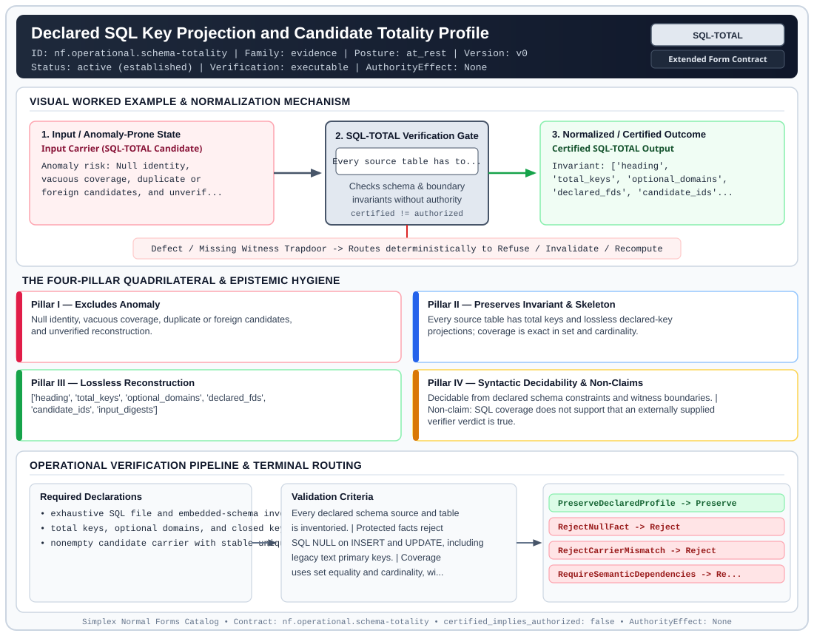

# Declared SQL Key Projection and Candidate Totality Profile (`SQL-TOTAL`)

> **Contract ID:** `nf.operational.schema-totality` | **Family:** `evidence` | **Index Status:** `active` | **AuthorityEffect:** `None`

**[⬅ Back to Wiki Home](Home)** | **[View SVG Diagram](images/nf.operational.schema-totality.svg)**

---

## 1. Executive Summary & Metadata

Declared SQL Key Projection and Candidate Totality Profile (SQL-TOTAL) enforces structural normalization and explicit defect routing in the evidence regime.

| Property | Value |
| :--- | :--- |
| **Canonical ID** | `nf.operational.schema-totality` |
| **Short Name** | `SQL-TOTAL` |
| **Full Name** | Declared SQL Key Projection and Candidate Totality Profile |
| **Family** | `evidence` (Cryptographic Receipts, Dual Witnesses, Loss Ledgers, CDC Logs & Schema Totality) |
| **Qualification** | Extended Form Contract (Normal Form Contract) |
| **Data / Math Posture** | at_rest |
| **Index Status** | `active` |
| **Theory Status** | `established` |
| **Verification Status** | `executable` |
| **Contract Version** | `v0` |
| **Governance Fence** | `AuthorityEffect: None` (`certified_implies_authorized: false`) |

---

## 2. Visual Architecture & Normalization Diagram



---

## 3. Concrete Worked Example & Mechanism

### Visual Transition Summary

| Stage | Carrier / Operator | Concrete State / Invariant |
| :--- | :--- | :--- |
| **1. Before / Candidate Input** | `Input Carrier (SQL-TOTAL Candidate)` | Anomaly risk: Null identity, ; vacuous coverage, duplicate or ; foreign candidates, and unverif... |
| **2. Normalization / Gate** | `SQL-TOTAL Verification Gate` | `Every source table has to...` (`certified_implies_authorized: false`) |
| **3. After / Certified Output** | `Certified SQL-TOTAL Output` | Invariant: ['heading', ; 'total_keys', 'optional_domains', ; 'declared_fds', 'candidate_ids'... |

---

## 4. The Four-Pillar Quadrilateral & Non-Claims

Every contract in `simplex-normal-forms` is evaluated against the **Four-Pillar Quadrilateral** defined in `contracts/_golden_nfs/standard.yaml`:

| Pillar | Requirement | Contract Specification for `nf.operational.schema-totality` |
| :--- | :--- | :--- |
| **Pillar I: Excludes Anomaly** | Name and eliminate a specific class of data or state defects. | Null identity, vacuous coverage, duplicate or foreign candidates, and unverified reconstruction. |
| **Pillar II: Preserves Invariant** | State the structural invariant and protected skeleton preserved across transitions. | **Invariant:** Every source table has total keys and lossless declared-key projections; coverage is exact in set and cardinality.<br>**Protected Skeleton:** ['heading', 'total_keys', 'optional_domains', 'declared_fds', 'candidate_ids', 'input_digests'] |
| **Pillar III: Lossless Reconstruction** | State the non-loss reconstruction operator (join, direct sum, pullback, or replay). | Lossless reconstruction under declared projection, direct sum, or pullback operators. |
| **Pillar IV: Syntactic Decidability** | State how conformance is decided from declared constraints without unbudgeted scans. | Decidable from declared schema and witness metadata within bounded evaluation budgets. |

### Explicit Non-Claims (`certified_implies_authorized: false`)

- SQL coverage does not support that an externally supplied verifier verdict is true.
- Storage scalars do not establish semantic atomicity of JSON or CSV payloads.
- No undeclared functional, multivalued, or join dependency is inferred.
- Key-plus-one-attribute projections do not certify unrestricted semantic 6NF.
- Educational REAL aggregate demos do not become exact mathematical solvers.
- Certification does not imply authorization or a Genesis scale extension.

---

## 5. Operational Verification & Terminal Routing

### 5.1 Required Declarations

- exhaustive SQL file and embedded-schema inventory
- total keys, optional domains, and closed key-FD scope
- nonempty candidate carrier with stable unique IDs and input digests

### 5.2 Required Evidence

- per-table projection and reconstruction SQL
- losslessness and dependency-preservation results
- null mutation and missing, duplicate, foreign, or input-mismatched candidate refusals

### 5.3 Validation Criteria

| Criterion ID | Name | Condition |
| :--- | :--- | :--- |
| `criterion` | Check | Every declared schema source and table is inventoried. |
| `criterion` | Check | Protected facts reject SQL NULL on INSERT and UPDATE, including legacy text primary keys. |
| `criterion` | Check | Coverage uses set equality and cardinality, with input-bound foreign keys. |
| `criterion` | Check | Mathematical acceptance is separate from structural exhaustiveness. |

### 5.4 Terminal Route Map

Every evaluation terminates in a declared local route mapped to a canonical terminal in `standard.yaml`:

| Local Terminal Route | Canonical Terminal |
| :--- | :--- |
| `PreserveDeclaredProfile` | `Preserve` |
| `RejectNullFact` | `Reject` |
| `RejectCarrierMismatch` | `Reject` |
| `RequireSemanticDependencies` | `Refuse` |

### 5.5 Declared Failure Modes

_All defects route explicitly through the Terminal Route Map above._

---

## 6. Epistemic Claim Hygiene Quadrant

In accordance with the repository's epistemic claim discipline:

1. **What it supports:**
   - Supports syntactic and operational checking of `nf.operational.schema-totality` (`SQL-TOTAL`) against its declared schema, boundary constraints, and witness obligations in this model.
   - Supports deterministic terminal routing (`PreserveDeclaredProfile, RejectNullFact, RejectCarrierMismatch, RequireSemanticDependencies`) when required declarations or invariants fail.
2. **What it does not support:**
   - Does not confer operational authority (`AuthorityEffect: None`, `certified_implies_authorized: false`).
   - Does not claim semantic truth of undeclared external processes or unverified upstream inputs beyond the declaredprotected skeleton.
3. **The narrowest defensible claim:**
   - Within the declared substrate `at_rest`, this contract enforces that `Null identity, vacuous coverage, duplicate or foreign candidates, and unverified reconstruction.` is either excluded under `Every source table has total keys and lossless declared-key projections; coverage is exact in set and cardinality.` or routed to an explicit refusal/recovery terminal.
4. **The next test needed:**
   - Property-based falsification and mutation testing across boundary edge cases and composed multi-step pipelines for `nf.operational.schema-totality`.

---

## 7. Canonical YAML Contract (`contracts/nf.operational.schema-totality.yaml`)

<details>
<summary><strong>Click to expand full canonical YAML contract (contracts/nf.operational.schema-totality.yaml)</strong></summary>

```yaml
schema_version: smplx.nf.contract.v0
schema_ref: ./normal_form_contract_schema.yaml
contract_kind: normal_form_contract
identity:
  id: nf.operational.schema-totality
  name: Declared SQL Key Projection and Candidate Totality Profile
  short_name: SQL-TOTAL
  version: v0
  status: active
  family: evidence
classification:
  hierarchy_level: normal_form
  subject_kind: [relvar, candidate_carrier, schema_inventory]
  data_posture: at_rest
  mathematical_posture: operational
purpose:
  excludes_anomaly: Null identity, vacuous coverage, duplicate or foreign candidates, and unverified reconstruction.
  preserves_invariant: Every source table has total keys and lossless declared-key projections; coverage is exact in set and cardinality.
  protected_skeleton: [heading, total_keys, optional_domains, declared_fds, candidate_ids, input_digests]
  erased_structure: []
  non_claims:
    - SQL coverage does not support that an externally supplied verifier verdict is true.
    - Storage scalars do not establish semantic atomicity of JSON or CSV payloads.
    - No undeclared functional, multivalued, or join dependency is inferred.
    - Key-plus-one-attribute projections do not certify unrestricted semantic 6NF.
    - Educational REAL aggregate demos do not become exact mathematical solvers.
    - Certification does not imply authorization or a Genesis scale extension.
definition:
  source: omega_engine_pfp/infrastructure/yaml/normal_forms/schema_pipeline.py
  formal_statement: >-
    For each declared table heading H and minimal total SQL keys K_i, use only
    K_i -> H as the FD theory. Choose a minimal key K and project onto K union {a}
    for each nonkey attribute a. Check heading coverage, chase losslessness, and
    dependency preservation separately. A candidate problem has a nonempty stable
    carrier; checks exhaust it only if IDs and cardinalities agree in both directions.
  quadrilateral:
    qualifies_as_true_normal_form: false
    qualification_gap: operational SQL profile; semantic domains and complete MVD/JD theories remain undeclared
    anomaly_exclusion: Null protected facts and incomplete or duplicate evidence cannot masquerade as total coverage.
    lossless_join:
      status: checked_under_declared_key_fds
      statement: Exact chase verifies reconstruction; optional payload values join through total keys.
    dependency_preservation:
      status: independently_checked
      statement: The projected FD theory must preserve original declared dependencies or expose a specific gap.
    syntactic_decision:
      status: finite_schema_decidable
      statement: SQLite metadata, finite key FD closure, and exact candidate set/cardinality determine this profile.
declarations_required:
  - exhaustive SQL file and embedded-schema inventory
  - total keys, optional domains, and closed key-FD scope
  - nonempty candidate carrier with stable unique IDs and input digests
evidence_required:
  - per-table projection and reconstruction SQL
  - losslessness and dependency-preservation results
  - null mutation and missing, duplicate, foreign, or input-mismatched candidate refusals
validation_criteria:
  - Every declared schema source and table is inventoried.
  - Protected facts reject SQL NULL on INSERT and UPDATE, including legacy text primary keys.
  - Coverage uses set equality and cardinality, with input-bound foreign keys.
  - Mathematical acceptance is separate from structural exhaustiveness.
terminal_routes: [PreserveDeclaredProfile, RejectNullFact, RejectCarrierMismatch, RequireSemanticDependencies]
terminal_route_map:
  PreserveDeclaredProfile: Preserve
  RejectNullFact: Reject
  RejectCarrierMismatch: Reject
  RequireSemanticDependencies: Refuse
certification:
  certificate_required: true
  certificate_kind: omega.nf.schema-inventory.v1
  obstruction_class_required: false
  loss_ledger_required: false
  loss_ledger_trigger_id: null
  verifier_required: true
authorization:
  authorized_by: null
  certified_implies_authorized: false
proof_obligations:
  - id: sql_totality.semantic_nf4_nf5_nf6
    status: open
    statement: Declare complete semantic domains, MVDs, and JDs before stronger normalization certification.
references:
  - ./normal_form_contract_schema.yaml
  - schema_pipeline.py
```

</details>
