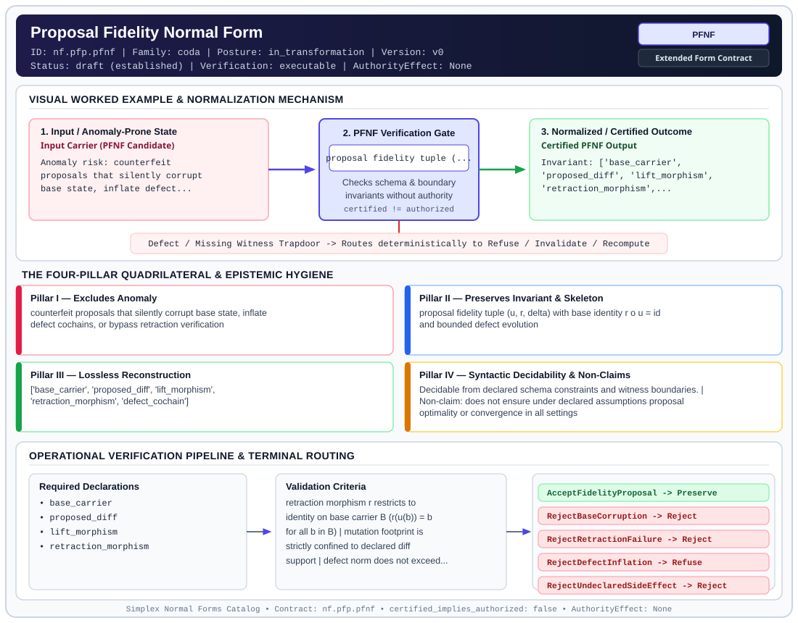

# Proposal Fidelity Normal Form (`PFNF`)

> **Contract ID:** `nf.pfp.pfnf` | **Family:** `coda` | **Index Status:** `draft` | **AuthorityEffect:** `None`

**[⬅ Back to Wiki Home](Home)** | **[View SVG Diagram](images/nf.pfp.pfnf.svg)**

---

## 1. Executive Summary & Metadata

Proposal Fidelity Normal Form (PFNF) enforces structural normalization and explicit defect routing in the coda regime.

| Property | Value |
| :--- | :--- |
| **Canonical ID** | `nf.pfp.pfnf` |
| **Short Name** | `PFNF` |
| **Full Name** | Proposal Fidelity Normal Form |
| **Family** | `coda` (CODA Foundational Quotient, Representation Transport (`CODA_MUR`) & Proof-Fact Contracts) |
| **Qualification** | Extended Form Contract (Normal Form Contract) |
| **Data / Math Posture** | in_transformation |
| **Index Status** | `draft` |
| **Theory Status** | `established` |
| **Verification Status** | `executable` |
| **Contract Version** | `v0` |
| **Governance Fence** | `AuthorityEffect: None` (`certified_implies_authorized: false`) |

---

## 2. Visual Architecture & Normalization Diagram



---

## 3. Concrete Worked Example & Mechanism

### Visual Transition Summary

| Stage | Carrier / Operator | Concrete State / Invariant |
| :--- | :--- | :--- |
| **1. Before / Candidate Input** | `Input Carrier (PFNF Candidate)` | Anomaly risk: counterfeit ; proposals that silently corrupt ; base state, inflate defect... |
| **2. Normalization / Gate** | `PFNF Verification Gate` | `proposal fidelity tuple (...` (`certified_implies_authorized: false`) |
| **3. After / Certified Output** | `Certified PFNF Output` | Invariant: ['base_carrier', ; 'proposed_diff', 'lift_morphism', ; 'retraction_morphism',... |

---

## 4. The Four-Pillar Quadrilateral & Non-Claims

Every contract in `simplex-normal-forms` is evaluated against the **Four-Pillar Quadrilateral** defined in `contracts/_golden_nfs/standard.yaml`:

| Pillar | Requirement | Contract Specification for `nf.pfp.pfnf` |
| :--- | :--- | :--- |
| **Pillar I: Excludes Anomaly** | Name and eliminate a specific class of data or state defects. | counterfeit proposals that silently corrupt base state, inflate defect cochains, or bypass retraction verification |
| **Pillar II: Preserves Invariant** | State the structural invariant and protected skeleton preserved across transitions. | **Invariant:** proposal fidelity tuple (u, r, delta) with base identity r o u = id and bounded defect evolution<br>**Protected Skeleton:** ['base_carrier', 'proposed_diff', 'lift_morphism', 'retraction_morphism', 'defect_cochain'] |
| **Pillar III: Lossless Reconstruction** | State the non-loss reconstruction operator (join, direct sum, pullback, or replay). | Lossless reconstruction under declared projection, direct sum, or pullback operators. |
| **Pillar IV: Syntactic Decidability** | State how conformance is decided from declared constraints without unbudgeted scans. | Decidable from declared schema and witness metadata within bounded evaluation budgets. |

### Explicit Non-Claims (`certified_implies_authorized: false`)

- does not ensure under declared assumptions proposal optimality or convergence in all settings
- does not mint authority

---

## 5. Operational Verification & Terminal Routing

### 5.1 Required Declarations

- base_carrier
- proposed_diff
- lift_morphism
- retraction_morphism

### 5.2 Required Evidence

- base_retraction_receipt
- defect_cochain_bounds

### 5.3 Validation Criteria

| Criterion ID | Name | Condition |
| :--- | :--- | :--- |
| `criterion` | Check | retraction morphism r restricts to identity on base carrier B (r(u(b)) = b for all b in B) |
| `criterion` | Check | mutation footprint is strictly confined to declared diff support |
| `criterion` | Check | defect norm does not exceed declared loss budget (Phi_1(P) <= Phi_1(B) + budget) |
| `criterion` | Check | verifier evaluation receipt carries AuthorityEffect None |

### 5.4 Terminal Route Map

Every evaluation terminates in a declared local route mapped to a canonical terminal in `standard.yaml`:

| Local Terminal Route | Canonical Terminal |
| :--- | :--- |
| `AcceptFidelityProposal` | `Preserve` |
| `RejectBaseCorruption` | `Reject` |
| `RejectRetractionFailure` | `Reject` |
| `RejectDefectInflation` | `Refuse` |
| `RejectUndeclaredSideEffect` | `Reject` |
| `EscalateToArbiter` | `Escalate` |

### 5.5 Declared Failure Modes

- **symptom**: applying proposal modifies elements of the base carrier outside declared diff, **diagnosis**: base state corruption, **terminal**: RejectBaseCorruption
- **symptom**: down-map retraction r fails to invert lift u on base carrier, **diagnosis**: broken proposal retraction, **terminal**: RejectRetractionFailure
- **symptom**: proposal results in unbudgeted defect norm increase, **diagnosis**: defect inflation, **terminal**: RejectDefectInflation

---

## 6. Epistemic Claim Hygiene Quadrant

In accordance with the repository's epistemic claim discipline:

1. **What it supports:**
   - Supports syntactic and operational checking of `nf.pfp.pfnf` (`PFNF`) against its declared schema, boundary constraints, and witness obligations in this model.
   - Supports deterministic terminal routing (`AcceptFidelityProposal, RejectBaseCorruption, RejectRetractionFailure, RejectDefectInflation`) when required declarations or invariants fail.
2. **What it does not support:**
   - Does not confer operational authority (`AuthorityEffect: None`, `certified_implies_authorized: false`).
   - Does not claim semantic truth of undeclared external processes or unverified upstream inputs beyond the declaredprotected skeleton.
3. **The narrowest defensible claim:**
   - Within the declared substrate `in_transformation`, this contract enforces that `counterfeit proposals that silently corrupt base state, inflate defect cochains, or bypass retraction verification` is either excluded under `proposal fidelity tuple (u, r, delta) with base identity r o u = id and bounded defect evolution` or routed to an explicit refusal/recovery terminal.
4. **The next test needed:**
   - Property-based falsification and mutation testing across boundary edge cases and composed multi-step pipelines for `nf.pfp.pfnf`.

---

## 7. Canonical YAML Contract (`contracts/nf.pfp.pfnf.yaml`)

<details>
<summary><strong>Click to expand full canonical YAML contract (contracts/nf.pfp.pfnf.yaml)</strong></summary>

```yaml
schema_version: smplx.nf.contract.v0
contract_kind: normal_form_contract
identity:
  id: nf.pfp.pfnf
  name: Proposal Fidelity Normal Form
  short_name: PFNF
  version: v0
  status: draft
  family: coda
  theory_status: established
  contract_status: draft
  verification_status: executable
classification:
  hierarchy_level: normal_form
  subject_kind:
  - proposal_packet
  - lift_morphism
  - retraction_morphism
  - defect_vector
  data_posture: in_transformation
  mathematical_posture: operational
purpose:
  excludes_anomaly: counterfeit proposals that silently corrupt base state, inflate defect cochains, or bypass retraction verification
  preserves_invariant: proposal fidelity tuple (u, r, delta) with base identity r o u = id and bounded defect evolution
  protected_skeleton:
  - base_carrier
  - proposed_diff
  - lift_morphism
  - retraction_morphism
  - defect_cochain
  erased_structure:
  - transient_scratchpad_history
  non_claims:
  - does not ensure under declared assumptions proposal optimality or convergence in all settings
  - does not mint authority
declarations_required:
- base_carrier
- proposed_diff
- lift_morphism
- retraction_morphism
evidence_required:
- base_retraction_receipt
- defect_cochain_bounds
validation_criteria:
- retraction morphism r restricts to identity on base carrier B (r(u(b)) = b for all b in B)
- mutation footprint is strictly confined to declared diff support
- defect norm does not exceed declared loss budget (Phi_1(P) <= Phi_1(B) + budget)
- verifier evaluation receipt carries AuthorityEffect None
proof_obligations:
- id: pfnf.base_retraction_invariance
  status: upstream_theorem
  ref: 030_the_symbol_game_proposal_fidelity_protocol_pfp
  section: 0_how_to_play_the_symbol_game
terminal_routes:
- AcceptFidelityProposal
- RejectBaseCorruption
- RejectRetractionFailure
- RejectDefectInflation
- RejectUndeclaredSideEffect
- EscalateToArbiter
terminal_route_map:
  AcceptFidelityProposal: Preserve
  RejectBaseCorruption: Reject
  RejectRetractionFailure: Reject
  RejectDefectInflation: Refuse
  RejectUndeclaredSideEffect: Reject
  EscalateToArbiter: Escalate
certification:
  certificate_required: true
  certificate_kind: proposal_fidelity_certificate
  obstruction_class_required: true
  loss_ledger_required: true
  verifier_required: true
authorization:
  authorized_by: null
  certified_implies_authorized: false
failure_modes:
- symptom: applying proposal modifies elements of the base carrier outside declared diff
  diagnosis: base state corruption
  terminal: RejectBaseCorruption
- symptom: down-map retraction r fails to invert lift u on base carrier
  diagnosis: broken proposal retraction
  terminal: RejectRetractionFailure
- symptom: proposal results in unbudgeted defect norm increase
  diagnosis: defect inflation
  terminal: RejectDefectInflation
definition:
  formal_statement: a proposal packet is in Proposal Fidelity Normal Form iff it supplies lift u, retraction r, and defect delta such that r(u(b)) = b on base carrier B, diff support is bounded, and defect evolution satisfies declared budgets
  quadrilateral:
    qualifies_as_true_normal_form: false
    qualification_gap: operational_protocol_not_relational_project_join
    anomaly_exclusion: counterfeit proposals, base state corruption, and unbudgeted defect inflation
    lossless_join:
      status: dual_state_reconstruction
      statement: base state is recovered losslessly via retraction r, proposed state via lift u
    dependency_preservation:
      status: base_invariants_preserved
      statement: base carrier invariants are preserved under retraction
    syntactic_decision:
      status: certificate_decidable
      statement: decidable by evaluating retraction on base support and verifying defect certificates
schema_ref: ./normal_form_contract_schema.yaml
```

</details>
