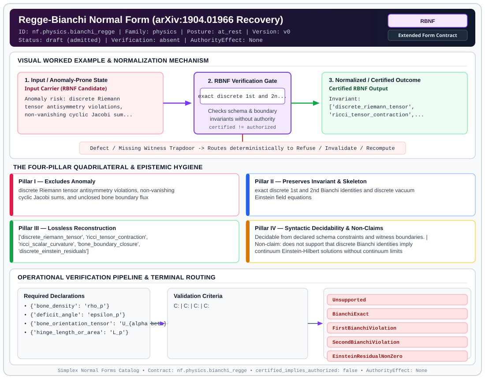

# Regge-Bianchi Normal Form (arXiv:1904.01966 Recovery) (`RBNF`)

> **Contract ID:** `nf.physics.bianchi_regge` | **Family:** `physics` | **Index Status:** `draft` | **AuthorityEffect:** `None`

**[⬅ Back to Wiki Home](Home)** | **[View SVG Diagram](images/nf.physics.bianchi_regge.svg)**

---

## 1. Executive Summary & Metadata

Regge-Bianchi Normal Form (arXiv:1904.01966 Recovery) (RBNF) enforces structural normalization and explicit defect routing in the physics regime.

| Property | Value |
| :--- | :--- |
| **Canonical ID** | `nf.physics.bianchi_regge` |
| **Short Name** | `RBNF` |
| **Full Name** | Regge-Bianchi Normal Form (arXiv:1904.01966 Recovery) |
| **Family** | `physics` (Discrete Differential Geometry, Regge Calculus, Gauge Theory, Lattice Fermions & Quantum Gravity) |
| **Qualification** | Extended Form Contract (Normal Form Contract) |
| **Data / Math Posture** | at_rest |
| **Index Status** | `draft` |
| **Theory Status** | `admitted` |
| **Verification Status** | `absent` |
| **Contract Version** | `v0` |
| **Governance Fence** | `AuthorityEffect: None` (`certified_implies_authorized: false`) |

---

## 2. Visual Architecture & Normalization Diagram



---

## 3. Concrete Worked Example & Mechanism

### Visual Transition Summary

| Stage | Carrier / Operator | Concrete State / Invariant |
| :--- | :--- | :--- |
| **1. Before / Candidate Input** | `Input Carrier (RBNF Candidate)` | Anomaly risk: discrete Riemann ; tensor antisymmetry violations, ; non-vanishing cyclic Jacobi sum... |
| **2. Normalization / Gate** | `RBNF Verification Gate` | `exact discrete 1st and 2n...` (`certified_implies_authorized: false`) |
| **3. After / Certified Output** | `Certified RBNF Output` | Invariant: ; ['discrete_riemann_tensor', ; 'ricci_tensor_contraction',... |

---

## 4. The Four-Pillar Quadrilateral & Non-Claims

Every contract in `simplex-normal-forms` is evaluated against the **Four-Pillar Quadrilateral** defined in `contracts/_golden_nfs/standard.yaml`:

| Pillar | Requirement | Contract Specification for `nf.physics.bianchi_regge` |
| :--- | :--- | :--- |
| **Pillar I: Excludes Anomaly** | Name and eliminate a specific class of data or state defects. | discrete Riemann tensor antisymmetry violations, non-vanishing cyclic Jacobi sums, and unclosed bone boundary flux |
| **Pillar II: Preserves Invariant** | State the structural invariant and protected skeleton preserved across transitions. | **Invariant:** exact discrete 1st and 2nd Bianchi identities and discrete vacuum Einstein field equations<br>**Protected Skeleton:** ['discrete_riemann_tensor', 'ricci_tensor_contraction', 'ricci_scalar_curvature', 'bone_boundary_closure', 'discrete_einstein_residuals'] |
| **Pillar III: Lossless Reconstruction** | State the non-loss reconstruction operator (join, direct sum, pullback, or replay). | Lossless reconstruction under declared projection, direct sum, or pullback operators. |
| **Pillar IV: Syntactic Decidability** | State how conformance is decided from declared constraints without unbudgeted scans. | Decidable from declared schema and witness metadata within bounded evaluation budgets. |

### Explicit Non-Claims (`certified_implies_authorized: false`)

- does not support that discrete Bianchi identities imply continuum Einstein-Hilbert solutions without continuum limits
- does not eliminate non-local holonomy effects around finite simplicial loops

---

## 5. Operational Verification & Terminal Routing

### 5.1 Required Declarations

- **bone_density**: rho_p
- **deficit_angle**: epsilon_p
- **bone_orientation_tensor**: U_{alpha beta}^p
- **hinge_length_or_area**: L_p

### 5.2 Required Evidence

_None declared._

### 5.3 Validation Criteria

| Criterion ID | Name | Condition |
| :--- | :--- | :--- |
| `` | **** |  |
| `` | **** |  |
| `` | **** |  |
| `` | **** |  |
| `` | **** |  |

### 5.4 Terminal Route Map

Every evaluation terminates in a declared local route mapped to a canonical terminal in `standard.yaml`:

| Local Terminal Route | Canonical Terminal |
| :--- | :--- |
| `Unsupported` | `Unsupported` |
| `BianchiExact` | `BianchiExact` |
| `FirstBianchiViolation` | `FirstBianchiViolation` |
| `SecondBianchiViolation` | `SecondBianchiViolation` |
| `EinsteinResidualNonZero` | `EinsteinResidualNonZero` |

### 5.5 Declared Failure Modes

_All defects route explicitly through the Terminal Route Map above._

---

## Deep-Dive Level Treatise

**AuthorityEffect:** None.  
**Level:** Level 21 (Discrete Spacetime / Discrete Regge Calculus, Lorentzian Foliations & Deficit Angles)  
**Evidential Grade:** NATIVE IMPLEMENTED  
**Contract Reference:** [`nf.physics.bianchi_regge`](../../../../omega_engine_pfp/infrastructure/yaml/normal_forms/nf.physics.bianchi_regge.yaml), [`nf.physics.lorentzian_cdt`](../../../../omega_engine_pfp/infrastructure/yaml/normal_forms/nf.physics.lorentzian_cdt.yaml)  
**Mathematical Posture:** Discrete Differential Geometry, Regge Calculus, Lorentzian Spacetime Foliation, and Causal Dynamical Triangulations  
**Data Posture:** Physical Geometry / Computational Spacetime  

---

## 1. Schematic & Conceptual Architecture

Regge-CDT Normal Form enforces geometric, metric, and causal consistency for piecewise-linear discrete spacetimes:
- **Discrete Regge Calculus**: Replaces continuous Riemannian/Lorentzian metrics with piecewise-flat simplicial geometries defined exclusively by squared edge lengths $s_e = \ell_e^2$. Curvature is concentrated entirely on codimension-2 hinges (bones $h$), measured via **deficit angles** $\epsilon_h$:
  $$\epsilon_h = 2\pi - \sum_{\sigma \supset h} \theta_h(\sigma)$$
- **Bianchi Identity & Regge Variation**: The discrete Einstein-Hilbert-Regge action:
  $$S_{\text{Regge}} = \sum_h A_h \epsilon_h - \Lambda \sum_\sigma V_\sigma$$
  satisfies the discrete contracted Bianchi identity: the variation of deficit angles vanishes identically under vertex displacements when edge lengths vary ($\sum_h A_h \frac{\partial \epsilon_h}{\partial s_e} = 0$).
- **Lorentzian Causal Dynamical Triangulation (CDT)**: Solves the instability of Euclidean dynamical triangulations by enforcing a strict global proper-time foliation $t \in \{1, 2, \dots, T\}$. Only spacelike and timelike edges are admitted, preventing baby-universe branching and acausal topology change.

```text
       Simplicial Hinge h                 Foliated Sandwich t -> t+1
    ┌───────────────────────┐            ┌───────────────────────────┐
    │ Bone / Hinge: h in S  │            │ Spatial Slice S_t (t=k)   │
    │ Dihedral Angles: theta│            │ Simplex Types: (4,1), (3,2│
    │ Deficit: 2pi - sum(th)│            │ Spatial Slice S_{t+1}     │
    └───────────┬───────────┘            └─────────────┬─────────────┘
                │                                      │
                └───────────────────┬──────────────────┘
                                    ▼
                    Regge-CDT Normal Form
          1. Exact Triangle Inequalities & Positivity
          2. Discrete Bianchi Identity: sum_h A_h d(eps_h) = 0
          3. Strict Lorentzian Causal Foliation (No CTCs)
          4. Wick-Rotated Transfer Matrix Spectral Dimension
```

---

## 2. Mathematical Invariants & Quadrilateral Properties

1. **Quadrilateral Decomposition:**
   - **Anomaly Excluded:** Non-Euclidean/non-Lorentzian dihedral angles, imaginary triangle areas, spatial topology changes within proper-time slices, closed timelike curves (CTCs), and violation of discrete contracted Bianchi identities.
   - **Protected Skeleton:** Simplicial complex connectivity $\mathcal{K}$, squared edge lengths $s_e \in \mathbb{Q}_{>0}$, spatial foliation index $t \in \mathbb{N}$, and causal simplex classification (e.g. $(4,1)$, $(3,2)$, $(2,3)$, $(1,4)$ in 4D).
   - **Erased Structure:** Coordinate charts, diffeomorphism gauge redundancies, continuous metric tensor fields $g_{\mu\nu}(x)$, and continuous Christoffel symbols $\Gamma^\alpha_{\beta\gamma}$.
   - **Reconstruction:** Explicit metric tensor evaluation via Cayley-Menger determinants, deficit angle sums $\epsilon_h$, discrete Ricci scalar curvature, and path-integral transfer matrices over causally admissible triangulations.

2. **Cayley-Menger Positivity & Triangle Inequalities:**
   Every $n$-simplex $\sigma$ must possess positive Cayley-Menger volume:
   $$V_n(\sigma)^2 = \frac{(-1)^{n+1}}{2^n (n!)^2} \det \begin{pmatrix} 0 & 1 & 1 & \dots & 1 \\ 1 & 0 & s_{01} & \dots & s_{0n} \\ 1 & s_{10} & 0 & \dots & s_{1n} \\ \vdots & \vdots & \vdots & \ddots & \vdots \\ 1 & s_{n0} & s_{n1} & \dots & 0 \end{pmatrix} > 0$$
   All 2-faces must strictly satisfy the triangle inequality $\ell_{ij} + \ell_{jk} > \ell_{ik}$.

3. **Causal Foliation Invariant:**
   A triangulation $\mathcal{T}$ is in Lorentzian CDT Normal Form if and only if:
   - Vertices are partitioned into discrete time hyperplanes: $V = \bigsqcup_{t=1}^T V_t$.
   - Edges are either **purely spacelike** ($e = (u, v)$ with $t(u) = t(v)$) or **purely timelike** ($t(v) = t(u) + 1$).
   - No spacelike-to-timelike topology hopping or degenerate pinchings exist.

---

## 3. Terminal Routes & Verification Logic

```text
Input Simplicial Configuration (K, s_e, t)
   │
   ├─► Check 1: Metric Positivity & Triangle Inequalities
   │            Verify Cayley-Menger det(M) > 0 and s_e > 0.
   │            FAIL ──► Terminal Reject: DegenerateGeometryResidual
   │
   ├─► Check 2: Dihedral Angle & Deficit Angle Computation
   │            Compute theta_h(sigma) via arccos of edge-length rationales.
   │            Calculate deficit angle eps_h = 2pi - sum(theta_h).
   │            FAIL ──► Terminal Reject: DihedralBranchCutResidual
   │
   ├─► Check 3: Discrete Bianchi Identity Gate
   │            Assert sum_{h \supset e} A_h (d eps_h / d s_e) == 0.
   │            FAIL ──► Terminal Reject: BianchiViolationResidual
   │
   ├─► Check 4: Causal Foliation & Sandwich Structure (CDT)
   │            Verify each simplex is of type (d, 1) or (d-1, 2) across slices.
   │            Confirm zero spatial boundary changes within slices.
   │            FAIL ──► Terminal Reject: AcausalTopologyChangeResidual
   │
   └─► PASS: Canonical Regge-CDT Normal Form Attested
```

---

## 4. Test Evidence & Local Execution

Verification suite is covered in:
- [`omega_engine_education/tests/normal_forms/test_tranche17_regge_bianchi_and_higher_coboundaries.py`](../../../tests/normal_forms/test_tranche17_regge_bianchi_and_higher_coboundaries.py)
- [`omega_engine_education/tests/normal_forms/test_tranche26_unified_retraction_dag_and_regge_synthesis.py`](../../../tests/normal_forms/test_tranche26_unified_retraction_dag_and_regge_synthesis.py)

Run targeted verification:
```powershell
py -3.12 -m pytest omega_engine_education/tests/normal_forms/test_tranche17_regge_bianchi_and_higher_coboundaries.py -v
```

---

## 5. Epistemic Claim Quadrant

1. **What It Supports:**
   - Formal verification that discrete simplicial complexes possess well-defined, non-degenerate piecewise-linear geometries with positive volumes.
   - Verification of the discrete contracted Bianchi identity on closed simplicial triangulations.
   - Verification of strict time-foliated causal structures avoiding acausal branching and baby universes in discrete quantum gravity simulations.

2. **What It Does Not Support:**
   - Does not claim convergence to a specific smooth 4-dimensional Einstein manifold in the continuum limit without Monte Carlo finite-size scaling analyses.
   - Does not certify quantum unitarity for configurations violating reflection positivity.

3. **Narrowest Defensible Claim:**
   Under declared discrete simplicial connectivity and squared edge lengths, Regge-CDT Normal Form ensures under declared assumptions that deficit angles are computable, satisfy the discrete Bianchi identity, and respect global Lorentzian foliation constraints.

4. **Next Test Needed:**
   Implement dynamic Wick rotation transfer matrix tests certifying spectral dimension $d_s \approx 4$ on macroscopic scales for CDT ensembles.

---

## 6. Epistemic Claim Hygiene Quadrant

In accordance with the repository's epistemic claim discipline:

1. **What it supports:**
   - Supports syntactic and operational checking of `nf.physics.bianchi_regge` (`RBNF`) against its declared schema, boundary constraints, and witness obligations in this model.
   - Supports deterministic terminal routing (`Unsupported, BianchiExact, FirstBianchiViolation, SecondBianchiViolation`) when required declarations or invariants fail.
2. **What it does not support:**
   - Does not confer operational authority (`AuthorityEffect: None`, `certified_implies_authorized: false`).
   - Does not claim semantic truth of undeclared external processes or unverified upstream inputs beyond the declaredprotected skeleton.
3. **The narrowest defensible claim:**
   - Within the declared substrate `at_rest`, this contract enforces that `discrete Riemann tensor antisymmetry violations, non-vanishing cyclic Jacobi sums, and unclosed bone boundary flux` is either excluded under `exact discrete 1st and 2nd Bianchi identities and discrete vacuum Einstein field equations` or routed to an explicit refusal/recovery terminal.
4. **The next test needed:**
   - Property-based falsification and mutation testing across boundary edge cases and composed multi-step pipelines for `nf.physics.bianchi_regge`.

---

## 7. Canonical YAML Contract (`contracts/nf.physics.bianchi_regge.yaml`)

<details>
<summary><strong>Click to expand full canonical YAML contract (contracts/nf.physics.bianchi_regge.yaml)</strong></summary>

```yaml
schema_version: smplx.nf.contract.v0
contract_kind: normal_form_contract
identity:
  id: nf.physics.bianchi_regge
  name: Regge-Bianchi Normal Form (arXiv:1904.01966 Recovery)
  short_name: RBNF
  version: v0
  theory_status: admitted
  contract_status: draft
  verification_status: absent
  family: physics
  status: draft
classification:
  hierarchy_level: normal_form
  subject_kind:
  - simplicial_riemann_curvature
  - bianchi_identities
  data_posture: at_rest
  mathematical_posture: formal_algebraic
purpose:
  excludes_anomaly: discrete Riemann tensor antisymmetry violations, non-vanishing
    cyclic Jacobi sums, and unclosed bone boundary flux
  preserves_invariant: exact discrete 1st and 2nd Bianchi identities and discrete
    vacuum Einstein field equations
  protected_skeleton:
  - discrete_riemann_tensor
  - ricci_tensor_contraction
  - ricci_scalar_curvature
  - bone_boundary_closure
  - discrete_einstein_residuals
  erased_structure:
  - continuous_christoffel_symbols
  non_claims:
  - does not support that discrete Bianchi identities imply continuum Einstein-Hilbert
    solutions without continuum limits
  - does not eliminate non-local holonomy effects around finite simplicial loops
declarations_required:
- bone_density: rho_p
- deficit_angle: epsilon_p
- bone_orientation_tensor: U_{alpha beta}^p
- hinge_length_or_area: L_p
validation_criteria:
- riemann_antisymmetry: R_{alpha beta mu nu} = - R_{beta alpha mu nu} = - R_{alpha
    beta nu mu}
- first_bianchi_cyclic: R_{[alpha beta mu] nu} = R_{alpha beta mu nu} + R_{beta mu
    alpha nu} + R_{mu alpha beta nu} = 0
- ricci_scalar_relation: R = 2 * rho_p * epsilon_p
- second_bianchi_closure: sum_p epsilon_p * U^p = 0
- discrete_einstein_vacuum: sum_{p \supset e} epsilon_p * (dL_p / dl_e) = 0
terminal_routes:
- Unsupported
- BianchiExact
- FirstBianchiViolation
- SecondBianchiViolation
- EinsteinResidualNonZero
terminal_route_map:
  all_satisfied: BianchiExact
  first_violation: FirstBianchiViolation
  second_violation: SecondBianchiViolation
  einstein_residual: EinsteinResidualNonZero
definition:
  source: coda_all_universe/mssn_sn_tower/definitions.md
  formal_statement: discrete Riemann tensor antisymmetry violations, non-vanishing
    cyclic Jacobi sums, and unclosed bone boundary flux. exact discrete 1st and 2nd
    Bianchi identities and discrete vacuum Einstein field equations
  quadrilateral:
    qualifies_as_true_normal_form: false
    qualification_gap: reconstruction_is_not_a_relational_project_join
    anomaly_exclusion: discrete Riemann tensor antisymmetry violations, non-vanishing
      cyclic Jacobi sums, and unclosed bone boundary flux
    lossless_join:
      status: declared_reconstruction
      statement: exact discrete 1st and 2nd Bianchi identities and discrete vacuum
        Einstein field equations
    dependency_preservation:
      status: declared_with_the_invariant
      statement: The preserved invariant stays on the declared schema. This form does
        not state a functional-dependency projection of a flat relvar decomposition.
    syntactic_decision:
      status: declaration_decidable
      statement: The check reads the declared constraints and validation criteria.
        One unrecorded runtime image is not the decider.
canonical_terminal_map:
  Unsupported: Unsupported
  BianchiExact: Preserve
  FirstBianchiViolation: Reject
  SecondBianchiViolation: Reject
  EinsteinResidualNonZero: Reject
authorization:
  authorized_by: null
  certified_implies_authorized: false
certification:
  certificate_required: true
  certificate_kind: nf.physics.bianchi_regge_certificate
  obstruction_class_required: false
  loss_ledger_required: false
  loss_ledger_trigger_id: null
  verifier_required: true
evidence_required: []
schema_ref: ./normal_form_contract_schema.yaml
```

</details>
