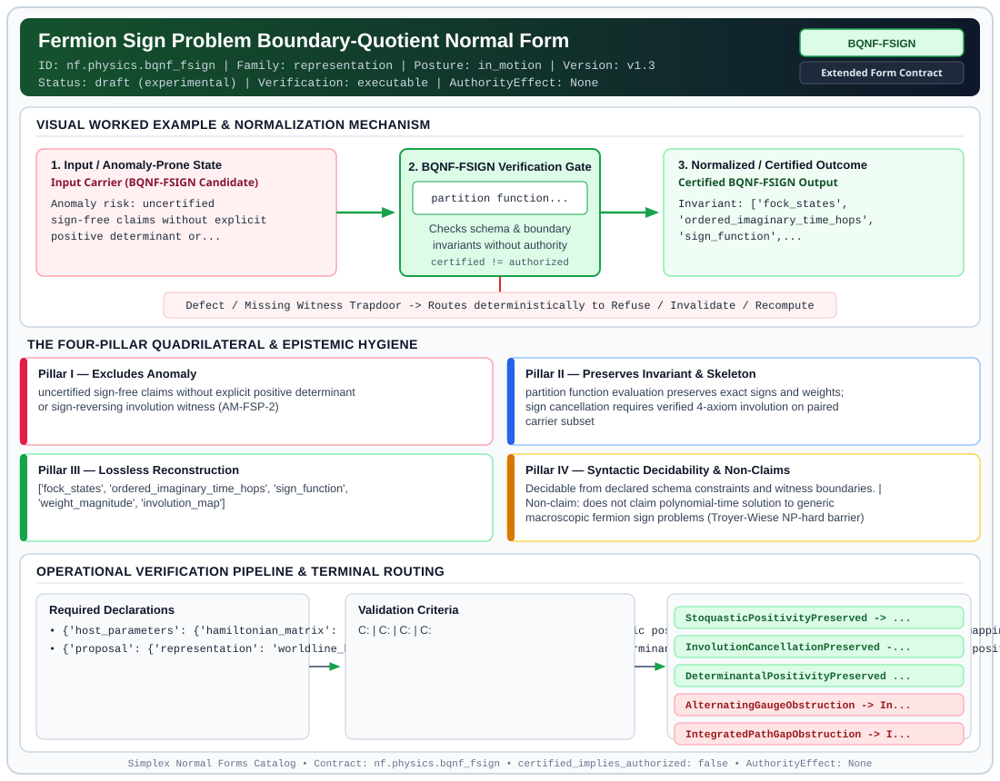

# Fermion Sign Problem Boundary-Quotient Normal Form (`BQNF-FSIGN`)

> **Contract ID:** `nf.physics.bqnf_fsign` | **Family:** `representation` | **Index Status:** `draft` | **AuthorityEffect:** `None`

**[⬅ Back to Wiki Home](Home)** | **[View SVG Diagram](images/nf.physics.bqnf_fsign.svg)**

---

## 1. Executive Summary & Metadata

Fermion Sign Problem Boundary-Quotient Normal Form (BQNF-FSIGN) enforces structural normalization and explicit defect routing in the representation regime.

| Property | Value |
| :--- | :--- |
| **Canonical ID** | `nf.physics.bqnf_fsign` |
| **Short Name** | `BQNF-FSIGN` |
| **Full Name** | Fermion Sign Problem Boundary-Quotient Normal Form |
| **Family** | `representation` (Data in Representation, Canonical Wire Grammars, Orbit Representatives & Gauge Fixing) |
| **Qualification** | Extended Form Contract (Normal Form Contract) |
| **Data / Math Posture** | in_motion |
| **Index Status** | `draft` |
| **Theory Status** | `experimental` |
| **Verification Status** | `executable` |
| **Contract Version** | `v1.3` |
| **Governance Fence** | `AuthorityEffect: None` (`certified_implies_authorized: false`) |

---

## 2. Visual Architecture & Normalization Diagram



---

## 3. Concrete Worked Example & Mechanism

### Visual Transition Summary

| Stage | Carrier / Operator | Concrete State / Invariant |
| :--- | :--- | :--- |
| **1. Before / Candidate Input** | `Input Carrier (BQNF-FSIGN Candidate)` | Anomaly risk: uncertified ; sign-free claims without explicit ; positive determinant or... |
| **2. Normalization / Gate** | `BQNF-FSIGN Verification Gate` | `partition function...` (`certified_implies_authorized: false`) |
| **3. After / Certified Output** | `Certified BQNF-FSIGN Output` | Invariant: ['fock_states', ; 'ordered_imaginary_time_hops', ; 'sign_function',... |

### Contract-Declared Worked Cases

```yaml
- ref: research/mssn_sn_tower/demos/demo_2
  section: "\xA73.2"
```

---

## 4. The Four-Pillar Quadrilateral & Non-Claims

Every contract in `simplex-normal-forms` is evaluated against the **Four-Pillar Quadrilateral** defined in `contracts/_golden_nfs/standard.yaml`:

| Pillar | Requirement | Contract Specification for `nf.physics.bqnf_fsign` |
| :--- | :--- | :--- |
| **Pillar I: Excludes Anomaly** | Name and eliminate a specific class of data or state defects. | uncertified sign-free claims without explicit positive determinant or sign-reversing involution witness (AM-FSP-2) |
| **Pillar II: Preserves Invariant** | State the structural invariant and protected skeleton preserved across transitions. | **Invariant:** partition function evaluation preserves exact signs and weights; sign cancellation requires verified 4-axiom involution on paired carrier subset<br>**Protected Skeleton:** ['fock_states', 'ordered_imaginary_time_hops', 'sign_function', 'weight_magnitude', 'involution_map'] |
| **Pillar III: Lossless Reconstruction** | State the non-loss reconstruction operator (join, direct sum, pullback, or replay). | Lossless reconstruction under declared projection, direct sum, or pullback operators. |
| **Pillar IV: Syntactic Decidability** | State how conformance is decided from declared constraints without unbudgeted scans. | Decidable from declared schema and witness metadata within bounded evaluation budgets. |

### Explicit Non-Claims (`certified_implies_authorized: false`)

- does not claim polynomial-time solution to generic macroscopic fermion sign problems (Troyer-Wiese NP-hard barrier)
- does not claim odd cycles obstruct determinantal QMC representations
- does not grant live external execution authority (AuthorityEffect None)
- does not classify time-labelled path measures from integrated sequence weights
- does not treat historical verifier labels as independent ground truth
- 64 occupation states form a finite base for the path algebra, but do not make the countable time-integrated path carrier finite without truncation or bounding

---

## 5. Operational Verification & Terminal Routing

### 5.1 Required Declarations

- **host_parameters**: {'hamiltonian_matrix': 'explicit real symmetric matrix for stoquastic positivity', 'configuration_weights': 'nonempty mapping of configuration IDs to signed rational weights for finite_signed', 'determinant_hypotheses': 'explicit U, h_up, h_down; for U<0 also identical real spin matrices and equal mu_up, mu_down', 'bonds': 'declared graph edges for alternating gauge witness', 'c3_parameters': 't=1, U=2, beta=1/4, mu=0 for integrated-sequence gap'}
- **proposal**: {'representation': 'worldline_hopping | determinant | continuous_hs | determinantal_continuous_hs | finite_signed', 'route': 'positivity | determinantal_positivity | determinant_squaring | exact_cancellation', 'xi_witness': 'pairs map on host IDs; free text is not evidence', 'obstruction_witness': 'alternating_site_gauge with explicit odd cycle, or c3_integrated_path_gap'}

### 5.2 Required Evidence

- **route_discriminated_union**: {'positivity': {'positive_witness': 'explicit non-negative matrix off-diagonal or non-negative weight table'}, 'determinantal_positivity': {'determinant_witness': 'positive determinant decomposition receipt'}, 'exact_cancellation': {'xi_witness': 'pairs map on host IDs satisfying involution axioms'}, 'alternating_site_gauge_obstruction': {'obstruction_witness': 'alternating_site_gauge with explicit odd-holonomy cycle'}, 'integrated_path_gap_obstruction': {'obstruction_witness': 'c3_integrated_path_gap'}}

### 5.3 Validation Criteria

| Criterion ID | Name | Condition |
| :--- | :--- | :--- |
| `` | **** |  |
| `` | **** |  |
| `` | **** |  |
| `` | **** |  |
| `` | **** |  |
| `` | **** |  |
| `` | **** |  |
| `` | **** |  |
| `` | **** |  |

### 5.4 Terminal Route Map

Every evaluation terminates in a declared local route mapped to a canonical terminal in `standard.yaml`:

| Local Terminal Route | Canonical Terminal |
| :--- | :--- |
| `StoquasticPositivityPreserved` | `Preserve` |
| `InvolutionCancellationPreserved` | `Preserve` |
| `DeterminantalPositivityPreserved` | `Preserve` |
| `AlternatingGaugeObstruction` | `Invalidate` |
| `IntegratedPathGapObstruction` | `Invalidate` |
| `UnsupportedProposal` | `Unsupported` |
| `Refuse` | `Refuse` |

### 5.5 Declared Failure Modes

- **symptom**: involution pairs same-sign paths, **diagnosis**: xi_witness violates sign-reversal axiom, **terminal**: Refuse
- **symptom**: odd-cycle witness is not an odd cycle on declared graph, **diagnosis**: obstruction claim false or ungrounded, **terminal**: Refuse
- **symptom**: weight mismatch across paired states, **diagnosis**: xi_witness violates weight-preservation axiom, **terminal**: Refuse
- **symptom**: negative configurations omitted from paired subset, **diagnosis**: negative weight coverage incomplete, **terminal**: Refuse

---

## 6. Epistemic Claim Hygiene Quadrant

In accordance with the repository's epistemic claim discipline:

1. **What it supports:**
   - Supports syntactic and operational checking of `nf.physics.bqnf_fsign` (`BQNF-FSIGN`) against its declared schema, boundary constraints, and witness obligations in this model.
   - Supports deterministic terminal routing (`StoquasticPositivityPreserved, InvolutionCancellationPreserved, DeterminantalPositivityPreserved, AlternatingGaugeObstruction`) when required declarations or invariants fail.
2. **What it does not support:**
   - Does not confer operational authority (`AuthorityEffect: None`, `certified_implies_authorized: false`).
   - Does not claim semantic truth of undeclared external processes or unverified upstream inputs beyond the declaredprotected skeleton.
3. **The narrowest defensible claim:**
   - Within the declared substrate `in_motion`, this contract enforces that `uncertified sign-free claims without explicit positive determinant or sign-reversing involution witness (AM-FSP-2)` is either excluded under `partition function evaluation preserves exact signs and weights; sign cancellation requires verified 4-axiom involution on paired carrier subset` or routed to an explicit refusal/recovery terminal.
4. **The next test needed:**
   - Property-based falsification and mutation testing across boundary edge cases and composed multi-step pipelines for `nf.physics.bqnf_fsign`.

---

## 7. Canonical YAML Contract (`contracts/nf.physics.bqnf_fsign.yaml`)

<details>
<summary><strong>Click to expand full canonical YAML contract (contracts/nf.physics.bqnf_fsign.yaml)</strong></summary>

```yaml
schema_version: smplx.nf.contract.v0
schema_ref: ./normal_form_contract_schema.yaml
contract_kind: normal_form_contract
identity:
  id: nf.physics.bqnf_fsign
  name: Fermion Sign Problem Boundary-Quotient Normal Form
  short_name: BQNF-FSIGN
  version: v1.3
  theory_status: experimental
  contract_status: draft
  status: draft
  verification_status: executable
  family: representation
classification:
  hierarchy_level: certified_normal_form
  subject_kind:
  - fock_carrier
  - worldline_path_expansion
  - involution_witness
  data_posture: in_motion
  mathematical_posture: formal_algebraic
purpose:
  excludes_anomaly: uncertified sign-free claims without explicit positive determinant
    or sign-reversing involution witness (AM-FSP-2)
  preserves_invariant: partition function evaluation preserves exact signs and weights;
    sign cancellation requires verified 4-axiom involution on paired carrier subset
  protected_skeleton:
  - fock_states
  - ordered_imaginary_time_hops
  - sign_function
  - weight_magnitude
  - involution_map
  erased_structure: []
  non_claims:
  - does not claim polynomial-time solution to generic macroscopic fermion sign problems
    (Troyer-Wiese NP-hard barrier)
  - does not claim odd cycles obstruct determinantal QMC representations
  - does not grant live external execution authority (AuthorityEffect None)
  - does not classify time-labelled path measures from integrated sequence weights
  - does not treat historical verifier labels as independent ground truth
  - 64 occupation states form a finite base for the path algebra, but do not make
    the countable time-integrated path carrier finite without truncation or bounding
definition:
  source: coda_all_universe/mssn_sn_tower/definitions.md
  formal_statement: >
    A fermion system presentation is in BQNF-FSIGN when partition function evaluation
    either establishes positivity under an explicit sign-free determinant/matrix, or
    supports exact pairwise cancellation under a verified 4-axiom involution on a paired
    carrier subset with a non-negative survivor sector. Non-cancellable obstructions
    terminalize via explicit cycle or gap witnesses.
  quadrilateral:
    qualifies_as_true_normal_form: false
    qualification_gap: involution_pairing_and_boundary_quotients_are_not_relational_project_join_theorems
    qualifies_as_extended_form: true
    anomaly_exclusion: uncertified sign-free claims without explicit positive determinant or sign-reversing involution witness
    lossless_join:
      status: involution_reconstruction
      statement: partition function evaluates strictly to the non-negative survivor sector plus exact pairwise cancellation
    dependency_preservation:
      status: involution_laws_retained
      statement: the four involution laws (involution, fixed-point free, sign-reversal, weight-preservation) are verified locally on the paired subset
    syntactic_decision:
      status: instance_constraint_check
      statement: checkable from the declared Hamiltonian parameters, configuration weights, and route-specific witnesses
obstruction_substrate:
  finite_carrier:
    description: Host-owned finite signed rational weight table for exact cancellation;
      64 occupation states underlying a countable carrier of time-integrated C3 hopping
      sequences
    fock_states: 64
  carrier_realization:
    ref: fock.triangular_hubbard_c3.v1
    path: code/fock_path_enumerator.py
  geometry_module: null
  gauge_metric_selector: null
  obstruction_class:
    alternating_site_gauge: odd cycle excludes flipping every edge; does not establish
      a physical sign problem
    integrated_sequence: C3 t=1 U=2 beta=1/4 mu=0 gap excludes equal-weight integrated
      partners for one designated sequence
declarations_required:
- host_parameters:
    hamiltonian_matrix: explicit real symmetric matrix for stoquastic positivity
    configuration_weights: nonempty mapping of configuration IDs to signed rational
      weights for finite_signed
    determinant_hypotheses: explicit U, h_up, h_down; for U<0 also identical real
      spin matrices and equal mu_up, mu_down
    bonds: declared graph edges for alternating gauge witness
    c3_parameters: t=1, U=2, beta=1/4, mu=0 for integrated-sequence gap
- proposal:
    representation: worldline_hopping | determinant | continuous_hs | determinantal_continuous_hs
      | finite_signed
    route: positivity | determinantal_positivity | determinant_squaring | exact_cancellation
    xi_witness: pairs map on host IDs; free text is not evidence
    obstruction_witness: alternating_site_gauge with explicit odd cycle, or c3_integrated_path_gap
evidence_required:
- route_discriminated_union:
    positivity:
      positive_witness: explicit non-negative matrix off-diagonal or non-negative weight table
    determinantal_positivity:
      determinant_witness: positive determinant decomposition receipt
    exact_cancellation:
      xi_witness: pairs map on host IDs satisfying involution axioms
    alternating_site_gauge_obstruction:
      obstruction_witness: alternating_site_gauge with explicit odd-holonomy cycle
    integrated_path_gap_obstruction:
      obstruction_witness: c3_integrated_path_gap
validation_criteria:
- positivity: explicit matrix off-diagonal <= 0 or all declared finite weights >=
    0
- determinant: check supported Hamiltonian class, explicit interaction and required
    matrix/chemical-potential hypotheses
- involution_law: pairs[pairs[x]] == x on the paired subset
- fixed_point_free: pairs[x] != x
- sign_reversing: w[x] * w[pairs[x]] < 0
- weight_preserving: abs(w[x]) == abs(w[pairs[x]])
- negative_coverage: all negative host weights occur in the paired subset
- gauge_obstruction: supplied odd cycle belongs to declared bonds
- path_gap: validate fixed C3 model and bounds for 0, 1, 2, 3, and >=4 hops
terminal_routes:
- StoquasticPositivityPreserved
- InvolutionCancellationPreserved
- DeterminantalPositivityPreserved
- AlternatingGaugeObstruction
- IntegratedPathGapObstruction
- UnsupportedProposal
- Refuse
terminal_route_map:
  StoquasticPositivityPreserved: Preserve
  InvolutionCancellationPreserved: Preserve
  DeterminantalPositivityPreserved: Preserve
  AlternatingGaugeObstruction: Invalidate
  IntegratedPathGapObstruction: Invalidate
  UnsupportedProposal: Unsupported
  Refuse: Refuse
certification:
  certificate_required: true
  certificate_kind: fsp_witness_certificate
  obstruction_class_required: true
  loss_ledger_required: false
  loss_ledger_trigger_id: null
  verifier_required: true
authorization:
  authorized_by: null
  certified_implies_authorized: false
failure_modes:
- symptom: involution pairs same-sign paths
  diagnosis: xi_witness violates sign-reversal axiom
  terminal: Refuse
- symptom: odd-cycle witness is not an odd cycle on declared graph
  diagnosis: obstruction claim false or ungrounded
  terminal: Refuse
- symptom: weight mismatch across paired states
  diagnosis: xi_witness violates weight-preservation axiom
  terminal: Refuse
- symptom: negative configurations omitted from paired subset
  diagnosis: negative weight coverage incomplete
  terminal: Refuse
examples:
- ref: research/mssn_sn_tower/demos/demo_2
  section: §3.2
references:
- research/mssn_sn_tower/demos/demo_2
- coda_all_universe/mssn_sn_tower/definitions.md
```

</details>
