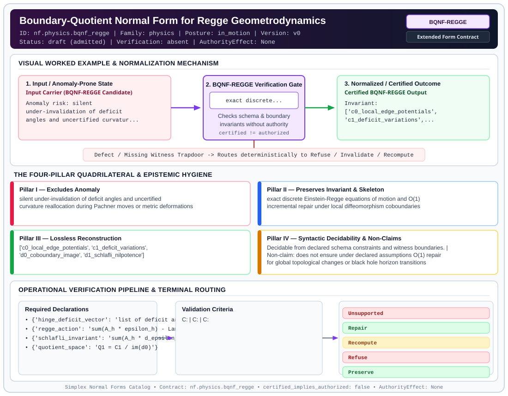

# Boundary-Quotient Normal Form for Regge Geometrodynamics (`BQNF-REGGE`)

> **Contract ID:** `nf.physics.bqnf_regge` | **Family:** `physics` | **Index Status:** `draft` | **AuthorityEffect:** `None`

**[⬅ Back to Wiki Home](Home)** | **[View SVG Diagram](images/nf.physics.bqnf_regge.svg)**

---

## 1. Executive Summary & Metadata

Boundary-Quotient Normal Form for Regge Geometrodynamics (BQNF-REGGE) enforces structural normalization and explicit defect routing in the physics regime.

| Property | Value |
| :--- | :--- |
| **Canonical ID** | `nf.physics.bqnf_regge` |
| **Short Name** | `BQNF-REGGE` |
| **Full Name** | Boundary-Quotient Normal Form for Regge Geometrodynamics |
| **Family** | `physics` (Discrete Differential Geometry, Regge Calculus, Gauge Theory, Lattice Fermions & Quantum Gravity) |
| **Qualification** | Extended Form Contract (Normal Form Contract) |
| **Data / Math Posture** | in_motion |
| **Index Status** | `draft` |
| **Theory Status** | `admitted` |
| **Verification Status** | `absent` |
| **Contract Version** | `v0` |
| **Governance Fence** | `AuthorityEffect: None` (`certified_implies_authorized: false`) |

---

## 2. Visual Architecture & Normalization Diagram



---

## 3. Concrete Worked Example & Mechanism

### Visual Transition Summary

| Stage | Carrier / Operator | Concrete State / Invariant |
| :--- | :--- | :--- |
| **1. Before / Candidate Input** | `Input Carrier (BQNF-REGGE Candidate)` | Anomaly risk: silent ; under-invalidation of deficit ; angles and uncertified curvatur... |
| **2. Normalization / Gate** | `BQNF-REGGE Verification Gate` | `exact discrete...` (`certified_implies_authorized: false`) |
| **3. After / Certified Output** | `Certified BQNF-REGGE Output` | Invariant: ; ['c0_local_edge_potentials', ; 'c1_deficit_variations',... |

---

## 4. The Four-Pillar Quadrilateral & Non-Claims

Every contract in `simplex-normal-forms` is evaluated against the **Four-Pillar Quadrilateral** defined in `contracts/_golden_nfs/standard.yaml`:

| Pillar | Requirement | Contract Specification for `nf.physics.bqnf_regge` |
| :--- | :--- | :--- |
| **Pillar I: Excludes Anomaly** | Name and eliminate a specific class of data or state defects. | silent under-invalidation of deficit angles and uncertified curvature reallocation during Pachner moves or metric deformations |
| **Pillar II: Preserves Invariant** | State the structural invariant and protected skeleton preserved across transitions. | **Invariant:** exact discrete Einstein-Regge equations of motion and O(1) incremental repair under local diffeomorphism coboundaries<br>**Protected Skeleton:** ['c0_local_edge_potentials', 'c1_deficit_variations', 'd0_coboundary_image', 'd1_schlafli_nilpotence'] |
| **Pillar III: Lossless Reconstruction** | State the non-loss reconstruction operator (join, direct sum, pullback, or replay). | Lossless reconstruction under declared projection, direct sum, or pullback operators. |
| **Pillar IV: Syntactic Decidability** | State how conformance is decided from declared constraints without unbudgeted scans. | Decidable from declared schema and witness metadata within bounded evaluation budgets. |

### Explicit Non-Claims (`certified_implies_authorized: false`)

- does not ensure under declared assumptions O(1) repair for global topological changes or black hole horizon transitions
- does not claim continuum general covariance without discrete gauge quotienting

---

## 5. Operational Verification & Terminal Routing

### 5.1 Required Declarations

- **hinge_deficit_vector**: list of deficit angles epsilon_h = 2*pi - sum(theta_h)
- **regge_action**: sum(A_h * epsilon_h) - Lambda * sum(V_sigma)
- **schlafli_invariant**: sum(A_h * d_epsilon_h) = 0
- **quotient_space**: Q1 = C1 / im(d0)

### 5.2 Required Evidence

_None declared._

### 5.3 Validation Criteria

| Criterion ID | Name | Condition |
| :--- | :--- | :--- |
| `` | **** |  |
| `` | **** |  |
| `` | **** |  |

### 5.4 Terminal Route Map

Every evaluation terminates in a declared local route mapped to a canonical terminal in `standard.yaml`:

| Local Terminal Route | Canonical Terminal |
| :--- | :--- |
| `Unsupported` | `Unsupported` |
| `Repair` | `Repair` |
| `Recompute` | `Recompute` |
| `Refuse` | `Refuse` |
| `Preserve` | `Preserve` |

### 5.5 Declared Failure Modes

_All defects route explicitly through the Terminal Route Map above._

---

## 6. Epistemic Claim Hygiene Quadrant

In accordance with the repository's epistemic claim discipline:

1. **What it supports:**
   - Supports syntactic and operational checking of `nf.physics.bqnf_regge` (`BQNF-REGGE`) against its declared schema, boundary constraints, and witness obligations in this model.
   - Supports deterministic terminal routing (`Unsupported, Repair, Recompute, Refuse`) when required declarations or invariants fail.
2. **What it does not support:**
   - Does not confer operational authority (`AuthorityEffect: None`, `certified_implies_authorized: false`).
   - Does not claim semantic truth of undeclared external processes or unverified upstream inputs beyond the declaredprotected skeleton.
3. **The narrowest defensible claim:**
   - Within the declared substrate `in_motion`, this contract enforces that `silent under-invalidation of deficit angles and uncertified curvature reallocation during Pachner moves or metric deformations` is either excluded under `exact discrete Einstein-Regge equations of motion and O(1) incremental repair under local diffeomorphism coboundaries` or routed to an explicit refusal/recovery terminal.
4. **The next test needed:**
   - Property-based falsification and mutation testing across boundary edge cases and composed multi-step pipelines for `nf.physics.bqnf_regge`.

---

## 7. Canonical YAML Contract (`contracts/nf.physics.bqnf_regge.yaml`)

<details>
<summary><strong>Click to expand full canonical YAML contract (contracts/nf.physics.bqnf_regge.yaml)</strong></summary>

```yaml
schema_version: smplx.nf.contract.v0
contract_kind: normal_form_contract
identity:
  id: nf.physics.bqnf_regge
  name: Boundary-Quotient Normal Form for Regge Geometrodynamics
  short_name: BQNF-REGGE
  version: v0
  theory_status: admitted
  contract_status: draft
  verification_status: absent
  family: physics
  status: draft
classification:
  hierarchy_level: normal_form
  subject_kind:
  - pachner_moves
  - curvature_defects
  - regge_action
  data_posture: in_motion
  mathematical_posture: operational
purpose:
  excludes_anomaly: silent under-invalidation of deficit angles and uncertified curvature
    reallocation during Pachner moves or metric deformations
  preserves_invariant: exact discrete Einstein-Regge equations of motion and O(1)
    incremental repair under local diffeomorphism coboundaries
  protected_skeleton:
  - c0_local_edge_potentials
  - c1_deficit_variations
  - d0_coboundary_image
  - d1_schlafli_nilpotence
  erased_structure: []
  non_claims:
  - does not ensure under declared assumptions O(1) repair for global topological changes or black hole horizon
    transitions
  - does not claim continuum general covariance without discrete gauge quotienting
declarations_required:
- hinge_deficit_vector: list of deficit angles epsilon_h = 2*pi - sum(theta_h)
- regge_action: sum(A_h * epsilon_h) - Lambda * sum(V_sigma)
- schlafli_invariant: sum(A_h * d_epsilon_h) = 0
- quotient_space: Q1 = C1 / im(d0)
validation_criteria:
- exact_repair_route: when deficit variation omega in im(d0), local potential alpha
    repairs curvature in O(1)
- closed_residual_route: when [omega] != 0 in Q1 and d1 omega = 0, routes to bounded
    partition recomputation
- closure_failure_route: when d1 omega != 0 (Schlafli breach), terminalizes as Refuse
terminal_routes:
- Unsupported
- Repair
- Recompute
- Refuse
- Preserve
terminal_route_map:
  exact_coboundary: Repair
  closed_cohomology_class: Recompute
  schlafli_violation: Refuse
  zero_variation: Preserve
definition:
  source: coda_all_universe/mssn_sn_tower/definitions.md
  formal_statement: silent under-invalidation of deficit angles and uncertified curvature
    reallocation during Pachner moves or metric deformations. exact discrete Einstein-Regge
    equations of motion and O(1) incremental repair under local diffeomorphism coboundaries
  quadrilateral:
    qualifies_as_true_normal_form: false
    qualification_gap: reconstruction_is_not_a_relational_project_join
    anomaly_exclusion: silent under-invalidation of deficit angles and uncertified
      curvature reallocation during Pachner moves or metric deformations
    lossless_join:
      status: declared_reconstruction
      statement: exact discrete Einstein-Regge equations of motion and O(1) incremental
        repair under local diffeomorphism coboundaries
    dependency_preservation:
      status: declared_with_the_invariant
      statement: The preserved invariant stays on the declared schema. This form does
        not state a functional-dependency projection of a flat relvar decomposition.
    syntactic_decision:
      status: declaration_decidable
      statement: The check reads the declared constraints and validation criteria.
        One unrecorded runtime image is not the decider.
authorization:
  authorized_by: null
  certified_implies_authorized: false
certification:
  certificate_required: true
  certificate_kind: nf.physics.bqnf_regge_certificate
  obstruction_class_required: false
  loss_ledger_required: false
  loss_ledger_trigger_id: null
  verifier_required: true
evidence_required: []
schema_ref: ./normal_form_contract_schema.yaml
```

</details>
