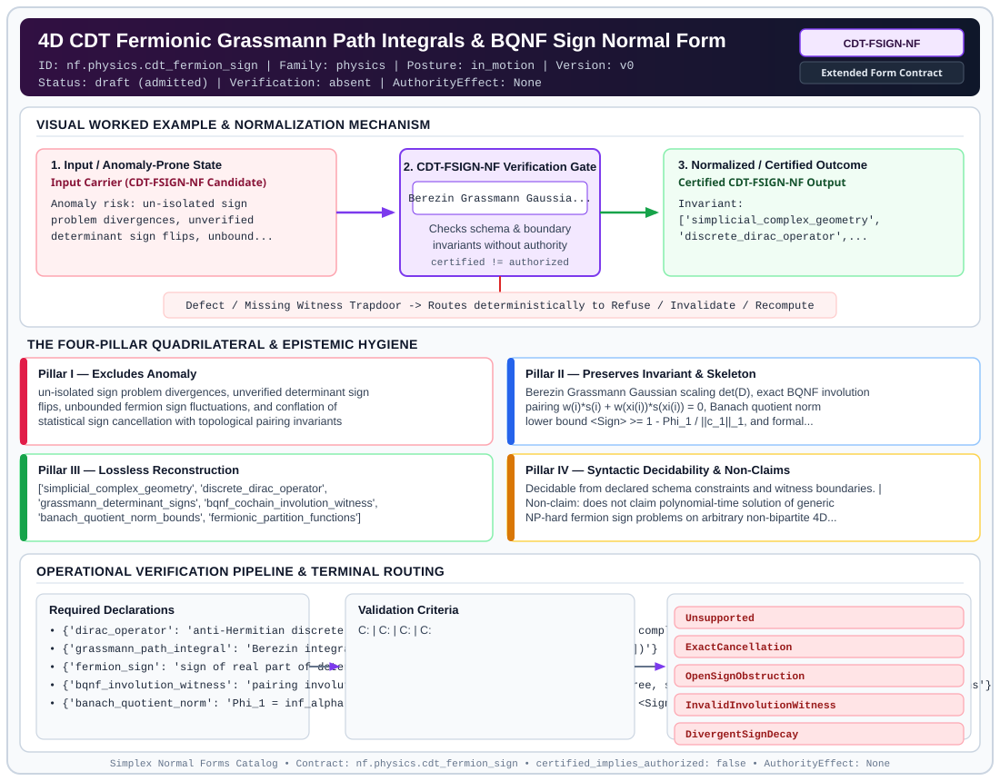

# 4D CDT Fermionic Grassmann Path Integrals & BQNF Sign Normal Form (`CDT-FSIGN-NF`)

> **Contract ID:** `nf.physics.cdt_fermion_sign` | **Family:** `physics` | **Index Status:** `draft` | **AuthorityEffect:** `None`

**[⬅ Back to Wiki Home](Home)** | **[View SVG Diagram](images/nf.physics.cdt_fermion_sign.svg)**

---

## 1. Executive Summary & Metadata

4D CDT Fermionic Grassmann Path Integrals & BQNF Sign Normal Form (CDT-FSIGN-NF) enforces structural normalization and explicit defect routing in the physics regime.

| Property | Value |
| :--- | :--- |
| **Canonical ID** | `nf.physics.cdt_fermion_sign` |
| **Short Name** | `CDT-FSIGN-NF` |
| **Full Name** | 4D CDT Fermionic Grassmann Path Integrals & BQNF Sign Normal Form |
| **Family** | `physics` (Discrete Differential Geometry, Regge Calculus, Gauge Theory, Lattice Fermions & Quantum Gravity) |
| **Qualification** | Extended Form Contract (Normal Form Contract) |
| **Data / Math Posture** | in_motion |
| **Index Status** | `draft` |
| **Theory Status** | `admitted` |
| **Verification Status** | `absent` |
| **Contract Version** | `v0` |
| **Governance Fence** | `AuthorityEffect: None` (`certified_implies_authorized: false`) |

---

## 2. Visual Architecture & Normalization Diagram



---

## 3. Concrete Worked Example & Mechanism

### Visual Transition Summary

| Stage | Carrier / Operator | Concrete State / Invariant |
| :--- | :--- | :--- |
| **1. Before / Candidate Input** | `Input Carrier (CDT-FSIGN-NF Candidate)` | Anomaly risk: un-isolated sign ; problem divergences, unverified ; determinant sign flips, unbound... |
| **2. Normalization / Gate** | `CDT-FSIGN-NF Verification Gate` | `Berezin Grassmann Gaussia...` (`certified_implies_authorized: false`) |
| **3. After / Certified Output** | `Certified CDT-FSIGN-NF Output` | Invariant: ; ['simplicial_complex_geometry', ; 'discrete_dirac_operator',... |

---

## 4. The Four-Pillar Quadrilateral & Non-Claims

Every contract in `simplex-normal-forms` is evaluated against the **Four-Pillar Quadrilateral** defined in `contracts/_golden_nfs/standard.yaml`:

| Pillar | Requirement | Contract Specification for `nf.physics.cdt_fermion_sign` |
| :--- | :--- | :--- |
| **Pillar I: Excludes Anomaly** | Name and eliminate a specific class of data or state defects. | un-isolated sign problem divergences, unverified determinant sign flips, unbounded fermion sign fluctuations, and conflation of statistical sign cancellation with topological pairing invariants |
| **Pillar II: Preserves Invariant** | State the structural invariant and protected skeleton preserved across transitions. | **Invariant:** Berezin Grassmann Gaussian scaling det(D), exact BQNF involution pairing w(i)*s(i) + w(xi(i))*s(xi(i)) = 0, Banach quotient norm lower bound <Sign> >= 1 - Phi_1 / ||c_1||_1, and formal classification of un-cancelled ensembles under FermionSignProblemComplexityObstruction<br>**Protected Skeleton:** ['simplicial_complex_geometry', 'discrete_dirac_operator', 'grassmann_determinant_signs', 'bqnf_cochain_involution_witness', 'banach_quotient_norm_bounds', 'fermionic_partition_functions'] |
| **Pillar III: Lossless Reconstruction** | State the non-loss reconstruction operator (join, direct sum, pullback, or replay). | Lossless reconstruction under declared projection, direct sum, or pullback operators. |
| **Pillar IV: Syntactic Decidability** | State how conformance is decided from declared constraints without unbudgeted scans. | Decidable from declared schema and witness metadata within bounded evaluation budgets. |

### Explicit Non-Claims (`certified_implies_authorized: false`)

- does not claim polynomial-time solution of generic NP-hard fermion sign problems on arbitrary non-bipartite 4D triangulations
- does not claim absence of exponential sign decay in chiral or magnetically frustrated simplicial geometries without global parity or reflection symmetries

---

## 5. Operational Verification & Terminal Routing

### 5.1 Required Declarations

- **dirac_operator**: anti-Hermitian discrete or Kähler-Dirac operator D[T] on simplicial complex
- **grassmann_path_integral**: Berezin integral over Grassmann variables yielding det(D[T])
- **fermion_sign**: sign of real part of determinant sgn(Re(det(D))) in {-1, 1}
- **bqnf_involution_witness**: pairing involution Xi satisfying involutive, fixed-point-free, sign-reversing, and weight-preserving conditions
- **banach_quotient_norm**: Phi_1 = inf_alpha ||c_1 - d_0 alpha||_1 bounding average sign <Sign>

### 5.2 Required Evidence

_None declared._

### 5.3 Validation Criteria

| Criterion ID | Name | Condition |
| :--- | :--- | :--- |
| `` | **** |  |
| `` | **** |  |
| `` | **** |  |
| `` | **** |  |
| `` | **** |  |

### 5.4 Terminal Route Map

Every evaluation terminates in a declared local route mapped to a canonical terminal in `standard.yaml`:

| Local Terminal Route | Canonical Terminal |
| :--- | :--- |
| `Unsupported` | `Unsupported` |
| `ExactCancellation` | `ExactCancellation` |
| `OpenSignObstruction` | `OpenSignObstruction` |
| `InvalidInvolutionWitness` | `InvalidInvolutionWitness` |
| `DivergentSignDecay` | `DivergentSignDecay` |

### 5.5 Declared Failure Modes

_All defects route explicitly through the Terminal Route Map above._

---

## 6. Epistemic Claim Hygiene Quadrant

In accordance with the repository's epistemic claim discipline:

1. **What it supports:**
   - Supports syntactic and operational checking of `nf.physics.cdt_fermion_sign` (`CDT-FSIGN-NF`) against its declared schema, boundary constraints, and witness obligations in this model.
   - Supports deterministic terminal routing (`Unsupported, ExactCancellation, OpenSignObstruction, InvalidInvolutionWitness`) when required declarations or invariants fail.
2. **What it does not support:**
   - Does not confer operational authority (`AuthorityEffect: None`, `certified_implies_authorized: false`).
   - Does not claim semantic truth of undeclared external processes or unverified upstream inputs beyond the declaredprotected skeleton.
3. **The narrowest defensible claim:**
   - Within the declared substrate `in_motion`, this contract enforces that `un-isolated sign problem divergences, unverified determinant sign flips, unbounded fermion sign fluctuations, and conflation of statistical sign cancellation with topological pairing invariants` is either excluded under `Berezin Grassmann Gaussian scaling det(D), exact BQNF involution pairing w(i)*s(i) + w(xi(i))*s(xi(i)) = 0, Banach quotient norm lower bound <Sign> >= 1 - Phi_1 / ||c_1||_1, and formal classification of un-cancelled ensembles under FermionSignProblemComplexityObstruction` or routed to an explicit refusal/recovery terminal.
4. **The next test needed:**
   - Property-based falsification and mutation testing across boundary edge cases and composed multi-step pipelines for `nf.physics.cdt_fermion_sign`.

---

## 7. Canonical YAML Contract (`contracts/nf.physics.cdt_fermion_sign.yaml`)

<details>
<summary><strong>Click to expand full canonical YAML contract (contracts/nf.physics.cdt_fermion_sign.yaml)</strong></summary>

```yaml
schema_version: smplx.nf.contract.v0
contract_kind: normal_form_contract
identity:
  id: nf.physics.cdt_fermion_sign
  name: 4D CDT Fermionic Grassmann Path Integrals & BQNF Sign Normal Form
  short_name: CDT-FSIGN-NF
  version: v0
  theory_status: admitted
  contract_status: draft
  verification_status: absent
  family: physics
  status: draft
classification:
  hierarchy_level: normal_form
  subject_kind:
  - fermionic_matter_fields
  - grassmann_path_integrals
  - fermion_determinant_sign_problem
  - boundary_quotient_normal_form
  - cochain_involution_witness
  - causal_dynamical_triangulations
  data_posture: in_motion
  mathematical_posture: formal_algebraic
purpose:
  excludes_anomaly: un-isolated sign problem divergences, unverified determinant sign
    flips, unbounded fermion sign fluctuations, and conflation of statistical sign
    cancellation with topological pairing invariants
  preserves_invariant: Berezin Grassmann Gaussian scaling det(D), exact BQNF involution
    pairing w(i)*s(i) + w(xi(i))*s(xi(i)) = 0, Banach quotient norm lower bound <Sign>
    >= 1 - Phi_1 / ||c_1||_1, and formal classification of un-cancelled ensembles
    under FermionSignProblemComplexityObstruction
  protected_skeleton:
  - simplicial_complex_geometry
  - discrete_dirac_operator
  - grassmann_determinant_signs
  - bqnf_cochain_involution_witness
  - banach_quotient_norm_bounds
  - fermionic_partition_functions
  erased_structure:
  - continuous_spinor_manifolds
  - infinite_dimensional_grassmann_algebras
  non_claims:
  - does not claim polynomial-time solution of generic NP-hard fermion sign problems
    on arbitrary non-bipartite 4D triangulations
  - does not claim absence of exponential sign decay in chiral or magnetically frustrated
    simplicial geometries without global parity or reflection symmetries
declarations_required:
- dirac_operator: anti-Hermitian discrete or Kähler-Dirac operator D[T] on simplicial
    complex
- grassmann_path_integral: Berezin integral over Grassmann variables yielding det(D[T])
- fermion_sign: sign of real part of determinant sgn(Re(det(D))) in {-1, 1}
- bqnf_involution_witness: pairing involution Xi satisfying involutive, fixed-point-free,
    sign-reversing, and weight-preserving conditions
- banach_quotient_norm: Phi_1 = inf_alpha ||c_1 - d_0 alpha||_1 bounding average sign
    <Sign>
validation_criteria:
- dirac_antihermitian: discrete Dirac operator satisfies D^dagger = -D or (gamma^5
    D)^dagger = gamma^5 D
- grassmann_scaling_verified: Grassmann path integral evaluates to det(D[T]) with
    exact Berezin scaling
- exact_involution_certified: for bipartite/reflection-symmetric complexes, involution
    Xi achieves exact pair-wise cancellation w(i)*s(i) + w(Xi(i))*s(Xi(i)) = 0
- quotient_bound_satisfied: for generic ensembles, average sign satisfies <Sign> >=
    1 - Phi_1 / ||c_1||_1
- obstruction_registered: ensembles with Phi_1 > 0 and decaying <Sign> ~ exp(-beta
    V_4 Delta f) are routed to OpenSignObstruction
terminal_routes:
- Unsupported
- ExactCancellation
- OpenSignObstruction
- InvalidInvolutionWitness
- DivergentSignDecay
terminal_route_map:
  exact_involution: ExactCancellation
  bounded_obstruction: OpenSignObstruction
  invalid_witness: InvalidInvolutionWitness
  divergent_decay: DivergentSignDecay
definition:
  source: coda_all_universe/mssn_sn_tower/definitions.md
  formal_statement: un-isolated sign problem divergences, unverified determinant sign
    flips, unbounded fermion sign fluctuations, and conflation of statistical sign
    cancellation with topological pairing invariants. Berezin Grassmann Gaussian scaling
    det(D), exact BQNF involution pairing w(i)*s(i) + w(xi(i))*s(xi(i)) = 0, Banach
    quotient norm lower bound <Sign> >= 1 - Phi_1 / ||c_1||_1, and formal classification
    of un-cancelled ensembles under FermionSignProblemComplexityObstruction
  quadrilateral:
    qualifies_as_true_normal_form: false
    qualification_gap: reconstruction_is_not_a_relational_project_join
    anomaly_exclusion: un-isolated sign problem divergences, unverified determinant
      sign flips, unbounded fermion sign fluctuations, and conflation of statistical
      sign cancellation with topological pairing invariants
    lossless_join:
      status: declared_reconstruction
      statement: Berezin Grassmann Gaussian scaling det(D), exact BQNF involution
        pairing w(i)*s(i) + w(xi(i))*s(xi(i)) = 0, Banach quotient norm lower bound
        <Sign> >= 1 - Phi_1 / ||c_1||_1, and formal classification of un-cancelled
        ensembles under FermionSignProblemComplexityObstruction
    dependency_preservation:
      status: declared_with_the_invariant
      statement: The preserved invariant stays on the declared schema. This form does
        not state a functional-dependency projection of a flat relvar decomposition.
    syntactic_decision:
      status: declaration_decidable
      statement: The check reads the declared constraints and validation criteria.
        One unrecorded runtime image is not the decider.
canonical_terminal_map:
  Unsupported: Unsupported
  ExactCancellation: Preserve
  OpenSignObstruction: Reject
  InvalidInvolutionWitness: Escalate
  DivergentSignDecay: Reject
authorization:
  authorized_by: null
  certified_implies_authorized: false
certification:
  certificate_required: true
  certificate_kind: nf.physics.cdt_fermion_sign_certificate
  obstruction_class_required: false
  loss_ledger_required: false
  loss_ledger_trigger_id: null
  verifier_required: true
evidence_required: []
schema_ref: ./normal_form_contract_schema.yaml
```

</details>
