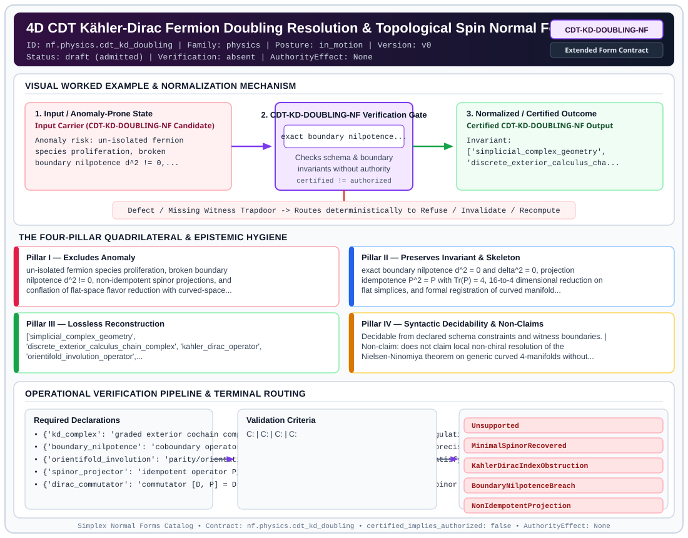

# 4D CDT Kähler-Dirac Fermion Doubling Resolution & Topological Spin Normal Form (`CDT-KD-DOUBLING-NF`)

> **Contract ID:** `nf.physics.cdt_kd_doubling` | **Family:** `physics` | **Index Status:** `draft` | **AuthorityEffect:** `None`

**[⬅ Back to Wiki Home](Home)** | **[View SVG Diagram](images/nf.physics.cdt_kd_doubling.svg)**

---

## 1. Executive Summary & Metadata

4D CDT Kähler-Dirac Fermion Doubling Resolution & Topological Spin Normal Form (CDT-KD-DOUBLING-NF) enforces structural normalization and explicit defect routing in the physics regime.

| Property | Value |
| :--- | :--- |
| **Canonical ID** | `nf.physics.cdt_kd_doubling` |
| **Short Name** | `CDT-KD-DOUBLING-NF` |
| **Full Name** | 4D CDT Kähler-Dirac Fermion Doubling Resolution & Topological Spin Normal Form |
| **Family** | `physics` (Discrete Differential Geometry, Regge Calculus, Gauge Theory, Lattice Fermions & Quantum Gravity) |
| **Qualification** | Extended Form Contract (Normal Form Contract) |
| **Data / Math Posture** | in_motion |
| **Index Status** | `draft` |
| **Theory Status** | `admitted` |
| **Verification Status** | `absent` |
| **Contract Version** | `v0` |
| **Governance Fence** | `AuthorityEffect: None` (`certified_implies_authorized: false`) |

---

## 2. Visual Architecture & Normalization Diagram



---

## 3. Concrete Worked Example & Mechanism

### Visual Transition Summary

| Stage | Carrier / Operator | Concrete State / Invariant |
| :--- | :--- | :--- |
| **1. Before / Candidate Input** | `Input Carrier (CDT-KD-DOUBLING-NF Candidate)` | Anomaly risk: un-isolated fermion ; species proliferation, broken ; boundary nilpotence d^2 != 0,... |
| **2. Normalization / Gate** | `CDT-KD-DOUBLING-NF Verification Gate` | `exact boundary nilpotence...` (`certified_implies_authorized: false`) |
| **3. After / Certified Output** | `Certified CDT-KD-DOUBLING-NF Output` | Invariant: ; ['simplicial_complex_geometry', ; 'discrete_exterior_calculus_cha... |

---

## 4. The Four-Pillar Quadrilateral & Non-Claims

Every contract in `simplex-normal-forms` is evaluated against the **Four-Pillar Quadrilateral** defined in `contracts/_golden_nfs/standard.yaml`:

| Pillar | Requirement | Contract Specification for `nf.physics.cdt_kd_doubling` |
| :--- | :--- | :--- |
| **Pillar I: Excludes Anomaly** | Name and eliminate a specific class of data or state defects. | un-isolated fermion species proliferation, broken boundary nilpotence d^2 != 0, non-idempotent spinor projections, and conflation of flat-space flavor reduction with curved-space topological spin geometry |
| **Pillar II: Preserves Invariant** | State the structural invariant and protected skeleton preserved across transitions. | **Invariant:** exact boundary nilpotence d^2 = 0 and delta^2 = 0, projection idempotence P^2 = P with Tr(P) = 4, 16-to-4 dimensional reduction on flat simplices, and formal registration of curved manifold non-commutativity [D, P] != 0 under KahlerDiracTopologicalSpinObstruction<br>**Protected Skeleton:** ['simplicial_complex_geometry', 'discrete_exterior_calculus_chain_complex', 'kahler_dirac_operator', 'orientifold_involution_operator', 'chiral_spinor_projection_operator', 'euler_poincare_and_spinor_index'] |
| **Pillar III: Lossless Reconstruction** | State the non-loss reconstruction operator (join, direct sum, pullback, or replay). | Lossless reconstruction under declared projection, direct sum, or pullback operators. |
| **Pillar IV: Syntactic Decidability** | State how conformance is decided from declared constraints without unbudgeted scans. | Decidable from declared schema and witness metadata within bounded evaluation budgets. |

### Explicit Non-Claims (`certified_implies_authorized: false`)

- does not claim local non-chiral resolution of the Nielsen-Ninomiya theorem on generic curved 4-manifolds without overlap or domain-wall fermions
- does not claim equality of the Euler characteristic chi(K) and four times the A-hat genus on general topological triangulations

---

## 5. Operational Verification & Terminal Routing

### 5.1 Required Declarations

- **kd_complex**: graded exterior cochain complex C^0 + C^1 + C^2 + C^3 + C^4 on 4D triangulation
- **boundary_nilpotence**: coboundary operator d satisfying d_{p+1} o d_p = 0 to machine precision
- **orientifold_involution**: parity/orientation involution Omega on differential forms satisfying Omega^2 = I
- **spinor_projector**: idempotent operator P_spinor with P^2 = P and Tr(P) = 4
- **dirac_commutator**: commutator [D, P] = D P - P D between Dirac-Kähler operator and spinor projector

### 5.2 Required Evidence

_None declared._

### 5.3 Validation Criteria

| Criterion ID | Name | Condition |
| :--- | :--- | :--- |
| `` | **** |  |
| `` | **** |  |
| `` | **** |  |
| `` | **** |  |
| `` | **** |  |

### 5.4 Terminal Route Map

Every evaluation terminates in a declared local route mapped to a canonical terminal in `standard.yaml`:

| Local Terminal Route | Canonical Terminal |
| :--- | :--- |
| `Unsupported` | `Unsupported` |
| `MinimalSpinorRecovered` | `MinimalSpinorRecovered` |
| `KahlerDiracIndexObstruction` | `KahlerDiracIndexObstruction` |
| `BoundaryNilpotenceBreach` | `BoundaryNilpotenceBreach` |
| `NonIdempotentProjection` | `NonIdempotentProjection` |

### 5.5 Declared Failure Modes

_All defects route explicitly through the Terminal Route Map above._

---

## 6. Epistemic Claim Hygiene Quadrant

In accordance with the repository's epistemic claim discipline:

1. **What it supports:**
   - Supports syntactic and operational checking of `nf.physics.cdt_kd_doubling` (`CDT-KD-DOUBLING-NF`) against its declared schema, boundary constraints, and witness obligations in this model.
   - Supports deterministic terminal routing (`Unsupported, MinimalSpinorRecovered, KahlerDiracIndexObstruction, BoundaryNilpotenceBreach`) when required declarations or invariants fail.
2. **What it does not support:**
   - Does not confer operational authority (`AuthorityEffect: None`, `certified_implies_authorized: false`).
   - Does not claim semantic truth of undeclared external processes or unverified upstream inputs beyond the declaredprotected skeleton.
3. **The narrowest defensible claim:**
   - Within the declared substrate `in_motion`, this contract enforces that `un-isolated fermion species proliferation, broken boundary nilpotence d^2 != 0, non-idempotent spinor projections, and conflation of flat-space flavor reduction with curved-space topological spin geometry` is either excluded under `exact boundary nilpotence d^2 = 0 and delta^2 = 0, projection idempotence P^2 = P with Tr(P) = 4, 16-to-4 dimensional reduction on flat simplices, and formal registration of curved manifold non-commutativity [D, P] != 0 under KahlerDiracTopologicalSpinObstruction` or routed to an explicit refusal/recovery terminal.
4. **The next test needed:**
   - Property-based falsification and mutation testing across boundary edge cases and composed multi-step pipelines for `nf.physics.cdt_kd_doubling`.

---

## 7. Canonical YAML Contract (`contracts/nf.physics.cdt_kd_doubling.yaml`)

<details>
<summary><strong>Click to expand full canonical YAML contract (contracts/nf.physics.cdt_kd_doubling.yaml)</strong></summary>

```yaml
schema_version: smplx.nf.contract.v0
contract_kind: normal_form_contract
identity:
  id: nf.physics.cdt_kd_doubling
  name: 4D CDT Kähler-Dirac Fermion Doubling Resolution & Topological Spin Normal
    Form
  short_name: CDT-KD-DOUBLING-NF
  version: v0
  theory_status: admitted
  contract_status: draft
  verification_status: absent
  family: physics
  status: draft
classification:
  hierarchy_level: normal_form
  subject_kind:
  - kahler_dirac_fermions
  - fermion_doubling_resolution
  - geometric_orientifold_involution
  - chiral_spinor_projection
  - boundary_nilpotence
  - causal_dynamical_triangulations
  data_posture: in_motion
  mathematical_posture: formal_algebraic
purpose:
  excludes_anomaly: un-isolated fermion species proliferation, broken boundary nilpotence
    d^2 != 0, non-idempotent spinor projections, and conflation of flat-space flavor
    reduction with curved-space topological spin geometry
  preserves_invariant: exact boundary nilpotence d^2 = 0 and delta^2 = 0, projection
    idempotence P^2 = P with Tr(P) = 4, 16-to-4 dimensional reduction on flat simplices,
    and formal registration of curved manifold non-commutativity [D, P] != 0 under
    KahlerDiracTopologicalSpinObstruction
  protected_skeleton:
  - simplicial_complex_geometry
  - discrete_exterior_calculus_chain_complex
  - kahler_dirac_operator
  - orientifold_involution_operator
  - chiral_spinor_projection_operator
  - euler_poincare_and_spinor_index
  erased_structure:
  - unphysical_flavor_species_mixing_in_flat_tangent_space
  - non_gauge_covariant_chiral_projectors
  non_claims:
  - does not claim local non-chiral resolution of the Nielsen-Ninomiya theorem on
    generic curved 4-manifolds without overlap or domain-wall fermions
  - does not claim equality of the Euler characteristic chi(K) and four times the
    A-hat genus on general topological triangulations
declarations_required:
- kd_complex: graded exterior cochain complex C^0 + C^1 + C^2 + C^3 + C^4 on 4D triangulation
- boundary_nilpotence: coboundary operator d satisfying d_{p+1} o d_p = 0 to machine
    precision
- orientifold_involution: parity/orientation involution Omega on differential forms
    satisfying Omega^2 = I
- spinor_projector: idempotent operator P_spinor with P^2 = P and Tr(P) = 4
- dirac_commutator: commutator [D, P] = D P - P D between Dirac-Kähler operator and
    spinor projector
validation_criteria:
- boundary_nilpotent: '||d^2||_inf <= 1e-12 across all form degrees p in {0, 1, 2,
    3}'
- projector_idempotent: '||P^2 - P||_inf <= 1e-12 and Tr(P) == 4'
- orientifold_involutive: '||Omega^2 - I||_inf <= 1e-12'
- flat_space_commutator_zero: '||[D, P]||_inf <= 1e-12 on flat 4-simplices routing
    to MinimalSpinorRecovered'
- curved_space_obstruction_registered: '||[D, P]||_inf > 1e-6 and chi != 4*A_hat routing
    to KahlerDiracIndexObstruction'
terminal_routes:
- Unsupported
- MinimalSpinorRecovered
- KahlerDiracIndexObstruction
- BoundaryNilpotenceBreach
- NonIdempotentProjection
terminal_route_map:
  flat_minimal_spinor: MinimalSpinorRecovered
  curved_topological_obstruction: KahlerDiracIndexObstruction
  nilpotence_breach: BoundaryNilpotenceBreach
  non_idempotent: NonIdempotentProjection
definition:
  source: coda_all_universe/mssn_sn_tower/definitions.md
  formal_statement: un-isolated fermion species proliferation, broken boundary nilpotence
    d^2 != 0, non-idempotent spinor projections, and conflation of flat-space flavor
    reduction with curved-space topological spin geometry. exact boundary nilpotence
    d^2 = 0 and delta^2 = 0, projection idempotence P^2 = P with Tr(P) = 4, 16-to-4
    dimensional reduction on flat simplices, and formal registration of curved manifold
    non-commutativity [D, P] != 0 under KahlerDiracTopologicalSpinObstruction
  quadrilateral:
    qualifies_as_true_normal_form: false
    qualification_gap: reconstruction_is_not_a_relational_project_join
    anomaly_exclusion: un-isolated fermion species proliferation, broken boundary
      nilpotence d^2 != 0, non-idempotent spinor projections, and conflation of flat-space
      flavor reduction with curved-space topological spin geometry
    lossless_join:
      status: declared_reconstruction
      statement: exact boundary nilpotence d^2 = 0 and delta^2 = 0, projection idempotence
        P^2 = P with Tr(P) = 4, 16-to-4 dimensional reduction on flat simplices, and
        formal registration of curved manifold non-commutativity [D, P] != 0 under
        KahlerDiracTopologicalSpinObstruction
    dependency_preservation:
      status: declared_with_the_invariant
      statement: The preserved invariant stays on the declared schema. This form does
        not state a functional-dependency projection of a flat relvar decomposition.
    syntactic_decision:
      status: declaration_decidable
      statement: The check reads the declared constraints and validation criteria.
        One unrecorded runtime image is not the decider.
canonical_terminal_map:
  Unsupported: Unsupported
  MinimalSpinorRecovered: Preserve
  KahlerDiracIndexObstruction: Reject
  BoundaryNilpotenceBreach: Reject
  NonIdempotentProjection: Escalate
authorization:
  authorized_by: null
  certified_implies_authorized: false
certification:
  certificate_required: true
  certificate_kind: nf.physics.cdt_kd_doubling_certificate
  obstruction_class_required: false
  loss_ledger_required: false
  loss_ledger_trigger_id: null
  verifier_required: true
evidence_required: []
schema_ref: ./normal_form_contract_schema.yaml
```

</details>
