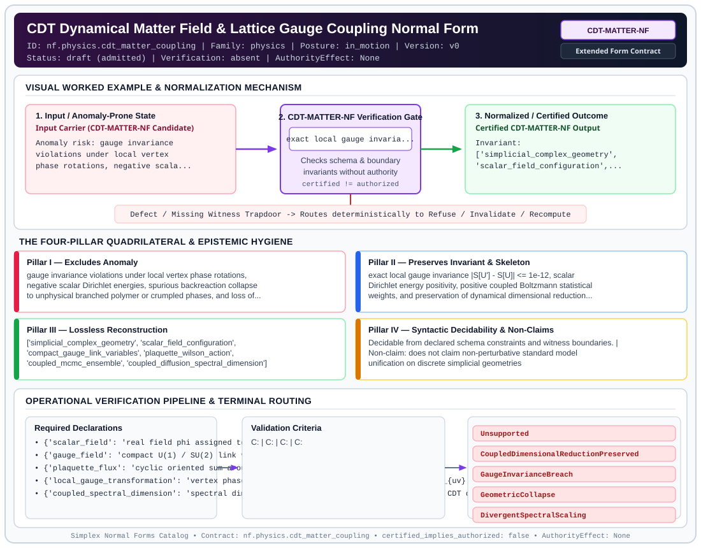

# CDT Dynamical Matter Field & Lattice Gauge Coupling Normal Form (`CDT-MATTER-NF`)

> **Contract ID:** `nf.physics.cdt_matter_coupling` | **Family:** `physics` | **Index Status:** `draft` | **AuthorityEffect:** `None`

**[⬅ Back to Wiki Home](Home)** | **[View SVG Diagram](images/nf.physics.cdt_matter_coupling.svg)**

---

## 1. Executive Summary & Metadata

CDT Dynamical Matter Field & Lattice Gauge Coupling Normal Form (CDT-MATTER-NF) enforces structural normalization and explicit defect routing in the physics regime.

| Property | Value |
| :--- | :--- |
| **Canonical ID** | `nf.physics.cdt_matter_coupling` |
| **Short Name** | `CDT-MATTER-NF` |
| **Full Name** | CDT Dynamical Matter Field & Lattice Gauge Coupling Normal Form |
| **Family** | `physics` (Discrete Differential Geometry, Regge Calculus, Gauge Theory, Lattice Fermions & Quantum Gravity) |
| **Qualification** | Extended Form Contract (Normal Form Contract) |
| **Data / Math Posture** | in_motion |
| **Index Status** | `draft` |
| **Theory Status** | `admitted` |
| **Verification Status** | `absent` |
| **Contract Version** | `v0` |
| **Governance Fence** | `AuthorityEffect: None` (`certified_implies_authorized: false`) |

---

## 2. Visual Architecture & Normalization Diagram



---

## 3. Concrete Worked Example & Mechanism

### Visual Transition Summary

| Stage | Carrier / Operator | Concrete State / Invariant |
| :--- | :--- | :--- |
| **1. Before / Candidate Input** | `Input Carrier (CDT-MATTER-NF Candidate)` | Anomaly risk: gauge invariance ; violations under local vertex ; phase rotations, negative scala... |
| **2. Normalization / Gate** | `CDT-MATTER-NF Verification Gate` | `exact local gauge invaria...` (`certified_implies_authorized: false`) |
| **3. After / Certified Output** | `Certified CDT-MATTER-NF Output` | Invariant: ; ['simplicial_complex_geometry', ; 'scalar_field_configuration',... |

---

## 4. The Four-Pillar Quadrilateral & Non-Claims

Every contract in `simplex-normal-forms` is evaluated against the **Four-Pillar Quadrilateral** defined in `contracts/_golden_nfs/standard.yaml`:

| Pillar | Requirement | Contract Specification for `nf.physics.cdt_matter_coupling` |
| :--- | :--- | :--- |
| **Pillar I: Excludes Anomaly** | Name and eliminate a specific class of data or state defects. | gauge invariance violations under local vertex phase rotations, negative scalar Dirichlet energies, spurious backreaction collapse to unphysical branched polymer or crumpled phases, and loss of macroscopic 4D spectral dimension |
| **Pillar II: Preserves Invariant** | State the structural invariant and protected skeleton preserved across transitions. | **Invariant:** exact local gauge invariance |S[U'] - S[U]| <= 1e-12, scalar Dirichlet energy positivity, positive coupled Boltzmann statistical weights, and preservation of dynamical dimensional reduction d_s(Planck) ~ 2 to d_s(macro) ~ 4<br>**Protected Skeleton:** ['simplicial_complex_geometry', 'scalar_field_configuration', 'compact_gauge_link_variables', 'plaquette_wilson_action', 'coupled_mcmc_ensemble', 'coupled_diffusion_spectral_dimension'] |
| **Pillar III: Lossless Reconstruction** | State the non-loss reconstruction operator (join, direct sum, pullback, or replay). | Lossless reconstruction under declared projection, direct sum, or pullback operators. |
| **Pillar IV: Syntactic Decidability** | State how conformance is decided from declared constraints without unbudgeted scans. | Decidable from declared schema and witness metadata within bounded evaluation budgets. |

### Explicit Non-Claims (`certified_implies_authorized: false`)

- does not claim non-perturbative standard model unification on discrete simplicial geometries
- does not claim avoidance of geometric collapse at arbitrary super-critical matter coupling without ultraviolet parameter tuning

---

## 5. Operational Verification & Terminal Routing

### 5.1 Required Declarations

- **scalar_field**: real field phi assigned to vertices with Dirichlet kinetic matrix
- **gauge_field**: compact U(1) / SU(2) link variables on oriented 1-simplices
- **plaquette_flux**: cyclic oriented sum around 2-simplices
- **local_gauge_transformation**: vertex phase rotation alpha_v inducing edge shift theta_{uv} + alpha_u - alpha_v
- **coupled_spectral_dimension**: spectral dimension d_s(tau) evaluated on matter-coupled CDT dual graphs

### 5.2 Required Evidence

_None declared._

### 5.3 Validation Criteria

| Criterion ID | Name | Condition |
| :--- | :--- | :--- |
| `` | **** |  |
| `` | **** |  |
| `` | **** |  |
| `` | **** |  |
| `` | **** |  |
| `` | **** |  |

### 5.4 Terminal Route Map

Every evaluation terminates in a declared local route mapped to a canonical terminal in `standard.yaml`:

| Local Terminal Route | Canonical Terminal |
| :--- | :--- |
| `Unsupported` | `Unsupported` |
| `CoupledDimensionalReductionPreserved` | `CoupledDimensionalReductionPreserved` |
| `GaugeInvarianceBreach` | `GaugeInvarianceBreach` |
| `GeometricCollapse` | `GeometricCollapse` |
| `DivergentSpectralScaling` | `DivergentSpectralScaling` |

### 5.5 Declared Failure Modes

_All defects route explicitly through the Terminal Route Map above._

---

## 6. Epistemic Claim Hygiene Quadrant

In accordance with the repository's epistemic claim discipline:

1. **What it supports:**
   - Supports syntactic and operational checking of `nf.physics.cdt_matter_coupling` (`CDT-MATTER-NF`) against its declared schema, boundary constraints, and witness obligations in this model.
   - Supports deterministic terminal routing (`Unsupported, CoupledDimensionalReductionPreserved, GaugeInvarianceBreach, GeometricCollapse`) when required declarations or invariants fail.
2. **What it does not support:**
   - Does not confer operational authority (`AuthorityEffect: None`, `certified_implies_authorized: false`).
   - Does not claim semantic truth of undeclared external processes or unverified upstream inputs beyond the declaredprotected skeleton.
3. **The narrowest defensible claim:**
   - Within the declared substrate `in_motion`, this contract enforces that `gauge invariance violations under local vertex phase rotations, negative scalar Dirichlet energies, spurious backreaction collapse to unphysical branched polymer or crumpled phases, and loss of macroscopic 4D spectral dimension` is either excluded under `exact local gauge invariance |S[U'] - S[U]| <= 1e-12, scalar Dirichlet energy positivity, positive coupled Boltzmann statistical weights, and preservation of dynamical dimensional reduction d_s(Planck) ~ 2 to d_s(macro) ~ 4` or routed to an explicit refusal/recovery terminal.
4. **The next test needed:**
   - Property-based falsification and mutation testing across boundary edge cases and composed multi-step pipelines for `nf.physics.cdt_matter_coupling`.

---

## 7. Canonical YAML Contract (`contracts/nf.physics.cdt_matter_coupling.yaml`)

<details>
<summary><strong>Click to expand full canonical YAML contract (contracts/nf.physics.cdt_matter_coupling.yaml)</strong></summary>

```yaml
schema_version: smplx.nf.contract.v0
contract_kind: normal_form_contract
identity:
  id: nf.physics.cdt_matter_coupling
  name: CDT Dynamical Matter Field & Lattice Gauge Coupling Normal Form
  short_name: CDT-MATTER-NF
  version: v0
  theory_status: admitted
  contract_status: draft
  verification_status: absent
  family: physics
  status: draft
classification:
  hierarchy_level: normal_form
  subject_kind:
  - dynamical_matter_fields
  - compact_lattice_gauge_theory
  - local_gauge_invariance
  - coupled_spectral_dimension
  - causal_dynamical_triangulations
  data_posture: in_motion
  mathematical_posture: formal_algebraic
purpose:
  excludes_anomaly: gauge invariance violations under local vertex phase rotations,
    negative scalar Dirichlet energies, spurious backreaction collapse to unphysical
    branched polymer or crumpled phases, and loss of macroscopic 4D spectral dimension
  preserves_invariant: exact local gauge invariance |S[U'] - S[U]| <= 1e-12, scalar
    Dirichlet energy positivity, positive coupled Boltzmann statistical weights, and
    preservation of dynamical dimensional reduction d_s(Planck) ~ 2 to d_s(macro)
    ~ 4
  protected_skeleton:
  - simplicial_complex_geometry
  - scalar_field_configuration
  - compact_gauge_link_variables
  - plaquette_wilson_action
  - coupled_mcmc_ensemble
  - coupled_diffusion_spectral_dimension
  erased_structure:
  - continuous_space_derivatives
  - non_gauge_invariant_field_combinations
  non_claims:
  - does not claim non-perturbative standard model unification on discrete simplicial
    geometries
  - does not claim avoidance of geometric collapse at arbitrary super-critical matter
    coupling without ultraviolet parameter tuning
declarations_required:
- scalar_field: real field phi assigned to vertices with Dirichlet kinetic matrix
- gauge_field: compact U(1) / SU(2) link variables on oriented 1-simplices
- plaquette_flux: cyclic oriented sum around 2-simplices
- local_gauge_transformation: vertex phase rotation alpha_v inducing edge shift theta_{uv}
    + alpha_u - alpha_v
- coupled_spectral_dimension: spectral dimension d_s(tau) evaluated on matter-coupled
    CDT dual graphs
validation_criteria:
- gauge_invariance_exact: '|S_gauge[U''] - S_gauge[U]| <= 1e-12 under arbitrary local
    gauge rotations'
- scalar_energy_nonnegative: Dirichlet kinetic energy sum_e w_e (phi_u - phi_v)^2
    >= 0
- coupled_planckian_dimension: short diffusion scale d_s(2) in [1.5, 2.5]
- coupled_macroscopic_dimension: macroscopic diffusion scale d_s(25) in [3.5, 4.5]
- coupled_dimensional_reduction_gap: d_s(25) - d_s(2) >= 1.5
- geometric_collapse_guard: super-critical matter coupling detected and refused as
    GeometricCollapse
terminal_routes:
- Unsupported
- CoupledDimensionalReductionPreserved
- GaugeInvarianceBreach
- GeometricCollapse
- DivergentSpectralScaling
terminal_route_map:
  all_valid: CoupledDimensionalReductionPreserved
  gauge_breach: GaugeInvarianceBreach
  collapse: GeometricCollapse
  divergent_scaling: DivergentSpectralScaling
definition:
  source: coda_all_universe/mssn_sn_tower/definitions.md
  formal_statement: gauge invariance violations under local vertex phase rotations,
    negative scalar Dirichlet energies, spurious backreaction collapse to unphysical
    branched polymer or crumpled phases, and loss of macroscopic 4D spectral dimension.
    exact local gauge invariance |S[U'] - S[U]| <= 1e-12, scalar Dirichlet energy
    positivity, positive coupled Boltzmann statistical weights, and preservation of
    dynamical dimensional reduction d_s(Planck) ~ 2 to d_s(macro) ~ 4
  quadrilateral:
    qualifies_as_true_normal_form: false
    qualification_gap: reconstruction_is_not_a_relational_project_join
    anomaly_exclusion: gauge invariance violations under local vertex phase rotations,
      negative scalar Dirichlet energies, spurious backreaction collapse to unphysical
      branched polymer or crumpled phases, and loss of macroscopic 4D spectral dimension
    lossless_join:
      status: declared_reconstruction
      statement: exact local gauge invariance |S[U'] - S[U]| <= 1e-12, scalar Dirichlet
        energy positivity, positive coupled Boltzmann statistical weights, and preservation
        of dynamical dimensional reduction d_s(Planck) ~ 2 to d_s(macro) ~ 4
    dependency_preservation:
      status: declared_with_the_invariant
      statement: The preserved invariant stays on the declared schema. This form does
        not state a functional-dependency projection of a flat relvar decomposition.
    syntactic_decision:
      status: declaration_decidable
      statement: The check reads the declared constraints and validation criteria.
        One unrecorded runtime image is not the decider.
canonical_terminal_map:
  Unsupported: Unsupported
  CoupledDimensionalReductionPreserved: Preserve
  GaugeInvarianceBreach: Reject
  GeometricCollapse: Reject
  DivergentSpectralScaling: Reject
authorization:
  authorized_by: null
  certified_implies_authorized: false
certification:
  certificate_required: true
  certificate_kind: nf.physics.cdt_matter_coupling_certificate
  obstruction_class_required: false
  loss_ledger_required: false
  loss_ledger_trigger_id: null
  verifier_required: true
evidence_required: []
schema_ref: ./normal_form_contract_schema.yaml
```

</details>
