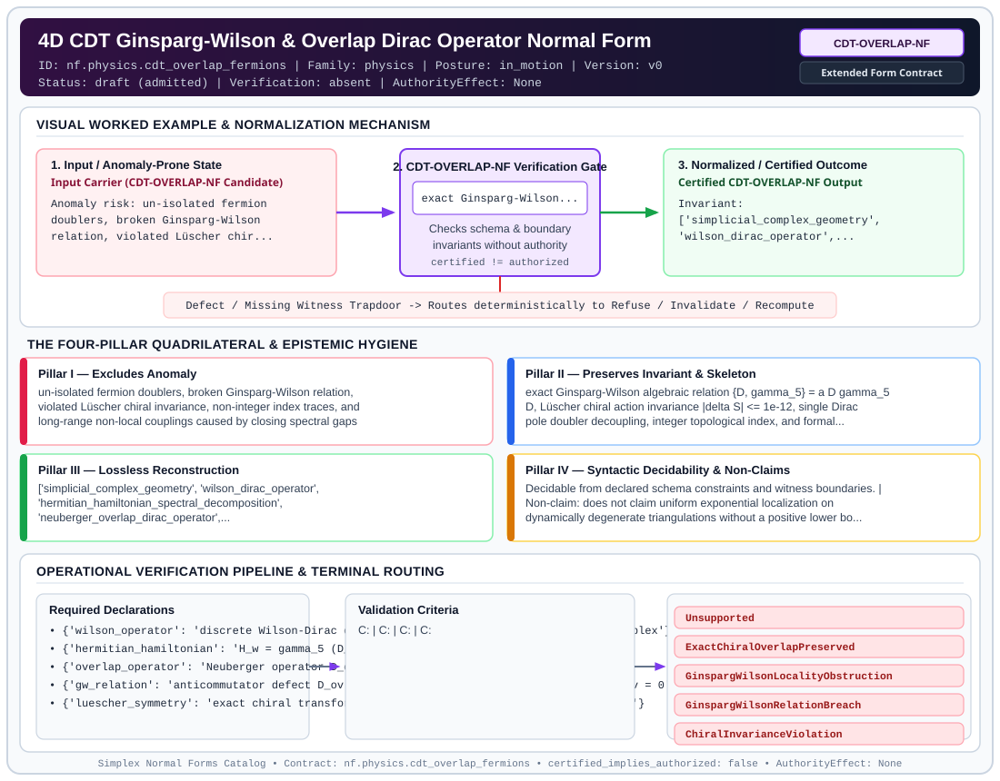

# 4D CDT Ginsparg-Wilson & Overlap Dirac Operator Normal Form (`CDT-OVERLAP-NF`)

> **Contract ID:** `nf.physics.cdt_overlap_fermions` | **Family:** `physics` | **Index Status:** `draft` | **AuthorityEffect:** `None`

**[⬅ Back to Wiki Home](Home)** | **[View SVG Diagram](images/nf.physics.cdt_overlap_fermions.svg)**

---

## 1. Executive Summary & Metadata

4D CDT Ginsparg-Wilson & Overlap Dirac Operator Normal Form (CDT-OVERLAP-NF) enforces structural normalization and explicit defect routing in the physics regime.

| Property | Value |
| :--- | :--- |
| **Canonical ID** | `nf.physics.cdt_overlap_fermions` |
| **Short Name** | `CDT-OVERLAP-NF` |
| **Full Name** | 4D CDT Ginsparg-Wilson & Overlap Dirac Operator Normal Form |
| **Family** | `physics` (Discrete Differential Geometry, Regge Calculus, Gauge Theory, Lattice Fermions & Quantum Gravity) |
| **Qualification** | Extended Form Contract (Normal Form Contract) |
| **Data / Math Posture** | in_motion |
| **Index Status** | `draft` |
| **Theory Status** | `admitted` |
| **Verification Status** | `absent` |
| **Contract Version** | `v0` |
| **Governance Fence** | `AuthorityEffect: None` (`certified_implies_authorized: false`) |

---

## 2. Visual Architecture & Normalization Diagram



---

## 3. Concrete Worked Example & Mechanism

### Visual Transition Summary

| Stage | Carrier / Operator | Concrete State / Invariant |
| :--- | :--- | :--- |
| **1. Before / Candidate Input** | `Input Carrier (CDT-OVERLAP-NF Candidate)` | Anomaly risk: un-isolated fermion ; doublers, broken Ginsparg-Wilson ; relation, violated Lüscher chir... |
| **2. Normalization / Gate** | `CDT-OVERLAP-NF Verification Gate` | `exact Ginsparg-Wilson...` (`certified_implies_authorized: false`) |
| **3. After / Certified Output** | `Certified CDT-OVERLAP-NF Output` | Invariant: ; ['simplicial_complex_geometry', ; 'wilson_dirac_operator',... |

---

## 4. The Four-Pillar Quadrilateral & Non-Claims

Every contract in `simplex-normal-forms` is evaluated against the **Four-Pillar Quadrilateral** defined in `contracts/_golden_nfs/standard.yaml`:

| Pillar | Requirement | Contract Specification for `nf.physics.cdt_overlap_fermions` |
| :--- | :--- | :--- |
| **Pillar I: Excludes Anomaly** | Name and eliminate a specific class of data or state defects. | un-isolated fermion doublers, broken Ginsparg-Wilson relation, violated Lüscher chiral invariance, non-integer index traces, and long-range non-local couplings caused by closing spectral gaps |
| **Pillar II: Preserves Invariant** | State the structural invariant and protected skeleton preserved across transitions. | **Invariant:** exact Ginsparg-Wilson algebraic relation {D, gamma_5} = a D gamma_5 D, Lüscher chiral action invariance |delta S| <= 1e-12, single Dirac pole doubler decoupling, integer topological index, and formal classification of singular geometries under GinspargWilsonLocalityObstruction<br>**Protected Skeleton:** ['simplicial_complex_geometry', 'wilson_dirac_operator', 'hermitian_hamiltonian_spectral_decomposition', 'neuberger_overlap_dirac_operator', 'luescher_exact_chiral_symmetry', 'lattice_index_theorem'] |
| **Pillar III: Lossless Reconstruction** | State the non-loss reconstruction operator (join, direct sum, pullback, or replay). | Lossless reconstruction under declared projection, direct sum, or pullback operators. |
| **Pillar IV: Syntactic Decidability** | State how conformance is decided from declared constraints without unbudgeted scans. | Decidable from declared schema and witness metadata within bounded evaluation budgets. |

### Explicit Non-Claims (`certified_implies_authorized: false`)

- does not claim uniform exponential localization on dynamically degenerate triangulations without a positive lower bound on the Wilson spectral gap
- does not claim absence of exceptional zero-mode crossings during topology-preserving Pachner transitions

---

## 5. Operational Verification & Terminal Routing

### 5.1 Required Declarations

- **wilson_operator**: discrete Wilson-Dirac operator D_w = D_naive + W on simplicial complex
- **hermitian_hamiltonian**: H_w = gamma_5 (D_w - m_0) with spectral decomposition
- **overlap_operator**: Neuberger operator D_ov = (1/a)(I + gamma_5 sgn(H_w))
- **gw_relation**: anticommutator defect D_ov gamma_5 + gamma_5 D_ov - a D_ov gamma_5 D_ov = 0
- **luescher_symmetry**: exact chiral transformation delta psi = gamma_5 (I - a D_ov) psi
- **topological_index**: lattice index (1/2) Tr(gamma_5 a D_ov) = n_+ - n_-

### 5.2 Required Evidence

_None declared._

### 5.3 Validation Criteria

| Criterion ID | Name | Condition |
| :--- | :--- | :--- |
| `` | **** |  |
| `` | **** |  |
| `` | **** |  |
| `` | **** |  |
| `` | **** |  |
| `` | **** |  |

### 5.4 Terminal Route Map

Every evaluation terminates in a declared local route mapped to a canonical terminal in `standard.yaml`:

| Local Terminal Route | Canonical Terminal |
| :--- | :--- |
| `Unsupported` | `Unsupported` |
| `ExactChiralOverlapPreserved` | `ExactChiralOverlapPreserved` |
| `GinspargWilsonLocalityObstruction` | `GinspargWilsonLocalityObstruction` |
| `GinspargWilsonRelationBreach` | `GinspargWilsonRelationBreach` |
| `ChiralInvarianceViolation` | `ChiralInvarianceViolation` |

### 5.5 Declared Failure Modes

_All defects route explicitly through the Terminal Route Map above._

---

## 6. Epistemic Claim Hygiene Quadrant

In accordance with the repository's epistemic claim discipline:

1. **What it supports:**
   - Supports syntactic and operational checking of `nf.physics.cdt_overlap_fermions` (`CDT-OVERLAP-NF`) against its declared schema, boundary constraints, and witness obligations in this model.
   - Supports deterministic terminal routing (`Unsupported, ExactChiralOverlapPreserved, GinspargWilsonLocalityObstruction, GinspargWilsonRelationBreach`) when required declarations or invariants fail.
2. **What it does not support:**
   - Does not confer operational authority (`AuthorityEffect: None`, `certified_implies_authorized: false`).
   - Does not claim semantic truth of undeclared external processes or unverified upstream inputs beyond the declaredprotected skeleton.
3. **The narrowest defensible claim:**
   - Within the declared substrate `in_motion`, this contract enforces that `un-isolated fermion doublers, broken Ginsparg-Wilson relation, violated Lüscher chiral invariance, non-integer index traces, and long-range non-local couplings caused by closing spectral gaps` is either excluded under `exact Ginsparg-Wilson algebraic relation {D, gamma_5} = a D gamma_5 D, Lüscher chiral action invariance |delta S| <= 1e-12, single Dirac pole doubler decoupling, integer topological index, and formal classification of singular geometries under GinspargWilsonLocalityObstruction` or routed to an explicit refusal/recovery terminal.
4. **The next test needed:**
   - Property-based falsification and mutation testing across boundary edge cases and composed multi-step pipelines for `nf.physics.cdt_overlap_fermions`.

---

## 7. Canonical YAML Contract (`contracts/nf.physics.cdt_overlap_fermions.yaml`)

<details>
<summary><strong>Click to expand full canonical YAML contract (contracts/nf.physics.cdt_overlap_fermions.yaml)</strong></summary>

```yaml
schema_version: smplx.nf.contract.v0
contract_kind: normal_form_contract
identity:
  id: nf.physics.cdt_overlap_fermions
  name: 4D CDT Ginsparg-Wilson & Overlap Dirac Operator Normal Form
  short_name: CDT-OVERLAP-NF
  version: v0
  theory_status: admitted
  contract_status: draft
  verification_status: absent
  family: physics
  status: draft
classification:
  hierarchy_level: normal_form
  subject_kind:
  - ginsparg_wilson_relation
  - overlap_dirac_operator
  - luescher_chiral_symmetry
  - atiyah_singer_index_theorem
  - doubler_decoupling
  - causal_dynamical_triangulations
  data_posture: in_motion
  mathematical_posture: formal_algebraic
purpose:
  excludes_anomaly: un-isolated fermion doublers, broken Ginsparg-Wilson relation,
    violated Lüscher chiral invariance, non-integer index traces, and long-range non-local
    couplings caused by closing spectral gaps
  preserves_invariant: exact Ginsparg-Wilson algebraic relation {D, gamma_5} = a D
    gamma_5 D, Lüscher chiral action invariance |delta S| <= 1e-12, single Dirac pole
    doubler decoupling, integer topological index, and formal classification of singular
    geometries under GinspargWilsonLocalityObstruction
  protected_skeleton:
  - simplicial_complex_geometry
  - wilson_dirac_operator
  - hermitian_hamiltonian_spectral_decomposition
  - neuberger_overlap_dirac_operator
  - luescher_exact_chiral_symmetry
  - lattice_index_theorem
  erased_structure:
  - continuous_spacetime_spinors
  - unphysical_fermion_doublers_at_brillouin_zone_edges
  non_claims:
  - does not claim uniform exponential localization on dynamically degenerate triangulations
    without a positive lower bound on the Wilson spectral gap
  - does not claim absence of exceptional zero-mode crossings during topology-preserving
    Pachner transitions
declarations_required:
- wilson_operator: discrete Wilson-Dirac operator D_w = D_naive + W on simplicial
    complex
- hermitian_hamiltonian: H_w = gamma_5 (D_w - m_0) with spectral decomposition
- overlap_operator: Neuberger operator D_ov = (1/a)(I + gamma_5 sgn(H_w))
- gw_relation: anticommutator defect D_ov gamma_5 + gamma_5 D_ov - a D_ov gamma_5
    D_ov = 0
- luescher_symmetry: exact chiral transformation delta psi = gamma_5 (I - a D_ov)
    psi
- topological_index: lattice index (1/2) Tr(gamma_5 a D_ov) = n_+ - n_-
validation_criteria:
- gw_relation_exact: '||D_ov gamma_5 + gamma_5 D_ov - a D_ov gamma_5 D_ov||_inf <=
    1e-12'
- luescher_invariance_exact: '|delta S_fermion| <= 1e-12 under Lüscher chiral transformations'
- doubler_mass_gap_positive: doubler modes acquire mass of order 1/a, separating from
    the physical Dirac mode
- index_integer_valued: '|Index - round(Index)| <= 1e-12'
- gapped_regular_complex: spectral gap lambda_min(H_w) > 0 and exponential localization
    length xi < inf routing to ExactChiralOverlapPreserved
- gapless_singular_complex: closing spectral gap lambda_min(H_w) < 1e-6 routing to
    GinspargWilsonLocalityObstruction
terminal_routes:
- Unsupported
- ExactChiralOverlapPreserved
- GinspargWilsonLocalityObstruction
- GinspargWilsonRelationBreach
- ChiralInvarianceViolation
terminal_route_map:
  gapped_chiral_preserved: ExactChiralOverlapPreserved
  gapless_locality_obstruction: GinspargWilsonLocalityObstruction
  gw_relation_breach: GinspargWilsonRelationBreach
  chiral_violation: ChiralInvarianceViolation
definition:
  source: coda_all_universe/mssn_sn_tower/definitions.md
  formal_statement: un-isolated fermion doublers, broken Ginsparg-Wilson relation,
    violated Lüscher chiral invariance, non-integer index traces, and long-range non-local
    couplings caused by closing spectral gaps. exact Ginsparg-Wilson algebraic relation
    {D, gamma_5} = a D gamma_5 D, Lüscher chiral action invariance |delta S| <= 1e-12,
    single Dirac pole doubler decoupling, integer topological index, and formal classification
    of singular geometries under GinspargWilsonLocalityObstruction
  quadrilateral:
    qualifies_as_true_normal_form: false
    qualification_gap: reconstruction_is_not_a_relational_project_join
    anomaly_exclusion: un-isolated fermion doublers, broken Ginsparg-Wilson relation,
      violated Lüscher chiral invariance, non-integer index traces, and long-range
      non-local couplings caused by closing spectral gaps
    lossless_join:
      status: declared_reconstruction
      statement: exact Ginsparg-Wilson algebraic relation {D, gamma_5} = a D gamma_5
        D, Lüscher chiral action invariance |delta S| <= 1e-12, single Dirac pole
        doubler decoupling, integer topological index, and formal classification of
        singular geometries under GinspargWilsonLocalityObstruction
    dependency_preservation:
      status: declared_with_the_invariant
      statement: The preserved invariant stays on the declared schema. This form does
        not state a functional-dependency projection of a flat relvar decomposition.
    syntactic_decision:
      status: declaration_decidable
      statement: The check reads the declared constraints and validation criteria.
        One unrecorded runtime image is not the decider.
canonical_terminal_map:
  Unsupported: Unsupported
  ExactChiralOverlapPreserved: Preserve
  GinspargWilsonLocalityObstruction: Reject
  GinspargWilsonRelationBreach: Reject
  ChiralInvarianceViolation: Reject
authorization:
  authorized_by: null
  certified_implies_authorized: false
certification:
  certificate_required: true
  certificate_kind: nf.physics.cdt_overlap_fermions_certificate
  obstruction_class_required: false
  loss_ledger_required: false
  loss_ledger_trigger_id: null
  verifier_required: true
evidence_required: []
schema_ref: ./normal_form_contract_schema.yaml
```

</details>
