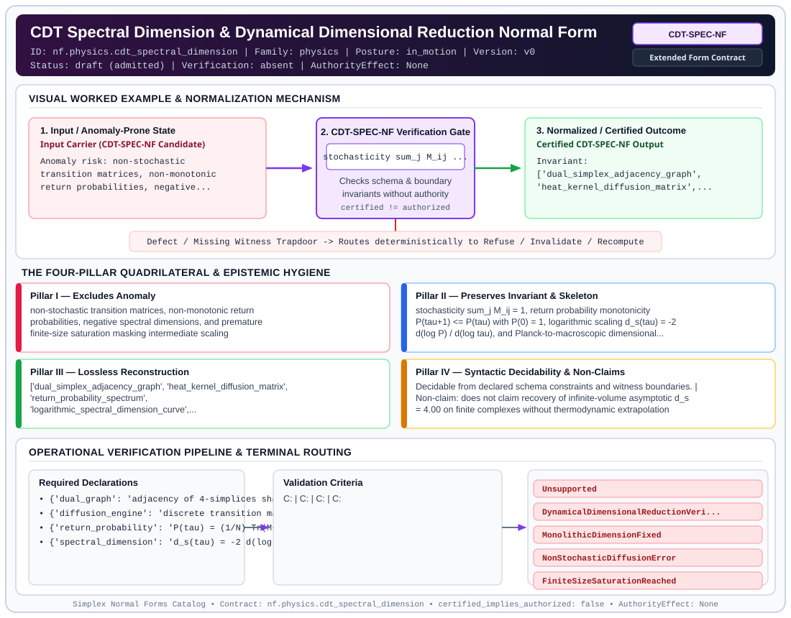

# CDT Spectral Dimension & Dynamical Dimensional Reduction Normal Form (`CDT-SPEC-NF`)

> **Contract ID:** `nf.physics.cdt_spectral_dimension` | **Family:** `physics` | **Index Status:** `draft` | **AuthorityEffect:** `None`

**[⬅ Back to Wiki Home](Home)** | **[View SVG Diagram](images/nf.physics.cdt_spectral_dimension.svg)**

---

## 1. Executive Summary & Metadata

CDT Spectral Dimension & Dynamical Dimensional Reduction Normal Form (CDT-SPEC-NF) enforces structural normalization and explicit defect routing in the physics regime.

| Property | Value |
| :--- | :--- |
| **Canonical ID** | `nf.physics.cdt_spectral_dimension` |
| **Short Name** | `CDT-SPEC-NF` |
| **Full Name** | CDT Spectral Dimension & Dynamical Dimensional Reduction Normal Form |
| **Family** | `physics` (Discrete Differential Geometry, Regge Calculus, Gauge Theory, Lattice Fermions & Quantum Gravity) |
| **Qualification** | Extended Form Contract (Normal Form Contract) |
| **Data / Math Posture** | in_motion |
| **Index Status** | `draft` |
| **Theory Status** | `admitted` |
| **Verification Status** | `absent` |
| **Contract Version** | `v0` |
| **Governance Fence** | `AuthorityEffect: None` (`certified_implies_authorized: false`) |

---

## 2. Visual Architecture & Normalization Diagram



---

## 3. Concrete Worked Example & Mechanism

### Visual Transition Summary

| Stage | Carrier / Operator | Concrete State / Invariant |
| :--- | :--- | :--- |
| **1. Before / Candidate Input** | `Input Carrier (CDT-SPEC-NF Candidate)` | Anomaly risk: non-stochastic ; transition matrices, non-monotonic ; return probabilities, negative... |
| **2. Normalization / Gate** | `CDT-SPEC-NF Verification Gate` | `stochasticity sum_j M_ij ...` (`certified_implies_authorized: false`) |
| **3. After / Certified Output** | `Certified CDT-SPEC-NF Output` | Invariant: ; ['dual_simplex_adjacency_graph', ; 'heat_kernel_diffusion_matrix',... |

---

## 4. The Four-Pillar Quadrilateral & Non-Claims

Every contract in `simplex-normal-forms` is evaluated against the **Four-Pillar Quadrilateral** defined in `contracts/_golden_nfs/standard.yaml`:

| Pillar | Requirement | Contract Specification for `nf.physics.cdt_spectral_dimension` |
| :--- | :--- | :--- |
| **Pillar I: Excludes Anomaly** | Name and eliminate a specific class of data or state defects. | non-stochastic transition matrices, non-monotonic return probabilities, negative spectral dimensions, and premature finite-size saturation masking intermediate scaling |
| **Pillar II: Preserves Invariant** | State the structural invariant and protected skeleton preserved across transitions. | **Invariant:** stochasticity sum_j M_ij = 1, return probability monotonicity P(tau+1) <= P(tau) with P(0) = 1, logarithmic scaling d_s(tau) = -2 d(log P) / d(log tau), and Planck-to-macroscopic dimensional reduction d_s(Planck) ~ 2 to d_s(macro) ~ 4<br>**Protected Skeleton:** ['dual_simplex_adjacency_graph', 'heat_kernel_diffusion_matrix', 'return_probability_spectrum', 'logarithmic_spectral_dimension_curve', 'finite_volume_saturation_boundary'] |
| **Pillar III: Lossless Reconstruction** | State the non-loss reconstruction operator (join, direct sum, pullback, or replay). | Lossless reconstruction under declared projection, direct sum, or pullback operators. |
| **Pillar IV: Syntactic Decidability** | State how conformance is decided from declared constraints without unbudgeted scans. | Decidable from declared schema and witness metadata within bounded evaluation budgets. |

### Explicit Non-Claims (`certified_implies_authorized: false`)

- does not claim recovery of infinite-volume asymptotic d_s = 4.00 on finite complexes without thermodynamic extrapolation
- does not claim that discrete random walks replace continuous Laplace-Beltrami spectral analysis on smooth manifolds

---

## 5. Operational Verification & Terminal Routing

### 5.1 Required Declarations

- **dual_graph**: adjacency of 4-simplices sharing 3-faces
- **diffusion_engine**: discrete transition matrix M and matrix power trace operator
- **return_probability**: P(tau) = (1/N) Tr(M^tau)
- **spectral_dimension**: d_s(tau) = -2 d(log P(tau)) / d(log tau)

### 5.2 Required Evidence

_None declared._

### 5.3 Validation Criteria

| Criterion ID | Name | Condition |
| :--- | :--- | :--- |
| `` | **** |  |
| `` | **** |  |
| `` | **** |  |
| `` | **** |  |
| `` | **** |  |

### 5.4 Terminal Route Map

Every evaluation terminates in a declared local route mapped to a canonical terminal in `standard.yaml`:

| Local Terminal Route | Canonical Terminal |
| :--- | :--- |
| `Unsupported` | `Unsupported` |
| `DynamicalDimensionalReductionVerified` | `DynamicalDimensionalReductionVerified` |
| `MonolithicDimensionFixed` | `MonolithicDimensionFixed` |
| `NonStochasticDiffusionError` | `NonStochasticDiffusionError` |
| `FiniteSizeSaturationReached` | `FiniteSizeSaturationReached` |

### 5.5 Declared Failure Modes

_All defects route explicitly through the Terminal Route Map above._

---

## 6. Epistemic Claim Hygiene Quadrant

In accordance with the repository's epistemic claim discipline:

1. **What it supports:**
   - Supports syntactic and operational checking of `nf.physics.cdt_spectral_dimension` (`CDT-SPEC-NF`) against its declared schema, boundary constraints, and witness obligations in this model.
   - Supports deterministic terminal routing (`Unsupported, DynamicalDimensionalReductionVerified, MonolithicDimensionFixed, NonStochasticDiffusionError`) when required declarations or invariants fail.
2. **What it does not support:**
   - Does not confer operational authority (`AuthorityEffect: None`, `certified_implies_authorized: false`).
   - Does not claim semantic truth of undeclared external processes or unverified upstream inputs beyond the declaredprotected skeleton.
3. **The narrowest defensible claim:**
   - Within the declared substrate `in_motion`, this contract enforces that `non-stochastic transition matrices, non-monotonic return probabilities, negative spectral dimensions, and premature finite-size saturation masking intermediate scaling` is either excluded under `stochasticity sum_j M_ij = 1, return probability monotonicity P(tau+1) <= P(tau) with P(0) = 1, logarithmic scaling d_s(tau) = -2 d(log P) / d(log tau), and Planck-to-macroscopic dimensional reduction d_s(Planck) ~ 2 to d_s(macro) ~ 4` or routed to an explicit refusal/recovery terminal.
4. **The next test needed:**
   - Property-based falsification and mutation testing across boundary edge cases and composed multi-step pipelines for `nf.physics.cdt_spectral_dimension`.

---

## 7. Canonical YAML Contract (`contracts/nf.physics.cdt_spectral_dimension.yaml`)

<details>
<summary><strong>Click to expand full canonical YAML contract (contracts/nf.physics.cdt_spectral_dimension.yaml)</strong></summary>

```yaml
schema_version: smplx.nf.contract.v0
contract_kind: normal_form_contract
identity:
  id: nf.physics.cdt_spectral_dimension
  name: CDT Spectral Dimension & Dynamical Dimensional Reduction Normal Form
  short_name: CDT-SPEC-NF
  version: v0
  theory_status: admitted
  contract_status: draft
  verification_status: absent
  family: physics
  status: draft
classification:
  hierarchy_level: normal_form
  subject_kind:
  - discrete_heat_kernel_diffusion
  - spectral_dimension
  - dynamical_dimensional_reduction
  - cdt_dual_graph_random_walk
  data_posture: in_motion
  mathematical_posture: formal_algebraic
purpose:
  excludes_anomaly: non-stochastic transition matrices, non-monotonic return probabilities,
    negative spectral dimensions, and premature finite-size saturation masking intermediate
    scaling
  preserves_invariant: stochasticity sum_j M_ij = 1, return probability monotonicity
    P(tau+1) <= P(tau) with P(0) = 1, logarithmic scaling d_s(tau) = -2 d(log P) /
    d(log tau), and Planck-to-macroscopic dimensional reduction d_s(Planck) ~ 2 to
    d_s(macro) ~ 4
  protected_skeleton:
  - dual_simplex_adjacency_graph
  - heat_kernel_diffusion_matrix
  - return_probability_spectrum
  - logarithmic_spectral_dimension_curve
  - finite_volume_saturation_boundary
  erased_structure:
  - embedding_coordinates
  - unphysical_acausal_diffusion_leaks
  non_claims:
  - does not claim recovery of infinite-volume asymptotic d_s = 4.00 on finite complexes
    without thermodynamic extrapolation
  - does not claim that discrete random walks replace continuous Laplace-Beltrami
    spectral analysis on smooth manifolds
declarations_required:
- dual_graph: adjacency of 4-simplices sharing 3-faces
- diffusion_engine: discrete transition matrix M and matrix power trace operator
- return_probability: P(tau) = (1/N) Tr(M^tau)
- spectral_dimension: d_s(tau) = -2 d(log P(tau)) / d(log tau)
validation_criteria:
- transition_stochasticity: every row of M sums to 1 within machine precision
- return_probability_decay: P(0) = 1 and P(tau) monotonically decreases with diffusion
    time tau
- planckian_spectral_reduction: at short diffusion times tau, d_s(tau) contracts toward
    2 (1.8 <= d_s <= 2.5)
- macroscopic_spectral_emergence: at intermediate diffusion times, d_s(tau) expands
    toward 4 (3.5 <= d_s <= 4.5)
- finite_size_cutoff_audit: as tau -> infinity, finite complex uniformization forces
    d_s -> 0
terminal_routes:
- Unsupported
- DynamicalDimensionalReductionVerified
- MonolithicDimensionFixed
- NonStochasticDiffusionError
- FiniteSizeSaturationReached
terminal_route_map:
  dimensional_reduction: DynamicalDimensionalReductionVerified
  monolithic: MonolithicDimensionFixed
  stochastic_error: NonStochasticDiffusionError
  saturated: FiniteSizeSaturationReached
definition:
  source: coda_all_universe/mssn_sn_tower/definitions.md
  formal_statement: non-stochastic transition matrices, non-monotonic return probabilities,
    negative spectral dimensions, and premature finite-size saturation masking intermediate
    scaling. stochasticity sum_j M_ij = 1, return probability monotonicity P(tau+1)
    <= P(tau) with P(0) = 1, logarithmic scaling d_s(tau) = -2 d(log P) / d(log tau),
    and Planck-to-macroscopic dimensional reduction d_s(Planck) ~ 2 to d_s(macro)
    ~ 4
  quadrilateral:
    qualifies_as_true_normal_form: false
    qualification_gap: reconstruction_is_not_a_relational_project_join
    anomaly_exclusion: non-stochastic transition matrices, non-monotonic return probabilities,
      negative spectral dimensions, and premature finite-size saturation masking intermediate
      scaling
    lossless_join:
      status: declared_reconstruction
      statement: stochasticity sum_j M_ij = 1, return probability monotonicity P(tau+1)
        <= P(tau) with P(0) = 1, logarithmic scaling d_s(tau) = -2 d(log P) / d(log
        tau), and Planck-to-macroscopic dimensional reduction d_s(Planck) ~ 2 to d_s(macro)
        ~ 4
    dependency_preservation:
      status: declared_with_the_invariant
      statement: The preserved invariant stays on the declared schema. This form does
        not state a functional-dependency projection of a flat relvar decomposition.
    syntactic_decision:
      status: declaration_decidable
      statement: The check reads the declared constraints and validation criteria.
        One unrecorded runtime image is not the decider.
canonical_terminal_map:
  Unsupported: Unsupported
  DynamicalDimensionalReductionVerified: Preserve
  MonolithicDimensionFixed: Preserve
  NonStochasticDiffusionError: Reject
  FiniteSizeSaturationReached: Escalate
authorization:
  authorized_by: null
  certified_implies_authorized: false
certification:
  certificate_required: true
  certificate_kind: nf.physics.cdt_spectral_dimension_certificate
  obstruction_class_required: false
  loss_ledger_required: false
  loss_ledger_trigger_id: null
  verifier_required: true
evidence_required: []
schema_ref: ./normal_form_contract_schema.yaml
```

</details>
