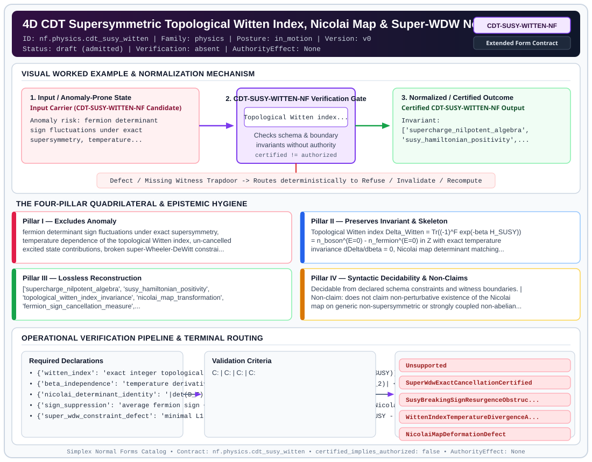

# 4D CDT Supersymmetric Topological Witten Index, Nicolai Map & Super-WDW Normal Form (`CDT-SUSY-WITTEN-NF`)

> **Contract ID:** `nf.physics.cdt_susy_witten` | **Family:** `physics` | **Index Status:** `draft` | **AuthorityEffect:** `None`

**[⬅ Back to Wiki Home](Home)** | **[View SVG Diagram](images/nf.physics.cdt_susy_witten.svg)**

---

## 1. Executive Summary & Metadata

4D CDT Supersymmetric Topological Witten Index, Nicolai Map & Super-WDW Normal Form (CDT-SUSY-WITTEN-NF) enforces structural normalization and explicit defect routing in the physics regime.

| Property | Value |
| :--- | :--- |
| **Canonical ID** | `nf.physics.cdt_susy_witten` |
| **Short Name** | `CDT-SUSY-WITTEN-NF` |
| **Full Name** | 4D CDT Supersymmetric Topological Witten Index, Nicolai Map & Super-WDW Normal Form |
| **Family** | `physics` (Discrete Differential Geometry, Regge Calculus, Gauge Theory, Lattice Fermions & Quantum Gravity) |
| **Qualification** | Extended Form Contract (Normal Form Contract) |
| **Data / Math Posture** | in_motion |
| **Index Status** | `draft` |
| **Theory Status** | `admitted` |
| **Verification Status** | `absent` |
| **Contract Version** | `v0` |
| **Governance Fence** | `AuthorityEffect: None` (`certified_implies_authorized: false`) |

---

## 2. Visual Architecture & Normalization Diagram



---

## 3. Concrete Worked Example & Mechanism

### Visual Transition Summary

| Stage | Carrier / Operator | Concrete State / Invariant |
| :--- | :--- | :--- |
| **1. Before / Candidate Input** | `Input Carrier (CDT-SUSY-WITTEN-NF Candidate)` | Anomaly risk: fermion determinant ; sign fluctuations under exact ; supersymmetry, temperature... |
| **2. Normalization / Gate** | `CDT-SUSY-WITTEN-NF Verification Gate` | `Topological Witten index...` (`certified_implies_authorized: false`) |
| **3. After / Certified Output** | `Certified CDT-SUSY-WITTEN-NF Output` | Invariant: ; ['supercharge_nilpotent_algebra', ; 'susy_hamiltonian_positivity',... |

---

## 4. The Four-Pillar Quadrilateral & Non-Claims

Every contract in `simplex-normal-forms` is evaluated against the **Four-Pillar Quadrilateral** defined in `contracts/_golden_nfs/standard.yaml`:

| Pillar | Requirement | Contract Specification for `nf.physics.cdt_susy_witten` |
| :--- | :--- | :--- |
| **Pillar I: Excludes Anomaly** | Name and eliminate a specific class of data or state defects. | fermion determinant sign fluctuations under exact supersymmetry, temperature dependence of the topological Witten index, un-cancelled excited state contributions, broken super-Wheeler-DeWitt constraints under unbroken supercharges, and un-audited spontaneous supersymmetry breaking |
| **Pillar II: Preserves Invariant** | State the structural invariant and protected skeleton preserved across transitions. | **Invariant:** Topological Witten index Delta_Witten = Tr((-1)^F exp(-beta H_SUSY)) = n_boson^(E=0) - n_fermion^(E=0) in Z with exact temperature invariance dDelta/dbeta = 0, Nicolai map determinant matching det(D_F) = |det(delta N / delta phi)| identically suppressing fermion sign fluctuations (<Sign> = 1.0), super-Wheeler-DeWitt constraint preservation Phi_super <= 1e-8 under unbroken supercharges, and formal classification of broken supergeometry under SusyBreakingSignResurgenceObstruction<br>**Protected Skeleton:** ['supercharge_nilpotent_algebra', 'susy_hamiltonian_positivity', 'topological_witten_index_invariance', 'nicolai_map_transformation', 'fermion_sign_cancellation_measure', 'super_wheeler_dewitt_constraint_projector'] |
| **Pillar III: Lossless Reconstruction** | State the non-loss reconstruction operator (join, direct sum, pullback, or replay). | Lossless reconstruction under declared projection, direct sum, or pullback operators. |
| **Pillar IV: Syntactic Decidability** | State how conformance is decided from declared constraints without unbudgeted scans. | Decidable from declared schema and witness metadata within bounded evaluation budgets. |

### Explicit Non-Claims (`certified_implies_authorized: false`)

- does not claim non-perturbative existence of the Nicolai map on generic non-supersymmetric or strongly coupled non-abelian gauge triangulations
- does not claim that spontaneous or geometric supersymmetry breaking preserves the super-Wheeler-DeWitt constraint without auxiliary goldstino compensation

---

## 5. Operational Verification & Terminal Routing

### 5.1 Required Declarations

- **witten_index**: exact integer topological index Delta_Witten = Tr((-1)^F exp(-beta H_SUSY))
- **beta_independence**: temperature derivative |Delta_Witten(beta_1) - Delta_Witten(beta_2)| <= 1e-10
- **nicolai_determinant_identity**: |det(D_F) - |det(delta N / delta phi)|| <= 1e-8
- **sign_suppression**: average fermion sign <Sign> = 1.0 along the bosonic image of the Nicolai map
- **super_wdw_constraint_defect**: minimal L1 defect norm Phi_super = min_alpha ||Omega_SUSY - D_super alpha||_1
- **susy_breaking_model**: positive ground state energy E_0 > 0 with sign resurgence and Phi_super > 1e-8

### 5.2 Required Evidence

_None declared._

### 5.3 Validation Criteria

| Criterion ID | Name | Condition |
| :--- | :--- | :--- |
| `` | **** |  |
| `` | **** |  |
| `` | **** |  |
| `` | **** |  |
| `` | **** |  |

### 5.4 Terminal Route Map

Every evaluation terminates in a declared local route mapped to a canonical terminal in `standard.yaml`:

| Local Terminal Route | Canonical Terminal |
| :--- | :--- |
| `Unsupported` | `Unsupported` |
| `SuperWdwExactCancellationCertified` | `SuperWdwExactCancellationCertified` |
| `SusyBreakingSignResurgenceObstruction` | `SusyBreakingSignResurgenceObstruction` |
| `WittenIndexTemperatureDivergenceAnomaly` | `WittenIndexTemperatureDivergenceAnomaly` |
| `NicolaiMapDeformationDefect` | `NicolaiMapDeformationDefect` |

### 5.5 Declared Failure Modes

_All defects route explicitly through the Terminal Route Map above._

---

## 6. Epistemic Claim Hygiene Quadrant

In accordance with the repository's epistemic claim discipline:

1. **What it supports:**
   - Supports syntactic and operational checking of `nf.physics.cdt_susy_witten` (`CDT-SUSY-WITTEN-NF`) against its declared schema, boundary constraints, and witness obligations in this model.
   - Supports deterministic terminal routing (`Unsupported, SuperWdwExactCancellationCertified, SusyBreakingSignResurgenceObstruction, WittenIndexTemperatureDivergenceAnomaly`) when required declarations or invariants fail.
2. **What it does not support:**
   - Does not confer operational authority (`AuthorityEffect: None`, `certified_implies_authorized: false`).
   - Does not claim semantic truth of undeclared external processes or unverified upstream inputs beyond the declaredprotected skeleton.
3. **The narrowest defensible claim:**
   - Within the declared substrate `in_motion`, this contract enforces that `fermion determinant sign fluctuations under exact supersymmetry, temperature dependence of the topological Witten index, un-cancelled excited state contributions, broken super-Wheeler-DeWitt constraints under unbroken supercharges, and un-audited spontaneous supersymmetry breaking` is either excluded under `Topological Witten index Delta_Witten = Tr((-1)^F exp(-beta H_SUSY)) = n_boson^(E=0) - n_fermion^(E=0) in Z with exact temperature invariance dDelta/dbeta = 0, Nicolai map determinant matching det(D_F) = |det(delta N / delta phi)| identically suppressing fermion sign fluctuations (<Sign> = 1.0), super-Wheeler-DeWitt constraint preservation Phi_super <= 1e-8 under unbroken supercharges, and formal classification of broken supergeometry under SusyBreakingSignResurgenceObstruction` or routed to an explicit refusal/recovery terminal.
4. **The next test needed:**
   - Property-based falsification and mutation testing across boundary edge cases and composed multi-step pipelines for `nf.physics.cdt_susy_witten`.

---

## 7. Canonical YAML Contract (`contracts/nf.physics.cdt_susy_witten.yaml`)

<details>
<summary><strong>Click to expand full canonical YAML contract (contracts/nf.physics.cdt_susy_witten.yaml)</strong></summary>

```yaml
schema_version: smplx.nf.contract.v0
contract_kind: normal_form_contract
identity:
  id: nf.physics.cdt_susy_witten
  name: 4D CDT Supersymmetric Topological Witten Index, Nicolai Map & Super-WDW Normal
    Form
  short_name: CDT-SUSY-WITTEN-NF
  version: v0
  theory_status: admitted
  contract_status: draft
  verification_status: absent
  family: physics
  status: draft
classification:
  hierarchy_level: normal_form
  subject_kind:
  - supersymmetric_causal_dynamical_triangulations
  - topological_witten_index
  - nicolai_map_isometry
  - fermion_sign_suppression
  - super_wheeler_dewitt_constraint
  - supergravity_simplicial_geometry
  data_posture: in_motion
  mathematical_posture: formal_algebraic
purpose:
  excludes_anomaly: fermion determinant sign fluctuations under exact supersymmetry,
    temperature dependence of the topological Witten index, un-cancelled excited state
    contributions, broken super-Wheeler-DeWitt constraints under unbroken supercharges,
    and un-audited spontaneous supersymmetry breaking
  preserves_invariant: Topological Witten index Delta_Witten = Tr((-1)^F exp(-beta
    H_SUSY)) = n_boson^(E=0) - n_fermion^(E=0) in Z with exact temperature invariance
    dDelta/dbeta = 0, Nicolai map determinant matching det(D_F) = |det(delta N / delta
    phi)| identically suppressing fermion sign fluctuations (<Sign> = 1.0), super-Wheeler-DeWitt
    constraint preservation Phi_super <= 1e-8 under unbroken supercharges, and formal
    classification of broken supergeometry under SusyBreakingSignResurgenceObstruction
  protected_skeleton:
  - supercharge_nilpotent_algebra
  - susy_hamiltonian_positivity
  - topological_witten_index_invariance
  - nicolai_map_transformation
  - fermion_sign_cancellation_measure
  - super_wheeler_dewitt_constraint_projector
  erased_structure:
  - non_supersymmetric_unpaired_excited_states
  - heuristic_continuum_superspace_without_simplicial_tetrad
  non_claims:
  - does not claim non-perturbative existence of the Nicolai map on generic non-supersymmetric
    or strongly coupled non-abelian gauge triangulations
  - does not claim that spontaneous or geometric supersymmetry breaking preserves
    the super-Wheeler-DeWitt constraint without auxiliary goldstino compensation
declarations_required:
- witten_index: exact integer topological index Delta_Witten = Tr((-1)^F exp(-beta
    H_SUSY))
- beta_independence: temperature derivative |Delta_Witten(beta_1) - Delta_Witten(beta_2)|
    <= 1e-10
- nicolai_determinant_identity: '|det(D_F) - |det(delta N / delta phi)|| <= 1e-8'
- sign_suppression: average fermion sign <Sign> = 1.0 along the bosonic image of the
    Nicolai map
- super_wdw_constraint_defect: minimal L1 defect norm Phi_super = min_alpha ||Omega_SUSY
    - D_super alpha||_1
- susy_breaking_model: positive ground state energy E_0 > 0 with sign resurgence and
    Phi_super > 1e-8
validation_criteria:
- witten_index_integer_quantized: '|Delta_Witten - round(Delta_Witten)| <= 1e-6 and
    |Delta_Witten - (n_b - n_f)| <= 1e-5'
- witten_index_beta_invariant: '|Delta_Witten(beta=0.1) - Delta_Witten(beta=10.0)|
    <= 1e-6'
- nicolai_sign_suppression_satisfied: <Sign> >= 0.999999 for unbroken SUSY routing
    to SuperWdwExactCancellationCertified
- super_wdw_satisfied_unbroken: Phi_super <= 1e-8 for unbroken supercharges routing
    to SuperWdwExactCancellationCertified
- susy_breaking_sign_resurgence_detected: E_0 > 0, <Sign> < 0.95, and Phi_super >
    1e-8 routing to SusyBreakingSignResurgenceObstruction
terminal_routes:
- Unsupported
- SuperWdwExactCancellationCertified
- SusyBreakingSignResurgenceObstruction
- WittenIndexTemperatureDivergenceAnomaly
- NicolaiMapDeformationDefect
terminal_route_map:
  unbroken_susy_certified: SuperWdwExactCancellationCertified
  susy_breaking_sign_resurgence: SusyBreakingSignResurgenceObstruction
  temperature_divergence: WittenIndexTemperatureDivergenceAnomaly
  nicolai_map_failure: NicolaiMapDeformationDefect
authority_effect: None
definition:
  source: coda_all_universe/mssn_sn_tower/definitions.md
  formal_statement: fermion determinant sign fluctuations under exact supersymmetry,
    temperature dependence of the topological Witten index, un-cancelled excited state
    contributions, broken super-Wheeler-DeWitt constraints under unbroken supercharges,
    and un-audited spontaneous supersymmetry breaking. Topological Witten index Delta_Witten
    = Tr((-1)^F exp(-beta H_SUSY)) = n_boson^(E=0) - n_fermion^(E=0) in Z with exact
    temperature invariance dDelta/dbeta = 0, Nicolai map determinant matching det(D_F)
    = |det(delta N / delta phi)| identically suppressing fermion sign fluctuations
    (<Sign> = 1.0), super-Wheeler-DeWitt constraint preservation Phi_super <= 1e-8
    under unbroken supercharges, and formal classification of broken supergeometry
    under SusyBreakingSignResurgenceObstruction
  quadrilateral:
    qualifies_as_true_normal_form: false
    qualification_gap: reconstruction_is_not_a_relational_project_join
    anomaly_exclusion: fermion determinant sign fluctuations under exact supersymmetry,
      temperature dependence of the topological Witten index, un-cancelled excited
      state contributions, broken super-Wheeler-DeWitt constraints under unbroken
      supercharges, and un-audited spontaneous supersymmetry breaking
    lossless_join:
      status: declared_reconstruction
      statement: Topological Witten index Delta_Witten = Tr((-1)^F exp(-beta H_SUSY))
        = n_boson^(E=0) - n_fermion^(E=0) in Z with exact temperature invariance dDelta/dbeta
        = 0, Nicolai map determinant matching det(D_F) = |det(delta N / delta phi)|
        identically suppressing fermion sign fluctuations (<Sign> = 1.0), super-Wheeler-DeWitt
        constraint preservation Phi_super <= 1e-8 under unbroken supercharges, and
        formal classification of broken supergeometry under SusyBreakingSignResurgenceObstruction
    dependency_preservation:
      status: declared_with_the_invariant
      statement: The preserved invariant stays on the declared schema. This form does
        not state a functional-dependency projection of a flat relvar decomposition.
    syntactic_decision:
      status: declaration_decidable
      statement: The check reads the declared constraints and validation criteria.
        One unrecorded runtime image is not the decider.
canonical_terminal_map:
  Unsupported: Unsupported
  SuperWdwExactCancellationCertified: Preserve
  SusyBreakingSignResurgenceObstruction: Reject
  WittenIndexTemperatureDivergenceAnomaly: Reject
  NicolaiMapDeformationDefect: Reject
authorization:
  authorized_by: null
  certified_implies_authorized: false
certification:
  certificate_required: true
  certificate_kind: nf.physics.cdt_susy_witten_certificate
  obstruction_class_required: false
  loss_ledger_required: false
  loss_ledger_trigger_id: null
  verifier_required: true
evidence_required: []
schema_ref: ./normal_form_contract_schema.yaml
```

</details>
