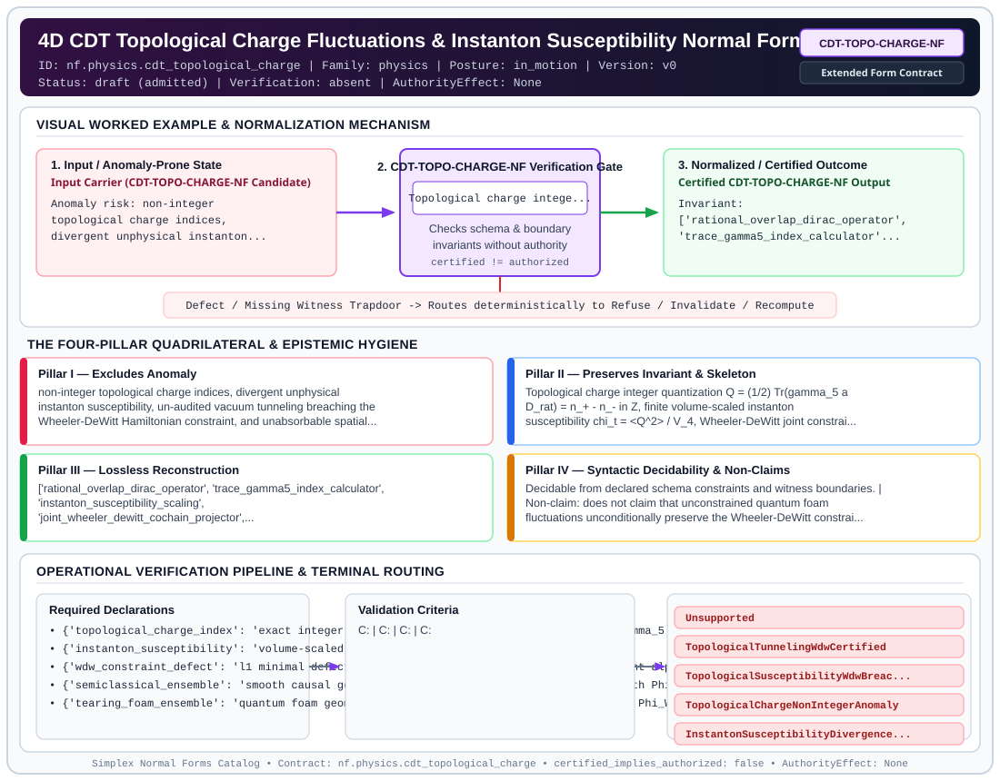

# 4D CDT Topological Charge Fluctuations & Instanton Susceptibility Normal Form (`CDT-TOPO-CHARGE-NF`)

> **Contract ID:** `nf.physics.cdt_topological_charge` | **Family:** `physics` | **Index Status:** `draft` | **AuthorityEffect:** `None`

**[⬅ Back to Wiki Home](Home)** | **[View SVG Diagram](images/nf.physics.cdt_topological_charge.svg)**

---

## 1. Executive Summary & Metadata

4D CDT Topological Charge Fluctuations & Instanton Susceptibility Normal Form (CDT-TOPO-CHARGE-NF) enforces structural normalization and explicit defect routing in the physics regime.

| Property | Value |
| :--- | :--- |
| **Canonical ID** | `nf.physics.cdt_topological_charge` |
| **Short Name** | `CDT-TOPO-CHARGE-NF` |
| **Full Name** | 4D CDT Topological Charge Fluctuations & Instanton Susceptibility Normal Form |
| **Family** | `physics` (Discrete Differential Geometry, Regge Calculus, Gauge Theory, Lattice Fermions & Quantum Gravity) |
| **Qualification** | Extended Form Contract (Normal Form Contract) |
| **Data / Math Posture** | in_motion |
| **Index Status** | `draft` |
| **Theory Status** | `admitted` |
| **Verification Status** | `absent` |
| **Contract Version** | `v0` |
| **Governance Fence** | `AuthorityEffect: None` (`certified_implies_authorized: false`) |

---

## 2. Visual Architecture & Normalization Diagram



---

## 3. Concrete Worked Example & Mechanism

### Visual Transition Summary

| Stage | Carrier / Operator | Concrete State / Invariant |
| :--- | :--- | :--- |
| **1. Before / Candidate Input** | `Input Carrier (CDT-TOPO-CHARGE-NF Candidate)` | Anomaly risk: non-integer ; topological charge indices, ; divergent unphysical instanton... |
| **2. Normalization / Gate** | `CDT-TOPO-CHARGE-NF Verification Gate` | `Topological charge intege...` (`certified_implies_authorized: false`) |
| **3. After / Certified Output** | `Certified CDT-TOPO-CHARGE-NF Output` | Invariant: ; ['rational_overlap_dirac_operator', ; 'trace_gamma5_index_calculator'... |

---

## 4. The Four-Pillar Quadrilateral & Non-Claims

Every contract in `simplex-normal-forms` is evaluated against the **Four-Pillar Quadrilateral** defined in `contracts/_golden_nfs/standard.yaml`:

| Pillar | Requirement | Contract Specification for `nf.physics.cdt_topological_charge` |
| :--- | :--- | :--- |
| **Pillar I: Excludes Anomaly** | Name and eliminate a specific class of data or state defects. | non-integer topological charge indices, divergent unphysical instanton susceptibility, un-audited vacuum tunneling breaching the Wheeler-DeWitt Hamiltonian constraint, and unabsorbable spatial curvature tears |
| **Pillar II: Preserves Invariant** | State the structural invariant and protected skeleton preserved across transitions. | **Invariant:** Topological charge integer quantization Q = (1/2) Tr(gamma_5 a D_rat) = n_+ - n_- in Z, finite volume-scaled instanton susceptibility chi_t = <Q^2> / V_4, Wheeler-DeWitt joint constraint preservation Phi_WDW <= 1e-8 under smooth instanton tunneling, and formal classification of tearing vacuum breaches under TopologicalSusceptibilityWdwBreachObstruction<br>**Protected Skeleton:** ['rational_overlap_dirac_operator', 'trace_gamma5_index_calculator', 'instanton_susceptibility_scaling', 'joint_wheeler_dewitt_cochain_projector', 'l1_dual_constraint_defect_norm', 'topological_tunneling_classification'] |
| **Pillar III: Lossless Reconstruction** | State the non-loss reconstruction operator (join, direct sum, pullback, or replay). | Lossless reconstruction under declared projection, direct sum, or pullback operators. |
| **Pillar IV: Syntactic Decidability** | State how conformance is decided from declared constraints without unbudgeted scans. | Decidable from declared schema and witness metadata within bounded evaluation budgets. |

### Explicit Non-Claims (`certified_implies_authorized: false`)

- does not claim that unconstrained quantum foam fluctuations unconditionally preserve the Wheeler-DeWitt constraint during violent topological transitions
- does not claim infinite-volume continuum extrapolation from finite-size CDT Monte Carlo ensembles

---

## 5. Operational Verification & Terminal Routing

### 5.1 Required Declarations

- **topological_charge_index**: exact integer Atiyah-Singer lattice index Q = (1/2) Tr(gamma_5 a D_rat)
- **instanton_susceptibility**: volume-scaled variance chi_t = (<Q^2> - <Q>^2) / V_4
- **wdw_constraint_defect**: l1 minimal defect norm Phi_WDW = min_alpha ||Omega_Q - D_joint alpha||_1
- **semiclassical_ensemble**: smooth causal geometries admitting instanton transitions with Phi_WDW <= 1e-8
- **tearing_foam_ensemble**: quantum foam geometries with hinge deficit tearing breaching Phi_WDW > 1e-8

### 5.2 Required Evidence

_None declared._

### 5.3 Validation Criteria

| Criterion ID | Name | Condition |
| :--- | :--- | :--- |
| `` | **** |  |
| `` | **** |  |
| `` | **** |  |
| `` | **** |  |

### 5.4 Terminal Route Map

Every evaluation terminates in a declared local route mapped to a canonical terminal in `standard.yaml`:

| Local Terminal Route | Canonical Terminal |
| :--- | :--- |
| `Unsupported` | `Unsupported` |
| `TopologicalTunnelingWdwCertified` | `TopologicalTunnelingWdwCertified` |
| `TopologicalSusceptibilityWdwBreachObstruction` | `TopologicalSusceptibilityWdwBreachObstruction` |
| `TopologicalChargeNonIntegerAnomaly` | `TopologicalChargeNonIntegerAnomaly` |
| `InstantonSusceptibilityDivergenceDefect` | `InstantonSusceptibilityDivergenceDefect` |

### 5.5 Declared Failure Modes

_All defects route explicitly through the Terminal Route Map above._

---

## 6. Epistemic Claim Hygiene Quadrant

In accordance with the repository's epistemic claim discipline:

1. **What it supports:**
   - Supports syntactic and operational checking of `nf.physics.cdt_topological_charge` (`CDT-TOPO-CHARGE-NF`) against its declared schema, boundary constraints, and witness obligations in this model.
   - Supports deterministic terminal routing (`Unsupported, TopologicalTunnelingWdwCertified, TopologicalSusceptibilityWdwBreachObstruction, TopologicalChargeNonIntegerAnomaly`) when required declarations or invariants fail.
2. **What it does not support:**
   - Does not confer operational authority (`AuthorityEffect: None`, `certified_implies_authorized: false`).
   - Does not claim semantic truth of undeclared external processes or unverified upstream inputs beyond the declaredprotected skeleton.
3. **The narrowest defensible claim:**
   - Within the declared substrate `in_motion`, this contract enforces that `non-integer topological charge indices, divergent unphysical instanton susceptibility, un-audited vacuum tunneling breaching the Wheeler-DeWitt Hamiltonian constraint, and unabsorbable spatial curvature tears` is either excluded under `Topological charge integer quantization Q = (1/2) Tr(gamma_5 a D_rat) = n_+ - n_- in Z, finite volume-scaled instanton susceptibility chi_t = <Q^2> / V_4, Wheeler-DeWitt joint constraint preservation Phi_WDW <= 1e-8 under smooth instanton tunneling, and formal classification of tearing vacuum breaches under TopologicalSusceptibilityWdwBreachObstruction` or routed to an explicit refusal/recovery terminal.
4. **The next test needed:**
   - Property-based falsification and mutation testing across boundary edge cases and composed multi-step pipelines for `nf.physics.cdt_topological_charge`.

---

## 7. Canonical YAML Contract (`contracts/nf.physics.cdt_topological_charge.yaml`)

<details>
<summary><strong>Click to expand full canonical YAML contract (contracts/nf.physics.cdt_topological_charge.yaml)</strong></summary>

```yaml
schema_version: smplx.nf.contract.v0
contract_kind: normal_form_contract
identity:
  id: nf.physics.cdt_topological_charge
  name: 4D CDT Topological Charge Fluctuations & Instanton Susceptibility Normal Form
  short_name: CDT-TOPO-CHARGE-NF
  version: v0
  theory_status: admitted
  contract_status: draft
  verification_status: absent
  family: physics
  status: draft
classification:
  hierarchy_level: normal_form
  subject_kind:
  - topological_charge_index
  - instanton_susceptibility
  - dynamical_cdt_monte_carlo
  - wheeler_dewitt_hamiltonian_constraint
  - topological_vacuum_tunneling
  - trace_gamma5_rational_overlap
  data_posture: in_motion
  mathematical_posture: formal_algebraic
purpose:
  excludes_anomaly: non-integer topological charge indices, divergent unphysical instanton
    susceptibility, un-audited vacuum tunneling breaching the Wheeler-DeWitt Hamiltonian
    constraint, and unabsorbable spatial curvature tears
  preserves_invariant: Topological charge integer quantization Q = (1/2) Tr(gamma_5
    a D_rat) = n_+ - n_- in Z, finite volume-scaled instanton susceptibility chi_t
    = <Q^2> / V_4, Wheeler-DeWitt joint constraint preservation Phi_WDW <= 1e-8 under
    smooth instanton tunneling, and formal classification of tearing vacuum breaches
    under TopologicalSusceptibilityWdwBreachObstruction
  protected_skeleton:
  - rational_overlap_dirac_operator
  - trace_gamma5_index_calculator
  - instanton_susceptibility_scaling
  - joint_wheeler_dewitt_cochain_projector
  - l1_dual_constraint_defect_norm
  - topological_tunneling_classification
  erased_structure:
  - heuristic_continuum_winding_without_lattice_index
  - unconstrained_instantons_violating_hamiltonian_lapse
  non_claims:
  - does not claim that unconstrained quantum foam fluctuations unconditionally preserve
    the Wheeler-DeWitt constraint during violent topological transitions
  - does not claim infinite-volume continuum extrapolation from finite-size CDT Monte
    Carlo ensembles
declarations_required:
- topological_charge_index: exact integer Atiyah-Singer lattice index Q = (1/2) Tr(gamma_5
    a D_rat)
- instanton_susceptibility: volume-scaled variance chi_t = (<Q^2> - <Q>^2) / V_4
- wdw_constraint_defect: l1 minimal defect norm Phi_WDW = min_alpha ||Omega_Q - D_joint
    alpha||_1
- semiclassical_ensemble: smooth causal geometries admitting instanton transitions
    with Phi_WDW <= 1e-8
- tearing_foam_ensemble: quantum foam geometries with hinge deficit tearing breaching
    Phi_WDW > 1e-8
validation_criteria:
- topological_charge_quantized: '|Q - round(Q)| <= 1e-6 and |Tr(gamma_5 a D_rat) -
    2*(n_+ - n_-)| <= 1e-5'
- instanton_susceptibility_finite: chi_t >= 0.0 and chi_t is stable under volume scaling
- wdw_constraint_satisfied_semiclassical: Phi_WDW <= 1e-8 for smooth semiclassical
    instanton tunneling routing to TopologicalTunnelingWdwCertified
- wdw_breach_detected_tearing: Phi_WDW > 1e-8 for violent simplicial tearing routing
    to TopologicalSusceptibilityWdwBreachObstruction
terminal_routes:
- Unsupported
- TopologicalTunnelingWdwCertified
- TopologicalSusceptibilityWdwBreachObstruction
- TopologicalChargeNonIntegerAnomaly
- InstantonSusceptibilityDivergenceDefect
terminal_route_map:
  semiclassical_tunneling_certified: TopologicalTunnelingWdwCertified
  tearing_foam_breach: TopologicalSusceptibilityWdwBreachObstruction
  charge_quantization_failure: TopologicalChargeNonIntegerAnomaly
  susceptibility_divergence: InstantonSusceptibilityDivergenceDefect
authority_effect: None
definition:
  source: coda_all_universe/mssn_sn_tower/definitions.md
  formal_statement: non-integer topological charge indices, divergent unphysical instanton
    susceptibility, un-audited vacuum tunneling breaching the Wheeler-DeWitt Hamiltonian
    constraint, and unabsorbable spatial curvature tears. Topological charge integer
    quantization Q = (1/2) Tr(gamma_5 a D_rat) = n_+ - n_- in Z, finite volume-scaled
    instanton susceptibility chi_t = <Q^2> / V_4, Wheeler-DeWitt joint constraint
    preservation Phi_WDW <= 1e-8 under smooth instanton tunneling, and formal classification
    of tearing vacuum breaches under TopologicalSusceptibilityWdwBreachObstruction
  quadrilateral:
    qualifies_as_true_normal_form: false
    qualification_gap: reconstruction_is_not_a_relational_project_join
    anomaly_exclusion: non-integer topological charge indices, divergent unphysical
      instanton susceptibility, un-audited vacuum tunneling breaching the Wheeler-DeWitt
      Hamiltonian constraint, and unabsorbable spatial curvature tears
    lossless_join:
      status: declared_reconstruction
      statement: Topological charge integer quantization Q = (1/2) Tr(gamma_5 a D_rat)
        = n_+ - n_- in Z, finite volume-scaled instanton susceptibility chi_t = <Q^2>
        / V_4, Wheeler-DeWitt joint constraint preservation Phi_WDW <= 1e-8 under
        smooth instanton tunneling, and formal classification of tearing vacuum breaches
        under TopologicalSusceptibilityWdwBreachObstruction
    dependency_preservation:
      status: declared_with_the_invariant
      statement: The preserved invariant stays on the declared schema. This form does
        not state a functional-dependency projection of a flat relvar decomposition.
    syntactic_decision:
      status: declaration_decidable
      statement: The check reads the declared constraints and validation criteria.
        One unrecorded runtime image is not the decider.
canonical_terminal_map:
  Unsupported: Unsupported
  TopologicalTunnelingWdwCertified: Escalate
  TopologicalSusceptibilityWdwBreachObstruction: Reject
  TopologicalChargeNonIntegerAnomaly: Reject
  InstantonSusceptibilityDivergenceDefect: Reject
authorization:
  authorized_by: null
  certified_implies_authorized: false
certification:
  certificate_required: true
  certificate_kind: nf.physics.cdt_topological_charge_certificate
  obstruction_class_required: false
  loss_ledger_required: false
  loss_ledger_trigger_id: null
  verifier_required: true
evidence_required: []
schema_ref: ./normal_form_contract_schema.yaml
```

</details>
