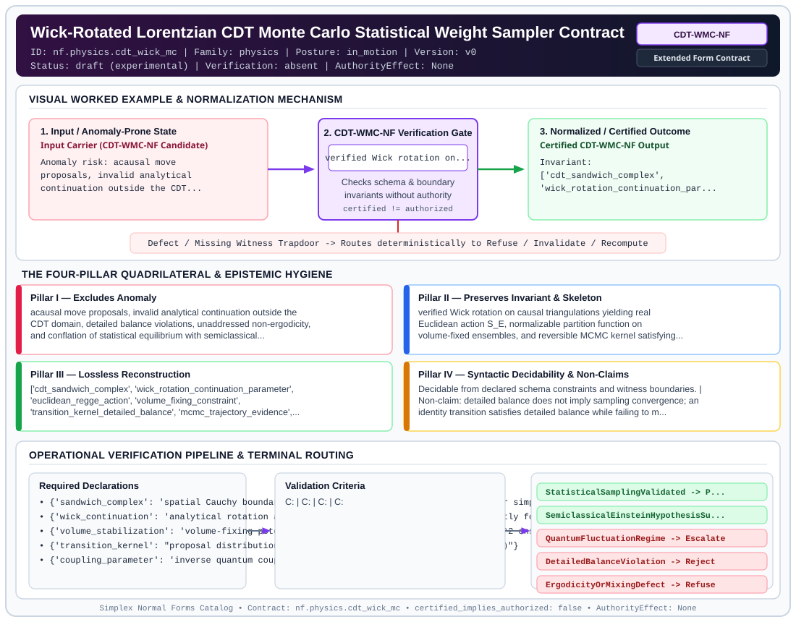

# Wick-Rotated Lorentzian CDT Monte Carlo Statistical Weight Sampler Contract (`CDT-WMC-NF`)

> **Contract ID:** `nf.physics.cdt_wick_mc` | **Family:** `physics` | **Index Status:** `draft` | **AuthorityEffect:** `None`

**[⬅ Back to Wiki Home](Home)** | **[View SVG Diagram](images/nf.physics.cdt_wick_mc.svg)**

---

## 1. Executive Summary & Metadata

Wick-Rotated Lorentzian CDT Monte Carlo Statistical Weight Sampler Contract (CDT-WMC-NF) enforces structural normalization and explicit defect routing in the physics regime.

| Property | Value |
| :--- | :--- |
| **Canonical ID** | `nf.physics.cdt_wick_mc` |
| **Short Name** | `CDT-WMC-NF` |
| **Full Name** | Wick-Rotated Lorentzian CDT Monte Carlo Statistical Weight Sampler Contract |
| **Family** | `physics` (Discrete Differential Geometry, Regge Calculus, Gauge Theory, Lattice Fermions & Quantum Gravity) |
| **Qualification** | Extended Form Contract (Normal Form Contract) |
| **Data / Math Posture** | in_motion |
| **Index Status** | `draft` |
| **Theory Status** | `experimental` |
| **Verification Status** | `absent` |
| **Contract Version** | `v0` |
| **Governance Fence** | `AuthorityEffect: None` (`certified_implies_authorized: false`) |

---

## 2. Visual Architecture & Normalization Diagram



---

## 3. Concrete Worked Example & Mechanism

### Visual Transition Summary

| Stage | Carrier / Operator | Concrete State / Invariant |
| :--- | :--- | :--- |
| **1. Before / Candidate Input** | `Input Carrier (CDT-WMC-NF Candidate)` | Anomaly risk: acausal move ; proposals, invalid analytical ; continuation outside the CDT... |
| **2. Normalization / Gate** | `CDT-WMC-NF Verification Gate` | `verified Wick rotation on...` (`certified_implies_authorized: false`) |
| **3. After / Certified Output** | `Certified CDT-WMC-NF Output` | Invariant: ; ['cdt_sandwich_complex', ; 'wick_rotation_continuation_par... |

---

## 4. The Four-Pillar Quadrilateral & Non-Claims

Every contract in `simplex-normal-forms` is evaluated against the **Four-Pillar Quadrilateral** defined in `contracts/_golden_nfs/standard.yaml`:

| Pillar | Requirement | Contract Specification for `nf.physics.cdt_wick_mc` |
| :--- | :--- | :--- |
| **Pillar I: Excludes Anomaly** | Name and eliminate a specific class of data or state defects. | acausal move proposals, invalid analytical continuation outside the CDT domain, detailed balance violations, unaddressed non-ergodicity, and conflation of statistical equilibrium with semiclassical gravitational convergence |
| **Pillar II: Preserves Invariant** | State the structural invariant and protected skeleton preserved across transitions. | **Invariant:** verified Wick rotation on causal triangulations yielding real Euclidean action S_E, normalizable partition function on volume-fixed ensembles, and reversible MCMC kernel satisfying detailed balance and empirical mixing<br>**Protected Skeleton:** ['cdt_sandwich_complex', 'wick_rotation_continuation_parameter', 'euclidean_regge_action', 'volume_fixing_constraint', 'transition_kernel_detailed_balance', 'mcmc_trajectory_evidence', 'semiclassical_observable_records'] |
| **Pillar III: Lossless Reconstruction** | State the non-loss reconstruction operator (join, direct sum, pullback, or replay). | Lossless reconstruction under declared projection, direct sum, or pullback operators. |
| **Pillar IV: Syntactic Decidability** | State how conformance is decided from declared constraints without unbudgeted scans. | Decidable from declared schema and witness metadata within bounded evaluation budgets. |

### Explicit Non-Claims (`certified_implies_authorized: false`)

- detailed balance does not imply sampling convergence; an identity transition satisfies detailed balance while failing to mix or sample the target distribution
- positive Gibbs weights exp(-beta * S_E) do not analytically force the classical Einstein residual to contract; convergence of <||E||>_beta is a distinct empirical hypothesis requiring explicit experimental evidence
- Wick rotation in CDT is an explicit analytical continuation on causal, foliated geometries, not a generic erasure of oscillatory phases
- positive weights alone do not establish a finite partition function; normalizability requires volume-fixing or explicit finite support
- does not claim continuum quantum general relativity without infinite-volume and continuum scaling limits

---

## 5. Operational Verification & Terminal Routing

### 5.1 Required Declarations

- **sandwich_complex**: spatial Cauchy boundaries Sigma_t, Sigma_{t+1} and causal interior simplices
- **wick_continuation**: analytical rotation alpha -> -alpha in lower half-plane on strictly foliated simplices
- **volume_stabilization**: volume-fixing potential V(N_4) = epsilon * (N_4 - N_4^target)^2 ensuring normalizability
- **transition_kernel**: proposal distribution q(T'|T) and acceptance probability p(T->T')
- **coupling_parameter**: inverse quantum coupling beta = 1/hbar
- **semiclassical_hypothesis**: declared threshold tau_E for mean Einstein residual norm <||E||>_beta

### 5.2 Required Evidence

- **sandwich_triangulation_metadata**: {'slices': 'integer', 'vertices': 'integer', 'simplices': 'integer'}
- **wick_rotation_parameter_alpha**: float
- **euclidean_action_values**: list
- **detailed_balance_residuals**: list
- **chain_autocorrelation_time**: float
- **gelman_rubin_r_hat**: float
- **inverse_temperature_beta_series**: list
- **mean_einstein_residual_series**: list
- **variance_einstein_residual_series**: list
- **semiclassical_hypothesis_verdict**: string

### 5.3 Validation Criteria

| Criterion ID | Name | Condition |
| :--- | :--- | :--- |
| `` | **** |  |
| `` | **** |  |
| `` | **** |  |
| `` | **** |  |
| `` | **** |  |
| `` | **** |  |

### 5.4 Terminal Route Map

Every evaluation terminates in a declared local route mapped to a canonical terminal in `standard.yaml`:

| Local Terminal Route | Canonical Terminal |
| :--- | :--- |
| `StatisticalSamplingValidated` | `Preserve` |
| `SemiclassicalEinsteinHypothesisSupported` | `Preserve` |
| `QuantumFluctuationRegime` | `Escalate` |
| `DetailedBalanceViolation` | `Reject` |
| `ErgodicityOrMixingDefect` | `Refuse` |
| `AcausalMoveRefusal` | `Refuse` |
| `Unsupported` | `Unsupported` |

### 5.5 Declared Failure Modes

_All defects route explicitly through the Terminal Route Map above._

---

## 6. Epistemic Claim Hygiene Quadrant

In accordance with the repository's epistemic claim discipline:

1. **What it supports:**
   - Supports syntactic and operational checking of `nf.physics.cdt_wick_mc` (`CDT-WMC-NF`) against its declared schema, boundary constraints, and witness obligations in this model.
   - Supports deterministic terminal routing (`StatisticalSamplingValidated, SemiclassicalEinsteinHypothesisSupported, QuantumFluctuationRegime, DetailedBalanceViolation`) when required declarations or invariants fail.
2. **What it does not support:**
   - Does not confer operational authority (`AuthorityEffect: None`, `certified_implies_authorized: false`).
   - Does not claim semantic truth of undeclared external processes or unverified upstream inputs beyond the declaredprotected skeleton.
3. **The narrowest defensible claim:**
   - Within the declared substrate `in_motion`, this contract enforces that `acausal move proposals, invalid analytical continuation outside the CDT domain, detailed balance violations, unaddressed non-ergodicity, and conflation of statistical equilibrium with semiclassical gravitational convergence` is either excluded under `verified Wick rotation on causal triangulations yielding real Euclidean action S_E, normalizable partition function on volume-fixed ensembles, and reversible MCMC kernel satisfying detailed balance and empirical mixing` or routed to an explicit refusal/recovery terminal.
4. **The next test needed:**
   - Property-based falsification and mutation testing across boundary edge cases and composed multi-step pipelines for `nf.physics.cdt_wick_mc`.

---

## 7. Canonical YAML Contract (`contracts/nf.physics.cdt_wick_mc.yaml`)

<details>
<summary><strong>Click to expand full canonical YAML contract (contracts/nf.physics.cdt_wick_mc.yaml)</strong></summary>

```yaml
schema_version: smplx.nf.contract.v0
contract_kind: normal_form_contract
identity:
  id: nf.physics.cdt_wick_mc
  name: Wick-Rotated Lorentzian CDT Monte Carlo Statistical Weight Sampler Contract
  short_name: CDT-WMC-NF
  version: v0
  theory_status: experimental
  contract_status: draft
  verification_status: absent
  family: physics
  status: draft
classification:
  hierarchy_level: normal_form
  subject_kind:
  - wick_rotation
  - lorentzian_cdt_sandwiches
  - quantum_path_integral_mcmc
  - discrete_einstein_convergence
  data_posture: in_motion
  mathematical_posture: operational
purpose:
  excludes_anomaly: acausal move proposals, invalid analytical continuation outside
    the CDT domain, detailed balance violations, unaddressed non-ergodicity, and conflation
    of statistical equilibrium with semiclassical gravitational convergence
  preserves_invariant: verified Wick rotation on causal triangulations yielding real
    Euclidean action S_E, normalizable partition function on volume-fixed ensembles,
    and reversible MCMC kernel satisfying detailed balance and empirical mixing
  protected_skeleton:
  - cdt_sandwich_complex
  - wick_rotation_continuation_parameter
  - euclidean_regge_action
  - volume_fixing_constraint
  - transition_kernel_detailed_balance
  - mcmc_trajectory_evidence
  - semiclassical_observable_records
  erased_structure:
  - microscopic_sweep_orderings
  - unverified_acausal_triangulations
  non_claims:
  - detailed balance does not imply sampling convergence; an identity transition satisfies
    detailed balance while failing to mix or sample the target distribution
  - positive Gibbs weights exp(-beta * S_E) do not analytically force the classical
    Einstein residual to contract; convergence of <||E||>_beta is a distinct empirical
    hypothesis requiring explicit experimental evidence
  - Wick rotation in CDT is an explicit analytical continuation on causal, foliated
    geometries, not a generic erasure of oscillatory phases
  - positive weights alone do not establish a finite partition function; normalizability
    requires volume-fixing or explicit finite support
  - does not claim continuum quantum general relativity without infinite-volume and
    continuum scaling limits
declarations_required:
- sandwich_complex: spatial Cauchy boundaries Sigma_t, Sigma_{t+1} and causal interior simplices
- wick_continuation: analytical rotation alpha -> -alpha in lower half-plane on strictly foliated simplices
- volume_stabilization: volume-fixing potential V(N_4) = epsilon * (N_4 - N_4^target)^2 ensuring normalizability
- transition_kernel: proposal distribution q(T'|T) and acceptance probability p(T->T')
- coupling_parameter: inverse quantum coupling beta = 1/hbar
- semiclassical_hypothesis: declared threshold tau_E for mean Einstein residual norm <||E||>_beta
validation_criteria:
- analytical_wick_validity: Euclidean action S_E is real-valued and bounded from below on the volume-stabilized carrier
- volume_normalizability: total 4-simplex count N_4 is bounded within declared envelope, ensuring normalizable measure
- detailed_balance_exact: kernel satisfies W(T) * q(T'|T) * p(T->T') = W(T') * q(T|T') * p(T'->T) within declared tolerance
- ergodicity_and_mixing: chain demonstrates finite integrated autocorrelation time and Gelman-Rubin convergence R_hat < 1.05
- foliation_integrity: proposals introducing CTCs, foliation branching, or spatial topology changes are rejected
- semiclassical_hypothesis_test: records whether empirical mean residual <||E||>_beta contracts below tau_E at high beta as a scoped experimental finding
terminal_routes:
- StatisticalSamplingValidated
- SemiclassicalEinsteinHypothesisSupported
- QuantumFluctuationRegime
- DetailedBalanceViolation
- ErgodicityOrMixingDefect
- AcausalMoveRefusal
- Unsupported
terminal_route_map:
  StatisticalSamplingValidated: Preserve
  SemiclassicalEinsteinHypothesisSupported: Preserve
  QuantumFluctuationRegime: Escalate
  DetailedBalanceViolation: Reject
  ErgodicityOrMixingDefect: Refuse
  AcausalMoveRefusal: Refuse
  Unsupported: Unsupported
extensions:
  condition_to_local_route_map:
    sampler_valid_stationary: StatisticalSamplingValidated
    sampler_valid_converged_experimental: SemiclassicalEinsteinHypothesisSupported
    sampler_valid_fluctuating: QuantumFluctuationRegime
    detailed_balance_error: DetailedBalanceViolation
    chain_non_ergodic: ErgodicityOrMixingDefect
    acausal_move_proposed: AcausalMoveRefusal
definition:
  source: coda_all_universe/mssn_sn_tower/definitions.md
  formal_statement: Wick-rotated Lorentzian CDT Monte Carlo contract evaluating analytical
    continuation on causal sandwiches, volume-stabilized positive Gibbs measures, reversible
    Markov kernels satisfying detailed balance and empirical mixing, and scoped testing
    of semiclassical Einstein convergence.
  quadrilateral:
    qualifies_as_true_normal_form: false
    qualification_gap: reconstruction_is_not_a_relational_project_join
    anomaly_exclusion: acausal move proposals, detailed balance violations, non-ergodic
      trapping, and unnormalizable Gibbs measures
    lossless_join:
      status: declared_reconstruction
      statement: stationary distribution sampling of volume-stabilized Euclidean CDT
    dependency_preservation:
      status: declared_with_the_invariant
      statement: The preserved invariant stays on the declared schema. This form does
        not state a functional-dependency projection of a flat relvar decomposition.
    syntactic_decision:
      status: declaration_decidable
      statement: The check reads the declared constraints and validation criteria.
        One unrecorded runtime image is not the decider.
canonical_terminal_map:
  StatisticalSamplingValidated: Preserve
  SemiclassicalEinsteinHypothesisSupported: Preserve
  QuantumFluctuationRegime: Escalate
  DetailedBalanceViolation: Reject
  ErgodicityOrMixingDefect: Refuse
  AcausalMoveRefusal: Refuse
  Unsupported: Unsupported
authorization:
  authorized_by: null
  certified_implies_authorized: false
certification:
  certificate_required: true
  certificate_kind: nf.physics.cdt_wick_mc_certificate
  obstruction_class_required: false
  loss_ledger_required: false
  loss_ledger_trigger_id: null
  verifier_required: true
evidence_required:
- sandwich_triangulation_metadata: {slices: integer, vertices: integer, simplices: integer}
- wick_rotation_parameter_alpha: float
- euclidean_action_values: list
- detailed_balance_residuals: list
- chain_autocorrelation_time: float
- gelman_rubin_r_hat: float
- inverse_temperature_beta_series: list
- mean_einstein_residual_series: list
- variance_einstein_residual_series: list
- semiclassical_hypothesis_verdict: string
schema_ref: ./normal_form_contract_schema.yaml
```

</details>
