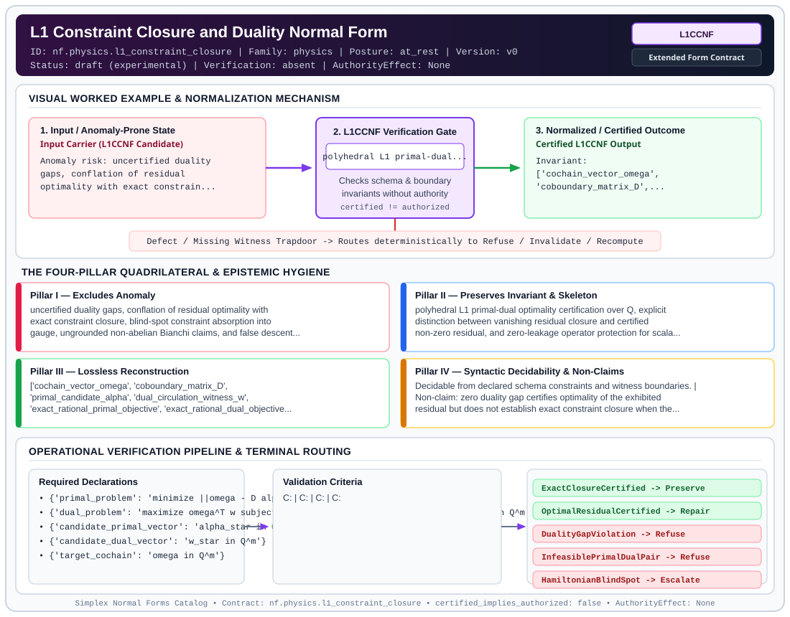

# L1 Constraint Closure and Duality Normal Form (`L1CCNF`)

> **Contract ID:** `nf.physics.l1_constraint_closure` | **Family:** `physics` | **Index Status:** `draft` | **AuthorityEffect:** `None`

**[⬅ Back to Wiki Home](Home)** | **[View SVG Diagram](images/nf.physics.l1_constraint_closure.svg)**

---

## 1. Executive Summary & Metadata

L1 Constraint Closure and Duality Normal Form (L1CCNF) enforces structural normalization and explicit defect routing in the physics regime.

| Property | Value |
| :--- | :--- |
| **Canonical ID** | `nf.physics.l1_constraint_closure` |
| **Short Name** | `L1CCNF` |
| **Full Name** | L1 Constraint Closure and Duality Normal Form |
| **Family** | `physics` (Discrete Differential Geometry, Regge Calculus, Gauge Theory, Lattice Fermions & Quantum Gravity) |
| **Qualification** | Extended Form Contract (Normal Form Contract) |
| **Data / Math Posture** | at_rest |
| **Index Status** | `draft` |
| **Theory Status** | `experimental` |
| **Verification Status** | `absent` |
| **Contract Version** | `v0` |
| **Governance Fence** | `AuthorityEffect: None` (`certified_implies_authorized: false`) |

---

## 2. Visual Architecture & Normalization Diagram



---

## 3. Concrete Worked Example & Mechanism

### Visual Transition Summary

| Stage | Carrier / Operator | Concrete State / Invariant |
| :--- | :--- | :--- |
| **1. Before / Candidate Input** | `Input Carrier (L1CCNF Candidate)` | Anomaly risk: uncertified duality ; gaps, conflation of residual ; optimality with exact constrain... |
| **2. Normalization / Gate** | `L1CCNF Verification Gate` | `polyhedral L1 primal-dual...` (`certified_implies_authorized: false`) |
| **3. After / Certified Output** | `Certified L1CCNF Output` | Invariant: ; ['cochain_vector_omega', ; 'coboundary_matrix_D',... |

---

## 4. The Four-Pillar Quadrilateral & Non-Claims

Every contract in `simplex-normal-forms` is evaluated against the **Four-Pillar Quadrilateral** defined in `contracts/_golden_nfs/standard.yaml`:

| Pillar | Requirement | Contract Specification for `nf.physics.l1_constraint_closure` |
| :--- | :--- | :--- |
| **Pillar I: Excludes Anomaly** | Name and eliminate a specific class of data or state defects. | uncertified duality gaps, conflation of residual optimality with exact constraint closure, blind-spot constraint absorption into gauge, ungrounded non-abelian Bianchi claims, and false descent credits on non-manifold complexes |
| **Pillar II: Preserves Invariant** | State the structural invariant and protected skeleton preserved across transitions. | **Invariant:** polyhedral L1 primal-dual optimality certification over Q, explicit distinction between vanishing residual closure and certified non-zero residual, and zero-leakage operator protection for scalar Hamiltonian constraints<br>**Protected Skeleton:** ['cochain_vector_omega', 'coboundary_matrix_D', 'primal_candidate_alpha', 'dual_circulation_witness_w', 'exact_rational_primal_objective', 'exact_rational_dual_objective', 'exact_zero_duality_gap', 'zero_residual_closure_condition', 'protected_scalar_component_projection'] |
| **Pillar III: Lossless Reconstruction** | State the non-loss reconstruction operator (join, direct sum, pullback, or replay). | Lossless reconstruction under declared projection, direct sum, or pullback operators. |
| **Pillar IV: Syntactic Decidability** | State how conformance is decided from declared constraints without unbudgeted scans. | Decidable from declared schema and witness metadata within bounded evaluation budgets. |

### Explicit Non-Claims (`certified_implies_authorized: false`)

- zero duality gap certifies optimality of the exhibited residual but does not establish exact constraint closure when the residual is non-zero
- direct-sum notation C^1 + C^0 does not prevent scalar absorption unless the operator explicitly satisfies im(D) intersect C^0 = {0}
- nonabelian transport and curvature coboundary scalar ||d_2 eps||_1 > 0 require an explicit model adapter and are not canonical geometric laws
- does not support continuous general relativity from discrete constraint closure
- does not derive Standard Model gauge groups, Higgs VEVs, or dark matter from simplicial cochains
- does not ensure under declared assumptions monotonic gradient descent on non-manifold complexes

---

## 5. Operational Verification & Terminal Routing

### 5.1 Required Declarations

- **primal_problem**: minimize ||omega - D alpha||_1 over alpha in Q^k
- **dual_problem**: maximize omega^T w subject to D^T w = 0 and ||w||_infty <= 1 over w in Q^m
- **candidate_primal_vector**: alpha_star in Q^k
- **candidate_dual_vector**: w_star in Q^m
- **target_cochain**: omega in Q^m
- **coboundary_matrix**: D in Q^{m x k}
- **joint_operator_split**: D = D_gauge + D_scalar with im(D) intersect C^0 = {0}

### 5.2 Required Evidence

- **primal_candidate_alpha**: list
- **dual_witness_w**: list
- **target_cochain_omega**: list
- **coboundary_matrix_D**: list
- **primal_objective_value**: string
- **dual_objective_value**: string
- **duality_gap_exact**: string
- **residual_norm_exact**: string
- **dual_divergence_free_exact**: boolean
- **dual_infinity_norm_bound_exact**: boolean
- **scalar_component_gauge_isolation_verified**: boolean
- **model_adapter_ref**: string

### 5.3 Validation Criteria

| Criterion ID | Name | Condition |
| :--- | :--- | :--- |
| `` | **** |  |
| `` | **** |  |
| `` | **** |  |
| `` | **** |  |
| `` | **** |  |
| `` | **** |  |
| `` | **** |  |
| `` | **** |  |

### 5.4 Terminal Route Map

Every evaluation terminates in a declared local route mapped to a canonical terminal in `standard.yaml`:

| Local Terminal Route | Canonical Terminal |
| :--- | :--- |
| `ExactClosureCertified` | `Preserve` |
| `OptimalResidualCertified` | `Repair` |
| `DualityGapViolation` | `Refuse` |
| `InfeasiblePrimalDualPair` | `Refuse` |
| `HamiltonianBlindSpot` | `Escalate` |
| `NonManifoldDescentFailure` | `Refuse` |
| `QuarantinedOverclaim` | `Escalate` |
| `Unsupported` | `Unsupported` |

### 5.5 Declared Failure Modes

_All defects route explicitly through the Terminal Route Map above._

---

## 6. Epistemic Claim Hygiene Quadrant

In accordance with the repository's epistemic claim discipline:

1. **What it supports:**
   - Supports syntactic and operational checking of `nf.physics.l1_constraint_closure` (`L1CCNF`) against its declared schema, boundary constraints, and witness obligations in this model.
   - Supports deterministic terminal routing (`ExactClosureCertified, OptimalResidualCertified, DualityGapViolation, InfeasiblePrimalDualPair`) when required declarations or invariants fail.
2. **What it does not support:**
   - Does not confer operational authority (`AuthorityEffect: None`, `certified_implies_authorized: false`).
   - Does not claim semantic truth of undeclared external processes or unverified upstream inputs beyond the declaredprotected skeleton.
3. **The narrowest defensible claim:**
   - Within the declared substrate `at_rest`, this contract enforces that `uncertified duality gaps, conflation of residual optimality with exact constraint closure, blind-spot constraint absorption into gauge, ungrounded non-abelian Bianchi claims, and false descent credits on non-manifold complexes` is either excluded under `polyhedral L1 primal-dual optimality certification over Q, explicit distinction between vanishing residual closure and certified non-zero residual, and zero-leakage operator protection for scalar Hamiltonian constraints` or routed to an explicit refusal/recovery terminal.
4. **The next test needed:**
   - Property-based falsification and mutation testing across boundary edge cases and composed multi-step pipelines for `nf.physics.l1_constraint_closure`.

---

## 7. Canonical YAML Contract (`contracts/nf.physics.l1_constraint_closure.yaml`)

<details>
<summary><strong>Click to expand full canonical YAML contract (contracts/nf.physics.l1_constraint_closure.yaml)</strong></summary>

```yaml
schema_version: smplx.nf.contract.v0
contract_kind: normal_form_contract
identity:
  id: nf.physics.l1_constraint_closure
  name: L1 Constraint Closure and Duality Normal Form
  short_name: L1CCNF
  version: v0
  theory_status: experimental
  contract_status: draft
  verification_status: absent
  family: physics
  status: draft
classification:
  hierarchy_level: normal_form
  subject_kind:
  - cochain_complex
  - linear_programming_duality
  - regge_geometry
  data_posture: at_rest
  mathematical_posture: formal_algebraic
purpose:
  excludes_anomaly: uncertified duality gaps, conflation of residual optimality with
    exact constraint closure, blind-spot constraint absorption into gauge, ungrounded
    non-abelian Bianchi claims, and false descent credits on non-manifold complexes
  preserves_invariant: polyhedral L1 primal-dual optimality certification over Q,
    explicit distinction between vanishing residual closure and certified non-zero residual,
    and zero-leakage operator protection for scalar Hamiltonian constraints
  protected_skeleton:
  - cochain_vector_omega
  - coboundary_matrix_D
  - primal_candidate_alpha
  - dual_circulation_witness_w
  - exact_rational_primal_objective
  - exact_rational_dual_objective
  - exact_zero_duality_gap
  - zero_residual_closure_condition
  - protected_scalar_component_projection
  erased_structure:
  - continuous_diffeomorphism_generators
  - unverified_heuristic_stopping_tolerances
  - speculative_particle_physics_analogies
  non_claims:
  - zero duality gap certifies optimality of the exhibited residual but does not establish
    exact constraint closure when the residual is non-zero
  - direct-sum notation C^1 + C^0 does not prevent scalar absorption unless the operator
    explicitly satisfies im(D) intersect C^0 = {0}
  - nonabelian transport and curvature coboundary scalar ||d_2 eps||_1 > 0 require
    an explicit model adapter and are not canonical geometric laws
  - does not support continuous general relativity from discrete constraint closure
  - does not derive Standard Model gauge groups, Higgs VEVs, or dark matter from simplicial
    cochains
  - does not ensure under declared assumptions monotonic gradient descent on non-manifold complexes
declarations_required:
- primal_problem: minimize ||omega - D alpha||_1 over alpha in Q^k
- dual_problem: maximize omega^T w subject to D^T w = 0 and ||w||_infty <= 1 over w in Q^m
- candidate_primal_vector: alpha_star in Q^k
- candidate_dual_vector: w_star in Q^m
- target_cochain: omega in Q^m
- coboundary_matrix: D in Q^{m x k}
- joint_operator_split: D = D_gauge + D_scalar with im(D) intersect C^0 = {0}
validation_criteria:
- primal_objective_evaluation: P(alpha_star) = ||omega - D alpha_star||_1 evaluated in exact rational arithmetic over Q
- dual_feasibility_exact: D^T w_star = 0 and ||w_star||_infty <= 1 verified exactly over Q
- dual_objective_evaluation: D(w_star) = omega^T w_star evaluated in exact rational arithmetic over Q
- weak_duality_nonnegativity: P(alpha_star) - D(w_star) >= 0 verified exactly over Q
- optimality_gap_zero: duality gap g = P(alpha_star) - D(w_star) == 0 certifies alpha_star as optimal residual solution
- exact_closure_condition: exact constraint closure holds if and only if both g == 0 and P(alpha_star) == 0
- scalar_gauge_isolation: operator D satisfies im(D) intersect C^0 = {0}, preventing spurious gauge absorption
- model_specific_nonabelian_holonomy: if nonabelian transport adapter is declared, evaluate curvature coboundary condition on declared domain
terminal_routes:
- ExactClosureCertified
- OptimalResidualCertified
- DualityGapViolation
- InfeasiblePrimalDualPair
- HamiltonianBlindSpot
- NonManifoldDescentFailure
- QuarantinedOverclaim
- Unsupported
terminal_route_map:
  ExactClosureCertified: Preserve
  OptimalResidualCertified: Repair
  DualityGapViolation: Refuse
  InfeasiblePrimalDualPair: Refuse
  HamiltonianBlindSpot: Escalate
  NonManifoldDescentFailure: Refuse
  QuarantinedOverclaim: Escalate
  Unsupported: Unsupported
extensions:
  condition_to_local_route_map:
    gap_zero_and_residual_zero: ExactClosureCertified
    gap_zero_and_residual_positive: OptimalResidualCertified
    gap_positive: DualityGapViolation
    dual_infeasible_or_weak_duality_breach: InfeasiblePrimalDualPair
    scalar_absorbed_into_gauge: HamiltonianBlindSpot
    unearned_descent_credit: NonManifoldDescentFailure
    falsified_high_energy_climb: QuarantinedOverclaim
definition:
  source: coda_all_universe/mssn_sn_tower/definitions.md
  formal_statement: Exact rational L1 constraint closure distinguishes optimality of
    an exhibited residual (zero duality gap P(alpha) - D(w) = 0) from exact constraint
    closure (residual norm ||omega - D alpha||_1 = 0), with divergence-free dual circulation
    witnesses D^T w = 0, ||w||_infty <= 1, and zero-image operator isolation im(D) intersect C^0 = {0}.
  quadrilateral:
    qualifies_as_true_normal_form: false
    qualification_gap: reconstruction_is_not_a_relational_project_join
    anomaly_exclusion: uncertified duality gaps, false identification of optimal residual
      with exact closure, blind-spot constraint absorption into gauge, and false descent
      credits on non-manifold complexes
    lossless_join:
      status: declared_reconstruction
      statement: polyhedral LP strong duality with divergence-free circulation witnesses,
        direct-sum joint WDW isolation, and exact rational arithmetic over Q
    dependency_preservation:
      status: declared_with_the_invariant
      statement: The preserved invariant stays on the declared schema. This form does
        not state a functional-dependency projection of a flat relvar decomposition.
    syntactic_decision:
      status: declaration_decidable
      statement: The check reads the declared constraints and validation criteria.
        One unrecorded runtime image is not the decider.
canonical_terminal_map:
  ExactClosureCertified: Preserve
  OptimalResidualCertified: Repair
  DualityGapViolation: Refuse
  InfeasiblePrimalDualPair: Refuse
  HamiltonianBlindSpot: Escalate
  NonManifoldDescentFailure: Refuse
  QuarantinedOverclaim: Escalate
  Unsupported: Unsupported
authorization:
  authorized_by: null
  certified_implies_authorized: false
certification:
  certificate_required: true
  certificate_kind: nf.physics.l1_constraint_closure_certificate
  obstruction_class_required: false
  loss_ledger_required: false
  loss_ledger_trigger_id: null
  verifier_required: true
evidence_required:
- primal_candidate_alpha: list
- dual_witness_w: list
- target_cochain_omega: list
- coboundary_matrix_D: list
- primal_objective_value: string
- dual_objective_value: string
- duality_gap_exact: string
- residual_norm_exact: string
- dual_divergence_free_exact: boolean
- dual_infinity_norm_bound_exact: boolean
- scalar_component_gauge_isolation_verified: boolean
- model_adapter_ref: string
schema_ref: ./normal_form_contract_schema.yaml
```

</details>
