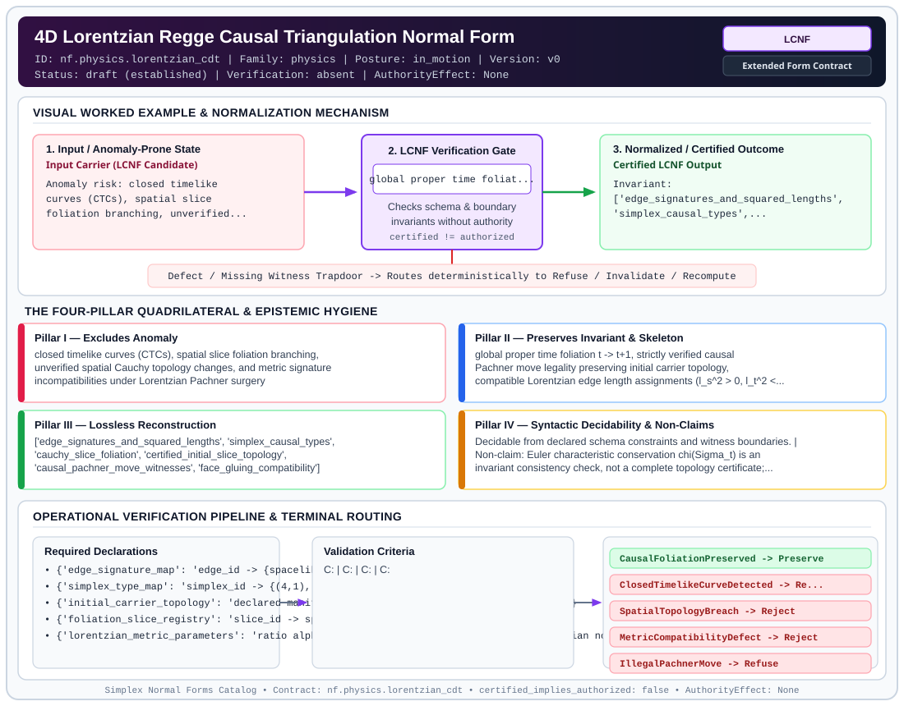

# 4D Lorentzian Regge Causal Triangulation Normal Form (`LCNF`)

> **Contract ID:** `nf.physics.lorentzian_cdt` | **Family:** `physics` | **Index Status:** `draft` | **AuthorityEffect:** `None`

**[⬅ Back to Wiki Home](Home)** | **[View SVG Diagram](images/nf.physics.lorentzian_cdt.svg)**

---

## 1. Executive Summary & Metadata

4D Lorentzian Regge Causal Triangulation Normal Form (LCNF) enforces structural normalization and explicit defect routing in the physics regime.

| Property | Value |
| :--- | :--- |
| **Canonical ID** | `nf.physics.lorentzian_cdt` |
| **Short Name** | `LCNF` |
| **Full Name** | 4D Lorentzian Regge Causal Triangulation Normal Form |
| **Family** | `physics` (Discrete Differential Geometry, Regge Calculus, Gauge Theory, Lattice Fermions & Quantum Gravity) |
| **Qualification** | Extended Form Contract (Normal Form Contract) |
| **Data / Math Posture** | in_motion |
| **Index Status** | `draft` |
| **Theory Status** | `established` |
| **Verification Status** | `absent` |
| **Contract Version** | `v0` |
| **Governance Fence** | `AuthorityEffect: None` (`certified_implies_authorized: false`) |

---

## 2. Visual Architecture & Normalization Diagram



---

## 3. Concrete Worked Example & Mechanism

### Visual Transition Summary

| Stage | Carrier / Operator | Concrete State / Invariant |
| :--- | :--- | :--- |
| **1. Before / Candidate Input** | `Input Carrier (LCNF Candidate)` | Anomaly risk: closed timelike ; curves (CTCs), spatial slice ; foliation branching, unverified... |
| **2. Normalization / Gate** | `LCNF Verification Gate` | `global proper time foliat...` (`certified_implies_authorized: false`) |
| **3. After / Certified Output** | `Certified LCNF Output` | Invariant: ; ['edge_signatures_and_squared_lengths', ; 'simplex_causal_types',... |

---

## 4. The Four-Pillar Quadrilateral & Non-Claims

Every contract in `simplex-normal-forms` is evaluated against the **Four-Pillar Quadrilateral** defined in `contracts/_golden_nfs/standard.yaml`:

| Pillar | Requirement | Contract Specification for `nf.physics.lorentzian_cdt` |
| :--- | :--- | :--- |
| **Pillar I: Excludes Anomaly** | Name and eliminate a specific class of data or state defects. | closed timelike curves (CTCs), spatial slice foliation branching, unverified spatial Cauchy topology changes, and metric signature incompatibilities under Lorentzian Pachner surgery |
| **Pillar II: Preserves Invariant** | State the structural invariant and protected skeleton preserved across transitions. | **Invariant:** global proper time foliation t -> t+1, strictly verified causal Pachner move legality preserving initial carrier topology, compatible Lorentzian edge length assignments (l_s^2 > 0, l_t^2 < 0), and invariant spatial Euler characteristic<br>**Protected Skeleton:** ['edge_signatures_and_squared_lengths', 'simplex_causal_types', 'cauchy_slice_foliation', 'certified_initial_slice_topology', 'causal_pachner_move_witnesses', 'face_gluing_compatibility'] |
| **Pillar III: Lossless Reconstruction** | State the non-loss reconstruction operator (join, direct sum, pullback, or replay). | Lossless reconstruction under declared projection, direct sum, or pullback operators. |
| **Pillar IV: Syntactic Decidability** | State how conformance is decided from declared constraints without unbudgeted scans. | Decidable from declared schema and witness metadata within bounded evaluation budgets. |

### Explicit Non-Claims (`certified_implies_authorized: false`)

- Euler characteristic conservation chi(Sigma_t) is an invariant consistency check, not a complete topology certificate; topologies with identical Euler characteristics (e.g., S^3 and T^3 with chi=0) are distinguished by checked move legality and initial carrier homology
- monotonic time labels certify directed graph acyclicity; they do not alone establish that simplices realize compatible nondegenerate Lorentzian metrics without explicit metric data and face-gluing compatibility
- does not support that discrete CDT converges to continuous 4D de Sitter spacetime without quantum Monte Carlo infinite volume limits
- does not eliminate Wick rotation path integral measure ambiguities

---

## 5. Operational Verification & Terminal Routing

### 5.1 Required Declarations

- **edge_signature_map**: edge_id -> {spacelike (l_s^2 > 0), timelike (l_t^2 < 0)}
- **simplex_type_map**: simplex_id -> {(4,1), (3,2), (2,3), (1,4)}
- **initial_carrier_topology**: declared manifold class and verified homology of Sigma_0
- **foliation_slice_registry**: slice_id -> spatial 3-triangulation
- **lorentzian_metric_parameters**: ratio alpha = -l_t^2 / l_s^2 satisfying Regge Lorentzian nondegeneracy (alpha > 7/12 in 4D)
- **causal_pachner_moves**: sequence of local bistellar replacements with verified replacement complexes and boundary matches

### 5.2 Required Evidence

- **initial_carrier_topology**: {'manifold_type': 'string', 'homology_ranks': 'list'}
- **slice_foliation_indices**: list
- **edge_lengths_squared**: dict
- **causal_pachner_moves_log**: list
- **move_legality_witnesses**: list
- **euler_characteristic_sequence**: list
- **simplex_lorentzian_gram_signs**: list
- **face_gluing_compatibility_verified**: boolean
- **time_directed_acyclicity_witness**: boolean

### 5.3 Validation Criteria

| Criterion ID | Name | Condition |
| :--- | :--- | :--- |
| `` | **** |  |
| `` | **** |  |
| `` | **** |  |
| `` | **** |  |
| `` | **** |  |
| `` | **** |  |

### 5.4 Terminal Route Map

Every evaluation terminates in a declared local route mapped to a canonical terminal in `standard.yaml`:

| Local Terminal Route | Canonical Terminal |
| :--- | :--- |
| `CausalFoliationPreserved` | `Preserve` |
| `ClosedTimelikeCurveDetected` | `Refuse` |
| `SpatialTopologyBreach` | `Reject` |
| `MetricCompatibilityDefect` | `Reject` |
| `IllegalPachnerMove` | `Refuse` |
| `Unsupported` | `Unsupported` |

### 5.5 Declared Failure Modes

_All defects route explicitly through the Terminal Route Map above._

---

## 6. Epistemic Claim Hygiene Quadrant

In accordance with the repository's epistemic claim discipline:

1. **What it supports:**
   - Supports syntactic and operational checking of `nf.physics.lorentzian_cdt` (`LCNF`) against its declared schema, boundary constraints, and witness obligations in this model.
   - Supports deterministic terminal routing (`CausalFoliationPreserved, ClosedTimelikeCurveDetected, SpatialTopologyBreach, MetricCompatibilityDefect`) when required declarations or invariants fail.
2. **What it does not support:**
   - Does not confer operational authority (`AuthorityEffect: None`, `certified_implies_authorized: false`).
   - Does not claim semantic truth of undeclared external processes or unverified upstream inputs beyond the declaredprotected skeleton.
3. **The narrowest defensible claim:**
   - Within the declared substrate `in_motion`, this contract enforces that `closed timelike curves (CTCs), spatial slice foliation branching, unverified spatial Cauchy topology changes, and metric signature incompatibilities under Lorentzian Pachner surgery` is either excluded under `global proper time foliation t -> t+1, strictly verified causal Pachner move legality preserving initial carrier topology, compatible Lorentzian edge length assignments (l_s^2 > 0, l_t^2 < 0), and invariant spatial Euler characteristic` or routed to an explicit refusal/recovery terminal.
4. **The next test needed:**
   - Property-based falsification and mutation testing across boundary edge cases and composed multi-step pipelines for `nf.physics.lorentzian_cdt`.

---

## 7. Canonical YAML Contract (`contracts/nf.physics.lorentzian_cdt.yaml`)

<details>
<summary><strong>Click to expand full canonical YAML contract (contracts/nf.physics.lorentzian_cdt.yaml)</strong></summary>

```yaml
schema_version: smplx.nf.contract.v0
contract_kind: normal_form_contract
identity:
  id: nf.physics.lorentzian_cdt
  name: 4D Lorentzian Regge Causal Triangulation Normal Form
  short_name: LCNF
  version: v0
  theory_status: established
  contract_status: draft
  verification_status: absent
  family: physics
  status: draft
classification:
  hierarchy_level: normal_form
  subject_kind:
  - lorentzian_simplicial_geometry
  - causal_dynamical_triangulations
  data_posture: in_motion
  mathematical_posture: formal_algebraic
purpose:
  excludes_anomaly: closed timelike curves (CTCs), spatial slice foliation branching,
    unverified spatial Cauchy topology changes, and metric signature incompatibilities
    under Lorentzian Pachner surgery
  preserves_invariant: global proper time foliation t -> t+1, strictly verified causal
    Pachner move legality preserving initial carrier topology, compatible Lorentzian
    edge length assignments (l_s^2 > 0, l_t^2 < 0), and invariant spatial Euler characteristic
  protected_skeleton:
  - edge_signatures_and_squared_lengths
  - simplex_causal_types
  - cauchy_slice_foliation
  - certified_initial_slice_topology
  - causal_pachner_move_witnesses
  - face_gluing_compatibility
  erased_structure:
  - continuous_spacetime_diffeomorphisms
  - acausal_spacelike_topology_changes
  non_claims:
  - Euler characteristic conservation chi(Sigma_t) is an invariant consistency check,
    not a complete topology certificate; topologies with identical Euler characteristics
    (e.g., S^3 and T^3 with chi=0) are distinguished by checked move legality and initial
    carrier homology
  - monotonic time labels certify directed graph acyclicity; they do not alone establish
    that simplices realize compatible nondegenerate Lorentzian metrics without explicit
    metric data and face-gluing compatibility
  - does not support that discrete CDT converges to continuous 4D de Sitter spacetime
    without quantum Monte Carlo infinite volume limits
  - does not eliminate Wick rotation path integral measure ambiguities
declarations_required:
- edge_signature_map: edge_id -> {spacelike (l_s^2 > 0), timelike (l_t^2 < 0)}
- simplex_type_map: simplex_id -> {(4,1), (3,2), (2,3), (1,4)}
- initial_carrier_topology: declared manifold class and verified homology of Sigma_0
- foliation_slice_registry: slice_id -> spatial 3-triangulation
- lorentzian_metric_parameters: ratio alpha = -l_t^2 / l_s^2 satisfying Regge Lorentzian nondegeneracy (alpha > 7/12 in 4D)
- causal_pachner_moves: sequence of local bistellar replacements with verified replacement complexes and boundary matches
validation_criteria:
- proper_foliation: all spacelike edges connect vertices at the same time slice t; all timelike edges connect t to t+1
- no_ctc: causal vertex ordering is strictly irreflexive and transitive (t_u < t_v for all timelike edges (u,v))
- lorentzian_metric_admissibility: ratio alpha = -l_t^2 / l_s^2 strictly satisfies simplex metric nondegeneracy on all simplex causal types
- face_gluing_compatibility: shared faces between adjacent simplices possess identical induced piecewise-flat Lorentzian geometry
- move_legality_topology_preservation: every spatial transition is composed of verified local causal Pachner moves that preserve PL 3-manifold homeomorphism to Sigma_0
- euler_characteristic_conservation: spatial Euler characteristic chi(Sigma_t) remains constant across all slices as a necessary consistency check
terminal_routes:
- CausalFoliationPreserved
- ClosedTimelikeCurveDetected
- SpatialTopologyBreach
- MetricCompatibilityDefect
- IllegalPachnerMove
- Unsupported
terminal_route_map:
  CausalFoliationPreserved: Preserve
  ClosedTimelikeCurveDetected: Refuse
  SpatialTopologyBreach: Reject
  MetricCompatibilityDefect: Reject
  IllegalPachnerMove: Refuse
  Unsupported: Unsupported
extensions:
  condition_to_local_route_map:
    all_valid: CausalFoliationPreserved
    ctc_detected: ClosedTimelikeCurveDetected
    move_topology_breach: SpatialTopologyBreach
    lorentzian_metric_incompatibility: MetricCompatibilityDefect
    unverified_pachner_surgery: IllegalPachnerMove
definition:
  source: coda_all_universe/mssn_sn_tower/definitions.md
  formal_statement: Lorentzian causal dynamical triangulation normal form preserving
    global proper time foliation, acyclic causal ordering, compatible Lorentzian simplex
    metrics, and certified spatial 3-manifold topology under verified causal Pachner surgeries.
  quadrilateral:
    qualifies_as_true_normal_form: false
    qualification_gap: reconstruction_is_not_a_relational_project_join
    anomaly_exclusion: closed timelike curves (CTCs), spatial slice foliation branching,
      spatial topology changes, and Lorentzian metric degeneracy
    lossless_join:
      status: declared_reconstruction
      statement: global proper time foliation t -> t+1 and invariant spatial 3-manifold
        topology certified through legal move sequence from Sigma_0
    dependency_preservation:
      status: declared_with_the_invariant
      statement: The preserved invariant stays on the declared schema. This form does
        not state a functional-dependency projection of a flat relvar decomposition.
    syntactic_decision:
      status: declaration_decidable
      statement: The check reads the declared constraints and validation criteria.
        One unrecorded runtime image is not the decider.
canonical_terminal_map:
  CausalFoliationPreserved: Preserve
  ClosedTimelikeCurveDetected: Refuse
  SpatialTopologyBreach: Reject
  MetricCompatibilityDefect: Reject
  IllegalPachnerMove: Refuse
  Unsupported: Unsupported
authorization:
  authorized_by: null
  certified_implies_authorized: false
certification:
  certificate_required: true
  certificate_kind: nf.physics.lorentzian_cdt_certificate
  obstruction_class_required: false
  loss_ledger_required: false
  loss_ledger_trigger_id: null
  verifier_required: true
evidence_required:
- initial_carrier_topology: {manifold_type: string, homology_ranks: list}
- slice_foliation_indices: list
- edge_lengths_squared: dict
- causal_pachner_moves_log: list
- move_legality_witnesses: list
- euler_characteristic_sequence: list
- simplex_lorentzian_gram_signs: list
- face_gluing_compatibility_verified: boolean
- time_directed_acyclicity_witness: boolean
schema_ref: ./normal_form_contract_schema.yaml
```

</details>
