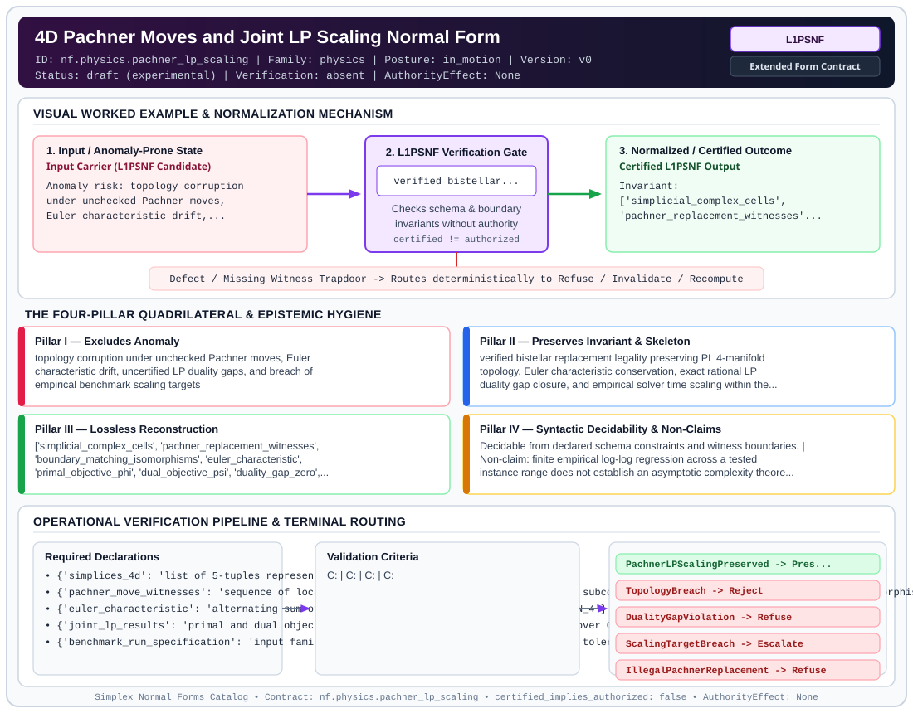

# 4D Pachner Moves and Joint LP Scaling Normal Form (`L1PSNF`)

> **Contract ID:** `nf.physics.pachner_lp_scaling` | **Family:** `physics` | **Index Status:** `draft` | **AuthorityEffect:** `None`

**[⬅ Back to Wiki Home](Home)** | **[View SVG Diagram](images/nf.physics.pachner_lp_scaling.svg)**

---

## 1. Executive Summary & Metadata

4D Pachner Moves and Joint LP Scaling Normal Form (L1PSNF) enforces structural normalization and explicit defect routing in the physics regime.

| Property | Value |
| :--- | :--- |
| **Canonical ID** | `nf.physics.pachner_lp_scaling` |
| **Short Name** | `L1PSNF` |
| **Full Name** | 4D Pachner Moves and Joint LP Scaling Normal Form |
| **Family** | `physics` (Discrete Differential Geometry, Regge Calculus, Gauge Theory, Lattice Fermions & Quantum Gravity) |
| **Qualification** | Extended Form Contract (Normal Form Contract) |
| **Data / Math Posture** | in_motion |
| **Index Status** | `draft` |
| **Theory Status** | `experimental` |
| **Verification Status** | `absent` |
| **Contract Version** | `v0` |
| **Governance Fence** | `AuthorityEffect: None` (`certified_implies_authorized: false`) |

---

## 2. Visual Architecture & Normalization Diagram



---

## 3. Concrete Worked Example & Mechanism

### Visual Transition Summary

| Stage | Carrier / Operator | Concrete State / Invariant |
| :--- | :--- | :--- |
| **1. Before / Candidate Input** | `Input Carrier (L1PSNF Candidate)` | Anomaly risk: topology corruption ; under unchecked Pachner moves, ; Euler characteristic drift,... |
| **2. Normalization / Gate** | `L1PSNF Verification Gate` | `verified bistellar...` (`certified_implies_authorized: false`) |
| **3. After / Certified Output** | `Certified L1PSNF Output` | Invariant: ; ['simplicial_complex_cells', ; 'pachner_replacement_witnesses'... |

---

## 4. The Four-Pillar Quadrilateral & Non-Claims

Every contract in `simplex-normal-forms` is evaluated against the **Four-Pillar Quadrilateral** defined in `contracts/_golden_nfs/standard.yaml`:

| Pillar | Requirement | Contract Specification for `nf.physics.pachner_lp_scaling` |
| :--- | :--- | :--- |
| **Pillar I: Excludes Anomaly** | Name and eliminate a specific class of data or state defects. | topology corruption under unchecked Pachner moves, Euler characteristic drift, uncertified LP duality gaps, and breach of empirical benchmark scaling targets |
| **Pillar II: Preserves Invariant** | State the structural invariant and protected skeleton preserved across transitions. | **Invariant:** verified bistellar replacement legality preserving PL 4-manifold topology, Euler characteristic conservation, exact rational LP duality gap closure, and empirical solver time scaling within the declared target exponent alpha <= 3.5 on tested instances<br>**Protected Skeleton:** ['simplicial_complex_cells', 'pachner_replacement_witnesses', 'boundary_matching_isomorphisms', 'euler_characteristic', 'primal_objective_phi', 'dual_objective_psi', 'duality_gap_zero', 'empirical_scaling_exponent'] |
| **Pillar III: Lossless Reconstruction** | State the non-loss reconstruction operator (join, direct sum, pullback, or replay). | Lossless reconstruction under declared projection, direct sum, or pullback operators. |
| **Pillar IV: Syntactic Decidability** | State how conformance is decided from declared constraints without unbudgeted scans. | Decidable from declared schema and witness metadata within bounded evaluation budgets. |

### Explicit Non-Claims (`certified_implies_authorized: false`)

- finite empirical log-log regression across a tested instance range does not establish an asymptotic complexity theorem; exceeding threshold alpha > 3.5 denotes an empirical scaling-target breach, not super-polynomial divergence (e.g., polynomial N^4 exceeds 3.5)
- bistellar move validity requires local replacement witnesses and link conditions; Euler characteristic and cell intersection checks alone do not certify topology preservation
- does not support polynomial time complexity for general non-sparse linear programs
- does not claim recovery of smooth 4D general relativity without non-perturbative scaling

---

## 5. Operational Verification & Terminal Routing

### 5.1 Required Declarations

- **simplices_4d**: list of 5-tuples representing 4-simplices
- **pachner_move_witnesses**: sequence of local replacement records with declared removed subcomplex, inserted subcomplex, and boundary isomorphism
- **euler_characteristic**: alternating sum of cell counts chi = N_0 - N_1 + N_2 - N_3 + N_4
- **joint_lp_results**: primal and dual objectives with duality gap g = |Phi - Psi| == 0 over Q
- **benchmark_run_specification**: input family, coefficient bit lengths, solver version, tolerance, and measurement range [N_min, N_max]
- **empirical_scaling_exponent**: estimated power-law slope alpha from regression of log(solve_time) vs log(N_4)

### 5.2 Required Evidence

- **pachner_replacement_witnesses**: list
- **boundary_subcomplex_matches**: list
- **euler_characteristic_series**: list
- **primal_dual_gap_series**: list
- **benchmark_measurement_range**: {'min_n4': 'integer', 'max_n4': 'integer', 'step_count': 'integer'}
- **solver_environment_metadata**: {'solver_name': 'string', 'solver_version': 'string', 'coefficient_bit_lengths': 'integer'}
- **empirical_regression_exponent**: float
- **empirical_r_squared**: float

### 5.3 Validation Criteria

| Criterion ID | Name | Condition |
| :--- | :--- | :--- |
| `` | **** |  |
| `` | **** |  |
| `` | **** |  |
| `` | **** |  |
| `` | **** |  |

### 5.4 Terminal Route Map

Every evaluation terminates in a declared local route mapped to a canonical terminal in `standard.yaml`:

| Local Terminal Route | Canonical Terminal |
| :--- | :--- |
| `PachnerLPScalingPreserved` | `Preserve` |
| `TopologyBreach` | `Reject` |
| `DualityGapViolation` | `Refuse` |
| `ScalingTargetBreach` | `Escalate` |
| `IllegalPachnerReplacement` | `Refuse` |
| `Unsupported` | `Unsupported` |

### 5.5 Declared Failure Modes

_All defects route explicitly through the Terminal Route Map above._

---

## 6. Epistemic Claim Hygiene Quadrant

In accordance with the repository's epistemic claim discipline:

1. **What it supports:**
   - Supports syntactic and operational checking of `nf.physics.pachner_lp_scaling` (`L1PSNF`) against its declared schema, boundary constraints, and witness obligations in this model.
   - Supports deterministic terminal routing (`PachnerLPScalingPreserved, TopologyBreach, DualityGapViolation, ScalingTargetBreach`) when required declarations or invariants fail.
2. **What it does not support:**
   - Does not confer operational authority (`AuthorityEffect: None`, `certified_implies_authorized: false`).
   - Does not claim semantic truth of undeclared external processes or unverified upstream inputs beyond the declaredprotected skeleton.
3. **The narrowest defensible claim:**
   - Within the declared substrate `in_motion`, this contract enforces that `topology corruption under unchecked Pachner moves, Euler characteristic drift, uncertified LP duality gaps, and breach of empirical benchmark scaling targets` is either excluded under `verified bistellar replacement legality preserving PL 4-manifold topology, Euler characteristic conservation, exact rational LP duality gap closure, and empirical solver time scaling within the declared target exponent alpha <= 3.5 on tested instances` or routed to an explicit refusal/recovery terminal.
4. **The next test needed:**
   - Property-based falsification and mutation testing across boundary edge cases and composed multi-step pipelines for `nf.physics.pachner_lp_scaling`.

---

## 7. Canonical YAML Contract (`contracts/nf.physics.pachner_lp_scaling.yaml`)

<details>
<summary><strong>Click to expand full canonical YAML contract (contracts/nf.physics.pachner_lp_scaling.yaml)</strong></summary>

```yaml
schema_version: smplx.nf.contract.v0
contract_kind: normal_form_contract
identity:
  id: nf.physics.pachner_lp_scaling
  name: 4D Pachner Moves and Joint LP Scaling Normal Form
  short_name: L1PSNF
  version: v0
  theory_status: experimental
  contract_status: draft
  verification_status: absent
  family: physics
  status: draft
classification:
  hierarchy_level: normal_form
  subject_kind:
  - 4d_simplicial_complex
  - pachner_moves
  - linear_programming_scaling
  data_posture: in_motion
  mathematical_posture: operational
purpose:
  excludes_anomaly: topology corruption under unchecked Pachner moves, Euler characteristic
    drift, uncertified LP duality gaps, and breach of empirical benchmark scaling targets
  preserves_invariant: verified bistellar replacement legality preserving PL 4-manifold
    topology, Euler characteristic conservation, exact rational LP duality gap closure,
    and empirical solver time scaling within the declared target exponent alpha <= 3.5
    on tested instances
  protected_skeleton:
  - simplicial_complex_cells
  - pachner_replacement_witnesses
  - boundary_matching_isomorphisms
  - euler_characteristic
  - primal_objective_phi
  - dual_objective_psi
  - duality_gap_zero
  - empirical_scaling_exponent
  erased_structure:
  - continuous_diffeomorphism_generators
  - arbitrary_unbounded_solver_relaxations
  non_claims:
  - finite empirical log-log regression across a tested instance range does not establish
    an asymptotic complexity theorem; exceeding threshold alpha > 3.5 denotes an empirical
    scaling-target breach, not super-polynomial divergence (e.g., polynomial N^4 exceeds 3.5)
  - bistellar move validity requires local replacement witnesses and link conditions;
    Euler characteristic and cell intersection checks alone do not certify topology preservation
  - does not support polynomial time complexity for general non-sparse linear programs
  - does not claim recovery of smooth 4D general relativity without non-perturbative scaling
declarations_required:
- simplices_4d: list of 5-tuples representing 4-simplices
- pachner_move_witnesses: sequence of local replacement records with declared removed subcomplex, inserted subcomplex, and boundary isomorphism
- euler_characteristic: alternating sum of cell counts chi = N_0 - N_1 + N_2 - N_3 + N_4
- joint_lp_results: primal and dual objectives with duality gap g = |Phi - Psi| == 0 over Q
- benchmark_run_specification: input family, coefficient bit lengths, solver version, tolerance, and measurement range [N_min, N_max]
- empirical_scaling_exponent: estimated power-law slope alpha from regression of log(solve_time) vs log(N_4)
validation_criteria:
- pachner_move_legality: each bistellar move strictly replaces a standard subcomplex with its dual shell, matching the boundary subcomplex identically
- euler_characteristic_invariance: chi remains strictly invariant under all 1->5, 2->4, 3->3, 4->2, and 5->1 moves
- topological_validity: all generated simplices form an intersection-valid simplicial complex
- strong_duality_certified: duality gap |Phi - Psi| is certified zero in exact rational arithmetic over Q
- empirical_scaling_target: empirical scaling exponent satisfies alpha <= 3.5 over the declared measurement range
terminal_routes:
- PachnerLPScalingPreserved
- TopologyBreach
- DualityGapViolation
- ScalingTargetBreach
- IllegalPachnerReplacement
- Unsupported
terminal_route_map:
  PachnerLPScalingPreserved: Preserve
  TopologyBreach: Reject
  DualityGapViolation: Refuse
  ScalingTargetBreach: Escalate
  IllegalPachnerReplacement: Refuse
  Unsupported: Unsupported
extensions:
  condition_to_local_route_map:
    all_valid: PachnerLPScalingPreserved
    euler_drift: TopologyBreach
    gap_exceeded: DualityGapViolation
    empirical_exponent_exceeded: ScalingTargetBreach
    illegal_replacement: IllegalPachnerReplacement
definition:
  source: coda_all_universe/mssn_sn_tower/definitions.md
  formal_statement: Piecewise-flat 4-manifold topology preservation under verified local
    bistellar replacements with boundary-matching witnesses, exact rational LP duality
    gap certification, and empirical scaling validation against declared benchmark targets.
  quadrilateral:
    qualifies_as_true_normal_form: false
    qualification_gap: reconstruction_is_not_a_relational_project_join
    anomaly_exclusion: topology corruption under unchecked Pachner moves, Euler characteristic
      drift, uncertified duality gaps, and scaling-target breaches
    lossless_join:
      status: declared_reconstruction
      statement: verified bistellar move sequence preserving PL topology and exact LP duality closure
    dependency_preservation:
      status: declared_with_the_invariant
      statement: The preserved invariant stays on the declared schema. This form does
        not state a functional-dependency projection of a flat relvar decomposition.
    syntactic_decision:
      status: declaration_decidable
      statement: The check reads the declared constraints and validation criteria.
        One unrecorded runtime image is not the decider.
canonical_terminal_map:
  PachnerLPScalingPreserved: Preserve
  TopologyBreach: Reject
  DualityGapViolation: Refuse
  ScalingTargetBreach: Escalate
  IllegalPachnerReplacement: Refuse
  Unsupported: Unsupported
authorization:
  authorized_by: null
  certified_implies_authorized: false
certification:
  certificate_required: true
  certificate_kind: nf.physics.pachner_lp_scaling_certificate
  obstruction_class_required: false
  loss_ledger_required: false
  loss_ledger_trigger_id: null
  verifier_required: true
evidence_required:
- pachner_replacement_witnesses: list
- boundary_subcomplex_matches: list
- euler_characteristic_series: list
- primal_dual_gap_series: list
- benchmark_measurement_range: {min_n4: integer, max_n4: integer, step_count: integer}
- solver_environment_metadata: {solver_name: string, solver_version: string, coefficient_bit_lengths: integer}
- empirical_regression_exponent: float
- empirical_r_squared: float
schema_ref: ./normal_form_contract_schema.yaml
```

</details>
