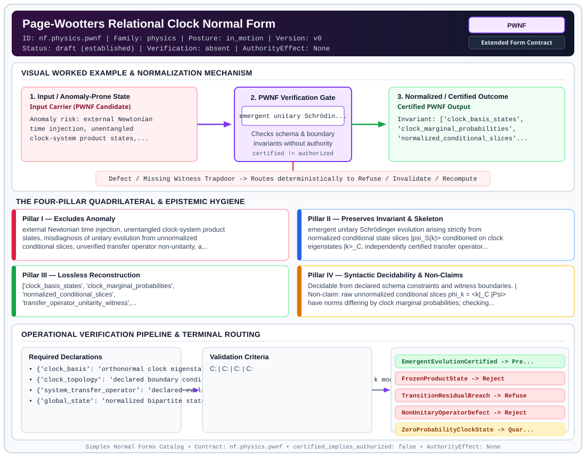

# Page-Wootters Relational Clock Normal Form (`PWNF`)

> **Contract ID:** `nf.physics.pwnf` | **Family:** `physics` | **Index Status:** `draft` | **AuthorityEffect:** `None`

**[⬅ Back to Wiki Home](Home)** | **[View SVG Diagram](images/nf.physics.pwnf.svg)**

---

## 1. Executive Summary & Metadata

Page-Wootters Relational Clock Normal Form (PWNF) enforces structural normalization and explicit defect routing in the physics regime.

| Property | Value |
| :--- | :--- |
| **Canonical ID** | `nf.physics.pwnf` |
| **Short Name** | `PWNF` |
| **Full Name** | Page-Wootters Relational Clock Normal Form |
| **Family** | `physics` (Discrete Differential Geometry, Regge Calculus, Gauge Theory, Lattice Fermions & Quantum Gravity) |
| **Qualification** | Extended Form Contract (Normal Form Contract) |
| **Data / Math Posture** | in_motion |
| **Index Status** | `draft` |
| **Theory Status** | `established` |
| **Verification Status** | `absent` |
| **Contract Version** | `v0` |
| **Governance Fence** | `AuthorityEffect: None` (`certified_implies_authorized: false`) |

---

## 2. Visual Architecture & Normalization Diagram



---

## 3. Concrete Worked Example & Mechanism

### Visual Transition Summary

| Stage | Carrier / Operator | Concrete State / Invariant |
| :--- | :--- | :--- |
| **1. Before / Candidate Input** | `Input Carrier (PWNF Candidate)` | Anomaly risk: external Newtonian ; time injection, unentangled ; clock-system product states,... |
| **2. Normalization / Gate** | `PWNF Verification Gate` | `emergent unitary Schrödin...` (`certified_implies_authorized: false`) |
| **3. After / Certified Output** | `Certified PWNF Output` | Invariant: ['clock_basis_states', ; 'clock_marginal_probabilities', ; 'normalized_conditional_slices'... |

---

## 4. The Four-Pillar Quadrilateral & Non-Claims

Every contract in `simplex-normal-forms` is evaluated against the **Four-Pillar Quadrilateral** defined in `contracts/_golden_nfs/standard.yaml`:

| Pillar | Requirement | Contract Specification for `nf.physics.pwnf` |
| :--- | :--- | :--- |
| **Pillar I: Excludes Anomaly** | Name and eliminate a specific class of data or state defects. | external Newtonian time injection, unentangled clock-system product states, misdiagnosis of unitary evolution from unnormalized conditional slices, unverified transfer operator non-unitarity, and unhandled zero-probability clock states |
| **Pillar II: Preserves Invariant** | State the structural invariant and protected skeleton preserved across transitions. | **Invariant:** emergent unitary Schrödinger evolution arising strictly from normalized conditional state slices |psi_S(k)> conditioned on clock eigenstates |k>_C, independently certified transfer operator unitarity U_S^dagger U_S = I, and positive entanglement entropy S(C) > 0<br>**Protected Skeleton:** ['clock_basis_states', 'clock_marginal_probabilities', 'normalized_conditional_slices', 'transfer_operator_unitarity_witness', 'clock_system_entanglement_entropy', 'declared_clock_topology'] |
| **Pillar III: Lossless Reconstruction** | State the non-loss reconstruction operator (join, direct sum, pullback, or replay). | Lossless reconstruction under declared projection, direct sum, or pullback operators. |
| **Pillar IV: Syntactic Decidability** | State how conformance is decided from declared constraints without unbudgeted scans. | Decidable from declared schema and witness metadata within bounded evaluation budgets. |

### Explicit Non-Claims (`certified_implies_authorized: false`)

- raw unnormalized conditional slices phi_k = <k|_C |Psi> have norms differing by clock marginal probabilities; checking transition residuals on unnormalized slices falsely rejects valid unitary evolutions. Slices must be normalized before comparison
- fitting one observed state transition does not support the transfer operator is unitary; unitarity U_S^dagger U_S = I must be independently verified
- quantum entanglement between clock and system alone does not derive ordinary Schrödinger evolution; conditional time requires conditioning a solution of a joint Hamiltonian constraint H_global |Psi> = 0, and clock-system interactions require explicit treatment
- does not force an arrow of time without thermodynamic boundary conditions
- does not claim clocks are immune to quantum decoherence in open systems

---

## 5. Operational Verification & Terminal Routing

### 5.1 Required Declarations

- **clock_basis**: orthonormal clock eigenstates {|k>_C} for k in {0, ..., d_C - 1}
- **clock_topology**: declared boundary condition (open with k < d_C - 1 or periodic with k mod d_C)
- **system_transfer_operator**: declared evolution operator U_S on H_S
- **global_state**: normalized bipartite state |Psi> in H_C (x) H_S

### 5.2 Required Evidence

- **global_bipartite_state**: list
- **clock_basis_dimension**: integer
- **system_basis_dimension**: integer
- **clock_marginal_probabilities**: list
- **von_neumann_entanglement_entropy**: float
- **unitarity_residual_norm**: float
- **normalized_slice_transition_residuals**: list
- **clock_boundary_condition**: string

### 5.3 Validation Criteria

| Criterion ID | Name | Condition |
| :--- | :--- | :--- |
| `` | **** |  |
| `` | **** |  |
| `` | **** |  |
| `` | **** |  |

### 5.4 Terminal Route Map

Every evaluation terminates in a declared local route mapped to a canonical terminal in `standard.yaml`:

| Local Terminal Route | Canonical Terminal |
| :--- | :--- |
| `EmergentEvolutionCertified` | `Preserve` |
| `FrozenProductState` | `Reject` |
| `TransitionResidualBreach` | `Refuse` |
| `NonUnitaryOperatorDefect` | `Reject` |
| `ZeroProbabilityClockState` | `Quarantine` |
| `Unsupported` | `Unsupported` |

### 5.5 Declared Failure Modes

_All defects route explicitly through the Terminal Route Map above._

---

## 6. Epistemic Claim Hygiene Quadrant

In accordance with the repository's epistemic claim discipline:

1. **What it supports:**
   - Supports syntactic and operational checking of `nf.physics.pwnf` (`PWNF`) against its declared schema, boundary constraints, and witness obligations in this model.
   - Supports deterministic terminal routing (`EmergentEvolutionCertified, FrozenProductState, TransitionResidualBreach, NonUnitaryOperatorDefect`) when required declarations or invariants fail.
2. **What it does not support:**
   - Does not confer operational authority (`AuthorityEffect: None`, `certified_implies_authorized: false`).
   - Does not claim semantic truth of undeclared external processes or unverified upstream inputs beyond the declaredprotected skeleton.
3. **The narrowest defensible claim:**
   - Within the declared substrate `in_motion`, this contract enforces that `external Newtonian time injection, unentangled clock-system product states, misdiagnosis of unitary evolution from unnormalized conditional slices, unverified transfer operator non-unitarity, and unhandled zero-probability clock states` is either excluded under `emergent unitary Schrödinger evolution arising strictly from normalized conditional state slices |psi_S(k)> conditioned on clock eigenstates |k>_C, independently certified transfer operator unitarity U_S^dagger U_S = I, and positive entanglement entropy S(C) > 0` or routed to an explicit refusal/recovery terminal.
4. **The next test needed:**
   - Property-based falsification and mutation testing across boundary edge cases and composed multi-step pipelines for `nf.physics.pwnf`.

---

## 7. Canonical YAML Contract (`contracts/nf.physics.pwnf.yaml`)

<details>
<summary><strong>Click to expand full canonical YAML contract (contracts/nf.physics.pwnf.yaml)</strong></summary>

```yaml
schema_version: smplx.nf.contract.v0
contract_kind: normal_form_contract
identity:
  id: nf.physics.pwnf
  name: Page-Wootters Relational Clock Normal Form
  short_name: PWNF
  version: v0
  theory_status: established
  contract_status: draft
  verification_status: absent
  family: physics
  status: draft
classification:
  hierarchy_level: normal_form
  subject_kind:
  - relational_quantum_mechanics
  - emergent_time
  - entanglement_entropy
  data_posture: in_motion
  mathematical_posture: formal_algebraic
purpose:
  excludes_anomaly: external Newtonian time injection, unentangled clock-system product
    states, misdiagnosis of unitary evolution from unnormalized conditional slices,
    unverified transfer operator non-unitarity, and unhandled zero-probability clock states
  preserves_invariant: emergent unitary Schrödinger evolution arising strictly from
    normalized conditional state slices |psi_S(k)> conditioned on clock eigenstates |k>_C,
    independently certified transfer operator unitarity U_S^dagger U_S = I, and positive
    entanglement entropy S(C) > 0
  protected_skeleton:
  - clock_basis_states
  - clock_marginal_probabilities
  - normalized_conditional_slices
  - transfer_operator_unitarity_witness
  - clock_system_entanglement_entropy
  - declared_clock_topology
  erased_structure:
  - ambient_background_clock
  non_claims:
  - raw unnormalized conditional slices phi_k = <k|_C |Psi> have norms differing by
    clock marginal probabilities; checking transition residuals on unnormalized slices
    falsely rejects valid unitary evolutions. Slices must be normalized before comparison
  - fitting one observed state transition does not support the transfer operator is unitary;
    unitarity U_S^dagger U_S = I must be independently verified
  - quantum entanglement between clock and system alone does not derive ordinary Schrödinger
    evolution; conditional time requires conditioning a solution of a joint Hamiltonian
    constraint H_global |Psi> = 0, and clock-system interactions require explicit treatment
  - does not force an arrow of time without thermodynamic boundary conditions
  - does not claim clocks are immune to quantum decoherence in open systems
declarations_required:
- clock_basis: orthonormal clock eigenstates {|k>_C} for k in {0, ..., d_C - 1}
- clock_topology: declared boundary condition (open with k < d_C - 1 or periodic with k mod d_C)
- system_transfer_operator: declared evolution operator U_S on H_S
- global_state: normalized bipartite state |Psi> in H_C (x) H_S
validation_criteria:
- non_zero_entanglement: clock-system von Neumann entanglement entropy S(C) = -Tr(rho_C log rho_C) > 0
- clock_marginal_support: clock states evaluated have positive marginal probability p(k) = <Psi| (|k><k|_C (x) I_S) |Psi> > 0; zero-probability states route to ZeroProbabilityClockState
- independent_unitarity_certified: transfer operator satisfies ||U_S^dagger U_S - I|| <= 1e-12 and ||U_S U_S^dagger - I|| <= 1e-12
- normalized_slice_step_exactness: for all adjacent supported clock states (k, k+1), the normalized conditional states |psi_S(k)> = (<k|_C |Psi>) / sqrt(p(k)) satisfy || |psi_S(k+1)> - U_S |psi_S(k)> || <= tau_step
terminal_routes:
- EmergentEvolutionCertified
- FrozenProductState
- TransitionResidualBreach
- NonUnitaryOperatorDefect
- ZeroProbabilityClockState
- Unsupported
terminal_route_map:
  EmergentEvolutionCertified: Preserve
  FrozenProductState: Reject
  TransitionResidualBreach: Refuse
  NonUnitaryOperatorDefect: Reject
  ZeroProbabilityClockState: Quarantine
  Unsupported: Unsupported
extensions:
  condition_to_local_route_map:
    exact_evolution_with_entanglement: EmergentEvolutionCertified
    zero_entanglement: FrozenProductState
    normalized_slice_residual_breach: TransitionResidualBreach
    operator_not_unitary: NonUnitaryOperatorDefect
    clock_marginal_zero: ZeroProbabilityClockState
definition:
  source: coda_all_universe/mssn_sn_tower/definitions.md
  formal_statement: Page-Wootters relational clock normal form establishing emergent
    unitary time evolution on normalized conditional subsystem slices from bipartite
    clock-system entanglement, with independently certified transfer operator unitarity
    and declared clock topology.
  quadrilateral:
    qualifies_as_true_normal_form: false
    qualification_gap: reconstruction_is_not_a_relational_project_join
    anomaly_exclusion: external Newtonian time injection, unentangled product states,
      raw-slice norm misdiagnosis, and uncertified non-unitary transfer operators
    lossless_join:
      status: declared_reconstruction
      statement: emergent unitary Schrödinger evolution on normalized conditional slices
    dependency_preservation:
      status: declared_with_the_invariant
      statement: The preserved invariant stays on the declared schema. This form does
        not state a functional-dependency projection of a flat relvar decomposition.
    syntactic_decision:
      status: declaration_decidable
      statement: The check reads the declared constraints and validation criteria.
        One unrecorded runtime image is not the decider.
canonical_terminal_map:
  EmergentEvolutionCertified: Preserve
  FrozenProductState: Reject
  TransitionResidualBreach: Refuse
  NonUnitaryOperatorDefect: Reject
  ZeroProbabilityClockState: Quarantine
  Unsupported: Unsupported
authorization:
  authorized_by: null
  certified_implies_authorized: false
certification:
  certificate_required: true
  certificate_kind: nf.physics.pwnf_certificate
  obstruction_class_required: false
  loss_ledger_required: false
  loss_ledger_trigger_id: null
  verifier_required: true
evidence_required:
- global_bipartite_state: list
- clock_basis_dimension: integer
- system_basis_dimension: integer
- clock_marginal_probabilities: list
- von_neumann_entanglement_entropy: float
- unitarity_residual_norm: float
- normalized_slice_transition_residuals: list
- clock_boundary_condition: string
schema_ref: ./normal_form_contract_schema.yaml
```

</details>
