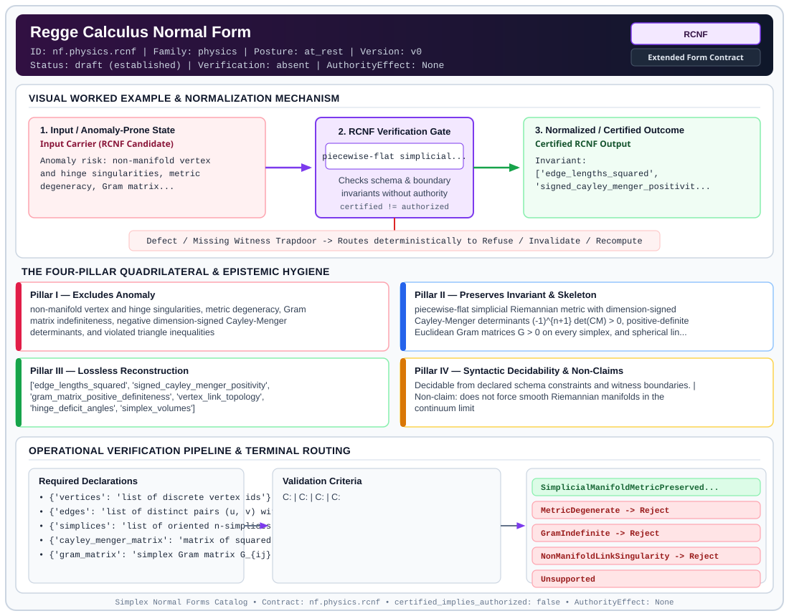

# Regge Calculus Normal Form (`RCNF`)

> **Contract ID:** `nf.physics.rcnf` | **Family:** `physics` | **Index Status:** `draft` | **AuthorityEffect:** `None`

**[⬅ Back to Wiki Home](Home)** | **[View SVG Diagram](images/nf.physics.rcnf.svg)**

---

## 1. Executive Summary & Metadata

Regge Calculus Normal Form (RCNF) enforces structural normalization and explicit defect routing in the physics regime.

| Property | Value |
| :--- | :--- |
| **Canonical ID** | `nf.physics.rcnf` |
| **Short Name** | `RCNF` |
| **Full Name** | Regge Calculus Normal Form |
| **Family** | `physics` (Discrete Differential Geometry, Regge Calculus, Gauge Theory, Lattice Fermions & Quantum Gravity) |
| **Qualification** | Extended Form Contract (Normal Form Contract) |
| **Data / Math Posture** | at_rest |
| **Index Status** | `draft` |
| **Theory Status** | `established` |
| **Verification Status** | `absent` |
| **Contract Version** | `v0` |
| **Governance Fence** | `AuthorityEffect: None` (`certified_implies_authorized: false`) |

---

## 2. Visual Architecture & Normalization Diagram



---

## 3. Concrete Worked Example & Mechanism

### Visual Transition Summary

| Stage | Carrier / Operator | Concrete State / Invariant |
| :--- | :--- | :--- |
| **1. Before / Candidate Input** | `Input Carrier (RCNF Candidate)` | Anomaly risk: non-manifold vertex ; and hinge singularities, metric ; degeneracy, Gram matrix... |
| **2. Normalization / Gate** | `RCNF Verification Gate` | `piecewise-flat simplicial...` (`certified_implies_authorized: false`) |
| **3. After / Certified Output** | `Certified RCNF Output` | Invariant: ; ['edge_lengths_squared', ; 'signed_cayley_menger_positivit... |

---

## 4. The Four-Pillar Quadrilateral & Non-Claims

Every contract in `simplex-normal-forms` is evaluated against the **Four-Pillar Quadrilateral** defined in `contracts/_golden_nfs/standard.yaml`:

| Pillar | Requirement | Contract Specification for `nf.physics.rcnf` |
| :--- | :--- | :--- |
| **Pillar I: Excludes Anomaly** | Name and eliminate a specific class of data or state defects. | non-manifold vertex and hinge singularities, metric degeneracy, Gram matrix indefiniteness, negative dimension-signed Cayley-Menger determinants, and violated triangle inequalities |
| **Pillar II: Preserves Invariant** | State the structural invariant and protected skeleton preserved across transitions. | **Invariant:** piecewise-flat simplicial Riemannian metric with dimension-signed Cayley-Menger determinants (-1)^{n+1} det(CM) > 0, positive-definite Euclidean Gram matrices G > 0 on every simplex, and spherical link complexes Lk(v) ~= S^{n-1}<br>**Protected Skeleton:** ['edge_lengths_squared', 'signed_cayley_menger_positivity', 'gram_matrix_positive_definiteness', 'vertex_link_topology', 'hinge_deficit_angles', 'simplex_volumes'] |
| **Pillar III: Lossless Reconstruction** | State the non-loss reconstruction operator (join, direct sum, pullback, or replay). | Lossless reconstruction under declared projection, direct sum, or pullback operators. |
| **Pillar IV: Syntactic Decidability** | State how conformance is decided from declared constraints without unbudgeted scans. | Decidable from declared schema and witness metadata within bounded evaluation budgets. |

### Explicit Non-Claims (`certified_implies_authorized: false`)

- does not force smooth Riemannian manifolds in the continuum limit
- does not eliminate topological singularities or coordinate gauge redundancies
- hinge star checks alone do not establish manifoldhood; vertex links must be explicitly verified against spherical topologies to exclude suspensions of non-spherical manifolds

---

## 5. Operational Verification & Terminal Routing

### 5.1 Required Declarations

- **vertices**: list of discrete vertex ids
- **edges**: list of distinct pairs (u, v) with squared lengths l_e^2 > 0
- **simplices**: list of oriented n-simplices
- **cayley_menger_matrix**: matrix of squared distances
- **gram_matrix**: simplex Gram matrix G_{ij} = (l_{0i}^2 + l_{0j}^2 - l_{ij}^2) / 2
- **manifold_class**: declared manifold dimension n and boundary specification (closed or manifold-with-boundary)

### 5.2 Required Evidence

- **vertices**: list
- **edges**: list
- **simplices**: list
- **squared_edge_lengths**: dict
- **gram_matrices**: list
- **gram_principal_minors_positive**: boolean
- **signed_cm_determinants_positive**: boolean
- **vertex_link_spherical_witnesses**: list
- **hinge_link_circle_witnesses**: list

### 5.3 Validation Criteria

| Criterion ID | Name | Condition |
| :--- | :--- | :--- |
| `` | **** |  |
| `` | **** |  |
| `` | **** |  |
| `` | **** |  |
| `` | **** |  |
| `` | **** |  |

### 5.4 Terminal Route Map

Every evaluation terminates in a declared local route mapped to a canonical terminal in `standard.yaml`:

| Local Terminal Route | Canonical Terminal |
| :--- | :--- |
| `SimplicialManifoldMetricPreserved` | `Preserve` |
| `MetricDegenerate` | `Reject` |
| `GramIndefinite` | `Reject` |
| `NonManifoldLinkSingularity` | `Reject` |
| `Unsupported` | `Unsupported` |

### 5.5 Declared Failure Modes

_All defects route explicitly through the Terminal Route Map above._

---

## 6. Epistemic Claim Hygiene Quadrant

In accordance with the repository's epistemic claim discipline:

1. **What it supports:**
   - Supports syntactic and operational checking of `nf.physics.rcnf` (`RCNF`) against its declared schema, boundary constraints, and witness obligations in this model.
   - Supports deterministic terminal routing (`SimplicialManifoldMetricPreserved, MetricDegenerate, GramIndefinite, NonManifoldLinkSingularity`) when required declarations or invariants fail.
2. **What it does not support:**
   - Does not confer operational authority (`AuthorityEffect: None`, `certified_implies_authorized: false`).
   - Does not claim semantic truth of undeclared external processes or unverified upstream inputs beyond the declaredprotected skeleton.
3. **The narrowest defensible claim:**
   - Within the declared substrate `at_rest`, this contract enforces that `non-manifold vertex and hinge singularities, metric degeneracy, Gram matrix indefiniteness, negative dimension-signed Cayley-Menger determinants, and violated triangle inequalities` is either excluded under `piecewise-flat simplicial Riemannian metric with dimension-signed Cayley-Menger determinants (-1)^{n+1} det(CM) > 0, positive-definite Euclidean Gram matrices G > 0 on every simplex, and spherical link complexes Lk(v) ~= S^{n-1}` or routed to an explicit refusal/recovery terminal.
4. **The next test needed:**
   - Property-based falsification and mutation testing across boundary edge cases and composed multi-step pipelines for `nf.physics.rcnf`.

---

## 7. Canonical YAML Contract (`contracts/nf.physics.rcnf.yaml`)

<details>
<summary><strong>Click to expand full canonical YAML contract (contracts/nf.physics.rcnf.yaml)</strong></summary>

```yaml
schema_version: smplx.nf.contract.v0
contract_kind: normal_form_contract
identity:
  id: nf.physics.rcnf
  name: Regge Calculus Normal Form
  short_name: RCNF
  version: v0
  theory_status: established
  contract_status: draft
  verification_status: absent
  family: physics
  status: draft
classification:
  hierarchy_level: normal_form
  subject_kind:
  - simplicial_complex
  - metric_geometry
  data_posture: at_rest
  mathematical_posture: formal_algebraic
purpose:
  excludes_anomaly: non-manifold vertex and hinge singularities, metric degeneracy,
    Gram matrix indefiniteness, negative dimension-signed Cayley-Menger determinants,
    and violated triangle inequalities
  preserves_invariant: piecewise-flat simplicial Riemannian metric with dimension-signed
    Cayley-Menger determinants (-1)^{n+1} det(CM) > 0, positive-definite Euclidean
    Gram matrices G > 0 on every simplex, and spherical link complexes Lk(v) ~= S^{n-1}
  protected_skeleton:
  - edge_lengths_squared
  - signed_cayley_menger_positivity
  - gram_matrix_positive_definiteness
  - vertex_link_topology
  - hinge_deficit_angles
  - simplex_volumes
  erased_structure:
  - continuous_smooth_coordinates
  non_claims:
  - does not force smooth Riemannian manifolds in the continuum limit
  - does not eliminate topological singularities or coordinate gauge redundancies
  - hinge star checks alone do not establish manifoldhood; vertex links must be explicitly
    verified against spherical topologies to exclude suspensions of non-spherical manifolds
declarations_required:
- vertices: list of discrete vertex ids
- edges: list of distinct pairs (u, v) with squared lengths l_e^2 > 0
- simplices: list of oriented n-simplices
- cayley_menger_matrix: matrix of squared distances
- gram_matrix: simplex Gram matrix G_{ij} = (l_{0i}^2 + l_{0j}^2 - l_{ij}^2) / 2
- manifold_class: declared manifold dimension n and boundary specification (closed or manifold-with-boundary)
validation_criteria:
- metric_positivity: every edge length l_e is strictly positive
- triangle_inequality: for every triangle (e1, e2, e3), l1 + l2 > l3 and cyclic permutations hold
- volume_positivity: Cayley-Menger determinant det(CM) satisfies (-1)^{n+1} det(CM) > 0 for every n-simplex
- gram_positive_definiteness: for every n-simplex, the Gram matrix G relative to vertex v_0 is strictly positive-definite (all principal minors strictly positive)
- vertex_link_manifoldhood: for every vertex v, the link complex Lk(v) is piecewise-linearly homeomorphic to S^{n-1} (or B^{n-1} if boundary)
- hinge_link_regularity: every codimension-2 hinge has a link PL homeomorphic to S^1 (or I if boundary) without branch cuts
terminal_routes:
- SimplicialManifoldMetricPreserved
- MetricDegenerate
- GramIndefinite
- NonManifoldLinkSingularity
- Unsupported
terminal_route_map:
  SimplicialManifoldMetricPreserved: Preserve
  MetricDegenerate: Reject
  GramIndefinite: Reject
  NonManifoldLinkSingularity: Reject
  Unsupported: Unsupported
extensions:
  condition_to_local_route_map:
    all_valid: SimplicialManifoldMetricPreserved
    negative_volume: MetricDegenerate
    gram_indefinite: GramIndefinite
    link_singularity: NonManifoldLinkSingularity
definition:
  source: coda_all_universe/mssn_sn_tower/definitions.md
  formal_statement: Piecewise-flat simplicial Riemannian metric with dimension-signed
    Cayley-Menger determinants (-1)^{n+1} det(CM) > 0, strictly positive-definite
    Gram matrices G > 0, and spherical vertex links Lk(v) preserving PL manifoldhood.
  quadrilateral:
    qualifies_as_true_normal_form: false
    qualification_gap: reconstruction_is_not_a_relational_project_join
    anomaly_exclusion: non-manifold vertex and hinge singularities, metric degeneracy,
      Gram matrix indefiniteness, and negative dimension-signed Cayley-Menger determinants
    lossless_join:
      status: declared_reconstruction
      statement: piecewise-flat simplicial Riemannian metric with dimension-signed
        Cayley-Menger determinants and positive-definite Gram matrices
    dependency_preservation:
      status: declared_with_the_invariant
      statement: The preserved invariant stays on the declared schema. This form does
        not state a functional-dependency projection of a flat relvar decomposition.
    syntactic_decision:
      status: declaration_decidable
      statement: The check reads the declared constraints and validation criteria.
        One unrecorded runtime image is not the decider.
canonical_terminal_map:
  SimplicialManifoldMetricPreserved: Preserve
  MetricDegenerate: Reject
  GramIndefinite: Reject
  NonManifoldLinkSingularity: Reject
  Unsupported: Unsupported
authorization:
  authorized_by: null
  certified_implies_authorized: false
certification:
  certificate_required: true
  certificate_kind: nf.physics.rcnf_certificate
  obstruction_class_required: false
  loss_ledger_required: false
  loss_ledger_trigger_id: null
  verifier_required: true
evidence_required:
- vertices: list
- edges: list
- simplices: list
- squared_edge_lengths: dict
- gram_matrices: list
- gram_principal_minors_positive: boolean
- signed_cm_determinants_positive: boolean
- vertex_link_spherical_witnesses: list
- hinge_link_circle_witnesses: list
schema_ref: ./normal_form_contract_schema.yaml
```

</details>
