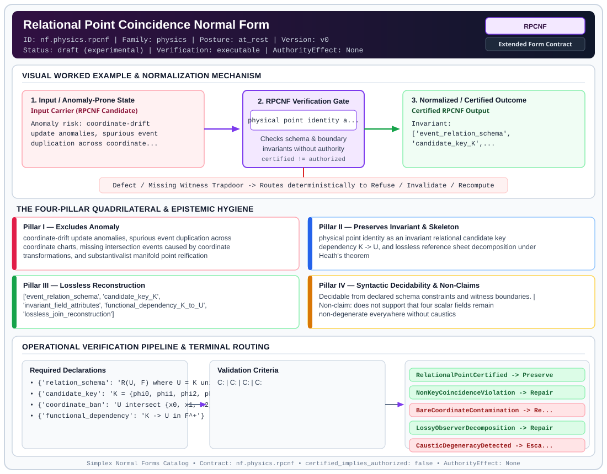

# Relational Point Coincidence Normal Form (`RPCNF`)

> **Contract ID:** `nf.physics.rpcnf` | **Family:** `physics` | **Index Status:** `draft` | **AuthorityEffect:** `None`

**[⬅ Back to Wiki Home](Home)** | **[View SVG Diagram](images/nf.physics.rpcnf.svg)**

---

## 1. Executive Summary & Metadata

Relational Point Coincidence Normal Form (RPCNF) enforces structural normalization and explicit defect routing in the physics regime.

| Property | Value |
| :--- | :--- |
| **Canonical ID** | `nf.physics.rpcnf` |
| **Short Name** | `RPCNF` |
| **Full Name** | Relational Point Coincidence Normal Form |
| **Family** | `physics` (Discrete Differential Geometry, Regge Calculus, Gauge Theory, Lattice Fermions & Quantum Gravity) |
| **Qualification** | Extended Form Contract (Normal Form Contract) |
| **Data / Math Posture** | at_rest |
| **Index Status** | `draft` |
| **Theory Status** | `experimental` |
| **Verification Status** | `executable` |
| **Contract Version** | `v0` |
| **Governance Fence** | `AuthorityEffect: None` (`certified_implies_authorized: false`) |

---

## 2. Visual Architecture & Normalization Diagram



---

## 3. Concrete Worked Example & Mechanism

### Visual Transition Summary

| Stage | Carrier / Operator | Concrete State / Invariant |
| :--- | :--- | :--- |
| **1. Before / Candidate Input** | `Input Carrier (RPCNF Candidate)` | Anomaly risk: coordinate-drift ; update anomalies, spurious event ; duplication across coordinate... |
| **2. Normalization / Gate** | `RPCNF Verification Gate` | `physical point identity a...` (`certified_implies_authorized: false`) |
| **3. After / Certified Output** | `Certified RPCNF Output` | Invariant: ; ['event_relation_schema', ; 'candidate_key_K',... |

---

## 4. The Four-Pillar Quadrilateral & Non-Claims

Every contract in `simplex-normal-forms` is evaluated against the **Four-Pillar Quadrilateral** defined in `contracts/_golden_nfs/standard.yaml`:

| Pillar | Requirement | Contract Specification for `nf.physics.rpcnf` |
| :--- | :--- | :--- |
| **Pillar I: Excludes Anomaly** | Name and eliminate a specific class of data or state defects. | coordinate-drift update anomalies, spurious event duplication across coordinate charts, missing intersection events caused by coordinate transformations, and substantivalist manifold point reification |
| **Pillar II: Preserves Invariant** | State the structural invariant and protected skeleton preserved across transitions. | **Invariant:** physical point identity as an invariant relational candidate key dependency K -> U, and lossless reference sheet decomposition under Heath's theorem<br>**Protected Skeleton:** ['event_relation_schema', 'candidate_key_K', 'invariant_field_attributes', 'functional_dependency_K_to_U', 'lossless_join_reconstruction'] |
| **Pillar III: Lossless Reconstruction** | State the non-loss reconstruction operator (join, direct sum, pullback, or replay). | Lossless reconstruction under declared projection, direct sum, or pullback operators. |
| **Pillar IV: Syntactic Decidability** | State how conformance is decided from declared constraints without unbudgeted scans. | Decidable from declared schema and witness metadata within bounded evaluation budgets. |

### Explicit Non-Claims (`certified_implies_authorized: false`)

- does not support that four scalar fields remain non-degenerate everywhere without caustics
- does not derive continuous Einstein manifolds from discrete relational tuples
- does not solve quantum gravity
- does not ensure under declared assumptions observer agreement on instrument calibration

---

## 5. Operational Verification & Terminal Routing

### 5.1 Required Declarations

- **relation_schema**: R(U, F) where U = K union A
- **candidate_key**: K = {phi0, phi1, phi2, phi3} with |K| = 4
- **coordinate_ban**: U intersect {x0, x1, x2, x3} = empty_set
- **functional_dependency**: K -> U in F^+

### 5.2 Required Evidence

- **relation_attributes**: list
- **candidate_key**: list
- **functional_dependencies**: list
- **coordinate_free_verified**: boolean
- **candidate_key_verified**: boolean
- **heaths_lossless_join_verified**: boolean

### 5.3 Validation Criteria

| Criterion ID | Name | Condition |
| :--- | :--- | :--- |
| `` | **** |  |
| `` | **** |  |
| `` | **** |  |
| `` | **** |  |
| `` | **** |  |

### 5.4 Terminal Route Map

Every evaluation terminates in a declared local route mapped to a canonical terminal in `standard.yaml`:

| Local Terminal Route | Canonical Terminal |
| :--- | :--- |
| `RelationalPointCertified` | `Preserve` |
| `NonKeyCoincidenceViolation` | `Repair` |
| `BareCoordinateContamination` | `Refuse` |
| `LossyObserverDecomposition` | `Repair` |
| `CausticDegeneracyDetected` | `Escalate` |
| `Unsupported` | `Unsupported` |

### 5.5 Declared Failure Modes

_All defects route explicitly through the Terminal Route Map above._

---

## 6. Epistemic Claim Hygiene Quadrant

In accordance with the repository's epistemic claim discipline:

1. **What it supports:**
   - Supports syntactic and operational checking of `nf.physics.rpcnf` (`RPCNF`) against its declared schema, boundary constraints, and witness obligations in this model.
   - Supports deterministic terminal routing (`RelationalPointCertified, NonKeyCoincidenceViolation, BareCoordinateContamination, LossyObserverDecomposition`) when required declarations or invariants fail.
2. **What it does not support:**
   - Does not confer operational authority (`AuthorityEffect: None`, `certified_implies_authorized: false`).
   - Does not claim semantic truth of undeclared external processes or unverified upstream inputs beyond the declaredprotected skeleton.
3. **The narrowest defensible claim:**
   - Within the declared substrate `at_rest`, this contract enforces that `coordinate-drift update anomalies, spurious event duplication across coordinate charts, missing intersection events caused by coordinate transformations, and substantivalist manifold point reification` is either excluded under `physical point identity as an invariant relational candidate key dependency K -> U, and lossless reference sheet decomposition under Heath's theorem` or routed to an explicit refusal/recovery terminal.
4. **The next test needed:**
   - Property-based falsification and mutation testing across boundary edge cases and composed multi-step pipelines for `nf.physics.rpcnf`.

---

## 7. Canonical YAML Contract (`contracts/nf.physics.rpcnf.yaml`)

<details>
<summary><strong>Click to expand full canonical YAML contract (contracts/nf.physics.rpcnf.yaml)</strong></summary>

```yaml
schema_version: smplx.nf.contract.v0
contract_kind: normal_form_contract
identity:
  id: nf.physics.rpcnf
  name: Relational Point Coincidence Normal Form
  short_name: RPCNF
  version: v0
  theory_status: experimental
  contract_status: draft
  verification_status: executable
  family: physics
  status: draft
classification:
  hierarchy_level: normal_form
  subject_kind:
  - spacetime_events
  - relational_algebra
  - point_coincidences
  data_posture: at_rest
  mathematical_posture: formal_algebraic
purpose:
  excludes_anomaly: coordinate-drift update anomalies, spurious event duplication across
    coordinate charts, missing intersection events caused by coordinate transformations,
    and substantivalist manifold point reification
  preserves_invariant: physical point identity as an invariant relational candidate key
    dependency K -> U, and lossless reference sheet decomposition under Heath's theorem
  protected_skeleton:
  - event_relation_schema
  - candidate_key_K
  - invariant_field_attributes
  - functional_dependency_K_to_U
  - lossless_join_reconstruction
  erased_structure:
  - bare_manifold_coordinates_x_mu
  - chart_transition_functions
  - unobservable_gauge_labels
  non_claims:
  - does not support that four scalar fields remain non-degenerate everywhere without caustics
  - does not derive continuous Einstein manifolds from discrete relational tuples
  - does not solve quantum gravity
  - does not ensure under declared assumptions observer agreement on instrument calibration
declarations_required:
- relation_schema: R(U, F) where U = K union A
- candidate_key: K = {phi0, phi1, phi2, phi3} with |K| = 4
- coordinate_ban: U intersect {x0, x1, x2, x3} = empty_set
- functional_dependency: K -> U in F^+
validation_criteria:
- first_normal_form_check: all attribute domains consist of atomic rational or discrete scalars
- key_minimality_check: exactly four scalar fields form K, with no proper subset determining U
- coordinate_absence_check: no bare manifold coordinates appear in the schema attribute set
- coincidence_determinism_check: all non-trivial functional dependencies X -> Y have X as a superkey
- lossless_decomposition_check: Heath's theorem r = pi_{KA}(r) bowtie pi_{KB}(r) holds exactly
terminal_routes:
- RelationalPointCertified
- NonKeyCoincidenceViolation
- BareCoordinateContamination
- LossyObserverDecomposition
- CausticDegeneracyDetected
- Unsupported
terminal_route_map:
  RelationalPointCertified: Preserve
  NonKeyCoincidenceViolation: Repair
  BareCoordinateContamination: Refuse
  LossyObserverDecomposition: Repair
  CausticDegeneracyDetected: Escalate
  Unsupported: Unsupported
definition:
  source: omega_engine_atlas/coda_atlas/F004_papers/004_general_relativity/003_relational_point_coincidence_and_witnessed_difference
  formal_statement: A spacetime field relation schema R(U, F) is in Relational Point Coincidence
    Normal Form (RPCNF) iff U contains no bare manifold coordinates, there exists a minimal
    four-attribute candidate key K = {phi0, phi1, phi2, phi3} such that K -> U in F^+, and every
    decomposition across observer sheets overlapping on K is lossless under Heath's theorem.
  quadrilateral:
    qualifies_as_true_normal_form: false
    qualification_gap: a draft contract is not a true normal form
    anomaly_exclusion: coordinate-dependent update and insertion anomalies
    lossless_join:
      status: heath
      statement: For any decomposition R1 = pi_{K union A}(R), R2 = pi_{K union B}(R),
        the join R1 bowtie R2 = R is strictly lossless because K is a candidate key.
    dependency_preservation:
      status: preserved_on_key_projection
      statement: All non-trivial functional dependencies are determined by candidate key K.
    syntactic_decision:
      status: schema_decidable
      statement: Decidable by testing functional dependencies on schema F and attribute set U.
canonical_terminal_map:
  RelationalPointCertified: Preserve
  NonKeyCoincidenceViolation: Repair
  BareCoordinateContamination: Refuse
  LossyObserverDecomposition: Repair
  CausticDegeneracyDetected: Escalate
  Unsupported: Unsupported
authorization:
  authorized_by: null
  certified_implies_authorized: false
certification:
  certificate_required: true
  certificate_kind: nf.physics.rpcnf_certificate
  obstruction_class_required: false
  loss_ledger_required: false
  loss_ledger_trigger_id: null
  verifier_required: true
evidence_required:
- relation_attributes: list
- candidate_key: list
- functional_dependencies: list
- coordinate_free_verified: boolean
- candidate_key_verified: boolean
- heaths_lossless_join_verified: boolean
schema_ref: ./normal_form_contract_schema.yaml
```

</details>
