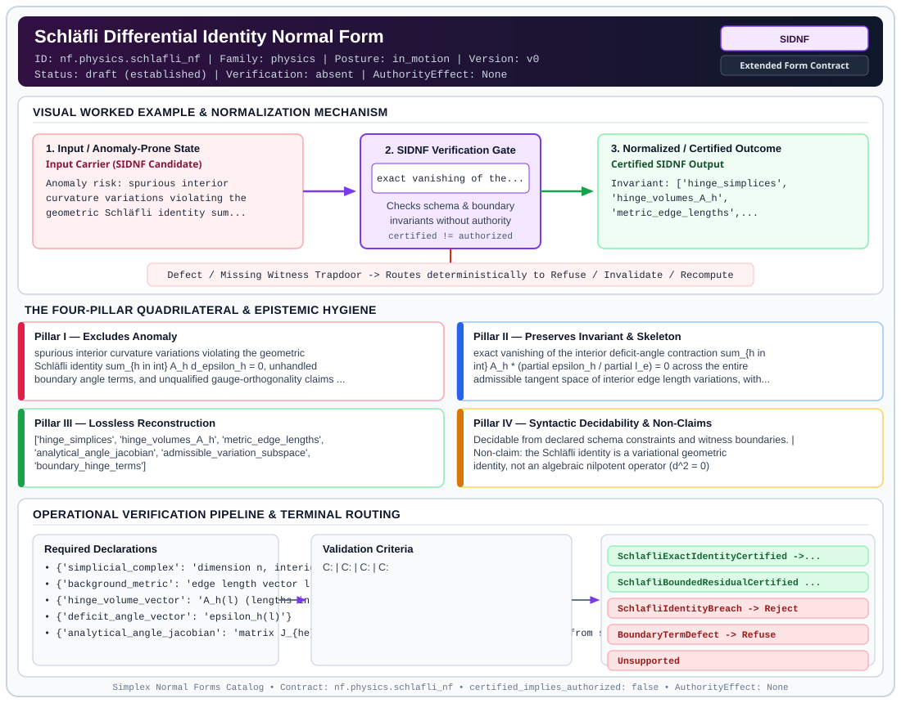

# Schläfli Differential Identity Normal Form (`SIDNF`)

> **Contract ID:** `nf.physics.schlafli_nf` | **Family:** `physics` | **Index Status:** `draft` | **AuthorityEffect:** `None`

**[⬅ Back to Wiki Home](Home)** | **[View SVG Diagram](images/nf.physics.schlafli_nf.svg)**

---

## 1. Executive Summary & Metadata

Schläfli Differential Identity Normal Form (SIDNF) enforces structural normalization and explicit defect routing in the physics regime.

| Property | Value |
| :--- | :--- |
| **Canonical ID** | `nf.physics.schlafli_nf` |
| **Short Name** | `SIDNF` |
| **Full Name** | Schläfli Differential Identity Normal Form |
| **Family** | `physics` (Discrete Differential Geometry, Regge Calculus, Gauge Theory, Lattice Fermions & Quantum Gravity) |
| **Qualification** | Extended Form Contract (Normal Form Contract) |
| **Data / Math Posture** | in_motion |
| **Index Status** | `draft` |
| **Theory Status** | `established` |
| **Verification Status** | `absent` |
| **Contract Version** | `v0` |
| **Governance Fence** | `AuthorityEffect: None` (`certified_implies_authorized: false`) |

---

## 2. Visual Architecture & Normalization Diagram



---

## 3. Concrete Worked Example & Mechanism

### Visual Transition Summary

| Stage | Carrier / Operator | Concrete State / Invariant |
| :--- | :--- | :--- |
| **1. Before / Candidate Input** | `Input Carrier (SIDNF Candidate)` | Anomaly risk: spurious interior ; curvature variations violating the ; geometric Schläfli identity sum... |
| **2. Normalization / Gate** | `SIDNF Verification Gate` | `exact vanishing of the...` (`certified_implies_authorized: false`) |
| **3. After / Certified Output** | `Certified SIDNF Output` | Invariant: ['hinge_simplices', ; 'hinge_volumes_A_h', ; 'metric_edge_lengths',... |

---

## 4. The Four-Pillar Quadrilateral & Non-Claims

Every contract in `simplex-normal-forms` is evaluated against the **Four-Pillar Quadrilateral** defined in `contracts/_golden_nfs/standard.yaml`:

| Pillar | Requirement | Contract Specification for `nf.physics.schlafli_nf` |
| :--- | :--- | :--- |
| **Pillar I: Excludes Anomaly** | Name and eliminate a specific class of data or state defects. | spurious interior curvature variations violating the geometric Schläfli identity sum_{h in int} A_h d_epsilon_h = 0, unhandled boundary angle terms, and unqualified gauge-orthogonality claims on curved simplicial geometries |
| **Pillar II: Preserves Invariant** | State the structural invariant and protected skeleton preserved across transitions. | **Invariant:** exact vanishing of the interior deficit-angle contraction sum_{h in int} A_h * (partial epsilon_h / partial l_e) = 0 across the entire admissible tangent space of interior edge length variations, with explicit boundary variation accounting<br>**Protected Skeleton:** ['hinge_simplices', 'hinge_volumes_A_h', 'metric_edge_lengths', 'analytical_angle_jacobian', 'admissible_variation_subspace', 'boundary_hinge_terms'] |
| **Pillar III: Lossless Reconstruction** | State the non-loss reconstruction operator (join, direct sum, pullback, or replay). | Lossless reconstruction under declared projection, direct sum, or pullback operators. |
| **Pillar IV: Syntactic Decidability** | State how conformance is decided from declared constraints without unbudgeted scans. | Decidable from declared schema and witness metadata within bounded evaluation budgets. |

### Explicit Non-Claims (`certified_implies_authorized: false`)

- the Schläfli identity is a variational geometric identity, not an algebraic nilpotent operator (d^2 = 0)
- curved Regge configurations do not generally retain the exact discrete gauge symmetries of flat configurations; gauge-orthogonality holds only when an explicit discrete gauge zero-mode witness is supplied
- evaluating a single numerical perturbation does not establish validity for all perturbations; the contracted gradient vector A^T J_epsilon must vanish across all interior variations
- exact identity satisfaction must be distinguished from bounded numerical tolerance residuals

---

## 5. Operational Verification & Terminal Routing

### 5.1 Required Declarations

- **simplicial_complex**: dimension n, interior hinges H_int, boundary hinges H_bdry
- **background_metric**: edge length vector l in R_{>0}^E
- **hinge_volume_vector**: A_h(l) (lengths in 3D, triangle areas in 4D)
- **deficit_angle_vector**: epsilon_h(l)
- **analytical_angle_jacobian**: matrix J_{he} = partial epsilon_h / partial l_e derived from simplex dihedral angles
- **variation_subspace**: tangent space T_l M of admissible interior edge variations dl

### 5.2 Required Evidence

- **simplicial_complex_dimension**: integer
- **interior_hinges**: list
- **boundary_hinges**: list
- **edge_lengths**: list
- **hinge_volumes**: list
- **analytical_angle_jacobian**: list
- **schlafli_contraction_vector**: list
- **contraction_infinity_norm**: float
- **boundary_variation_witness**: dict
- **gauge_symmetry_witness**: {'present': 'boolean', 'zero_modes': 'list'}

### 5.3 Validation Criteria

| Criterion ID | Name | Condition |
| :--- | :--- | :--- |
| `` | **** |  |
| `` | **** |  |
| `` | **** |  |
| `` | **** |  |

### 5.4 Terminal Route Map

Every evaluation terminates in a declared local route mapped to a canonical terminal in `standard.yaml`:

| Local Terminal Route | Canonical Terminal |
| :--- | :--- |
| `SchlafliExactIdentityCertified` | `Preserve` |
| `SchlafliBoundedResidualCertified` | `Repair` |
| `SchlafliIdentityBreach` | `Reject` |
| `BoundaryTermDefect` | `Refuse` |
| `Unsupported` | `Unsupported` |

### 5.5 Declared Failure Modes

_All defects route explicitly through the Terminal Route Map above._

---

## 6. Epistemic Claim Hygiene Quadrant

In accordance with the repository's epistemic claim discipline:

1. **What it supports:**
   - Supports syntactic and operational checking of `nf.physics.schlafli_nf` (`SIDNF`) against its declared schema, boundary constraints, and witness obligations in this model.
   - Supports deterministic terminal routing (`SchlafliExactIdentityCertified, SchlafliBoundedResidualCertified, SchlafliIdentityBreach, BoundaryTermDefect`) when required declarations or invariants fail.
2. **What it does not support:**
   - Does not confer operational authority (`AuthorityEffect: None`, `certified_implies_authorized: false`).
   - Does not claim semantic truth of undeclared external processes or unverified upstream inputs beyond the declaredprotected skeleton.
3. **The narrowest defensible claim:**
   - Within the declared substrate `in_motion`, this contract enforces that `spurious interior curvature variations violating the geometric Schläfli identity sum_{h in int} A_h d_epsilon_h = 0, unhandled boundary angle terms, and unqualified gauge-orthogonality claims on curved simplicial geometries` is either excluded under `exact vanishing of the interior deficit-angle contraction sum_{h in int} A_h * (partial epsilon_h / partial l_e) = 0 across the entire admissible tangent space of interior edge length variations, with explicit boundary variation accounting` or routed to an explicit refusal/recovery terminal.
4. **The next test needed:**
   - Property-based falsification and mutation testing across boundary edge cases and composed multi-step pipelines for `nf.physics.schlafli_nf`.

---

## 7. Canonical YAML Contract (`contracts/nf.physics.schlafli_nf.yaml`)

<details>
<summary><strong>Click to expand full canonical YAML contract (contracts/nf.physics.schlafli_nf.yaml)</strong></summary>

```yaml
schema_version: smplx.nf.contract.v0
contract_kind: normal_form_contract
identity:
  id: nf.physics.schlafli_nf
  name: Schläfli Differential Identity Normal Form
  short_name: SIDNF
  version: v0
  theory_status: established
  contract_status: draft
  verification_status: absent
  family: physics
  status: draft
classification:
  hierarchy_level: normal_form
  subject_kind:
  - schlafli_differential_identity
  - metric_variation
  - regge_geometry
  data_posture: in_motion
  mathematical_posture: formal_algebraic
purpose:
  excludes_anomaly: spurious interior curvature variations violating the geometric
    Schläfli identity sum_{h in int} A_h d_epsilon_h = 0, unhandled boundary angle
    terms, and unqualified gauge-orthogonality claims on curved simplicial geometries
  preserves_invariant: exact vanishing of the interior deficit-angle contraction sum_{h
    in int} A_h * (partial epsilon_h / partial l_e) = 0 across the entire admissible
    tangent space of interior edge length variations, with explicit boundary variation
    accounting
  protected_skeleton:
  - hinge_simplices
  - hinge_volumes_A_h
  - metric_edge_lengths
  - analytical_angle_jacobian
  - admissible_variation_subspace
  - boundary_hinge_terms
  erased_structure:
  - arbitrary_unbounded_heuristic_perturbations
  non_claims:
  - the Schläfli identity is a variational geometric identity, not an algebraic nilpotent
    operator (d^2 = 0)
  - curved Regge configurations do not generally retain the exact discrete gauge symmetries
    of flat configurations; gauge-orthogonality holds only when an explicit discrete
    gauge zero-mode witness is supplied
  - evaluating a single numerical perturbation does not establish validity for all
    perturbations; the contracted gradient vector A^T J_epsilon must vanish across
    all interior variations
  - exact identity satisfaction must be distinguished from bounded numerical tolerance
    residuals
declarations_required:
- simplicial_complex: dimension n, interior hinges H_int, boundary hinges H_bdry
- background_metric: edge length vector l in R_{>0}^E
- hinge_volume_vector: A_h(l) (lengths in 3D, triangle areas in 4D)
- deficit_angle_vector: epsilon_h(l)
- analytical_angle_jacobian: matrix J_{he} = partial epsilon_h / partial l_e derived from simplex dihedral angles
- variation_subspace: tangent space T_l M of admissible interior edge variations dl
validation_criteria:
- exact_schlafli_contraction: interior contraction c_e = sum_{h in H_int} A_h * (partial epsilon_h / partial l_e) vanishes identically (c_e == 0) across all interior edges e
- bounded_numerical_residual: when evaluated under finite arithmetic, ||c||_infty <= tau_residual with declared tolerance tau_residual
- boundary_term_accounting: any non-vanishing total variation matches declared boundary hinge variations sum_{h in H_bdry} A_h d_theta_h
- gauge_symmetry_witness_check: if gauge invariance is asserted, verify explicit zero-mode kernel witness of the discrete Regge Hessian
terminal_routes:
- SchlafliExactIdentityCertified
- SchlafliBoundedResidualCertified
- SchlafliIdentityBreach
- BoundaryTermDefect
- Unsupported
terminal_route_map:
  SchlafliExactIdentityCertified: Preserve
  SchlafliBoundedResidualCertified: Repair
  SchlafliIdentityBreach: Reject
  BoundaryTermDefect: Refuse
  Unsupported: Unsupported
extensions:
  condition_to_local_route_map:
    exact_zero_contraction: SchlafliExactIdentityCertified
    bounded_tolerance_residual: SchlafliBoundedResidualCertified
    non_zero_unaccounted_contraction: SchlafliIdentityBreach
    unhandled_boundary_variations: BoundaryTermDefect
definition:
  source: coda_all_universe/mssn_sn_tower/definitions.md
  formal_statement: The Schläfli differential identity normal form asserts that the
    contraction of interior deficit angle differentials with hinge volumes vanishes
    sum_{h in int} A_h d_epsilon_h = 0 for any interior metric perturbation, ensuring
    the Einstein-Regge equations of motion depend purely on deficit angles without
    spurious variation terms.
  quadrilateral:
    qualifies_as_true_normal_form: false
    qualification_gap: reconstruction_is_not_a_relational_project_join
    anomaly_exclusion: spurious interior curvature variations violating the geometric
      Schläfli identity and unhandled boundary angle variations
    lossless_join:
      status: declared_reconstruction
      statement: vanishing of interior deficit-angle variations across the interior
        tangent space
    dependency_preservation:
      status: declared_with_the_invariant
      statement: The preserved invariant stays on the declared schema. This form does
        not state a functional-dependency projection of a flat relvar decomposition.
    syntactic_decision:
      status: declaration_decidable
      statement: The check reads the declared constraints and validation criteria.
        One unrecorded runtime image is not the decider.
canonical_terminal_map:
  SchlafliExactIdentityCertified: Preserve
  SchlafliBoundedResidualCertified: Repair
  SchlafliIdentityBreach: Reject
  BoundaryTermDefect: Refuse
  Unsupported: Unsupported
authorization:
  authorized_by: null
  certified_implies_authorized: false
certification:
  certificate_required: true
  certificate_kind: nf.physics.schlafli_nf_certificate
  obstruction_class_required: false
  loss_ledger_required: false
  loss_ledger_trigger_id: null
  verifier_required: true
evidence_required:
- simplicial_complex_dimension: integer
- interior_hinges: list
- boundary_hinges: list
- edge_lengths: list
- hinge_volumes: list
- analytical_angle_jacobian: list
- schlafli_contraction_vector: list
- contraction_infinity_norm: float
- boundary_variation_witness: dict
- gauge_symmetry_witness: {present: boolean, zero_modes: list}
schema_ref: ./normal_form_contract_schema.yaml
```

</details>
