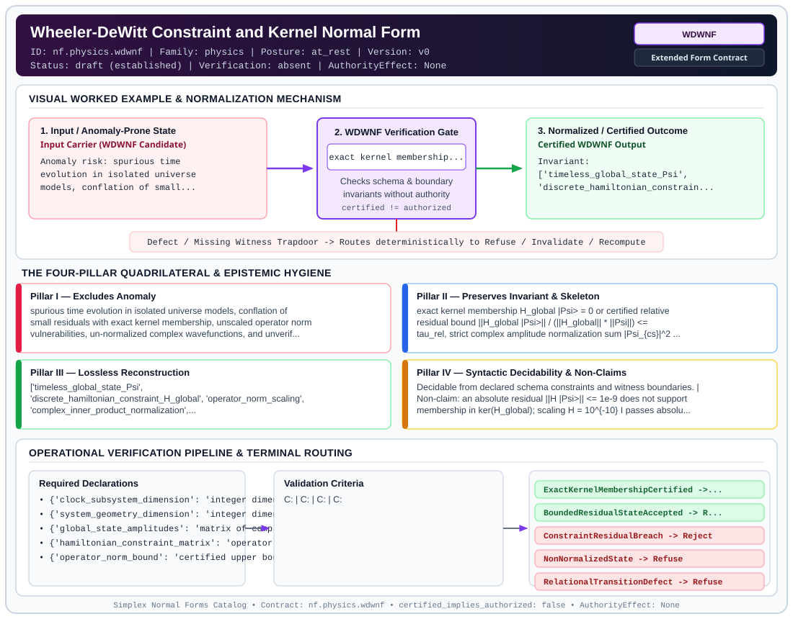

# Wheeler-DeWitt Constraint and Kernel Normal Form (`WDWNF`)

> **Contract ID:** `nf.physics.wdwnf` | **Family:** `physics` | **Index Status:** `draft` | **AuthorityEffect:** `None`

**[⬅ Back to Wiki Home](Home)** | **[View SVG Diagram](images/nf.physics.wdwnf.svg)**

---

## 1. Executive Summary & Metadata

Wheeler-DeWitt Constraint and Kernel Normal Form (WDWNF) enforces structural normalization and explicit defect routing in the physics regime.

| Property | Value |
| :--- | :--- |
| **Canonical ID** | `nf.physics.wdwnf` |
| **Short Name** | `WDWNF` |
| **Full Name** | Wheeler-DeWitt Constraint and Kernel Normal Form |
| **Family** | `physics` (Discrete Differential Geometry, Regge Calculus, Gauge Theory, Lattice Fermions & Quantum Gravity) |
| **Qualification** | Extended Form Contract (Normal Form Contract) |
| **Data / Math Posture** | at_rest |
| **Index Status** | `draft` |
| **Theory Status** | `established` |
| **Verification Status** | `absent` |
| **Contract Version** | `v0` |
| **Governance Fence** | `AuthorityEffect: None` (`certified_implies_authorized: false`) |

---

## 2. Visual Architecture & Normalization Diagram



---

## 3. Concrete Worked Example & Mechanism

### Visual Transition Summary

| Stage | Carrier / Operator | Concrete State / Invariant |
| :--- | :--- | :--- |
| **1. Before / Candidate Input** | `Input Carrier (WDWNF Candidate)` | Anomaly risk: spurious time ; evolution in isolated universe ; models, conflation of small... |
| **2. Normalization / Gate** | `WDWNF Verification Gate` | `exact kernel membership...` (`certified_implies_authorized: false`) |
| **3. After / Certified Output** | `Certified WDWNF Output` | Invariant: ; ['timeless_global_state_Psi', ; 'discrete_hamiltonian_constrain... |

---

## 4. The Four-Pillar Quadrilateral & Non-Claims

Every contract in `simplex-normal-forms` is evaluated against the **Four-Pillar Quadrilateral** defined in `contracts/_golden_nfs/standard.yaml`:

| Pillar | Requirement | Contract Specification for `nf.physics.wdwnf` |
| :--- | :--- | :--- |
| **Pillar I: Excludes Anomaly** | Name and eliminate a specific class of data or state defects. | spurious time evolution in isolated universe models, conflation of small residuals with exact kernel membership, unscaled operator norm vulnerabilities, un-normalized complex wavefunctions, and unverified relational clock transitions |
| **Pillar II: Preserves Invariant** | State the structural invariant and protected skeleton preserved across transitions. | **Invariant:** exact kernel membership H_global |Psi> = 0 or certified relative residual bound ||H_global |Psi>|| / (||H_global|| * ||Psi||) <= tau_rel, strict complex amplitude normalization sum |Psi_{cs}|^2 = 1, and independently certified relational transition operators<br>**Protected Skeleton:** ['timeless_global_state_Psi', 'discrete_hamiltonian_constraint_H_global', 'operator_norm_scaling', 'complex_inner_product_normalization', 'clock_subsystem_decomposition', 'declared_transition_operators'] |
| **Pillar III: Lossless Reconstruction** | State the non-loss reconstruction operator (join, direct sum, pullback, or replay). | Lossless reconstruction under declared projection, direct sum, or pullback operators. |
| **Pillar IV: Syntactic Decidability** | State how conformance is decided from declared constraints without unbudgeted scans. | Decidable from declared schema and witness metadata within bounded evaluation budgets. |

### Explicit Non-Claims (`certified_implies_authorized: false`)

- an absolute residual ||H |Psi>|| <= 1e-9 does not support membership in ker(H_global); scaling H = 10^{-10} I passes absolute residual tests on every unit state while possessing trivial kernel. Relative residual must be scaled by ||H_global||
- satisfying a single discrete Hamiltonian matrix equation does not alone establish diffeomorphism constraint satisfaction or complete gauge invariance
- relational reconstruction requires an explicitly bound clock decomposition and transition operator; it is not an automatic algebraic consequence of the kernel condition
- does not solve the operator ordering ambiguity in continuous field theory
- does not support a unique quantum gravity vacuum state without boundary conditions

---

## 5. Operational Verification & Terminal Routing

### 5.1 Required Declarations

- **clock_subsystem_dimension**: integer dimension d_C with orthonormal basis {|k>_C}
- **system_geometry_dimension**: integer dimension d_S with orthonormal basis {|s>_S}
- **global_state_amplitudes**: matrix of complex amplitudes Psi(c, s) in C^{d_C x d_S}
- **hamiltonian_constraint_matrix**: operator matrix H_global acting on H_C (x) H_S
- **operator_norm_bound**: certified upper bound ||H_global||_op
- **relational_clock_transitions**: sequence of target unitary operators U(k -> k+1) acting on H_S

### 5.2 Required Evidence

- **state_vector_amplitudes**: list
- **state_norm_squared**: float
- **hamiltonian_matrix**: list
- **hamiltonian_operator_norm**: float
- **absolute_residual_norm**: float
- **normalized_relative_residual**: float
- **exact_nullity_witness**: {'exact_zero_mode': 'boolean'}
- **relational_transition_matrices**: list

### 5.3 Validation Criteria

| Criterion ID | Name | Condition |
| :--- | :--- | :--- |
| `` | **** |  |
| `` | **** |  |
| `` | **** |  |
| `` | **** |  |

### 5.4 Terminal Route Map

Every evaluation terminates in a declared local route mapped to a canonical terminal in `standard.yaml`:

| Local Terminal Route | Canonical Terminal |
| :--- | :--- |
| `ExactKernelMembershipCertified` | `Preserve` |
| `BoundedResidualStateAccepted` | `Repair` |
| `ConstraintResidualBreach` | `Reject` |
| `NonNormalizedState` | `Refuse` |
| `RelationalTransitionDefect` | `Refuse` |
| `Unsupported` | `Unsupported` |

### 5.5 Declared Failure Modes

_All defects route explicitly through the Terminal Route Map above._

---

## 6. Epistemic Claim Hygiene Quadrant

In accordance with the repository's epistemic claim discipline:

1. **What it supports:**
   - Supports syntactic and operational checking of `nf.physics.wdwnf` (`WDWNF`) against its declared schema, boundary constraints, and witness obligations in this model.
   - Supports deterministic terminal routing (`ExactKernelMembershipCertified, BoundedResidualStateAccepted, ConstraintResidualBreach, NonNormalizedState`) when required declarations or invariants fail.
2. **What it does not support:**
   - Does not confer operational authority (`AuthorityEffect: None`, `certified_implies_authorized: false`).
   - Does not claim semantic truth of undeclared external processes or unverified upstream inputs beyond the declaredprotected skeleton.
3. **The narrowest defensible claim:**
   - Within the declared substrate `at_rest`, this contract enforces that `spurious time evolution in isolated universe models, conflation of small residuals with exact kernel membership, unscaled operator norm vulnerabilities, un-normalized complex wavefunctions, and unverified relational clock transitions` is either excluded under `exact kernel membership H_global |Psi> = 0 or certified relative residual bound ||H_global |Psi>|| / (||H_global|| * ||Psi||) <= tau_rel, strict complex amplitude normalization sum |Psi_{cs}|^2 = 1, and independently certified relational transition operators` or routed to an explicit refusal/recovery terminal.
4. **The next test needed:**
   - Property-based falsification and mutation testing across boundary edge cases and composed multi-step pipelines for `nf.physics.wdwnf`.

---

## 7. Canonical YAML Contract (`contracts/nf.physics.wdwnf.yaml`)

<details>
<summary><strong>Click to expand full canonical YAML contract (contracts/nf.physics.wdwnf.yaml)</strong></summary>

```yaml
schema_version: smplx.nf.contract.v0
contract_kind: normal_form_contract
identity:
  id: nf.physics.wdwnf
  name: Wheeler-DeWitt Constraint and Kernel Normal Form
  short_name: WDWNF
  version: v0
  theory_status: established
  contract_status: draft
  verification_status: absent
  family: physics
  status: draft
classification:
  hierarchy_level: normal_form
  subject_kind:
  - quantum_geometrodynamics
  - hamiltonian_constraint
  - mini_superspace
  data_posture: at_rest
  mathematical_posture: formal_algebraic
purpose:
  excludes_anomaly: spurious time evolution in isolated universe models, conflation
    of small residuals with exact kernel membership, unscaled operator norm vulnerabilities,
    un-normalized complex wavefunctions, and unverified relational clock transitions
  preserves_invariant: exact kernel membership H_global |Psi> = 0 or certified relative
    residual bound ||H_global |Psi>|| / (||H_global|| * ||Psi||) <= tau_rel, strict
    complex amplitude normalization sum |Psi_{cs}|^2 = 1, and independently certified
    relational transition operators
  protected_skeleton:
  - timeless_global_state_Psi
  - discrete_hamiltonian_constraint_H_global
  - operator_norm_scaling
  - complex_inner_product_normalization
  - clock_subsystem_decomposition
  - declared_transition_operators
  erased_structure:
  - absolute_external_newtonian_time
  non_claims:
  - an absolute residual ||H |Psi>|| <= 1e-9 does not support membership in ker(H_global);
    scaling H = 10^{-10} I passes absolute residual tests on every unit state while possessing
    trivial kernel. Relative residual must be scaled by ||H_global||
  - satisfying a single discrete Hamiltonian matrix equation does not alone establish
    diffeomorphism constraint satisfaction or complete gauge invariance
  - relational reconstruction requires an explicitly bound clock decomposition and
    transition operator; it is not an automatic algebraic consequence of the kernel condition
  - does not solve the operator ordering ambiguity in continuous field theory
  - does not support a unique quantum gravity vacuum state without boundary conditions
declarations_required:
- clock_subsystem_dimension: integer dimension d_C with orthonormal basis {|k>_C}
- system_geometry_dimension: integer dimension d_S with orthonormal basis {|s>_S}
- global_state_amplitudes: matrix of complex amplitudes Psi(c, s) in C^{d_C x d_S}
- hamiltonian_constraint_matrix: operator matrix H_global acting on H_C (x) H_S
- operator_norm_bound: certified upper bound ||H_global||_op
- relational_clock_transitions: sequence of target unitary operators U(k -> k+1) acting on H_S
validation_criteria:
- complex_normalization: sum_{c,s} |Psi(c, s)|^2 == 1 within declared tolerance 1e-12
- relative_residual_bound: relative constraint residual ||H_global |Psi>|| / (||H_global||_op * ||Psi||) <= tau_rel
- exact_kernel_nullity: if exact certification is claimed, verify exact zero eigenvalue witness H_global |Psi> == 0 over algebraic or rational field
- relational_transition_fidelity: for non-zero conditional slices |psi_S(k)>, verify that normalized states satisfy || |psi_S(k+1)> - U(k -> k+1) |psi_S(k)> || <= tau_U
terminal_routes:
- ExactKernelMembershipCertified
- BoundedResidualStateAccepted
- ConstraintResidualBreach
- NonNormalizedState
- RelationalTransitionDefect
- Unsupported
terminal_route_map:
  ExactKernelMembershipCertified: Preserve
  BoundedResidualStateAccepted: Repair
  ConstraintResidualBreach: Reject
  NonNormalizedState: Refuse
  RelationalTransitionDefect: Refuse
  Unsupported: Unsupported
extensions:
  condition_to_local_route_map:
    exact_nullity_and_normalized: ExactKernelMembershipCertified
    normalized_residual_bounded: BoundedResidualStateAccepted
    residual_exceeds_bound: ConstraintResidualBreach
    norm_differs_from_one: NonNormalizedState
    relational_transition_mismatch: RelationalTransitionDefect
definition:
  source: coda_all_universe/mssn_sn_tower/definitions.md
  formal_statement: Wheeler-DeWitt constraint normal form establishing operator-scaled
    relative residual bounds or exact kernel membership for normalized global wavefunctions,
    with independently certified relational clock transitions.
  quadrilateral:
    qualifies_as_true_normal_form: false
    qualification_gap: reconstruction_is_not_a_relational_project_join
    anomaly_exclusion: spurious time evolution in isolated universe models, false kernel
      membership under unscaled operators, and un-normalized complex wavefunctions
    lossless_join:
      status: declared_reconstruction
      statement: normalized global state in kernel of Hamiltonian constraint with relational
        clock decomposition
    dependency_preservation:
      status: declared_with_the_invariant
      statement: The preserved invariant stays on the declared schema. This form does
        not state a functional-dependency projection of a flat relvar decomposition.
    syntactic_decision:
      status: declaration_decidable
      statement: The check reads the declared constraints and validation criteria.
        One unrecorded runtime image is not the decider.
canonical_terminal_map:
  ExactKernelMembershipCertified: Preserve
  BoundedResidualStateAccepted: Repair
  ConstraintResidualBreach: Reject
  NonNormalizedState: Refuse
  RelationalTransitionDefect: Refuse
  Unsupported: Unsupported
authorization:
  authorized_by: null
  certified_implies_authorized: false
certification:
  certificate_required: true
  certificate_kind: nf.physics.wdwnf_certificate
  obstruction_class_required: false
  loss_ledger_required: false
  loss_ledger_trigger_id: null
  verifier_required: true
evidence_required:
- state_vector_amplitudes: list
- state_norm_squared: float
- hamiltonian_matrix: list
- hamiltonian_operator_norm: float
- absolute_residual_norm: float
- normalized_relative_residual: float
- exact_nullity_witness: {exact_zero_mode: boolean}
- relational_transition_matrices: list
schema_ref: ./normal_form_contract_schema.yaml
```

</details>
