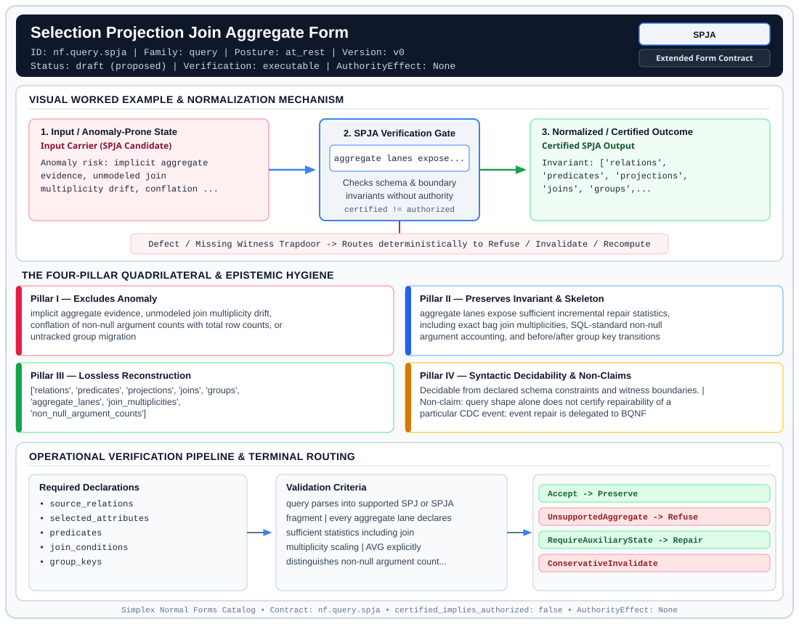

# Selection Projection Join Aggregate Form (`SPJA`)

> **Contract ID:** `nf.query.spja` | **Family:** `query` | **Index Status:** `draft` | **AuthorityEffect:** `None`

**[⬅ Back to Wiki Home](Home)** | **[View SVG Diagram](images/nf.query.spja.svg)**

---

## 1. Executive Summary & Metadata

Selection Projection Join Aggregate Form (SPJA) enforces structural normalization and explicit defect routing in the query regime.

| Property | Value |
| :--- | :--- |
| **Canonical ID** | `nf.query.spja` |
| **Short Name** | `SPJA` |
| **Full Name** | Selection Projection Join Aggregate Form |
| **Family** | `query` (Relational & Cochain Query Evaluation Normal Forms) |
| **Qualification** | Extended Form Contract (Normal Form Contract) |
| **Data / Math Posture** | at_rest |
| **Index Status** | `draft` |
| **Theory Status** | `proposed` |
| **Verification Status** | `executable` |
| **Contract Version** | `v0` |
| **Governance Fence** | `AuthorityEffect: None` (`certified_implies_authorized: false`) |

---

## 2. Visual Architecture & Normalization Diagram



---

## 3. Concrete Worked Example & Mechanism

### Visual Transition Summary

| Stage | Carrier / Operator | Concrete State / Invariant |
| :--- | :--- | :--- |
| **1. Before / Candidate Input** | `Input Carrier (SPJA Candidate)` | Anomaly risk: implicit aggregate ; evidence, unmodeled join ; multiplicity drift, conflation ... |
| **2. Normalization / Gate** | `SPJA Verification Gate` | `aggregate lanes expose...` (`certified_implies_authorized: false`) |
| **3. After / Certified Output** | `Certified SPJA Output` | Invariant: ['relations', ; 'predicates', 'projections', ; 'joins', 'groups',... |

### Contract-Declared Worked Cases

```yaml
- ref: ../1a_bqnf_incremental_repair.md
  section: 5. SPJA fragment
```

---

## 4. The Four-Pillar Quadrilateral & Non-Claims

Every contract in `simplex-normal-forms` is evaluated against the **Four-Pillar Quadrilateral** defined in `contracts/_golden_nfs/standard.yaml`:

| Pillar | Requirement | Contract Specification for `nf.query.spja` |
| :--- | :--- | :--- |
| **Pillar I: Excludes Anomaly** | Name and eliminate a specific class of data or state defects. | implicit aggregate evidence, unmodeled join multiplicity drift, conflation of non-null argument counts with total row counts, or untracked group migration |
| **Pillar II: Preserves Invariant** | State the structural invariant and protected skeleton preserved across transitions. | **Invariant:** aggregate lanes expose sufficient incremental repair statistics, including exact bag join multiplicities, SQL-standard non-null argument accounting, and before/after group key transitions<br>**Protected Skeleton:** ['relations', 'predicates', 'projections', 'joins', 'groups', 'aggregate_lanes', 'join_multiplicities', 'non_null_argument_counts'] |
| **Pillar III: Lossless Reconstruction** | State the non-loss reconstruction operator (join, direct sum, pullback, or replay). | Lossless reconstruction under declared projection, direct sum, or pullback operators. |
| **Pillar IV: Syntactic Decidability** | State how conformance is decided from declared constraints without unbudgeted scans. | Decidable from declared schema and witness metadata within bounded evaluation budgets. |

### Explicit Non-Claims (`certified_implies_authorized: false`)

- query shape alone does not certify repairability of a particular CDC event; event repair is delegated to BQNF
- does not decide general query containment or equivalence for non-monotone queries
- does not imply authority minting (AuthorityEffect: None)

---

## 5. Operational Verification & Terminal Routing

### 5.1 Required Declarations

- source_relations
- selected_attributes
- predicates
- join_conditions
- group_keys
- aggregate_lanes
- **query_semantics**: {'algebra_posture': 'bag_semantics_with_join_multiplicity', 'null_handling': 'sql_standard_null_elimination', 'avg_count_semantics': 'non_null_argument_count', 'group_mutation_tracking': 'before_after_group_keys'}

### 5.2 Required Evidence

- old_new_attribute_values
- joined_partner_multiplicities
- before_after_group_membership
- non_null_argument_indicators

### 5.3 Validation Criteria

| Criterion ID | Name | Condition |
| :--- | :--- | :--- |
| `criterion` | Check | query parses into supported SPJ or SPJA fragment |
| `criterion` | Check | every aggregate lane declares sufficient statistics including join multiplicity scaling |
| `criterion` | Check | AVG explicitly distinguishes non-null argument count from total join row count |
| `criterion` | Check | group key mutations provide both before and after group partitions |
| `criterion` | Check | unsupported aggregate types declare typed terminal at compile time |

### 5.4 Terminal Route Map

Every evaluation terminates in a declared local route mapped to a canonical terminal in `standard.yaml`:

| Local Terminal Route | Canonical Terminal |
| :--- | :--- |
| `Accept` | `Preserve` |
| `UnsupportedAggregate` | `Refuse` |
| `RequireAuxiliaryState` | `Repair` |
| `ConservativeInvalidate` | `ConservativeInvalidate` |

### 5.5 Declared Failure Modes

- **symptom**: AVG repaired from amount delta without explicit non-null argument COUNT, **diagnosis**: insufficient statistics for aggregate lane; non-null count required for exact division, **terminal**: ConservativeInvalidate
- **symptom**: join partner multiplicity omitted on joined SUM update, **diagnosis**: missing join multiplicity; source row change delta must scale by matching partners, **terminal**: ConservativeInvalidate
- **symptom**: aggregate operator outside supported algebra (e.g. median, non-algebraic window), **diagnosis**: unsupported aggregate operator lacking finite differential update statistics, **terminal**: UnsupportedAggregate

---

## 6. Epistemic Claim Hygiene Quadrant

In accordance with the repository's epistemic claim discipline:

1. **What it supports:**
   - Supports syntactic and operational checking of `nf.query.spja` (`SPJA`) against its declared schema, boundary constraints, and witness obligations in this model.
   - Supports deterministic terminal routing (`Accept, UnsupportedAggregate, RequireAuxiliaryState, ConservativeInvalidate`) when required declarations or invariants fail.
2. **What it does not support:**
   - Does not confer operational authority (`AuthorityEffect: None`, `certified_implies_authorized: false`).
   - Does not claim semantic truth of undeclared external processes or unverified upstream inputs beyond the declaredprotected skeleton.
3. **The narrowest defensible claim:**
   - Within the declared substrate `at_rest`, this contract enforces that `implicit aggregate evidence, unmodeled join multiplicity drift, conflation of non-null argument counts with total row counts, or untracked group migration` is either excluded under `aggregate lanes expose sufficient incremental repair statistics, including exact bag join multiplicities, SQL-standard non-null argument accounting, and before/after group key transitions` or routed to an explicit refusal/recovery terminal.
4. **The next test needed:**
   - Property-based falsification and mutation testing across boundary edge cases and composed multi-step pipelines for `nf.query.spja`.

---

## 7. Canonical YAML Contract (`contracts/nf.query.spja.yaml`)

<details>
<summary><strong>Click to expand full canonical YAML contract (contracts/nf.query.spja.yaml)</strong></summary>

```yaml
schema_version: smplx.nf.contract.v0
schema_ref: ./normal_form_contract_schema.yaml
contract_kind: normal_form_contract
identity:
  id: nf.query.spja
  name: Selection Projection Join Aggregate Form
  short_name: SPJA
  version: v0
  status: draft
  family: query
  theory_status: proposed
  contract_status: draft
  verification_status: executable
classification:
  hierarchy_level: form
  subject_kind:
  - query_shape
  - derived_relvar
  data_posture: at_rest
  mathematical_posture: operational
purpose:
  excludes_anomaly: implicit aggregate evidence, unmodeled join multiplicity drift,
    conflation of non-null argument counts with total row counts, or untracked group migration
  preserves_invariant: aggregate lanes expose sufficient incremental repair statistics,
    including exact bag join multiplicities, SQL-standard non-null argument accounting,
    and before/after group key transitions
  protected_skeleton:
  - relations
  - predicates
  - projections
  - joins
  - groups
  - aggregate_lanes
  - join_multiplicities
  - non_null_argument_counts
  erased_structure: []
  non_claims:
  - query shape alone does not certify repairability of a particular CDC event; event
    repair is delegated to BQNF
  - does not decide general query containment or equivalence for non-monotone queries
  - "does not imply authority minting (AuthorityEffect: None)"
declarations_required:
- source_relations
- selected_attributes
- predicates
- join_conditions
- group_keys
- aggregate_lanes
- query_semantics:
    algebra_posture: bag_semantics_with_join_multiplicity
    null_handling: sql_standard_null_elimination
    avg_count_semantics: non_null_argument_count
    group_mutation_tracking: before_after_group_keys
extensions:
  aggregate_evidence_specifications:
    SUM:
    - old_value
    - new_value
    - group_key_before_after
    - predicate_before_after
    - join_multiplicity
    COUNT:
    - membership_before_after
    - non_null_predicate
    - group_key_before_after
    - join_multiplicity
    AVG:
    - sum_statistic
    - non_null_count_statistic
    - join_multiplicity
    MIN_MAX:
    - extremum_witness_state
    - second_extremum_candidate
    - group_partition_witness
evidence_required:
- old_new_attribute_values
- joined_partner_multiplicities
- before_after_group_membership
- non_null_argument_indicators
validation_criteria:
- query parses into supported SPJ or SPJA fragment
- every aggregate lane declares sufficient statistics including join multiplicity scaling
- AVG explicitly distinguishes non-null argument count from total join row count
- group key mutations provide both before and after group partitions
- unsupported aggregate types declare typed terminal at compile time
proof_obligations: []
terminal_routes:
- Accept
- UnsupportedAggregate
- RequireAuxiliaryState
- ConservativeInvalidate
terminal_route_map:
  Accept: Preserve
  UnsupportedAggregate: Refuse
  RequireAuxiliaryState: Repair
  ConservativeInvalidate: ConservativeInvalidate
certification:
  certificate_required: false
  certificate_kind: null
  obstruction_class_required: false
  loss_ledger_required: false
  verifier_required: true
  loss_ledger_trigger_id: null
authorization:
  authorized_by: null
  certified_implies_authorized: false
failure_modes:
- symptom: AVG repaired from amount delta without explicit non-null argument COUNT
  diagnosis: insufficient statistics for aggregate lane; non-null count required for exact division
  terminal: ConservativeInvalidate
- symptom: join partner multiplicity omitted on joined SUM update
  diagnosis: missing join multiplicity; source row change delta must scale by matching partners
  terminal: ConservativeInvalidate
- symptom: aggregate operator outside supported algebra (e.g. median, non-algebraic window)
  diagnosis: unsupported aggregate operator lacking finite differential update statistics
  terminal: UnsupportedAggregate
examples:
- ref: ../1a_bqnf_incremental_repair.md
  section: 5. SPJA fragment
references:
- ../1a_bqnf_incremental_repair.md
- ../1_normal_forms.md
definition:
  source: coda_all_universe/mssn_sn_tower/definitions.md
  formal_statement: >
    An SPJA query expression satisfies the form if all aggregate lanes specify sufficient
    first-order repair statistics under bag semantics. For a source change delta d and join
    multiplicity m, the joined aggregate updates by m * d. The AVG lane computes sum / non_null_count,
    where non_null_count tracks the cardinality of non-null arguments rather than raw join rows.
  quadrilateral:
    qualifies_as_true_normal_form: false
    qualification_gap: reconstruction_is_incremental_view_maintenance_not_a_relational_project_join
    anomaly_exclusion: implicit aggregate evidence and unmodeled multiplicity drift
    lossless_join:
      status: declared_reconstruction
      statement: aggregate lanes expose sufficient repair statistics to reconstruct updated view values
    dependency_preservation:
      status: declared_with_the_invariant
      statement: The preserved invariant stays on the declared query schema.
    syntactic_decision:
      status: declaration_decidable
      statement: The check inspects declared aggregate lane definitions and multiplicity bindings.
```

</details>
