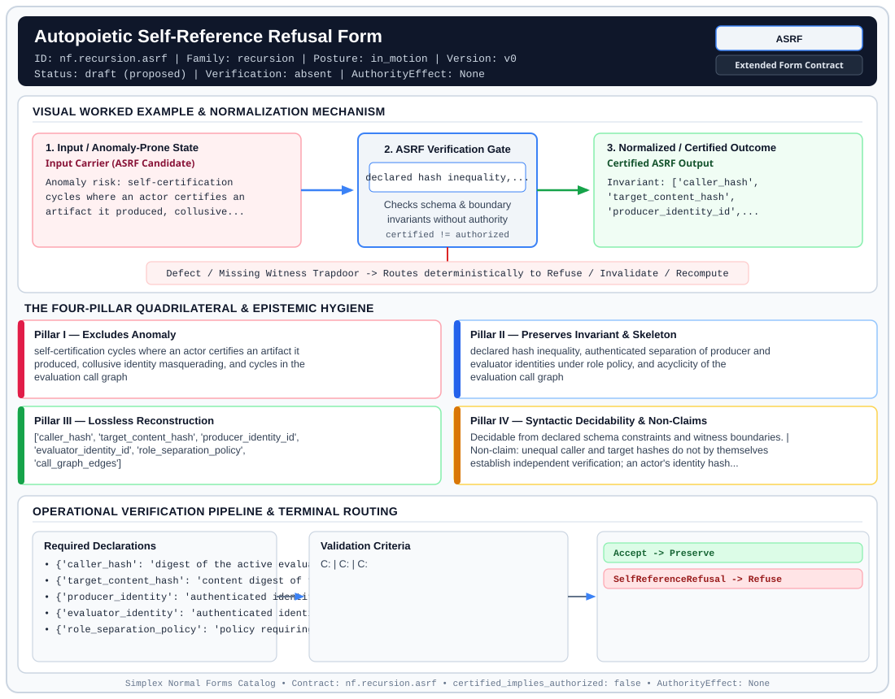

# Autopoietic Self-Reference Refusal Form (`ASRF`)

> **Contract ID:** `nf.recursion.asrf` | **Family:** `recursion` | **Index Status:** `draft` | **AuthorityEffect:** `None`

**[⬅ Back to Wiki Home](Home)** | **[View SVG Diagram](images/nf.recursion.asrf.svg)**

---

## 1. Executive Summary & Metadata

Autopoietic Self-Reference Refusal Form (ASRF) enforces structural normalization and explicit defect routing in the recursion regime.

| Property | Value |
| :--- | :--- |
| **Canonical ID** | `nf.recursion.asrf` |
| **Short Name** | `ASRF` |
| **Full Name** | Autopoietic Self-Reference Refusal Form |
| **Family** | `recursion` (Autopoietic Self-Reference Refusal & Caller-Verifier Separation (`ASRF`)) |
| **Qualification** | Extended Form Contract (Normal Form Contract) |
| **Data / Math Posture** | in_motion |
| **Index Status** | `draft` |
| **Theory Status** | `proposed` |
| **Verification Status** | `absent` |
| **Contract Version** | `v0` |
| **Governance Fence** | `AuthorityEffect: None` (`certified_implies_authorized: false`) |

### Foundational Treatise Specification

- **Levels**: Level 20
- **Spec Files**: ['20_grammar.md', '20_math.md']
- **Anomaly Excluded**: Self-referential infinite loops and counterfeit verification where an agent attempts to certify its own state.
- **Preserved Invariant**: System enforces caller-verifier non-identity (callerHash != targetHash) emitting GodelBreak refusal.
- **Lossless Reconstruction**: Refusal state cleanly separates valid grounded evaluations from self-referential loops.
- **Claim Hygiene Note**: Caller-verifier hash inequality verifies distinct identity labels, but does not support causal independence without authenticated actor bindings and execution isolation.
- **Nomenclature Note**: Renamed from Autopoietic Cohomology Normal Form (ACNF) to eliminate cohomology misnomer; computes no cohomology groups.

---

## 2. Visual Architecture & Normalization Diagram



---

## 3. Concrete Worked Example & Mechanism

### Visual Transition Summary

| Stage | Carrier / Operator | Concrete State / Invariant |
| :--- | :--- | :--- |
| **1. Before / Candidate Input** | `Input Carrier (ASRF Candidate)` | Anomaly risk: self-certification ; cycles where an actor certifies an ; artifact it produced, collusive... |
| **2. Normalization / Gate** | `ASRF Verification Gate` | `declared hash inequality,...` (`certified_implies_authorized: false`) |
| **3. After / Certified Output** | `Certified ASRF Output` | Invariant: ['caller_hash', ; 'target_content_hash', ; 'producer_identity_id',... |

---

## 4. The Four-Pillar Quadrilateral & Non-Claims

Every contract in `simplex-normal-forms` is evaluated against the **Four-Pillar Quadrilateral** defined in `contracts/_golden_nfs/standard.yaml`:

| Pillar | Requirement | Contract Specification for `nf.recursion.asrf` |
| :--- | :--- | :--- |
| **Pillar I: Excludes Anomaly** | Name and eliminate a specific class of data or state defects. | self-certification cycles where an actor certifies an artifact it produced, collusive identity masquerading, and cycles in the evaluation call graph |
| **Pillar II: Preserves Invariant** | State the structural invariant and protected skeleton preserved across transitions. | **Invariant:** declared hash inequality, authenticated separation of producer and evaluator identities under role policy, and acyclicity of the evaluation call graph<br>**Protected Skeleton:** ['caller_hash', 'target_content_hash', 'producer_identity_id', 'evaluator_identity_id', 'role_separation_policy', 'call_graph_edges'] |
| **Pillar III: Lossless Reconstruction** | State the non-loss reconstruction operator (join, direct sum, pullback, or replay). | Lossless reconstruction under declared projection, direct sum, or pullback operators. |
| **Pillar IV: Syntactic Decidability** | State how conformance is decided from declared constraints without unbudgeted scans. | Decidable from declared schema and witness metadata within bounded evaluation budgets. |

### Explicit Non-Claims (`certified_implies_authorized: false`)

- unequal caller and target hashes do not by themselves establish independent verification; an actor's identity hash naturally differs from an artifact's content hash even when the same actor produced and evaluated it
- this contract is an evaluator guard verifying declared hash inequality, authenticated producer/evaluator identity distinctness, and call-graph acyclicity; it does not constitute an incompleteness theorem or compute any cohomology group
- does not imply authorization

---

## 5. Operational Verification & Terminal Routing

### 5.1 Required Declarations

- **caller_hash**: digest of the active evaluating entity
- **target_content_hash**: content digest of the evaluated artifact
- **producer_identity**: authenticated identity that generated the artifact
- **evaluator_identity**: authenticated identity executing the evaluation
- **role_separation_policy**: policy requiring producer_identity != evaluator_identity
- **call_graph**: directed graph of evaluation invocations

### 5.2 Required Evidence

- **caller_identity_signature**: string
- **producer_identity_id**: string
- **evaluator_identity_id**: string
- **producer_evaluator_distinct**: boolean
- **caller_hash_value**: string
- **target_content_hash_value**: string
- **call_graph_edges**: list
- **acyclicity_verified**: boolean

### 5.3 Validation Criteria

| Criterion ID | Name | Condition |
| :--- | :--- | :--- |
| `` | **** |  |
| `` | **** |  |
| `` | **** |  |

### 5.4 Terminal Route Map

Every evaluation terminates in a declared local route mapped to a canonical terminal in `standard.yaml`:

| Local Terminal Route | Canonical Terminal |
| :--- | :--- |
| `Accept` | `Preserve` |
| `SelfReferenceRefusal` | `Refuse` |

### 5.5 Declared Failure Modes

- **symptom**: caller hash equals target hash, or call graph contains cycle, **diagnosis**: direct or cyclical self-certification attempt, **terminal**: SelfReferenceRefusal
- **symptom**: producer identity equals evaluator identity, **diagnosis**: violation of separation of duties policy, **terminal**: SelfReferenceRefusal

---

## 6. Epistemic Claim Hygiene Quadrant

In accordance with the repository's epistemic claim discipline:

1. **What it supports:**
   - Supports syntactic and operational checking of `nf.recursion.asrf` (`ASRF`) against its declared schema, boundary constraints, and witness obligations in this model.
   - Supports deterministic terminal routing (`Accept, SelfReferenceRefusal`) when required declarations or invariants fail.
2. **What it does not support:**
   - Does not confer operational authority (`AuthorityEffect: None`, `certified_implies_authorized: false`).
   - Does not claim semantic truth of undeclared external processes or unverified upstream inputs beyond the declaredprotected skeleton.
3. **The narrowest defensible claim:**
   - Within the declared substrate `in_motion`, this contract enforces that `self-certification cycles where an actor certifies an artifact it produced, collusive identity masquerading, and cycles in the evaluation call graph` is either excluded under `declared hash inequality, authenticated separation of producer and evaluator identities under role policy, and acyclicity of the evaluation call graph` or routed to an explicit refusal/recovery terminal.
4. **The next test needed:**
   - Property-based falsification and mutation testing across boundary edge cases and composed multi-step pipelines for `nf.recursion.asrf`.

---

## 7. Canonical YAML Contract (`contracts/nf.recursion.asrf.yaml`)

<details>
<summary><strong>Click to expand full canonical YAML contract (contracts/nf.recursion.asrf.yaml)</strong></summary>

```yaml
schema_version: smplx.nf.contract.v0
schema_ref: ./normal_form_contract_schema.yaml
contract_kind: form_contract
identity:
  id: nf.recursion.asrf
  name: Autopoietic Self-Reference Refusal Form
  short_name: ASRF
  version: v0
  theory_status: proposed
  contract_status: draft
  verification_status: absent
  family: recursion
  status: draft
classification:
  hierarchy_level: form
  subject_kind:
  - caller_identity
  - verification_target
  data_posture: in_motion
  mathematical_posture: operational
purpose:
  excludes_anomaly: self-certification cycles where an actor certifies an artifact
    it produced, collusive identity masquerading, and cycles in the evaluation call graph
  preserves_invariant: declared hash inequality, authenticated separation of producer
    and evaluator identities under role policy, and acyclicity of the evaluation call graph
  protected_skeleton:
  - caller_hash
  - target_content_hash
  - producer_identity_id
  - evaluator_identity_id
  - role_separation_policy
  - call_graph_edges
  erased_structure: []
  non_claims:
  - unequal caller and target hashes do not by themselves establish independent verification;
    an actor's identity hash naturally differs from an artifact's content hash even
    when the same actor produced and evaluated it
  - this contract is an evaluator guard verifying declared hash inequality, authenticated
    producer/evaluator identity distinctness, and call-graph acyclicity; it does not
    constitute an incompleteness theorem or compute any cohomology group
  - does not imply authorization
declarations_required:
- caller_hash: digest of the active evaluating entity
- target_content_hash: content digest of the evaluated artifact
- producer_identity: authenticated identity that generated the artifact
- evaluator_identity: authenticated identity executing the evaluation
- role_separation_policy: policy requiring producer_identity != evaluator_identity
- call_graph: directed graph of evaluation invocations
evidence_required:
- caller_identity_signature: string
- producer_identity_id: string
- evaluator_identity_id: string
- producer_evaluator_distinct: boolean
- caller_hash_value: string
- target_content_hash_value: string
- call_graph_edges: list
- acyclicity_verified: boolean
validation_criteria:
- hash_distinctness: caller hash differs strictly from target content hash
- role_separation: producer identity differs from evaluator identity under authenticated policy
- call_graph_acyclicity: declared call graph contains no directed cycle connecting caller, producer, and target
terminal_routes:
- Accept
- SelfReferenceRefusal
terminal_route_map:
  Accept: Preserve
  SelfReferenceRefusal: Refuse
extensions:
  condition_to_local_route_map:
    all_distinct_and_acyclic: Accept
    caller_target_hash_equal_or_cycle: SelfReferenceRefusal
    producer_equals_evaluator: SelfReferenceRefusal
certification:
  certificate_required: false
  certificate_kind: null
  obstruction_class_required: false
  loss_ledger_required: false
  verifier_required: false
  loss_ledger_trigger_id: null
authorization:
  authorized_by: null
  certified_implies_authorized: false
failure_modes:
- symptom: caller hash equals target hash, or call graph contains cycle
  diagnosis: direct or cyclical self-certification attempt
  terminal: SelfReferenceRefusal
- symptom: producer identity equals evaluator identity
  diagnosis: violation of separation of duties policy
  terminal: SelfReferenceRefusal
definition:
  source: coda_all_universe/mssn_sn_tower/definitions.md
  section: '3.7'
  formal_statement: Evaluator guard recording caller hash, target hash, and authenticated
    producer/evaluator identities. The step is preserved when producer and evaluator
    differ, hashes differ, and the call graph is acyclic. Self-cycles and unseparated
    roles route to refusal.
  quadrilateral:
    qualifies_as_true_normal_form: false
    qualification_gap: self_reference_cycle_refusal_is_an_evaluator_guard_not_a_relational_project_join_theorem
    qualifies_as_extended_form: true
    anomaly_exclusion: self-certification of a generated state
    lossless_join:
      status: refusal_separated
      statement: refused self-cycles are stored as refusals and are not folded into
        the admitted evaluations
    dependency_preservation:
      status: hash_inequality_retained
      statement: an admitted step keeps caller hash different from target hash and
        producer different from evaluator
    syntactic_decision:
      status: declaration_decidable
      statement: the check verifies declared identities, hashes, and call-graph acyclicity
```

</details>
