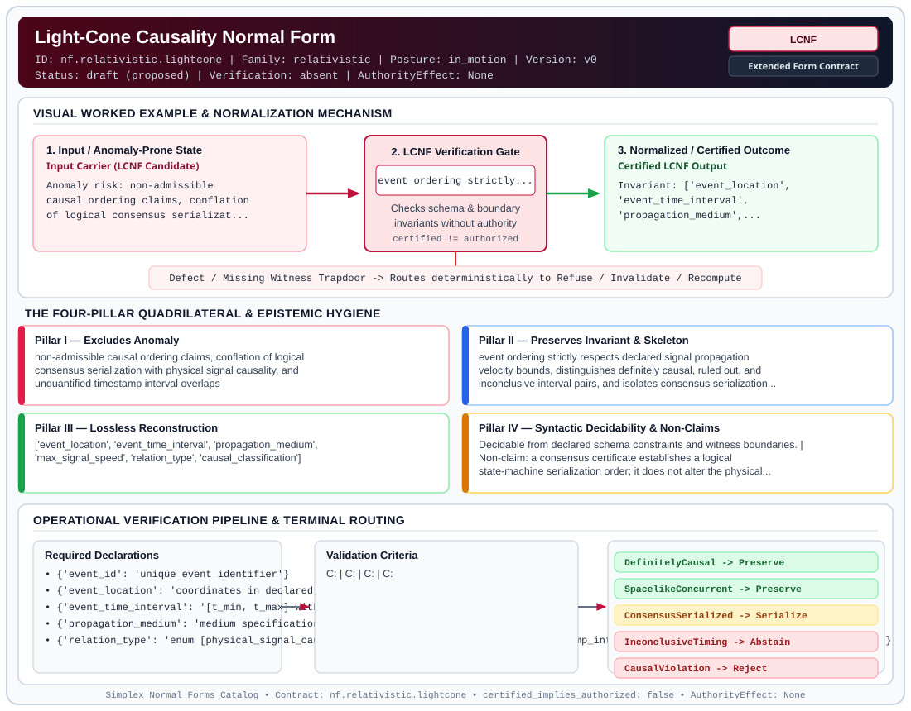

# Light-Cone Causality Normal Form (`LCNF`)

> **Contract ID:** `nf.relativistic.lightcone` | **Family:** `relativistic` | **Index Status:** `draft` | **AuthorityEffect:** `None`

**[⬅ Back to Wiki Home](Home)** | **[View SVG Diagram](images/nf.relativistic.lightcone.svg)**

---

## 1. Executive Summary & Metadata

Light-Cone Causality Normal Form (LCNF) enforces structural normalization and explicit defect routing in the relativistic regime.

| Property | Value |
| :--- | :--- |
| **Canonical ID** | `nf.relativistic.lightcone` |
| **Short Name** | `LCNF` |
| **Full Name** | Light-Cone Causality Normal Form |
| **Family** | `relativistic` (Causal Lightcone Structure & Relativistic Clock Synchronization Contracts) |
| **Qualification** | Extended Form Contract (Normal Form Contract) |
| **Data / Math Posture** | in_motion |
| **Index Status** | `draft` |
| **Theory Status** | `proposed` |
| **Verification Status** | `absent` |
| **Contract Version** | `v0` |
| **Governance Fence** | `AuthorityEffect: None` (`certified_implies_authorized: false`) |

---

## 2. Visual Architecture & Normalization Diagram



---

## 3. Concrete Worked Example & Mechanism

### Visual Transition Summary

| Stage | Carrier / Operator | Concrete State / Invariant |
| :--- | :--- | :--- |
| **1. Before / Candidate Input** | `Input Carrier (LCNF Candidate)` | Anomaly risk: non-admissible ; causal ordering claims, conflation ; of logical consensus serializat... |
| **2. Normalization / Gate** | `LCNF Verification Gate` | `event ordering strictly...` (`certified_implies_authorized: false`) |
| **3. After / Certified Output** | `Certified LCNF Output` | Invariant: ['event_location', ; 'event_time_interval', ; 'propagation_medium',... |

---

## 4. The Four-Pillar Quadrilateral & Non-Claims

Every contract in `simplex-normal-forms` is evaluated against the **Four-Pillar Quadrilateral** defined in `contracts/_golden_nfs/standard.yaml`:

| Pillar | Requirement | Contract Specification for `nf.relativistic.lightcone` |
| :--- | :--- | :--- |
| **Pillar I: Excludes Anomaly** | Name and eliminate a specific class of data or state defects. | non-admissible causal ordering claims, conflation of logical consensus serialization with physical signal causality, and unquantified timestamp interval overlaps |
| **Pillar II: Preserves Invariant** | State the structural invariant and protected skeleton preserved across transitions. | **Invariant:** event ordering strictly respects declared signal propagation velocity bounds, distinguishes definitely causal, ruled out, and inconclusive interval pairs, and isolates consensus serialization as logical order<br>**Protected Skeleton:** ['event_location', 'event_time_interval', 'propagation_medium', 'max_signal_speed', 'relation_type', 'causal_classification'] |
| **Pillar III: Lossless Reconstruction** | State the non-loss reconstruction operator (join, direct sum, pullback, or replay). | Lossless reconstruction under declared projection, direct sum, or pullback operators. |
| **Pillar IV: Syntactic Decidability** | State how conformance is decided from declared constraints without unbudgeted scans. | Decidable from declared schema and witness metadata within bounded evaluation budgets. |

### Explicit Non-Claims (`certified_implies_authorized: false`)

- a consensus certificate establishes a logical state-machine serialization order; it does not alter the physical spacetime interval or make physical propagation between spacelike events possible
- does not support absolute simultaneity; overlapping interval bounds represent lack of resolved timestamp order, not physical simultaneity
- does not provide consensus by itself without an explicit consensus witness
- does not make spacelike or network-concurrent events physically causal

---

## 5. Operational Verification & Terminal Routing

### 5.1 Required Declarations

- **event_id**: unique event identifier
- **event_location**: coordinates in declared reference frame
- **event_time_interval**: [t_min, t_max] with declared confidence
- **propagation_medium**: medium specification with speed bound c_max
- **relation_type**: enum [physical_signal_causality, observed_message_causality, timestamp_interval_order, consensus_logical_serialization]
- **consensus_witness_if_logical_order_claimed**: optional consensus certificate

### 5.2 Required Evidence

- **timestamp_uncertainty_packets**: list
- **location_or_region_witnesses**: list
- **distance_and_latency_bounds**: dict
- **consensus_certificate_if_ordering_spacelike_events**: string_or_null

### 5.3 Validation Criteria

| Criterion ID | Name | Condition |
| :--- | :--- | :--- |
| `` | **** |  |
| `` | **** |  |
| `` | **** |  |
| `` | **** |  |
| `` | **** |  |

### 5.4 Terminal Route Map

Every evaluation terminates in a declared local route mapped to a canonical terminal in `standard.yaml`:

| Local Terminal Route | Canonical Terminal |
| :--- | :--- |
| `DefinitelyCausal` | `Preserve` |
| `SpacelikeConcurrent` | `Preserve` |
| `ConsensusSerialized` | `Serialize` |
| `InconclusiveTiming` | `Abstain` |
| `CausalViolation` | `Reject` |
| `Unsupported` | `Unsupported` |

### 5.5 Declared Failure Modes

- **symptom**: replica log asserts write B observed write A before any declared signal could carry A to B, **diagnosis**: non-admissible causal edge (spacelike propagation violation), **terminal**: CausalViolation
- **symptom**: timestamps overlap such that causal direction cannot be determined, **diagnosis**: unquantified interval overlap, **terminal**: InconclusiveTiming

---

## 6. Epistemic Claim Hygiene Quadrant

In accordance with the repository's epistemic claim discipline:

1. **What it supports:**
   - Supports syntactic and operational checking of `nf.relativistic.lightcone` (`LCNF`) against its declared schema, boundary constraints, and witness obligations in this model.
   - Supports deterministic terminal routing (`DefinitelyCausal, SpacelikeConcurrent, ConsensusSerialized, InconclusiveTiming`) when required declarations or invariants fail.
2. **What it does not support:**
   - Does not confer operational authority (`AuthorityEffect: None`, `certified_implies_authorized: false`).
   - Does not claim semantic truth of undeclared external processes or unverified upstream inputs beyond the declaredprotected skeleton.
3. **The narrowest defensible claim:**
   - Within the declared substrate `in_motion`, this contract enforces that `non-admissible causal ordering claims, conflation of logical consensus serialization with physical signal causality, and unquantified timestamp interval overlaps` is either excluded under `event ordering strictly respects declared signal propagation velocity bounds, distinguishes definitely causal, ruled out, and inconclusive interval pairs, and isolates consensus serialization as logical order` or routed to an explicit refusal/recovery terminal.
4. **The next test needed:**
   - Property-based falsification and mutation testing across boundary edge cases and composed multi-step pipelines for `nf.relativistic.lightcone`.

---

## 7. Canonical YAML Contract (`contracts/nf.relativistic.lightcone.yaml`)

<details>
<summary><strong>Click to expand full canonical YAML contract (contracts/nf.relativistic.lightcone.yaml)</strong></summary>

```yaml
schema_version: smplx.nf.contract.v0
contract_kind: normal_form_contract
identity:
  id: nf.relativistic.lightcone
  name: Light-Cone Causality Normal Form
  short_name: LCNF
  version: v0
  status: draft
  family: relativistic
  theory_status: proposed
  contract_status: draft
  verification_status: absent
classification:
  hierarchy_level: normal_form
  subject_kind:
  - replica_event
  - distributed_write
  - distributed_claim
  data_posture: in_motion
  mathematical_posture: formal_algebraic
purpose:
  excludes_anomaly: non-admissible causal ordering claims, conflation of logical consensus
    serialization with physical signal causality, and unquantified timestamp interval overlaps
  preserves_invariant: event ordering strictly respects declared signal propagation
    velocity bounds, distinguishes definitely causal, ruled out, and inconclusive interval
    pairs, and isolates consensus serialization as logical order
  protected_skeleton:
  - event_location
  - event_time_interval
  - propagation_medium
  - max_signal_speed
  - relation_type
  - causal_classification
  erased_structure: []
  non_claims:
  - a consensus certificate establishes a logical state-machine serialization order;
    it does not alter the physical spacetime interval or make physical propagation
    between spacelike events possible
  - does not support absolute simultaneity; overlapping interval bounds represent lack
    of resolved timestamp order, not physical simultaneity
  - does not provide consensus by itself without an explicit consensus witness
  - does not make spacelike or network-concurrent events physically causal
obstruction_substrate:
  policy_ref: ../substrate/default_finite_obstruction_policy.yaml
  finite_carrier:
    description: finite event graph with spatial coordinates, bounded timestamp intervals,
      propagation velocities, and claimed causal edges
  carrier_realization:
    carrier_type: finite_spacetime_event_graph
    metric_model: minkowski_or_network_bounded_latency
  geometry_module: null
  gauge_metric_selector: null
declarations_required:
- event_id: unique event identifier
- event_location: coordinates in declared reference frame
- event_time_interval: "[t_min, t_max] with declared confidence"
- propagation_medium: medium specification with speed bound c_max
- relation_type: "enum [physical_signal_causality, observed_message_causality, timestamp_interval_order, consensus_logical_serialization]"
- consensus_witness_if_logical_order_claimed: optional consensus certificate
evidence_required:
- timestamp_uncertainty_packets: list
- location_or_region_witnesses: list
- distance_and_latency_bounds: dict
- consensus_certificate_if_ordering_spacelike_events: string_or_null
validation_criteria:
- definitely_causal_certified: t_B_min - t_A_max >= distance(A, B) / c_max supports B is in causal future of A
- ruled_out_spacelike: t_B_max - t_A_min < distance(A, B) / c_max supports physical signal cannot travel from A to B
- inconclusive_timing: intervals permit both timelike and spacelike realizations under declared bounds, routing to InconclusiveTiming
- consensus_logical_separation: logical serialization of spacelike events is recorded as ConsensusSerialized without asserting physical causality
- causal_impossibility_rejection: claiming physical cause-effect on strictly spacelike or retrocausal pairs routes to CausalViolation
terminal_routes:
- DefinitelyCausal
- SpacelikeConcurrent
- ConsensusSerialized
- InconclusiveTiming
- CausalViolation
- Unsupported
terminal_route_map:
  DefinitelyCausal: Preserve
  SpacelikeConcurrent: Preserve
  ConsensusSerialized: Serialize
  InconclusiveTiming: Abstain
  CausalViolation: Reject
  Unsupported: Unsupported
extensions:
  condition_to_local_route_map:
    definitely_inside_cone: DefinitelyCausal
    strictly_spacelike_without_consensus: SpacelikeConcurrent
    spacelike_with_valid_consensus: ConsensusSerialized
    uncertainty_interval_inconclusive: InconclusiveTiming
    claimed_cause_strictly_outside_cone: CausalViolation
certification:
  certificate_required: true
  certificate_kind: lightcone_causality_certificate
  obstruction_class_required: false
  loss_ledger_required: false
  loss_ledger_trigger_id: null
  verifier_required: true
authorization:
  authorized_by: null
  certified_implies_authorized: false
failure_modes:
- symptom: replica log asserts write B observed write A before any declared signal could carry A to B
  diagnosis: non-admissible causal edge (spacelike propagation violation)
  terminal: CausalViolation
- symptom: timestamps overlap such that causal direction cannot be determined
  diagnosis: unquantified interval overlap
  terminal: InconclusiveTiming
references:
- ../relnf.md
- ../1_normal_forms.md
definition:
  source: coda_all_universe/mssn_sn_tower/definitions.md
  formal_statement: Light-cone causality normal form asserting that physical causal
    claims strictly satisfy propagation velocity bounds on event intervals, distinguishing
    physical signal causality from logical consensus serialization, and routing unresolved
    overlaps to abstention.
  quadrilateral:
    qualifies_as_true_normal_form: false
    qualification_gap: reconstruction_is_not_a_relational_project_join
    anomaly_exclusion: non-admissible causal ordering claims and consensus/causality conflation
    lossless_join:
      status: declared_reconstruction
      statement: event ordering respects declared signal propagation constraints
    dependency_preservation:
      status: declared_with_the_invariant
      statement: The preserved invariant stays on the declared schema. This form does
        not state a functional-dependency projection of a flat relvar decomposition.
    syntactic_decision:
      status: declaration_decidable
      statement: The check reads the declared constraints and validation criteria.
        One unrecorded runtime image is not the decider.
canonical_terminal_map:
  DefinitelyCausal: Preserve
  SpacelikeConcurrent: Preserve
  ConsensusSerialized: Serialize
  InconclusiveTiming: Abstain
  CausalViolation: Reject
  Unsupported: Unsupported
schema_ref: ./normal_form_contract_schema.yaml
```

</details>
