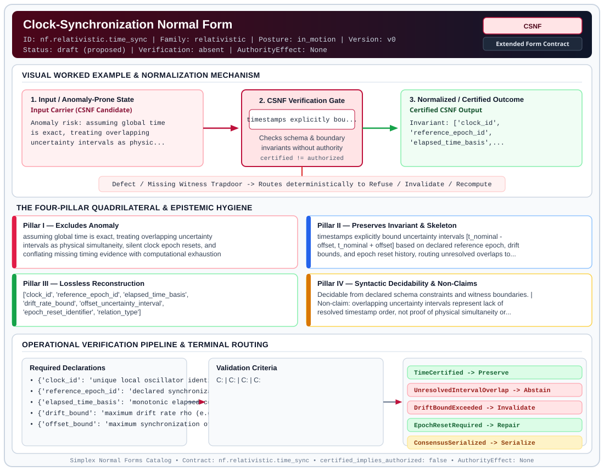

# Clock-Synchronization Normal Form (`CSNF`)

> **Contract ID:** `nf.relativistic.time_sync` | **Family:** `relativistic` | **Index Status:** `draft` | **AuthorityEffect:** `None`

**[⬅ Back to Wiki Home](Home)** | **[View SVG Diagram](images/nf.relativistic.time_sync.svg)**

---

## 1. Executive Summary & Metadata

Clock-Synchronization Normal Form (CSNF) enforces structural normalization and explicit defect routing in the relativistic regime.

| Property | Value |
| :--- | :--- |
| **Canonical ID** | `nf.relativistic.time_sync` |
| **Short Name** | `CSNF` |
| **Full Name** | Clock-Synchronization Normal Form |
| **Family** | `relativistic` (Causal Lightcone Structure & Relativistic Clock Synchronization Contracts) |
| **Qualification** | Extended Form Contract (Normal Form Contract) |
| **Data / Math Posture** | in_motion |
| **Index Status** | `draft` |
| **Theory Status** | `proposed` |
| **Verification Status** | `absent` |
| **Contract Version** | `v0` |
| **Governance Fence** | `AuthorityEffect: None` (`certified_implies_authorized: false`) |

---

## 2. Visual Architecture & Normalization Diagram



---

## 3. Concrete Worked Example & Mechanism

### Visual Transition Summary

| Stage | Carrier / Operator | Concrete State / Invariant |
| :--- | :--- | :--- |
| **1. Before / Candidate Input** | `Input Carrier (CSNF Candidate)` | Anomaly risk: assuming global time ; is exact, treating overlapping ; uncertainty intervals as physic... |
| **2. Normalization / Gate** | `CSNF Verification Gate` | `timestamps explicitly bou...` (`certified_implies_authorized: false`) |
| **3. After / Certified Output** | `Certified CSNF Output` | Invariant: ['clock_id', ; 'reference_epoch_id', ; 'elapsed_time_basis',... |

---

## 4. The Four-Pillar Quadrilateral & Non-Claims

Every contract in `simplex-normal-forms` is evaluated against the **Four-Pillar Quadrilateral** defined in `contracts/_golden_nfs/standard.yaml`:

| Pillar | Requirement | Contract Specification for `nf.relativistic.time_sync` |
| :--- | :--- | :--- |
| **Pillar I: Excludes Anomaly** | Name and eliminate a specific class of data or state defects. | assuming global time is exact, treating overlapping uncertainty intervals as physical simultaneity, silent clock epoch resets, and conflating missing timing evidence with computational exhaustion |
| **Pillar II: Preserves Invariant** | State the structural invariant and protected skeleton preserved across transitions. | **Invariant:** timestamps explicitly bound uncertainty intervals [t_nominal - offset, t_nominal + offset] based on declared reference epoch, drift bounds, and epoch reset history, routing unresolved overlaps to epistemic abstention<br>**Protected Skeleton:** ['clock_id', 'reference_epoch_id', 'elapsed_time_basis', 'drift_rate_bound', 'offset_uncertainty_interval', 'epoch_reset_identifier', 'relation_type'] |
| **Pillar III: Lossless Reconstruction** | State the non-loss reconstruction operator (join, direct sum, pullback, or replay). | Lossless reconstruction under declared projection, direct sum, or pullback operators. |
| **Pillar IV: Syntactic Decidability** | State how conformance is decided from declared constraints without unbudgeted scans. | Decidable from declared schema and witness metadata within bounded evaluation budgets. |

### Explicit Non-Claims (`certified_implies_authorized: false`)

- overlapping uncertainty intervals represent lack of resolved timestamp order, not proof of physical simultaneity or network concurrency
- does not convert bounded clock intervals into absolute Newtonian simultaneity
- does not authorize total ordering without disjoint certified intervals or an explicit consensus serialization certificate
- missing timing evidence or unresolved intervals do not denote computational budget exhaustion

---

## 5. Operational Verification & Terminal Routing

### 5.1 Required Declarations

- **clock_id**: unique local oscillator identifier
- **reference_epoch_id**: declared synchronization epoch
- **elapsed_time_basis**: monotonic elapsed counter since epoch
- **drift_bound**: maximum drift rate rho (e.g. microseconds per second)
- **offset_bound**: maximum synchronization offset epsilon at last sync
- **epoch_reset_log**: history of clock adjustments and epoch step changes
- **relation_type**: enum [timestamp_interval_order, consensus_logical_serialization]

### 5.2 Required Evidence

- **clock_sync_trace**: list
- **drift_measurement_records**: list
- **offset_interval_bounds**: dict
- **reset_event_log**: list
- **consensus_certificate_if_total_order_claimed**: string_or_null

### 5.3 Validation Criteria

| Criterion ID | Name | Condition |
| :--- | :--- | :--- |
| `` | **** |  |
| `` | **** |  |
| `` | **** |  |
| `` | **** |  |
| `` | **** |  |

### 5.4 Terminal Route Map

Every evaluation terminates in a declared local route mapped to a canonical terminal in `standard.yaml`:

| Local Terminal Route | Canonical Terminal |
| :--- | :--- |
| `TimeCertified` | `Preserve` |
| `UnresolvedIntervalOverlap` | `Abstain` |
| `DriftBoundExceeded` | `Invalidate` |
| `EpochResetRequired` | `Repair` |
| `ConsensusSerialized` | `Serialize` |
| `Unsupported` | `Unsupported` |

### 5.5 Declared Failure Modes

- **symptom**: wall-clock timestamps from two unsynchronized nodes are compared as exact scalars, **diagnosis**: absolute time assumption; overlapping uncertainty intervals, **terminal**: UnresolvedIntervalOverlap
- **symptom**: clock drift exceeds declared maximum rate bound, **diagnosis**: synchronization failure, **terminal**: DriftBoundExceeded

---

## 6. Epistemic Claim Hygiene Quadrant

In accordance with the repository's epistemic claim discipline:

1. **What it supports:**
   - Supports syntactic and operational checking of `nf.relativistic.time_sync` (`CSNF`) against its declared schema, boundary constraints, and witness obligations in this model.
   - Supports deterministic terminal routing (`TimeCertified, UnresolvedIntervalOverlap, DriftBoundExceeded, EpochResetRequired`) when required declarations or invariants fail.
2. **What it does not support:**
   - Does not confer operational authority (`AuthorityEffect: None`, `certified_implies_authorized: false`).
   - Does not claim semantic truth of undeclared external processes or unverified upstream inputs beyond the declaredprotected skeleton.
3. **The narrowest defensible claim:**
   - Within the declared substrate `in_motion`, this contract enforces that `assuming global time is exact, treating overlapping uncertainty intervals as physical simultaneity, silent clock epoch resets, and conflating missing timing evidence with computational exhaustion` is either excluded under `timestamps explicitly bound uncertainty intervals [t_nominal - offset, t_nominal + offset] based on declared reference epoch, drift bounds, and epoch reset history, routing unresolved overlaps to epistemic abstention` or routed to an explicit refusal/recovery terminal.
4. **The next test needed:**
   - Property-based falsification and mutation testing across boundary edge cases and composed multi-step pipelines for `nf.relativistic.time_sync`.

---

## 7. Canonical YAML Contract (`contracts/nf.relativistic.time_sync.yaml`)

<details>
<summary><strong>Click to expand full canonical YAML contract (contracts/nf.relativistic.time_sync.yaml)</strong></summary>

```yaml
schema_version: smplx.nf.contract.v0
contract_kind: normal_form_contract
identity:
  id: nf.relativistic.time_sync
  name: Clock-Synchronization Normal Form
  short_name: CSNF
  version: v0
  status: draft
  family: relativistic
  theory_status: proposed
  contract_status: draft
  verification_status: absent
classification:
  hierarchy_level: normal_form
  subject_kind:
  - timestamp_claim
  - replica_event
  - distributed_claim
  data_posture: in_motion
  mathematical_posture: operational
purpose:
  excludes_anomaly: assuming global time is exact, treating overlapping uncertainty
    intervals as physical simultaneity, silent clock epoch resets, and conflating missing
    timing evidence with computational exhaustion
  preserves_invariant: timestamps explicitly bound uncertainty intervals [t_nominal
    - offset, t_nominal + offset] based on declared reference epoch, drift bounds, and
    epoch reset history, routing unresolved overlaps to epistemic abstention
  protected_skeleton:
  - clock_id
  - reference_epoch_id
  - elapsed_time_basis
  - drift_rate_bound
  - offset_uncertainty_interval
  - epoch_reset_identifier
  - relation_type
  erased_structure: []
  non_claims:
  - overlapping uncertainty intervals represent lack of resolved timestamp order,
    not proof of physical simultaneity or network concurrency
  - does not convert bounded clock intervals into absolute Newtonian simultaneity
  - does not authorize total ordering without disjoint certified intervals or an explicit
    consensus serialization certificate
  - missing timing evidence or unresolved intervals do not denote computational budget
    exhaustion
obstruction_substrate:
  policy_ref: ../substrate/default_finite_obstruction_policy.yaml
  finite_carrier:
    description: finite clock synchronization packets with certified drift rates, offset
      bounds, monotonicity rules, and reset event logs
  carrier_realization:
    carrier_type: bounded_clock_synchronization_network
    synchronization_protocol: ntp_ptp_or_true_time
  geometry_module: null
  gauge_metric_selector: null
declarations_required:
- clock_id: unique local oscillator identifier
- reference_epoch_id: declared synchronization epoch
- elapsed_time_basis: monotonic elapsed counter since epoch
- drift_bound: maximum drift rate rho (e.g. microseconds per second)
- offset_bound: maximum synchronization offset epsilon at last sync
- epoch_reset_log: history of clock adjustments and epoch step changes
- relation_type: "enum [timestamp_interval_order, consensus_logical_serialization]"
evidence_required:
- clock_sync_trace: list
- drift_measurement_records: list
- offset_interval_bounds: dict
- reset_event_log: list
- consensus_certificate_if_total_order_claimed: string_or_null
validation_criteria:
- bounded_uncertainty_interval: timestamp claim carries certified interval [t - delta, t + delta] where delta = epsilon + rho * (t - t_sync)
- epoch_reset_tracking: clock resets emit explicit epoch advance records and are never silently folded into earlier epochs
- total_order_disjointness: total ordering between events A and B requires strictly disjoint intervals (t_A + delta_A < t_B - delta_B)
- interval_overlap_abstention: overlapping intervals without a consensus certificate route to UnresolvedIntervalOverlap (Abstain)
- drift_bound_verification: observed drift rates exceeding declared bounds route to DriftBoundExceeded (Invalidate)
terminal_routes:
- TimeCertified
- UnresolvedIntervalOverlap
- DriftBoundExceeded
- EpochResetRequired
- ConsensusSerialized
- Unsupported
terminal_route_map:
  TimeCertified: Preserve
  UnresolvedIntervalOverlap: Abstain
  DriftBoundExceeded: Invalidate
  EpochResetRequired: Repair
  ConsensusSerialized: Serialize
  Unsupported: Unsupported
extensions:
  condition_to_local_route_map:
    disjoint_certified_intervals: TimeCertified
    overlapping_intervals_no_consensus: UnresolvedIntervalOverlap
    drift_rate_breached: DriftBoundExceeded
    clock_reset_detected: EpochResetRequired
    overlapping_with_valid_consensus: ConsensusSerialized
certification:
  certificate_required: true
  certificate_kind: clock_sync_certificate
  obstruction_class_required: false
  loss_ledger_required: false
  loss_ledger_trigger_id: null
  verifier_required: true
authorization:
  authorized_by: null
  certified_implies_authorized: false
failure_modes:
- symptom: wall-clock timestamps from two unsynchronized nodes are compared as exact scalars
  diagnosis: absolute time assumption; overlapping uncertainty intervals
  terminal: UnresolvedIntervalOverlap
- symptom: clock drift exceeds declared maximum rate bound
  diagnosis: synchronization failure
  terminal: DriftBoundExceeded
references:
- ../relnf.md
- ../1_normal_forms.md
definition:
  source: coda_all_universe/mssn_sn_tower/definitions.md
  formal_statement: Clock-synchronization normal form establishing bounded uncertainty
    intervals from certified drift rates and synchronization offsets, separating physical
    timestamp ordering from logical consensus serialization, and routing unresolved
    overlaps to epistemic abstention.
  quadrilateral:
    qualifies_as_true_normal_form: false
    qualification_gap: reconstruction_is_not_a_relational_project_join
    anomaly_exclusion: assuming global time is exact and treating overlapping intervals
      as absolute simultaneity
    lossless_join:
      status: declared_reconstruction
      statement: timestamps carry synchronization error, clock authority, and bounded
        ordering limits
    dependency_preservation:
      status: declared_with_the_invariant
      statement: The preserved invariant stays on the declared schema. This form does
        not state a functional-dependency projection of a flat relvar decomposition.
    syntactic_decision:
      status: declaration_decidable
      statement: The check reads the declared constraints and validation criteria.
        One unrecorded runtime image is not the decider.
canonical_terminal_map:
  TimeCertified: Preserve
  UnresolvedIntervalOverlap: Abstain
  DriftBoundExceeded: Invalidate
  EpochResetRequired: Repair
  ConsensusSerialized: Serialize
  Unsupported: Unsupported
schema_ref: ./normal_form_contract_schema.yaml
```

</details>
