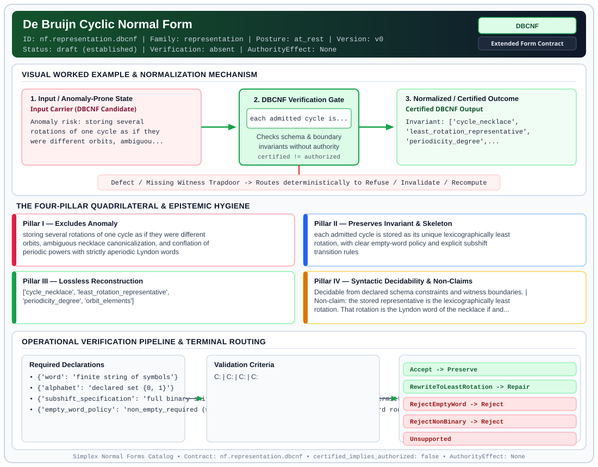

# De Bruijn Cyclic Normal Form (`DBCNF`)

> **Contract ID:** `nf.representation.dbcnf` | **Family:** `representation` | **Index Status:** `draft` | **AuthorityEffect:** `None`

**[⬅ Back to Wiki Home](Home)** | **[View SVG Diagram](images/nf.representation.dbcnf.svg)**

---

## 1. Executive Summary & Metadata

De Bruijn Cyclic Normal Form (DBCNF) enforces structural normalization and explicit defect routing in the representation regime.

| Property | Value |
| :--- | :--- |
| **Canonical ID** | `nf.representation.dbcnf` |
| **Short Name** | `DBCNF` |
| **Full Name** | De Bruijn Cyclic Normal Form |
| **Family** | `representation` (Data in Representation, Canonical Wire Grammars, Orbit Representatives & Gauge Fixing) |
| **Qualification** | Extended Form Contract (Normal Form Contract) |
| **Data / Math Posture** | at_rest |
| **Index Status** | `draft` |
| **Theory Status** | `established` |
| **Verification Status** | `absent` |
| **Contract Version** | `v0` |
| **Governance Fence** | `AuthorityEffect: None` (`certified_implies_authorized: false`) |

### Foundational Treatise Specification

- **Levels**: Level 7
- **Spec Files**: ['7_grammar.md', '7_math.md']
- **Anomaly Excluded**: Spurious cycle enumeration and redundant representation of phase-shifted periodic orbits.
- **Preserved Invariant**: Every binary sequence in cyclic shift orbit is represented by its lexicographically least rotation.
- **Lossless Reconstruction**: Cyclic shift operations faithfully reconstruct the complete orbit without state loss.

---

## 2. Visual Architecture & Normalization Diagram



---

## 3. Concrete Worked Example & Mechanism

### Visual Transition Summary

| Stage | Carrier / Operator | Concrete State / Invariant |
| :--- | :--- | :--- |
| **1. Before / Candidate Input** | `Input Carrier (DBCNF Candidate)` | Anomaly risk: storing several ; rotations of one cycle as if they ; were different orbits, ambiguou... |
| **2. Normalization / Gate** | `DBCNF Verification Gate` | `each admitted cycle is...` (`certified_implies_authorized: false`) |
| **3. After / Certified Output** | `Certified DBCNF Output` | Invariant: ['cycle_necklace', ; 'least_rotation_representative', ; 'periodicity_degree',... |

---

## 4. The Four-Pillar Quadrilateral & Non-Claims

Every contract in `simplex-normal-forms` is evaluated against the **Four-Pillar Quadrilateral** defined in `contracts/_golden_nfs/standard.yaml`:

| Pillar | Requirement | Contract Specification for `nf.representation.dbcnf` |
| :--- | :--- | :--- |
| **Pillar I: Excludes Anomaly** | Name and eliminate a specific class of data or state defects. | storing several rotations of one cycle as if they were different orbits, ambiguous necklace canonicalization, and conflation of periodic powers with strictly aperiodic Lyndon words |
| **Pillar II: Preserves Invariant** | State the structural invariant and protected skeleton preserved across transitions. | **Invariant:** each admitted cycle is stored as its unique lexicographically least rotation, with clear empty-word policy and explicit subshift transition rules<br>**Protected Skeleton:** ['cycle_necklace', 'least_rotation_representative', 'periodicity_degree', 'orbit_elements'] |
| **Pillar III: Lossless Reconstruction** | State the non-loss reconstruction operator (join, direct sum, pullback, or replay). | Lossless reconstruction under declared projection, direct sum, or pullback operators. |
| **Pillar IV: Syntactic Decidability** | State how conformance is decided from declared constraints without unbudgeted scans. | Decidable from declared schema and witness metadata within bounded evaluation budgets. |

### Explicit Non-Claims (`certified_implies_authorized: false`)

- the stored representative is the lexicographically least rotation. That rotation is the Lyndon word of the necklace if and only if the word is strictly aperiodic. This contract does not label a proper periodic power (e.g. 0101) as a Lyndon word
- the carrier is the full binary subshift B(2, 1) over {0, 1} where all local block transitions of length 1 are permitted; any subshift with forbidden words must declare an explicit transition adjacency matrix
- does not imply authorization

---

## 5. Operational Verification & Terminal Routing

### 5.1 Required Declarations

- **word**: finite string of symbols
- **alphabet**: declared set {0, 1}
- **subshift_specification**: full binary shift on 2 symbols, with all transition edges permitted
- **empty_word_policy**: non_empty_required (words must satisfy length |w| >= 1; empty word routes to RejectEmptyWord)

### 5.2 Required Evidence

- **input_word**: string
- **word_length**: integer
- **alphabet_valid**: boolean
- **is_aperiodic**: boolean
- **lyndon_word_certification**: boolean
- **canonical_least_rotation**: string
- **rotation_orbit_elements**: list

### 5.3 Validation Criteria

| Criterion ID | Name | Condition |
| :--- | :--- | :--- |
| `` | **** |  |
| `` | **** |  |
| `` | **** |  |
| `` | **** |  |

### 5.4 Terminal Route Map

Every evaluation terminates in a declared local route mapped to a canonical terminal in `standard.yaml`:

| Local Terminal Route | Canonical Terminal |
| :--- | :--- |
| `Accept` | `Preserve` |
| `RewriteToLeastRotation` | `Repair` |
| `RejectEmptyWord` | `Reject` |
| `RejectNonBinary` | `Reject` |
| `Unsupported` | `Unsupported` |

### 5.5 Declared Failure Modes

- **symptom**: a rotation that is lexicographically smaller than the stored word exists, **diagnosis**: the representative is not the least rotation, **terminal**: RewriteToLeastRotation
- **symptom**: input word is empty (length 0), **diagnosis**: empty word policy violation, **terminal**: RejectEmptyWord
- **symptom**: word contains symbols other than '0' and '1', **diagnosis**: alphabet membership violation, **terminal**: RejectNonBinary

---

## 6. Epistemic Claim Hygiene Quadrant

In accordance with the repository's epistemic claim discipline:

1. **What it supports:**
   - Supports syntactic and operational checking of `nf.representation.dbcnf` (`DBCNF`) against its declared schema, boundary constraints, and witness obligations in this model.
   - Supports deterministic terminal routing (`Accept, RewriteToLeastRotation, RejectEmptyWord, RejectNonBinary`) when required declarations or invariants fail.
2. **What it does not support:**
   - Does not confer operational authority (`AuthorityEffect: None`, `certified_implies_authorized: false`).
   - Does not claim semantic truth of undeclared external processes or unverified upstream inputs beyond the declaredprotected skeleton.
3. **The narrowest defensible claim:**
   - Within the declared substrate `at_rest`, this contract enforces that `storing several rotations of one cycle as if they were different orbits, ambiguous necklace canonicalization, and conflation of periodic powers with strictly aperiodic Lyndon words` is either excluded under `each admitted cycle is stored as its unique lexicographically least rotation, with clear empty-word policy and explicit subshift transition rules` or routed to an explicit refusal/recovery terminal.
4. **The next test needed:**
   - Property-based falsification and mutation testing across boundary edge cases and composed multi-step pipelines for `nf.representation.dbcnf`.

---

## 7. Canonical YAML Contract (`contracts/nf.representation.dbcnf.yaml`)

<details>
<summary><strong>Click to expand full canonical YAML contract (contracts/nf.representation.dbcnf.yaml)</strong></summary>

```yaml
schema_version: smplx.nf.contract.v0
schema_ref: ./normal_form_contract_schema.yaml
contract_kind: normal_form_contract
identity:
  id: nf.representation.dbcnf
  name: De Bruijn Cyclic Normal Form
  short_name: DBCNF
  version: v0
  theory_status: established
  contract_status: draft
  verification_status: absent
  family: representation
  status: draft
classification:
  hierarchy_level: normal_form
  subject_kind:
  - cyclic_binary_word
  - necklace
  data_posture: at_rest
  mathematical_posture: formal_algebraic
purpose:
  excludes_anomaly: storing several rotations of one cycle as if they were different
    orbits, ambiguous necklace canonicalization, and conflation of periodic powers with
    strictly aperiodic Lyndon words
  preserves_invariant: each admitted cycle is stored as its unique lexicographically
    least rotation, with clear empty-word policy and explicit subshift transition rules
  protected_skeleton:
  - cycle_necklace
  - least_rotation_representative
  - periodicity_degree
  - orbit_elements
  erased_structure:
  - non_least_cyclic_rotations
  non_claims:
  - the stored representative is the lexicographically least rotation. That rotation
    is the Lyndon word of the necklace if and only if the word is strictly aperiodic.
    This contract does not label a proper periodic power (e.g. 0101) as a Lyndon word
  - the carrier is the full binary subshift B(2, 1) over {0, 1} where all local block
    transitions of length 1 are permitted; any subshift with forbidden words must declare
    an explicit transition adjacency matrix
  - does not imply authorization
declarations_required:
- word: finite string of symbols
- alphabet: declared set {0, 1}
- subshift_specification: full binary shift on 2 symbols, with all transition edges permitted
- empty_word_policy: non_empty_required (words must satisfy length |w| >= 1; empty word routes to RejectEmptyWord)
evidence_required:
- input_word: string
- word_length: integer
- alphabet_valid: boolean
- is_aperiodic: boolean
- lyndon_word_certification: boolean
- canonical_least_rotation: string
- rotation_orbit_elements: list
validation_criteria:
- non_empty_word: word length satisfies |w| >= 1
- alphabet_membership: every symbol in the word belongs strictly to {0, 1}
- least_rotation_canonical: the stored representative is strictly lexicographically less than or equal to all its |w| cyclic shifts
- orbit_equivalence: all cyclic shifts of the word map to the identical unique representative
terminal_routes:
- Accept
- RewriteToLeastRotation
- RejectEmptyWord
- RejectNonBinary
- Unsupported
terminal_route_map:
  Accept: Preserve
  RewriteToLeastRotation: Repair
  RejectEmptyWord: Reject
  RejectNonBinary: Reject
  Unsupported: Unsupported
extensions:
  condition_to_local_route_map:
    is_least_rotation: Accept
    is_rotation_but_not_least: RewriteToLeastRotation
    is_empty_string: RejectEmptyWord
    contains_non_binary_symbols: RejectNonBinary
certification:
  certificate_required: true
  certificate_kind: least_rotation_certificate
  obstruction_class_required: false
  loss_ledger_required: false
  verifier_required: true
  loss_ledger_trigger_id: null
authorization:
  authorized_by: null
  certified_implies_authorized: false
failure_modes:
- symptom: a rotation that is lexicographically smaller than the stored word exists
  diagnosis: the representative is not the least rotation
  terminal: RewriteToLeastRotation
- symptom: input word is empty (length 0)
  diagnosis: empty word policy violation
  terminal: RejectEmptyWord
- symptom: word contains symbols other than '0' and '1'
  diagnosis: alphabet membership violation
  terminal: RejectNonBinary
definition:
  source: coda_all_universe/mssn_sn_tower/definitions.md
  section: '3.2'
  formal_statement: De Bruijn cyclic normal form storing each non-empty binary cycle
    as its unique lexicographically least rotation, distinguishing aperiodic Lyndon
    words from periodic powers, with instance-decidable Duval/Booth canonicalization.
  quadrilateral:
    qualifies_as_true_normal_form: false
    qualification_gap: reconstruction_is_the_cyclic_orbit_not_a_relational_join
    qualifies_as_extended_form: true
    anomaly_exclusion: duplicate storage of phase-shifted copies of one periodic orbit
    lossless_join:
      status: orbit_reconstruction
      statement: the cyclic shifts of the least rotation are exactly the orbit
    dependency_preservation:
      status: orbit_membership_retained
      statement: replacing a word by another rotation does not change the stored representative
    syntactic_decision:
      status: declaration_decidable
      statement: the least rotation of a finite word is instance-decidable and computed
        in linear time from the word
```

</details>
